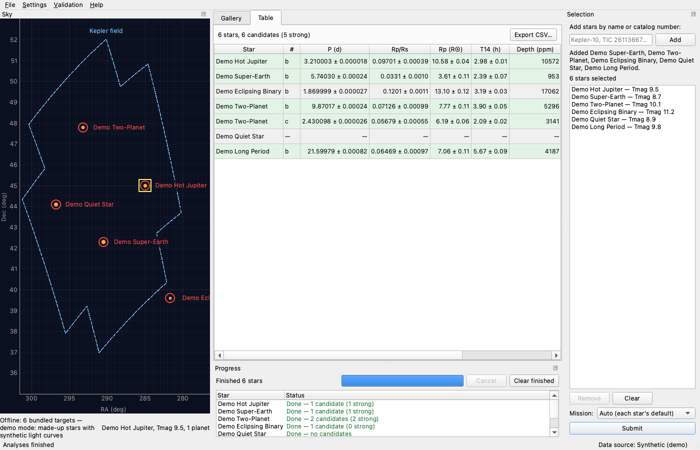
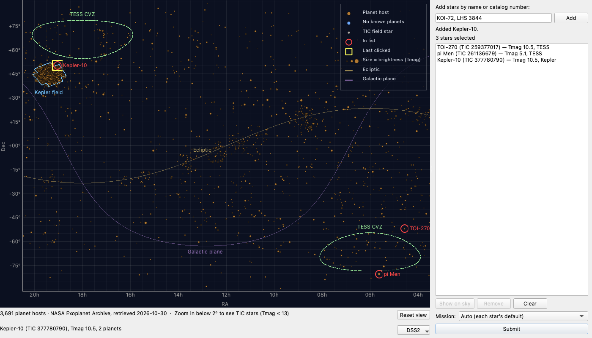
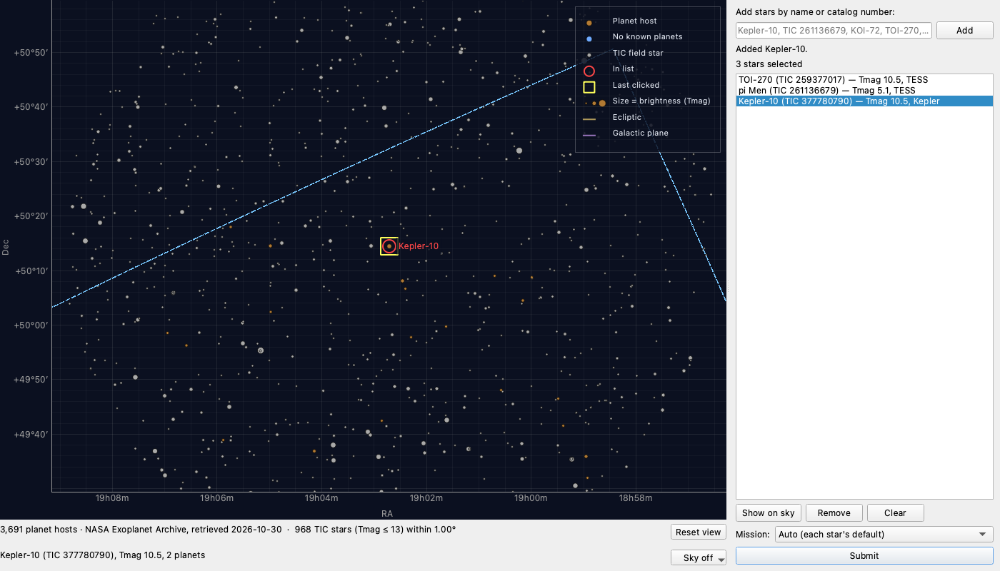
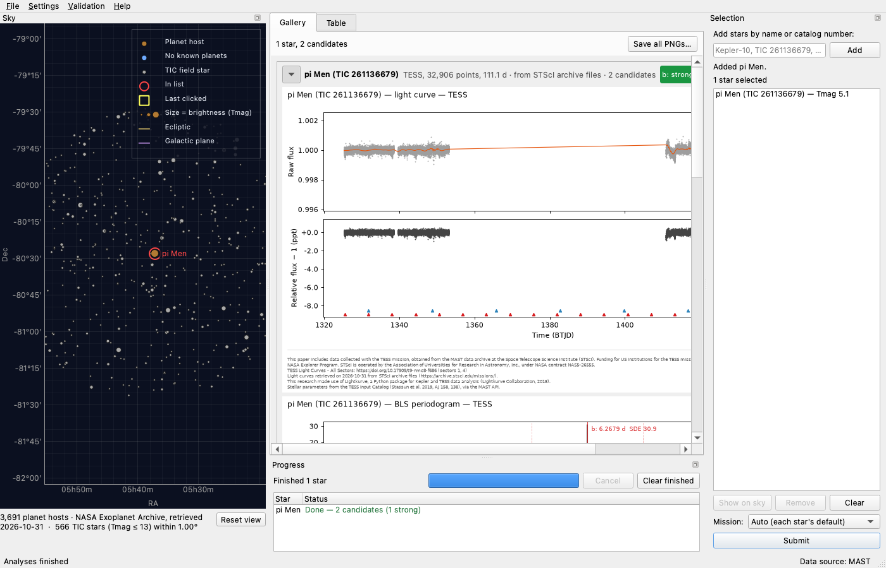
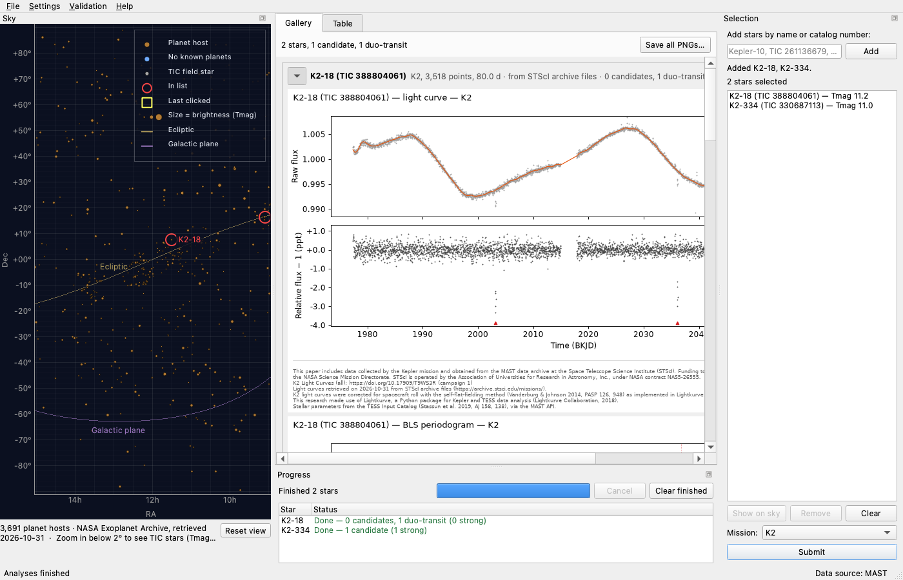

# Transitory

A desktop dashboard for finding transiting planets in public TESS and Kepler
light curves.  Pick stars on a zoomable sky map or by name / catalog number,
and Transitory fetches each star's light curves from MAST, cleans them,
searches them for periodic transit dips (Box Least Squares), fits the best
candidates with a limb-darkened transit model, vets them, and shows the
results as a gallery of plots per star and a summary table.



It runs on macOS, Linux and Windows (Python 3.11 or later).

## Install

```bash
git clone https://github.com/wingware-dev/transitory.git
cd transitory
python3 -m venv .venv
source .venv/bin/activate          # Windows: .venv\Scripts\activate
pip install -e ".[dev]"            # or: pip install -r requirements.txt
```

Install it editable (`-e`) or run it from the checkout: the cache and report
directories default to the checkout itself (see [Cache](#cache)).

## Run

```bash
python run_dashboard.py                                        # real TESS / Kepler data from MAST
python run_dashboard.py --demo                                 # made-up data, no downloads
python run_dashboard.py --targets "Kepler-10, TOI-270" --max-sectors 10
```

After `pip install -e .` the same is available as the `transitory` command.

| Option | Meaning |
|---|---|
| `--demo` | Use made-up light curves with planets put in at known periods and depths; nothing is downloaded. |
| `--targets NAMES` | Comma-separated stars to put in the selection list at start-up, by name or catalog number (`"Kepler-10, TIC 261136679, KIC 11904151"`). |
| `--max-sectors N` | TESS sectors / Kepler quarters to download and analyse per star; default 20, `0` for all. |

In the window:

1. **Choose stars.**  Click a star on the sky map to add it (see
   [The sky map](#the-sky-map)).  Or type names in the selection panel and
   press Enter: planet names, TIC / KIC / EPIC numbers, KOI / TOI numbers or
   SIMBAD names, one or comma-separated.
2. **Submit.**  The stars are analysed in background workers, with the
   mission preference chosen in the panel; the progress panel shows each
   star's step.
3. **Read the results.**  The *Gallery* tab has, per star, the raw and
   cleaned light curve, the BLS periodogram, and each candidate's transits
   folded on its period with the fitted model.  The *Table* tab lists every
   candidate with its period, Rp/Rs, T14, depth, SNR, SDE, confidence and the
   vetting notes.
4. **Keep them.**  *File ▸ Save all plots as PNG…* and *File ▸ Export table
   as CSV…*.  Every plot carries the data credits of its star.

### The sky map



The map plots the known planet hosts from the NASA Exoplanet Archive by
right ascension and declination, with RA increasing to the left as on the
sky.  The Kepler field and the TESS continuous viewing zones are outlined,
and faint lines mark the ecliptic and the galactic plane.  The legend in
the top-right corner keys the markers: planet host (orange, translucent so
the Kepler field's CCD modules show through), no known planets (blue), TIC
field star (grey), in the selection list (red ring), and last clicked
(yellow square).  Marker size follows brightness (Tmag).

- **Pan:** drag, or scroll with two fingers on a trackpad.  Panning carries on
  across 0h.
- **Zoom:** use the mouse wheel, pinch on a trackpad, or hold Ctrl (Cmd on
  macOS) and scroll.  On a Windows touchpad that doesn't report scroll
  phases, two-finger scrolling zooms instead of panning.
- **Reset view** (or the Home key) returns to the starting view.
- **Click** a star to add it to the selection list, or to remove it if it's
  already listed.  The white ring shows which star a click will pick.
- **Right-click** for a menu: add or remove the star, *Centre here*, *Copy
  name* / *Copy TIC ID*, and *Show ecliptic and galactic plane*, which turns
  the two lines off and on.
- **Show on sky** in the selection panel, or double-clicking a listed star,
  centres the map on that star at 1.5°.  Typing one new name does the same.

The two lines under the map show the catalog status, the hovered position
and the star under the pointer.  Zoomed out, the status says *Zoom in below
2° to see TIC stars (Tmag ≤ 13)*.  Below 2°, the TESS Input Catalog stars in
view are loaded from MAST.



In demo mode the map shows only the demo stars: no TIC stars are loaded.

### Sectors / quarters per star

A TESS star in the continuous viewing zone can have 40+ sectors.  By default
each star uses at most **20** sectors or quarters, which keeps all 17 Kepler
quarters (long periods need the whole four-year baseline) and bounds TESS
downloads.  Change it at start-up with `--max-sectors N` (`0` = all), or while
running from **Settings ▸ Sectors / quarters per star** (5, 10, 20, 40, All);
the change applies to stars submitted afterwards.  In demo mode the menu is
disabled, since there is nothing to download.

### Demo mode

`--demo` replaces MAST with a synthetic source: six made-up stars in and near
the Kepler field (a hot Jupiter, a super-Earth, a two-planet system, an
eclipsing binary, a quiet star and a long-period planet), with light curves
generated on the fly.  The whole dashboard works the same, offline, which
makes it the quickest way to see what it does.  Their credit line says the
data are synthetic.

## How detections are graded

- **Search.** BLS runs over periods from 0.3 d to half the baseline, up to
  three passes per star, masking each found signal before the next pass.  A
  peak becomes a candidate only with **SDE ≥ 9 and SNR ≥ 10**, backed by
  three or more transits, or by two agreeing ones at SDE ≥ 10.
- **Red noise.** SNRs and the vetting's depth errors are scaled by the
  red-noise *beta factor* (Pont, Zucker & Queloz 2006; Winn et al. 2008), so
  correlated stellar and instrumental noise doesn't make a dip look more
  significant than it is.  Fit uncertainties likewise allow for red noise and
  transit-timing scatter.
- **Confidence**, in the table:
  - **strong**: passes every check;
  - **weak**: a detection that is marginal (SNR or SDE near the threshold,
    a large Rp/Rs, a failed fit);
  - **duo-transit**: only two transits, passing every check, with a fitted
    T14 that agrees with the dip's width.  It may be a long-period planet,
    but two dips can't show periodicity, so it is shown as its own class and
    **not counted as a planet candidate**;
  - **none**: rejected — odd/even depths that disagree, a secondary eclipse
    too deep for a planet, a size too big for a planet, too few transits, or
    a repeat or alias of a stronger signal on the star.

## Validation

To show it can be trusted, Transitory re-discovers known planets: a set of
stars with confirmed planets of different sizes and periods, plus null stars
with no published planet or candidate, compared with the NASA Exoplanet
Archive's published values.

The latest live run ([full report](docs/validation/validation.md), 13 targets,
all sectors / quarters / campaigns, archive values retrieved 2026-10-29):

| | |
|---|---|
| Known planets recovered at the published period | **13 / 13** (none missed, none at an alias; K2-18 b from its 2 transits in Campaign 1) |
| Spurious detections on the 3 null stars | 1 (KIC 8006161, *weak*, 3 transits) |
| Spurious detections on planet hosts | 0 |
| Duo-transit signals on planet hosts | 4 (Kepler-7, Kepler-22; not counted as candidates) |
| Median \|ΔRp/Rs\| against published | 4.6% |

Run it yourself from **Validation ▸ Run known-planet validation…** (and
*Show validation report*), or from the command line:

```bash
python -m transitory.validation                 # live: downloads all sectors, ~30+ min
python -m transitory.validation --demo          # synthetic stars, offline
python -m transitory.validation --targets "Kepler-10, pi Men c" --max-sectors 10
```

Reports go to `reports/validation/`; `--publish` also copies one to
`docs/validation/`.  `--rebuild-credits` rewrites only the last report's data
credits, from its `results.json` (and the light-curve cache for an older
report), without searching again.

## Cache

Downloaded data are kept so nothing is fetched twice:

- light-curve FITS files under `cache/archive/<mission>/` (from STScI's
  archive files or the AWS mirror) or `cache/mastDownload/` (from the MAST
  search, via lightkurve), with
  `cache/index.json` recording which files answer which query;
- MAST and Exoplanet Archive query results under `cache/catalog/` (archive
  results are refreshed after 30 days).

`cache/` is in the checkout by default and is not committed (`.gitignore`).
Set `TRANSITORY_CACHE_DIR` to put it elsewhere, and `TRANSITORY_REPORTS_DIR`
for the reports directory (default `reports/`).  Deleting the cache is safe;
it is rebuilt on demand.  Requests to MAST are made one at a time, with a
descriptive user agent, timeouts and a single retry.

### Where light curves come from

A star's files are looked up by its KIC, EPIC or TIC in **STScI's archive
files** (archive.stsci.edu), else on **AWS Open Data** (`s3://stpubdata`),
MAST's copy on Amazon's servers (TESS-SPOC full-frame-image light curves
included), else found with the **MAST search**: the
search is for stars known only by name, or when neither copy can be reached.
A source that times out or fails is skipped for the next, and not asked
again for the rest of the run, so one service being down doesn't stall
every star.  The gallery header and the table's notes say which source gave
each star's light curve, and its credits say where and when.
`TRANSITORY_LC_SOURCES` (e.g. `s3,search`) changes the order or leaves sources
out.



K2 light curves keep a few-ppt sawtooth from the spacecraft's roll, which
its thrusters corrected every six hours.  Each K2 campaign's flux is
decorrelated from the star's motion with Lightkurve's self-flat-fielding
(Vanderburg & Johnson 2014) before cleaning, and the credits say so.
Without it K2-18 b (32.9 days, in Campaign 1) is missed.



## Tests

```bash
pytest                 # offline: synthetic light curves and recorded archive responses
pytest -n auto         # in parallel (pytest-xdist)
```

The GUI tests run headless (pytest-qt).  The screenshots in `docs/shots/` are
made with `python tools/take_shots.py`.  The sky shots use the live services
(Exoplanet Archive, MAST).  When a service doesn't answer, the TIC-field
shot keeps its old file.

## Platform notes

- **macOS**: use a python.org or Homebrew Python 3.11+; the system Python is
  too old.  The menus appear in the macOS menu bar.
- **Linux**: Qt 6 needs the XCB cursor library on X11 (Debian/Ubuntu:
  `sudo apt install libxcb-cursor0`).  On Wayland, `QT_QPA_PLATFORM=xcb` is a
  fallback if the window misbehaves.  For a headless machine (CI),
  `QT_QPA_PLATFORM=offscreen` runs the GUI tests without a display.
- **Windows**: use `py -m venv .venv` and `.venv\Scripts\activate`, then the
  same `pip` and `python` commands.  Long cache paths can exceed Windows'
  260-character limit; enable long paths or set `TRANSITORY_CACHE_DIR` to a
  short directory such as `C:\transitory-cache`.

## Data credits

TESS and Kepler data come from MAST at STScI, and published planet values
from the NASA Exoplanet Archive; both ask to be acknowledged in any work that
uses them.  **Help ▸ Data Credits…** lists the acknowledgements and data DOIs
for the stars you analysed (with *Copy as text*), with where and when their
light curves were retrieved, and every plot carries its star's credit lines.  The full wording and the software citations are in
[docs/CREDITS.md](docs/CREDITS.md).

## How it was built

AI agents (Claude Code) wrote all of Transitory, working inside Wing Pro
12.1, a Python IDE from [Wingware](https://wingware.com/).  Wing's Tasks
Manager is itself an AI agent: it turns a request into a queue of tasks,
gives each to a separate coding agent, answers their questions, checks and
commits their work, and starts the next.  The agents planned, built and
tested the app, made their own judgement calls, filed the problems they
found as new tasks, took the screenshots in `docs/shots/` with the test
harness they built, and each finished piece of work became a commit here.

This was a large run, and not a smooth one.  It was done as a real-world
test, on a laptop that was closed for hours at a time and later used on a
train with a connection that came and went, from 7:55 am on October 29,
2026 to about 10 pm on October 30.  It made 80 tasks and 63 commits, with
18 hours of agent work.  It had three parts.

**The original prompt** built the dashboard, the transit search and fit,
and the known-planet validation, which then found problems in the search
and fit that became tasks of their own:

> I'd like a Python tool that gives me a dashboard for finding planets
> around other stars in public space-telescope data, for macOS, Linux and
> Windows. It should show me the sky so I can zoom in and select one or
> more stars by clicking and/or entering name or catalog number.  When I
> submit the stars, it should fetch each star's brightness measurements
> from the TESS or Kepler missions, clean them up, search them for the
> small regular dips of a planet passing in front of the star, and fit the
> best candidates to estimate each planet's orbital period, size compared
> to its star, and how long each transit lasts. The results should be
> shown to me with a gallery of plots for each star (the raw and cleaned
> brightness, the search results, and the dips lined up on the period with
> the fitted model) and a summary table of what it found and how confident
> it is.
>
> I want to be able to trust what it finds, so it should prove itself by
> rediscovering known planets. Pick a set of stars with confirmed planets
> of different sizes and periods, plus a few stars known to have none, and
> have the report compare what it finds with the published values,
> including any it misses. Tests should use made-up brightness data with
> planets put in at known periods and depths, not downloaded data, so they
> run can offline. Keep downloaded data in a local cache that isn't
> committed, and make sure we follow the archive's terms for using and
> crediting its data.
>
> Once the code exists, set it up in Wing as the main entry point so I can
> test/debug it. Run all tasks to completion except small details and
> ideas for future improvements.
>
> Commit a screenshot of each major visible change under docs/shots/ since
> we'll be creating a publishable trace of this run later.

**Improving the sky view.**  After trying it, the next morning:

> When I mouse over stars, the details section at bottom expands and
> collapses, which also shifts the stars, making it impossible to actually
> hover/select specific stars.  Also can't scroll or zoom on the sky and
> in general that view seems to need improvement.  There are some
> suggested draft tasks that might be part of that.

The Tasks Manager fixed the first two and had an agent plan the rest:
true aspect and RA in hours, a legend, field stars from the TESS Input
Catalog when zoomed in, click and right-click actions, and a survey image
behind the stars.  The image service, CDS hips2fits, stopped answering
partway through and never came back during the run, so the background
was switched off and left for later.

**Fixing the data sources.**  That evening, nothing worked:

> Nothing seems to work anymore.   All the stars I tried raise an
> exception that there is no MAST data, even one in the Kepler field.
> That one said could not connect.  I wonder if we're hitting a maximum
> free use limit or something.

MAST's observation search, which the app used to find every light curve,
was hanging, though its other services worked; and stars from the K2
mission had never been supported.  Asked to wait for MAST to recover, the
user answered:

> If the data sources are this flaky it sounds to me like this whole app
> is useless.  Is there a better approach or do we give up?

An agent planned a more resilient data path, and the tasks that followed
find light-curve files at their fixed places on STScI's archive and on
its AWS mirror before falling back to the search, give up quickly on a
service that is down, say which source each light curve came from, add
K2 with a correction for the spacecraft's roll, and add a NASA SkyView
fallback for the sky images.  The validation was then rerun live with two
K2 stars added (K2-18 and K2-334).

The run ended with 18 proposed tasks left for later (see the trail's
"Tasks not run").

Before publishing, the DSS2 sky images the agents had recorded from NASA
SkyView for the tests were replaced with made-up star fields, since DSS2
images are copyrighted by the survey plates' owners, and were removed from
the history.  So the commits the trail links to have the made-up images.

[run-trail/RUN.md](run-trail/RUN.md) is the run's full trail: every task
with its prompt, the questions and who answered them, the judgement calls,
the findings filed, the commits and screenshots, and the time and tokens
each used, followed by what went wrong along the way.
[run-trail/trail.json](run-trail/trail.json) has the same data.

## License

MIT; see [LICENSE](LICENSE).

The data Transitory downloads while it runs, from MAST and the NASA
Exoplanet Archive, is not part of this repository; it is kept in
`cache/`, which git ignores.  The tests replay small recorded replies from
those services' catalogs and file listings (`tests/data/`), and the
validation report in `docs/validation/` plots light curves from MAST.
TESS, Kepler and K2 data come from MAST at the Space Telescope Science
Institute; see [Data credits](#data-credits) and
[docs/CREDITS.md](docs/CREDITS.md) for the acknowledgements MAST and the
Exoplanet Archive ask for.
