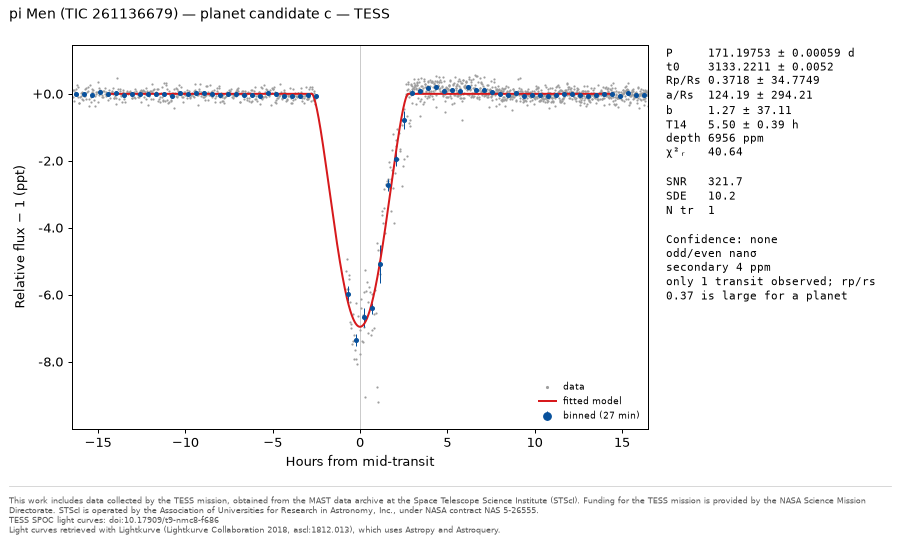
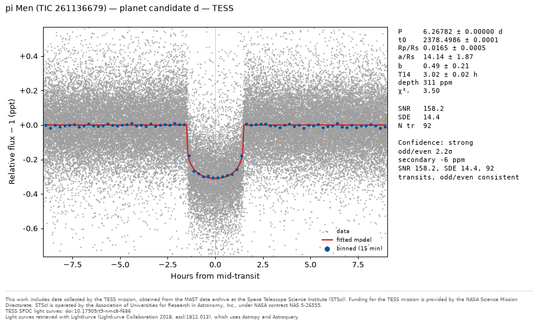
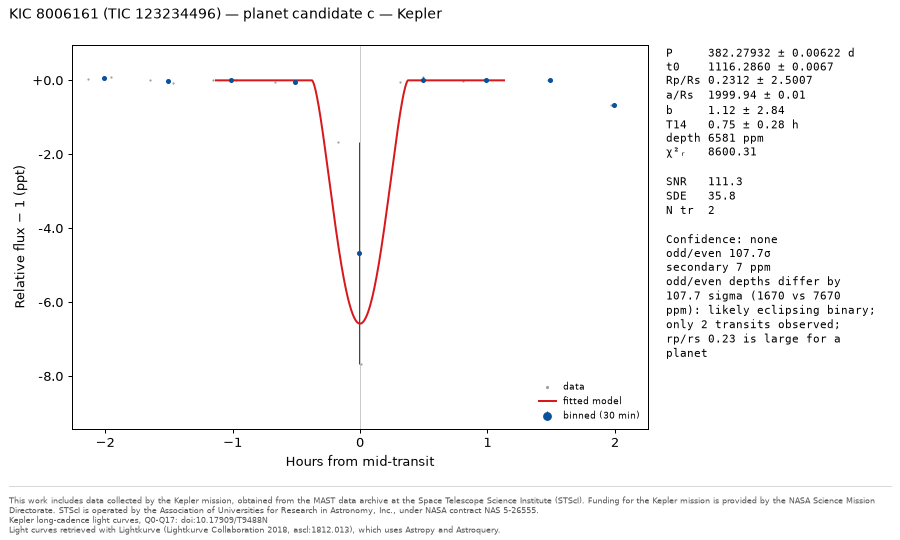
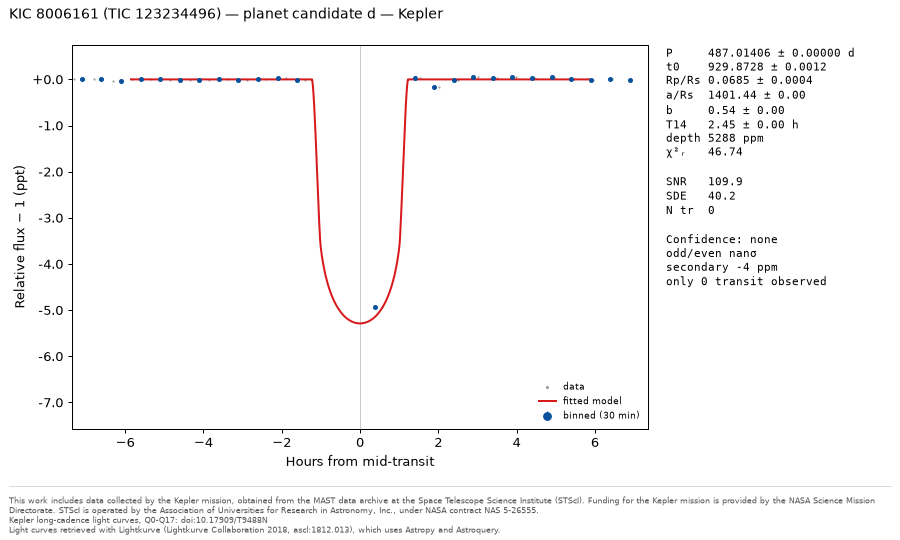
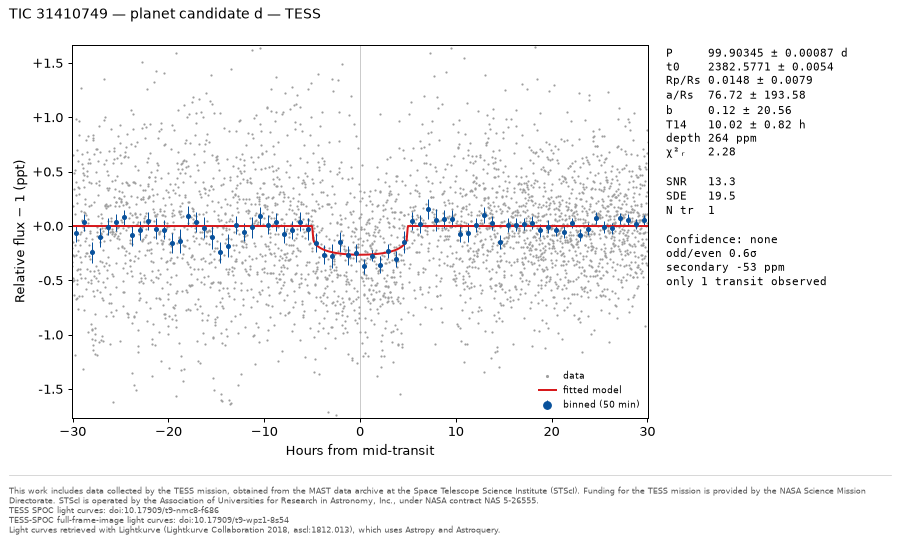

# Known-planet validation

Run 2026-10-29 13:12 UTC (152 min) on **MAST** light curves, using all sectors / quarters.

Published values: NASA Exoplanet Archive, retrieved 2026-10-29 (pscomppars for planets; pscomppars, the cumulative KOI table and the TOI table to check that the null stars have no published signal).

Pipeline: BLS search from 0.3 d to half the baseline, up to 3 passes per star, detection at SDE ≥ 7 and SNR ≥ 7. A found period matches a published one within 1%, also at the 1/2× and 2× aliases.

## Summary

| | |
|---|---|
| Targets | 11 (3 null stars) |
| Published planets | 11 |
| Recovered at the published period | 10 |
| Recovered at an alias | 0 |
| Missed | 1 |
| Spurious detections on null stars | 1 |
| Spurious detections on planet hosts | 5 |
| Extra candidates rejected by vetting | 15 |
| Planets found twice (duplicates) | 2 |
| Targets with errors | 0 |

## What the run shows

- TOI-270 b missed because the search spent its 3 passes on other signals, though the planet is detectable (see Missed planets).
- 19 of 21 extra candidates cover at most 2 transits, at periods of 43–840 d: single dips from systematics or variability that the search accepts as periodic. They take search passes from real planets (on KIC 6106415, KIC 8006161, Kepler-10, Kepler-2, Kepler-22, Kepler-7, LHS 3844, TIC 31410749, TOI-270, WASP-18, pi Men); the vetting rejects most of them afterwards.
- 6 spurious detections passed vetting as 'strong' or 'weak' (KIC 8006161, Kepler-2, Kepler-22, Kepler-7, LHS 3844). Their SNRs (up to 152) assume white noise; the correlated noise and instrumental dips behind them make that SNR far too optimistic.
- Found again by a later search pass: HAT-P-7 b on Kepler-2; WASP-18 b on WASP-18. Masking a deep transit leaves residual signal, or its secondary eclipse, at the same period.
- Kepler-10 b, Kepler-7 b, HAT-P-7 b, WASP-18 b rated only 'weak' because the vetting detected a secondary eclipse, although it calls the eclipse small enough to be the planet's own emission (as published for hot Jupiters such as these). A planetary-size secondary eclipse should not lower the confidence of a deep, many-transit signal.
- Found periods differ from the published ones by more than 5σ for HAT-P-7 b (88σ), pi Men c (17σ), WASP-18 b (13σ), TOI-270 c (26σ), TOI-270 d (512σ): the fit's period errors assume white noise and a strictly periodic orbit, so they are too small, and transit-timing variations shift the mean period with the time span observed (TOI-270 c and d are near a 2:1 resonance).
- Rp/Rs agrees with the published value within a median of 5.2%; beyond 10%: Kepler-10 b (+17%), Kepler-22 b (+22%), TOI-270 c (+18%), TOI-270 d (+19%). The fit fixes limb darkening at Sun-like values, which biases Rp/Rs for stars unlike the Sun (the M-dwarf host of TOI-270 c, TOI-270 d), and shallow transits leave Rp/Rs degenerate with the impact parameter.

## Planets: found vs. published

| Planet | Status | P published (d) | P found (d), difference | Rp/Rs published | Rp/Rs found | Δ | T14 published (h) | T14 found (h) | Δ | SNR | SDE | Confidence |
|---|---|---|---|---|---|---|---|---|---|---|---|---|
| Kepler-10 b (b) | found | 0.83749 | 0.83749118 ± 0.00000034 (+0.00000048 d, 1.4σ) | 0.0127 | 0.0149 ± 0.0004 | +17.3% | 1.81 | 1.89 ± 0.03 | +4.5% | 209.8 | 112.7 | weak |
| Kepler-10 c (c) | found | 45.29430 | 45.294245 ± 0.000072 (-0.000056 d, 0.8σ) | 0.0204 | 0.0203 ± 0.0015 | -0.5% | 6.87 | 6.90 ± 0.10 | +0.4% | 141.3 | 106.1 | strong |
| Kepler-7 b (b) | found | 4.88549 | 4.88548878 ± 0.00000030 (-0.00000042 d, 1.4σ) | 0.0829 | 0.0804 ± 0.0001 | -3.1% | 5.13 | 5.21 ± 0.01 | +1.5% | 3144.8 | 106.9 | weak |
| HAT-P-7 b (b) | found | 2.20474 | 2.20473540 ± 0.00000005 (-0.00000460 d, 88.3σ) | 0.0754 | 0.0746 ± 0.0000 | -1.1% | 3.88 | 3.90 ± 0.00 | +0.6% | 6348.2 | 116.9 | weak |
| Kepler-22 b (b) | found | 289.86388 | 289.86404 ± 0.00123 (+0.00016 d, 0.1σ) | 0.0203 | 0.0248 ± 0.0012 | +21.9% | 7.42 | 7.61 ± 0.29 | +2.7% | 56.2 | 65.2 | strong |
| pi Men c (d) | found | 6.26784 | 6.2678228 ± 0.0000010 (-0.0000171 d, 16.7σ) | 0.0158 | 0.0165 ± 0.0005 | +4.0% | 2.95 | 3.02 ± 0.02 | +2.1% | 158.2 | 14.4 | strong |
| LHS 3844 b (b) | found | 0.46293 | 0.46292965 ± 0.00000002 (-0.00000006 d, 2.7σ) | 0.0626 | 0.0656 ± 0.0010 | +4.8% | 0.52 | 0.55 ± 0.01 | +4.2% | 84.6 | 110.6 | strong |
| WASP-18 b (b) | found | 0.94145 | 0.94145237 ± 0.00000001 (+0.00000014 d, 13.2σ) | 0.1018 | 0.0962 ± 0.0001 | -5.5% | 2.21 | 2.20 ± 0.00 | -0.4% | 1659.2 | 123.2 | weak |
| TOI-270 b | missed | 3.35992 | — | 0.0307 | — | — | 1.29 | — | — | — | — | — |
| TOI-270 c (b) | found | 5.66051 | 5.6604780 ± 0.0000012 (-0.0000320 d, 25.7σ) | 0.0560 | 0.0660 ± 0.0008 | +17.8% | 1.68 | 1.97 ± 0.03 | +16.9% | 81.5 | 15.5 | strong |
| TOI-270 d (d) | found | 11.38194 | 11.3797013 ± 0.0000044 (-0.0022387 d, 511.5σ) | 0.0491 | 0.0584 ± 0.0011 | +18.9% | 2.12 | 2.43 ± 0.05 | +14.7% | 64.9 | 60.9 | strong |

## Missed planets

- **TOI-270 b** (P = 3.3599 d): expected SNR 33 from the published depth (977 ppm) and 2,050 in-transit points; the search stopped after its 3 passes, which found 5.661 d, 58.601 d, 11.380 d; periodogram SDE at the published period: 1.5, 1.8, 24.1 by pass (detection needs 7).
  Expected: Three small planets around an M dwarf, c and d near a 2:1 period ratio; the search stops after 3 passes, so every pass must find a real planet.

## Other detections

Candidates that match no published planet. *Spurious* ones passed vetting (weak or strong) and count as false positives; *rejected* ones were flagged by the vetting itself; *duplicates* are a recovered planet found again by a later search pass.

| Star | Candidate | P (d) | Depth (ppm) | SNR | SDE | Transits | Confidence | Kind | Explanation |
|---|---|---|---|---|---|---|---|---|---|
| Kepler-10 | d | 840.2149 | 305 | 28.5 | 19.5 | 1 | none | rejected | only 1 event covered: more likely individual systematics or stellar variability than a periodic signal; vetting: only 1 transit observed. |
| Kepler-7 | c | 603.3278 | 1438 | 71.7 | 38.1 | 1 | none | rejected | only 1 event covered: more likely individual systematics or stellar variability than a periodic signal; vetting: only 1 transit observed. |
| Kepler-7 | d | 719.9758 | 604 | 30.7 | 40.1 | 2 | weak | spurious | near 2× the Kepler orbit (372.5 d); only 2 events covered: more likely individual systematics or stellar variability than a periodic signal; vetting: only 2 transits observed. |
| Kepler-2 | c | 2.2047 | 65 | 71.6 | 92.6 | 611 | none | duplicate | HAT-P-7 b found again in a later search pass (at 1× its period): what the masking after its detection left behind (residual transit signal, or the planet's secondary eclipse); vetting: secondary eclipse of the P=2.2047 d signal, not a separate planet. |
| Kepler-2 | d | 307.1124 | 468 | 24.8 | 18.4 | 2 | weak | spurious | only 2 events covered: more likely individual systematics or stellar variability than a periodic signal; vetting: only 2 transits observed. |
| Kepler-22 | c | 362.9396 | 903 | 47.5 | 46.4 | 1 | none | rejected | near 1× the Kepler orbit (372.5 d); only 1 event covered: more likely individual systematics or stellar variability than a periodic signal; vetting: only 1 transit observed. |
| Kepler-22 | d | 254.9107 | 127 | 22.8 | 29.0 | 5 | strong | spurious | not an alias or a known systematic period; correlated (red) noise, which the white-noise SNR does not account for, is the likely cause; vetting: SNR 22.8, SDE 29.0, 5 transits, odd/even consistent. |
| pi Men | b | 195.6311 | 28400 | 3119.0 | 13.3 | 1 | none | rejected | only 1 event covered: more likely individual systematics or stellar variability than a periodic signal; vetting: only 1 transit observed. |
| pi Men | c | 171.1975 | 6188 | 321.7 | 10.2 | 1 | none | rejected | only 1 event covered: more likely individual systematics or stellar variability than a periodic signal; vetting: only 1 transit observed; rp/rs 0.37 is large for a planet. |
| LHS 3844 | c | 114.6281 | 9561 | 38.0 | 17.9 | 2 | weak | spurious | only 2 events covered: more likely individual systematics or stellar variability than a periodic signal; vetting: only 2 transits observed. |
| LHS 3844 | d | 109.1540 | 3918 | 26.9 | 16.7 | 2 | weak | spurious | only 2 events covered: more likely individual systematics or stellar variability than a periodic signal; vetting: only 2 transits observed. |
| WASP-18 | c | 42.6844 | 3593 | 80.6 | 9.1 | 1 | none | rejected | only 1 event covered: more likely individual systematics or stellar variability than a periodic signal; vetting: only 1 transit observed; odd/even depths differ by 22.2 sigma (-12 vs 1103 ppm): likely eclipsing binary. |
| WASP-18 | d | 0.9415 | 292 | 59.8 | 61.1 | 225 | none | duplicate | WASP-18 b found again in a later search pass (at 1× its period): what the masking after its detection left behind (residual transit signal, or the planet's secondary eclipse); vetting: secondary eclipse of the P=0.9414 d signal, not a separate planet. |
| TOI-270 | c | 58.1797 | 5744 | 67.5 | 7.6 | 1 | none | rejected | only 1 event covered: more likely individual systematics or stellar variability than a periodic signal; vetting: only 1 transit observed; odd/even depths differ by 8.8 sigma (-236 vs 758 ppm): likely eclipsing binary; marginal SDE 7.6; rp/rs 0.37 is large for a planet. |
| KIC 8006161 | b | 442.3362 | 1092 | 151.5 | 33.4 | 3 | weak | spurious | only 3 events covered: more likely individual systematics or stellar variability than a periodic signal; vetting: rp/rs 0.32 is large for a planet. |
| KIC 8006161 | c | 382.2793 | 1236 | 111.3 | 35.8 | 2 | none | rejected | near 1× the Kepler orbit (372.5 d); only 2 events covered: more likely individual systematics or stellar variability than a periodic signal; vetting: odd/even depths differ by 107.7 sigma (1670 vs 7670 ppm): likely eclipsing binary; only 2 transits observed; rp/rs 0.23 is large for a planet. |
| KIC 8006161 | d | 487.0141 | 2441 | 109.9 | 40.2 | 0 | none | rejected | only 0 events covered: more likely individual systematics or stellar variability than a periodic signal; vetting: only 0 transit observed. |
| KIC 6106415 | b | 443.5386 | 3537 | 181.4 | 33.6 | 0 | none | rejected | only 0 events covered: more likely individual systematics or stellar variability than a periodic signal; vetting: only 0 transit observed. |
| KIC 6106415 | c | 554.7528 | 1217 | 152.9 | 29.4 | 2 | none | rejected | only 2 events covered: more likely individual systematics or stellar variability than a periodic signal; vetting: odd/even depths differ by 123.7 sigma (6731 vs 687 ppm): likely eclipsing binary; only 2 transits observed. |
| KIC 6106415 | d | 437.3226 | 1818 | 131.9 | 22.4 | 1 | none | rejected | only 1 event covered: more likely individual systematics or stellar variability than a periodic signal; vetting: only 1 transit observed. |
| TIC 31410749 | b | 58.3463 | 344 | 14.9 | 13.9 | 2 | none | rejected | only 2 events covered: more likely individual systematics or stellar variability than a periodic signal; vetting: odd/even depths differ by 4.4 sigma (556 vs 192 ppm): likely eclipsing binary; only 2 transits observed. |
| TIC 31410749 | c | 68.7895 | 268 | 12.9 | 12.0 | 1 | none | rejected | only 1 event covered: more likely individual systematics or stellar variability than a periodic signal; vetting: only 1 transit observed. |
| TIC 31410749 | d | 99.9035 | 257 | 13.3 | 19.5 | 1 | none | rejected | only 1 event covered: more likely individual systematics or stellar variability than a periodic signal; vetting: only 1 transit observed. |

## Null stars

| Star | Why it is in the set | Published signals (archive check) | Data | Detections |
|---|---|---|---|---|
| KIC 8006161 | Bright (Tmag 6.8), quiet dwarf (HD 173701), Kepler asteroseismology target, 18 quarters. | none | Kepler 18 quarters, 65,262 points, 1,470 d baseline | b: spurious, c: rejected, d: rejected |
| KIC 6106415 | Bright (Tmag 6.7) dwarf, Kepler asteroseismology target, 14 long-cadence quarters. | none | Kepler 14 quarters, 50,642 points, 1,437 d baseline | b: rejected, c: rejected, d: rejected |
| TIC 31410749 | Tmag 8.3 dwarf in the southern TESS continuous viewing zone, 13 sectors (SPOC 2-min and TESS-SPOC full-frame-image light curves). | none | TESS SPOC+TESS-SPOC 13 sectors, 143,305 points, 1,852 d baseline | b: rejected, c: rejected, d: rejected |

## Targets

| Star | Role | Data | Time (s) | Errors |
|---|---|---|---|---|
| Kepler-10 | planet-host | Kepler 15 quarters, 51,973 points, 1,470 d baseline | 96 |  |
| Kepler-7 | planet-host | Kepler 18 quarters, 65,263 points, 1,470 d baseline | 104 |  |
| Kepler-2 | planet-host | Kepler 18 quarters, 65,283 points, 1,470 d baseline | 130 |  |
| Kepler-22 | planet-host | Kepler 18 quarters, 65,262 points, 1,470 d baseline | 86 |  |
| pi Men | planet-host | TESS SPOC 24 sectors, 393,701 points, 2,582 d baseline | 366 |  |
| LHS 3844 | planet-host | TESS SPOC 11 sectors, 168,801 points, 2,879 d baseline | 166 |  |
| WASP-18 | planet-host | TESS SPOC 10 sectors, 151,222 points, 2,906 d baseline | 154 |  |
| TOI-270 | planet-host | TESS SPOC 7 sectors, 137,828 points, 2,660 d baseline | 144 |  |
| KIC 8006161 | null | Kepler 18 quarters, 65,262 points, 1,470 d baseline | 76 |  |
| KIC 6106415 | null | Kepler 14 quarters, 50,642 points, 1,437 d baseline | 71 |  |
| TIC 31410749 | null | TESS SPOC+TESS-SPOC 13 sectors, 143,305 points, 1,852 d baseline | 146 |  |

## Folded light curves

## References for published values

- Bonomo et al. 2023 (https://ui.adsabs.harvard.edu/abs/2023A&A...677A..33B/abstract); NASA Exoplanet Archive pscomppars, retrieved 2026-10-29
- Bonomo et al. 2025 (https://ui.adsabs.harvard.edu/abs/2025A&A...696A.233B/abstract); NASA Exoplanet Archive pscomppars, retrieved 2026-10-29
- Cortés-Zuleta et al. 2020 (https://ui.adsabs.harvard.edu/abs/2020A&A...636A..98C/abstract); NASA Exoplanet Archive pscomppars, retrieved 2026-10-29
- Esteves et al. 2015 (https://ui.adsabs.harvard.edu/abs/2015ApJ...804..150E/abstract); NASA Exoplanet Archive pscomppars, retrieved 2026-10-29
- Kaye et al. 2022 (https://ui.adsabs.harvard.edu/abs/2022MNRAS.510.5464K/abstract); NASA Exoplanet Archive pscomppars, retrieved 2026-10-29
- Kunovac Hodžić et al. 2021 (https://ui.adsabs.harvard.edu/abs/2021MNRAS.502.2893K/abstract); NASA Exoplanet Archive pscomppars, retrieved 2026-10-29
- Nagel et al. 2026 (https://ui.adsabs.harvard.edu/abs/2026A&A...710A.311N/abstract); NASA Exoplanet Archive pscomppars, retrieved 2026-10-29
- Stassun et al. 2017 (https://ui.adsabs.harvard.edu/abs/2017AJ....153..136S/abstract); NASA Exoplanet Archive pscomppars, retrieved 2026-10-29

## Data credits

- This work includes data collected by the Kepler mission, obtained from the MAST data archive at the Space Telescope Science Institute (STScI). Funding for the Kepler mission is provided by the NASA Science Mission Directorate. STScI is operated by the Association of Universities for Research in Astronomy, Inc., under NASA contract NAS 5-26555.
- Kepler long-cadence light curves, Q0-Q17: doi:10.17909/T9488N
- Light curves retrieved with Lightkurve (Lightkurve Collaboration 2018, ascl:1812.013), which uses Astropy and Astroquery.
- This work includes data collected by the TESS mission, obtained from the MAST data archive at the Space Telescope Science Institute (STScI). Funding for the TESS mission is provided by the NASA Science Mission Directorate. STScI is operated by the Association of Universities for Research in Astronomy, Inc., under NASA contract NAS 5-26555.
- TESS SPOC light curves: doi:10.17909/t9-nmc8-f686
- TESS-SPOC full-frame-image light curves: doi:10.17909/t9-wpz1-8s54
- This research has made use of the NASA Exoplanet Archive, which is operated by the California Institute of Technology, under contract with the National Aeronautics and Space Administration under the Exoplanet Exploration Program.
