# Run trail

Generated 2026-10-30 22:26 from Wing's task store, the Tasks Manager's log, the agents' transcripts and the repository.  Times are local (-04:00).

This run was a test of the autonomous development features in Wing Pro 12.1: AI agents wrote all of Transitory from one prompt and two follow-up requests, with Wing's Tasks Manager queueing and running the work.  It was a large run with real-world interruptions: the laptop was closed for hours at a time, and part of it ran on a train with a connection that came and went.  It had three parts: the original prompt (T1 python-tool-gives-dashboard), the user's request to improve the sky view (T52 mouse-stars-details-section, then T55 sky-view-improvements), and fixing the data sources after MAST's observation search and the CDS sky-image service stopped answering, which kept the app from working at all for a while (T75 nothing-seems-work-anymore, then T81 resilient-data-path).

Before publishing, the DSS2 sky images the agents recorded from NASA SkyView for the tests were replaced with made-up star fields and removed from the history, since DSS2 images are copyrighted by the survey plates' owners.  The commits linked below therefore have the made-up images.

## Totals

| | Time | Input | Output | Cache read | Cache write |
|---|---|---|---|---|---|
| Workers (80 tasks) | 18h 39m task time | 148k | 1.81M | 231.38M | 5.52M |
| Tasks Manager (its sessions over the run) |  | 3,408 | 219k | 126.76M | 1.71M |
| **Total** | 37h 58m elapsed | 151k | 2.03M | 358.15M | 7.24M |

- Questions from workers: 1 (answered by the user 1, by the Tasks Manager 0, unanswered 0)
- Questions the Tasks Manager passed to the user, Wing's included: 2
- Questions from the Tasks Manager to the user: 7
- Judgement calls: 262
- Findings filed: 20
- Commits: 63
- Tasks Manager decisions: 274

## Timeline

| Time | Event |
|---|---|
| 2026-10-29 07:55 | T1 python-tool-gives-dashboard started |
| 2026-10-29 07:57 | T1 python-tool-gives-dashboard finished: done |
| 2026-10-29 07:58 | T2 skeleton-contracts-harness started |
| 2026-10-29 08:04 | T2 skeleton-contracts-harness finished: done |
| 2026-10-29 08:05 | Committed da10daa3039e for T2 skeleton-contracts-harness: Add project skeleton, shared data contracts and headless GUI test harness |
| 2026-10-29 08:05 | T3 pipeline-fetch-clean started |
| 2026-10-29 08:05 | T4 pipeline-search-fit started |
| 2026-10-29 08:05 | T5 catalog-resolve-archive started |
| 2026-10-29 08:05 | T6 gallery-plots started |
| 2026-10-29 08:09 | T6 gallery-plots finished: done |
| 2026-10-29 08:09 | Committed c6890977798f for T6 gallery-plots: Add gallery plots: light curve, BLS periodogram and phase-folded transit figures |
| 2026-10-29 08:10 | T8 dashboard-gallery-table started |
| 2026-10-29 08:17 | T8 dashboard-gallery-table finished: done |
| 2026-10-29 08:17 | Committed effe977a0fd6 for T8 dashboard-gallery-table: Add results gallery and summary table widgets |
| 2026-10-29 08:22 | T4 pipeline-search-fit finished: done |
| 2026-10-29 08:22 | Committed 8913b09aa35c for T4 pipeline-search-fit: Implement transit search, limb-darkened model, fit and vetting |
| 2026-10-29 08:28 | T3 pipeline-fetch-clean finished: done |
| 2026-10-29 08:28 | Committed 04cc17a71e1d for T3 pipeline-fetch-clean: Add MAST light-curve fetching, cache index and light-curve cleaning |
| 2026-10-29 08:29 | T5 catalog-resolve-archive finished: done |
| 2026-10-29 08:29 | Committed c2f9930f809e for T5 catalog-resolve-archive: Add catalog layer: name resolution, sky catalog and Exoplanet Archive queries |
| 2026-10-29 08:30 | T7 dashboard-sky-selection started |
| 2026-10-29 08:37 | T7 dashboard-sky-selection finished: done |
| 2026-10-29 08:37 | Committed 31377d5e21b4 for T7 dashboard-sky-selection: Add dashboard sky view and star-selection panel |
| 2026-10-29 08:38 | T9 dashboard-integration started |
| 2026-10-29 09:03 | T9 dashboard-integration filed T19 table-notes-duplicate-transits |
| 2026-10-29 09:03 | T9 dashboard-integration finished: done |
| 2026-10-29 09:03 | Committed 07adfee42ced for T9 dashboard-integration: Wire the dashboard end to end: workers, main window, data credits |
| 2026-10-29 09:03 | T10 known-planet-validation started |
| 2026-10-29 09:03 | T19 table-notes-duplicate-transits started |
| 2026-10-29 09:04 | T19 table-notes-duplicate-transits finished: done |
| 2026-10-29 09:04 | Committed f98cad3e69d3 for T19 table-notes-duplicate-transits: Stop repeating the transit count in the results table's Notes |
| 2026-10-29 09:04 | T16 lazy-gallery-figures started |
| 2026-10-29 09:11 | T16 lazy-gallery-figures finished: done |
| 2026-10-29 09:11 | Committed f5135562315d for T16 lazy-gallery-figures: Build gallery figures lazily, only for sections in or next to the view |
| 2026-10-29 11:49 | T22 search-reject-single-events started |
| 2026-10-29 11:49 | T23 vetting-planetary-secondary started |
| 2026-10-29 11:49 | T25 red-noise-spurious-evidence finished: dismissed |
| 2026-10-29 11:49 | T26 limb-darkening-evidence finished: dismissed |
| 2026-10-29 11:50 | T18 mission-limb-darkening started |
| 2026-10-29 11:50 | T28 mast-search-timeout started |
| 2026-10-29 11:51 | T23 vetting-planetary-secondary finished: done |
| 2026-10-29 11:51 | Committed 8c137701669b for T23 vetting-planetary-secondary: Keep 'strong' confidence for a planetary-size secondary eclipse |
| 2026-10-29 11:52 | T10 known-planet-validation filed T22 search-reject-single-events |
| 2026-10-29 11:52 | T10 known-planet-validation filed T23 vetting-planetary-secondary |
| 2026-10-29 11:52 | T10 known-planet-validation filed T24 search-mask-secondary |
| 2026-10-29 11:52 | T10 known-planet-validation filed T27 fit-period-errors-too-small |
| 2026-10-29 11:52 | T10 known-planet-validation filed T28 mast-search-timeout |
| 2026-10-29 11:52 | T10 known-planet-validation filed T25 red-noise-spurious-evidence |
| 2026-10-29 11:52 | T10 known-planet-validation filed T26 limb-darkening-evidence |
| 2026-10-29 11:52 | T10 known-planet-validation finished: done |
| 2026-10-29 11:52 | Committed bad78f7e264f for T10 known-planet-validation: Add known-planet validation with a live report and a Validation menu |
| 2026-10-29 11:54 | T28 mast-search-timeout finished: done |
| 2026-10-29 11:54 | Committed fc6afe6d26b9 for T28 mast-search-timeout: Time out and retry slow MAST and Exoplanet Archive requests |
| 2026-10-29 11:55 | T31 cap-mast-portal-polling started |
| 2026-10-29 11:56 | T24 search-mask-secondary finished: obsolete |
| 2026-10-29 11:56 | T22 search-reject-single-events finished: done |
| 2026-10-29 11:56 | Committed 06ae5c1ddd2b for T22 search-reject-single-events: Stop BLS passes going to single events and secondary eclipses |
| 2026-10-29 11:57 | T31 cap-mast-portal-polling finished: done |
| 2026-10-29 11:57 | Committed e37bdb090ab5 for T31 cap-mast-portal-polling: Cap MAST portal polling at 180 s |
| 2026-10-29 11:57 | T17 red-noise-aware-snr started |
| 2026-10-29 12:02 | T18 mission-limb-darkening finished: done |
| 2026-10-29 12:02 | Committed e8ce182f857a for T18 mission-limb-darkening: Fit with mission/Teff limb darkening and a stellar-density prior on a/Rs |
| 2026-10-29 12:02 | T27 fit-period-errors-too-small started |
| 2026-10-29 12:02 | T34 sky-hosts-stellar-params started |
| 2026-10-29 12:07 | T17 red-noise-aware-snr finished: done |
| 2026-10-29 12:07 | Committed bad8e55317e6 for T17 red-noise-aware-snr: Make transit SNR and vetting errors red-noise aware with a beta factor |
| 2026-10-29 12:07 | T34 sky-hosts-stellar-params finished: done |
| 2026-10-29 12:07 | Committed 1dbb131fcd51 for T34 sky-hosts-stellar-params: Carry stellar Teff, log g and mass through the sky-view host list |
| 2026-10-29 12:18 | T27 fit-period-errors-too-small finished: done |
| 2026-10-29 12:19 | Committed 19b9a96ad1ff for T27 fit-period-errors-too-small: Make fit uncertainties cover red noise and transit-timing scatter |
| 2026-10-29 12:20 | T29 rerun-live-validation started |
| 2026-10-29 15:34 | The Tasks Manager asked the user: Your Mac went to sleep three times while T29 rerun-live-validation (82c6cdde) was running. Each time, the agent's tur... |
| 2026-10-29 17:24 | T29 rerun-live-validation filed T43 null-star-stellar-params |
| 2026-10-29 17:24 | T29 rerun-live-validation filed T40 reject-two-transit-false-positives |
| 2026-10-29 17:24 | T29 rerun-live-validation filed T41 marginal-candidates-after-rejected-peaks |
| 2026-10-29 17:24 | T29 rerun-live-validation filed T42 toi270-rprs-t14-bias |
| 2026-10-29 17:24 | T29 rerun-live-validation finished: done |
| 2026-10-29 17:24 | Committed e9652238f1e8 for T29 rerun-live-validation: Rerun the live known-planet validation after the pipeline fixes |
| 2026-10-29 17:24 | T41 marginal-candidates-after-rejected-peaks started |
| 2026-10-29 17:25 | T43 null-star-stellar-params started |
| 2026-10-29 17:26 | T43 null-star-stellar-params finished: done |
| 2026-10-29 17:26 | Committed c95c9857211e for T43 null-star-stellar-params: Give the extra validation null stars their TIC Teff, log g and mass |
| 2026-10-29 17:26 | T40 reject-two-transit-false-positives started |
| 2026-10-29 18:10 | T40 reject-two-transit-false-positives finished: done |
| 2026-10-29 18:10 | Committed 241528203db3 for T40 reject-two-transit-false-positives: Show two-transit signals as a separate duo-transit class, not as planet candidates |
| 2026-10-29 18:10 | T44 raise-detection-thresholds started |
| 2026-10-29 18:33 | T41 marginal-candidates-after-rejected-peaks finished: done |
| 2026-10-29 18:33 | T44 raise-detection-thresholds finished: done |
| 2026-10-29 18:33 | Committed 9c5306578300 for T44 raise-detection-thresholds: Raise BLS detection thresholds to SDE 9 / SNR 10 and re-tier vetting confidence |
| 2026-10-29 18:33 | T33 refine-period-before-masking started |
| 2026-10-29 18:44 | T33 refine-period-before-masking finished: done |
| 2026-10-29 18:44 | Committed f82555674618 for T33 refine-period-before-masking: Search past repeats and harmonics of signals found in earlier passes |
| 2026-10-29 18:44 | T45 final-live-validation started |
| 2026-10-29 19:59 | T45 final-live-validation finished: done |
| 2026-10-29 19:59 | Committed 280153b9e0a1 for T45 final-live-validation: Rerun the live known-planet validation after the duo-transit, threshold and period changes |
| 2026-10-29 19:59 | T11 entry-point-readme-credits started |
| 2026-10-29 20:05 | T11 entry-point-readme-credits finished: done |
| 2026-10-29 20:05 | Committed b0911e42ac1d for T11 entry-point-readme-credits: Add README and data credits, set Wing's main entry point, and check credit wording against the source pages |
| 2026-10-29 20:06 | T46 validation-report-archive-dois started |
| 2026-10-29 20:06 | T47 star-credits-archive-tic started |
| 2026-10-29 20:07 | T46 validation-report-archive-dois finished: done |
| 2026-10-29 20:07 | Committed c1181196184d for T46 validation-report-archive-dois: List the Exoplanet Archive paper and table DOIs in the validation report's credits |
| 2026-10-29 20:10 | T47 star-credits-archive-tic finished: done |
| 2026-10-29 20:10 | Committed 524dd87c579b for T47 star-credits-archive-tic: Add the TIC and Exoplanet Archive credits to each star's credits when its target used their data |
| 2026-10-29 20:10 | T49 republish-validation-credits started |
| 2026-10-29 20:48 | T49 republish-validation-credits filed T50 group-validation-report-credits |
| 2026-10-29 20:48 | T49 republish-validation-credits finished: done |
| 2026-10-29 20:48 | Committed 6b9bed987851 for T49 republish-validation-credits: Republish the validation report with the current data credits |
| 2026-10-29 20:48 | T50 group-validation-report-credits started |
| 2026-10-29 20:55 | T50 group-validation-report-credits filed T51 report-dialog-hides-trailing-sections |
| 2026-10-29 20:55 | T50 group-validation-report-credits finished: done |
| 2026-10-29 20:55 | Committed e76138da8ec8 for T50 group-validation-report-credits: Group the validation report's data credits by mission and data product |
| 2026-10-29 20:55 | T51 report-dialog-hides-trailing-sections started |
| 2026-10-29 21:00 | T51 report-dialog-hides-trailing-sections finished: done |
| 2026-10-29 21:00 | Committed 2337b29b2457 for T51 report-dialog-hides-trailing-sections: Lay out the validation report dialog's sections after the figures |
| 2026-10-30 10:28 | T52 mouse-stars-details-section finished: obsolete |
| 2026-10-30 10:28 | T53 sky-hover-details-jitter started |
| 2026-10-30 10:28 | T55 sky-view-improvements started |
| 2026-10-30 10:31 | T53 sky-hover-details-jitter finished: done |
| 2026-10-30 10:31 | Committed 0085f291053b for T53 sky-hover-details-jitter: Keep the sky view's footer a fixed size so hovering stars never moves the plot |
| 2026-10-30 10:32 | T54 sky-scroll-zoom started |
| 2026-10-30 10:32 | The Tasks Manager passed T55 sky-view-improvements's question to the user |
| 2026-10-30 10:33 | T12 hips-sky-background finished: obsolete |
| 2026-10-30 10:34 | T61 hips-cutout-fetch started |
| 2026-10-30 10:37 | T54 sky-scroll-zoom finished: done |
| 2026-10-30 10:37 | Committed b4cc5a9509c2 for T54 sky-scroll-zoom: Pan and zoom the sky view with a trackpad, and add Reset view |
| 2026-10-30 10:38 | T56 sky-aspect-and-hours started |
| 2026-10-30 10:44 | T61 hips-cutout-fetch finished: done |
| 2026-10-30 10:44 | Committed 2f6aa1d1ded9 for T61 hips-cutout-fetch: Fetch and cache HiPS sky cutouts from CDS hips2fits for the sky view's background |
| 2026-10-30 10:45 | T56 sky-aspect-and-hours finished: done |
| 2026-10-30 10:45 | Committed 89a5bfde4545 for T56 sky-aspect-and-hours: Draw the sky view at its true aspect, with RA in hours and Dec in d m s |
| 2026-10-30 10:45 | T57 sky-legend-and-markers started |
| 2026-10-30 10:52 | T57 sky-legend-and-markers finished: done |
| 2026-10-30 10:52 | Committed 88a8fb285ee6 for T57 sky-legend-and-markers: Add a legend to the sky view, scale markers with zoom, and keep outline labels clear of star names |
| 2026-10-30 10:53 | T58 sky-field-stars-on-zoom started |
| 2026-10-30 10:59 | T58 sky-field-stars-on-zoom finished: done |
| 2026-10-30 10:59 | Committed 13b02cac7696 for T58 sky-field-stars-on-zoom: Load TIC field stars when going to a star, and hint how far to zoom |
| 2026-10-30 10:59 | T59 sky-click-hover-menu started |
| 2026-10-30 11:03 | T59 sky-click-hover-menu finished: done |
| 2026-10-30 11:03 | Committed 54583f4f33d4 for T59 sky-click-hover-menu: Sky view: ring the hovered star, toggle stars on click, add a right-click menu |
| 2026-10-30 11:03 | T60 sky-go-to-star started |
| 2026-10-30 11:06 | T60 sky-go-to-star finished: done |
| 2026-10-30 11:06 | Committed 5ae4830f199c for T60 sky-go-to-star: Show typed and listed stars on the sky |
| 2026-10-30 11:06 | T62 hips-sky-background-2 started |
| 2026-10-30 11:23 | T62 hips-sky-background-2 finished: done |
| 2026-10-30 11:23 | Committed d1c8475468a8 for T62 hips-sky-background-2: Show the HiPS survey image behind the sky-view stars |
| 2026-10-30 11:24 | The Tasks Manager asked the user: The CDS sky-image service (alasky.cds.unistra.fr and its mirror alaskybis) timed out from this Mac in tasks T61 and T... |
| 2026-10-30 11:24 | T67 sky-close-not-blocked started |
| 2026-10-30 11:26 | T67 sky-close-not-blocked finished: done |
| 2026-10-30 11:26 | Committed 79e6fd6bad9c for T67 sky-close-not-blocked: Don't block closing the sky view on a stalled sky-image fetch |
| 2026-10-30 11:27 | T70 catalog-close-not-blocked started |
| 2026-10-30 11:29 | T70 catalog-close-not-blocked finished: done |
| 2026-10-30 11:29 | Committed 9aa6f8eef074 for T70 catalog-close-not-blocked: Don't block closing on a stalled TIC field, host catalog or name lookup |
| 2026-10-30 11:29 | T63 sky-reference-lines started |
| 2026-10-30 11:40 | T63 sky-reference-lines finished: done |
| 2026-10-30 11:40 | Committed 0616d51e811c for T63 sky-reference-lines: Sky view: draw the ecliptic and galactic plane, and pan across 0h |
| 2026-10-30 11:40 | T66 record-tic-cone-1deg started |
| 2026-10-30 11:48 | T66 record-tic-cone-1deg finished: done |
| 2026-10-30 11:48 | Committed aff3dc8e438a for T66 record-tic-cone-1deg: Record the 1° Kepler-10 TIC field so the sky tests show a real field |
| 2026-10-30 11:48 | T64 sky-shots-and-docs started |
| 2026-10-30 11:58 | T55 sky-view-improvements finished: done |
| 2026-10-30 11:58 | T64 sky-shots-and-docs filed T71 purge-stand-in-hips-cache |
| 2026-10-30 11:58 | T64 sky-shots-and-docs finished: done |
| 2026-10-30 11:58 | Committed 89cc1e1198ac for T64 sky-shots-and-docs: Refresh the sky screenshots and document the sky map's controls |
| 2026-10-30 11:58 | The Tasks Manager asked the user: Two tasks need a steady connection to the CDS sky-image service (alasky.cds.unistra.fr), which kept timing out on the... |
| 2026-10-30 11:59 | T71 purge-stand-in-hips-cache started |
| 2026-10-30 12:00 | T71 purge-stand-in-hips-cache finished: done |
| 2026-10-30 12:00 | Committed f09fc27dc7ae for T71 purge-stand-in-hips-cache: Test that the screenshot host keeps the stand-in sky image out of the user's cache |
| 2026-10-30 17:10 | T68 hips-real-fixture started |
| 2026-10-30 17:16 | The Tasks Manager asked the user: T68 hips-real-fixture (fcc86da6) still can't reach CDS, even on your current network. Every CDS server (alasky.cds.un... |
| 2026-10-30 17:27 | The Tasks Manager asked the user: CDS hips2fits, the only source of the sky view's background images (from T62 hips-sky-background-2), doesn't respond,... |
| 2026-10-30 17:31 | T72 retake-sky-zoomed-dss2 finished: obsolete |
| 2026-10-30 17:31 | T73 remove-sky-background-chooser started |
| 2026-10-30 17:36 | T68 hips-real-fixture finished: blocked |
| 2026-10-30 17:36 | T73 remove-sky-background-chooser finished: done |
| 2026-10-30 17:36 | Committed ac2326ed4c69 for T73 remove-sky-background-chooser: Turn off the sky view's survey background while CDS hips2fits is down |
| 2026-10-30 17:47 | T75 nothing-seems-work-anymore started |
| 2026-10-30 18:04 | T75 nothing-seems-work-anymore filed T76 support-k2-light-curves |
| 2026-10-30 18:04 | T75 nothing-seems-work-anymore finished: done |
| 2026-10-30 18:04 | Committed 7e213150d3c1 for T75 nothing-seems-work-anymore: Say plainly when MAST is down rather than leaving it to look like missing data |
| 2026-10-30 18:05 | T76 support-k2-light-curves started |
| 2026-10-30 18:11 | T76 support-k2-light-curves finished: done |
| 2026-10-30 18:11 | Committed b909d796bab8 for T76 support-k2-light-curves: Fetch K2 light curves for K2 hosts instead of searching them as Kepler |
| 2026-10-30 18:11 | The Tasks Manager asked the user: MAST's observation search (the one that finds light curves) was hanging from this machine on 2026-10-30. T78 verify-k... |
| 2026-10-30 18:12 | T77 mast-outage-fail-fast started |
| 2026-10-30 18:14 | T77 mast-outage-fail-fast finished: done |
| 2026-10-30 18:14 | Committed 7bf97d8e04f0 for T77 mast-outage-fail-fast: Fail the rest of a run at once after a MAST search finds MAST down |
| 2026-10-30 18:14 | T80 regression-mast-fixes started |
| 2026-10-30 18:15 | T80 regression-mast-fixes finished: done |
| 2026-10-30 18:37 | The Tasks Manager asked the user: Today's failures were in two separate services, each a single point of failure for one feature: CDS for the sky backg... |
| 2026-10-30 18:38 | T81 resilient-data-path started |
| 2026-10-30 18:47 | The Tasks Manager passed T81 resilient-data-path's question to the user |
| 2026-10-30 18:48 | T82 tess-sectors started |
| 2026-10-30 18:48 | T83 static-archive-files started |
| 2026-10-30 18:48 | T84 epic-on-target started |
| 2026-10-30 18:48 | T87 skyview-sky-fallback started |
| 2026-10-30 18:51 | T82 tess-sectors finished: done |
| 2026-10-30 18:51 | Committed e722d30ca139 for T82 tess-sectors: Look up TESS sectors from MAST's FFI footprint file, without the CAOM search |
| 2026-10-30 18:52 | T84 epic-on-target finished: done |
| 2026-10-30 18:52 | Committed 61e1eb883667 for T84 epic-on-target: Carry the K2 EPIC number on StarTarget and search K2 by it |
| 2026-10-30 18:56 | T83 static-archive-files finished: done |
| 2026-10-30 18:56 | Committed 6367ca609787 for T83 static-archive-files: Find light-curve files by path on STScI's static directories and the AWS mirror |
| 2026-10-30 18:56 | T85 fetch-source-chain started |
| 2026-10-30 19:08 | T87 skyview-sky-fallback finished: done |
| 2026-10-30 19:08 | Committed 7a2420cab67a for T87 skyview-sky-fallback: Fall back to NASA SkyView for sky images when CDS hips2fits fails |
| 2026-10-30 20:30 | T85 fetch-source-chain finished: done |
| 2026-10-30 20:30 | Committed 4c3fdf6df8d1 for T85 fetch-source-chain: Fetch light curves from STScI archive files, then the AWS mirror, then the MAST search |
| 2026-10-30 20:30 | T86 show-data-source started |
| 2026-10-30 20:32 | T88 fill-missing-tess-spoc-sectors finished: obsolete |
| 2026-10-30 20:38 | T81 resilient-data-path finished: done |
| 2026-10-30 20:38 | T86 show-data-source filed T89 s3-has-tess-spoc |
| 2026-10-30 20:38 | T86 show-data-source finished: done |
| 2026-10-30 20:38 | Committed c487044cd062 for T86 show-data-source: Show where each light curve came from, in the gallery, table and credits |
| 2026-10-30 20:38 | T89 s3-has-tess-spoc started |
| 2026-10-30 20:42 | T89 s3-has-tess-spoc finished: done |
| 2026-10-30 20:42 | Committed ab06c0f00264 for T89 s3-has-tess-spoc: Fetch TESS-SPOC light curves from the AWS mirror and cite its Registry dataset |
| 2026-10-30 20:43 | T90 regression-resilient-data-sources started |
| 2026-10-30 20:45 | T90 regression-resilient-data-sources finished: done |
| 2026-10-30 20:45 | T78 verify-k2-end-to-end started |
| 2026-10-30 20:48 | T79 k2-detrended-light-curves finished: dismissed |
| 2026-10-30 20:48 | T91 k2-roll-systematics-cleaning started |
| 2026-10-30 20:49 | T92 singular-period-in-credits started |
| 2026-10-30 20:50 | T78 verify-k2-end-to-end filed T91 k2-roll-systematics-cleaning |
| 2026-10-30 20:50 | T78 verify-k2-end-to-end finished: done |
| 2026-10-30 20:50 | T92 singular-period-in-credits finished: done |
| 2026-10-30 20:50 | Committed 5cdec721e565 for T92 singular-period-in-credits: Name a single sector, quarter or campaign in the singular in credits |
| 2026-10-30 21:01 | The user answered T91 k2-roll-systematics-cleaning's question |
| 2026-10-30 21:07 | T91 k2-roll-systematics-cleaning finished: done |
| 2026-10-30 21:07 | Committed 2b6329dd19e6 for T91 k2-roll-systematics-cleaning: Correct K2 light curves for spacecraft roll so K2-18 b is found |
| 2026-10-30 21:08 | T93 k2-validation-targets started |
| 2026-10-30 21:11 | T93 k2-validation-targets finished: done |
| 2026-10-30 21:11 | Committed 453927474d9a for T93 k2-validation-targets: Add K2-18 and K2-334 to the known-planet validation set |
| 2026-10-30 21:12 | T96 regression-k2-roll-correction started |
| 2026-10-30 21:14 | T97 update-tests-for-k2-bundled-targets started |
| 2026-10-30 21:15 | T96 regression-k2-roll-correction filed T97 update-tests-for-k2-bundled-targets |
| 2026-10-30 21:15 | T96 regression-k2-roll-correction finished: done |
| 2026-10-30 21:15 | T97 update-tests-for-k2-bundled-targets finished: done |
| 2026-10-30 21:15 | Committed 8c284248b77f for T97 update-tests-for-k2-bundled-targets: Update two tests for the 11-target bundled set |
| 2026-10-30 21:15 | T95 republish-validation-report started |
| 2026-10-30 21:50 | T95 republish-validation-report finished: done |
| 2026-10-30 21:50 | Committed 995f60ddcb27 for T95 republish-validation-report: Republish the live validation report with K2-18 and K2-334 |
| 2026-10-30 21:50 | T98 validation-report-campaigns-wording started |
| 2026-10-30 21:52 | T98 validation-report-campaigns-wording finished: done |
| 2026-10-30 21:52 | Committed 901a1f4d8095 for T98 validation-report-campaigns-wording: Say "sectors / quarters / campaigns" in the validation report when K2 is included |

## Tasks

### T1 python-tool-gives-dashboard

- **Origin:** Written by the user
- **Goal:** Ungrouped Tasks
- **Ran:** 2026-10-29 07:55 to 2026-10-29 07:57 (2m 40s)
- **Outcome:** done
- **Usage:** 2,394 input, 14k output, 182k cache read, 37k cache write (claude-haiku-5-5, claude-opus-5-5)

**Prompt**

> I'd like a Python tool that gives me a dashboard for finding planets around other stars in public space-telescope data, for macOS, Linux and Windows. It should show me the sky so I can zoom in and select one or more stars by clicking and/or entering name or catalog number.  When I submit the stars, it should fetch each star's brightness measurements from the TESS or Kepler missions, clean them up, search them for the small regular dips of a planet passing in front of the star, and fit the best candidates to estimate each planet's orbital period, size compared to its star, and how long each transit lasts. The results should be shown to me with a gallery of plots for each star (the raw and cleaned brightness, the search results, and the dips lined up on the period with the fitted model) and a summary table of what it found and how confident it is.
>
> I want to be able to trust what it finds, so it should prove itself by rediscovering known planets. Pick a set of stars with confirmed planets of different sizes and periods, plus a few stars known to have none, and have the report compare what it finds with the published values, including any it misses. Tests should use made-up brightness data with planets put in at known periods and depths, not downloaded data, so they run can offline. Keep downloaded data in a local cache that isn't committed, and make sure we follow the archive's terms for using and crediting its data.
>
> Once the code exists, set it up in Wing as the main entry point so I can test/debug it. Run all tasks to completion except small details and ideas for future improvements.
>
> Commit a screenshot of each major visible change under docs/shots/ since we'll be creating a publishable trace of this run later.
>
> [Tasks Manager, 2026-10-29 07:54] Manager: running this as a research task first, since the project is empty and the request is large. Plan it as steps that can run side by side: settle the shared contracts early (package layout, data models, cache location), then give each feature its own files. Name each step's owned and shared files. Suggested order: (1) skeleton + harness; (2) the pipeline (fetch/cache, clean, search, fit) and the synthetic-data tests, which don't need the GUI; (3) the dashboard (sky view, star selection, gallery, table); (4) the known-planet validation report; (5) Wing main entry point + docs/credits. The harness drives the dashboard headless and takes screenshots for docs/shots/. Choose the GUI technology and give the reason. Cover the cache dir in .gitignore and say how the MAST / NASA Exoplanet Archive terms and credits will be met.
>
> See <project>/.TASKS/notes/i-d-like-a-python-tool-that-gives-me-a-dashboard-for-find.md

**Judgement calls**

1. **GUI is a PySide6 desktop app; pyqtgraph draws the sky, matplotlib draws the gallery plots**
   PySide6 has wheels for macOS, Linux and Windows and an LGPL licence. Its offscreen platform (QT_QPA_PLATFORM=offscreen with widget.grab()) gives headless driving and screenshots without a browser, and Wing can debug the whole thing in one process. pyqtgraph gives fast zoom/pan and click picking over thousands of stars. matplotlib makes plots good enough to publish and can also save them as PNGs for the report.
   Alternatives: Dash/Plotly web app with Aladin Lite (needs browser automation for screenshots and two-process debugging); Jupyter/ipywidgets (not a standalone tool); Tkinter (poor interactive plotting)
2. **Flat package transitory/ at the repo root, with top-level run_dashboard.py as Wing's main entry point**
   Runs and debugs from Wing with no editable install or PYTHONPATH setup.
   Alternatives: src/ layout + pip install -e .
3. **Cache lives in repo-root cache/ (gitignored); the TRANSITORY_CACHE_DIR environment variable overrides it**
   You asked for a local cache that isn't committed. lightkurve's download_dir and the archive/TIC query caches all go there.
   Alternatives: platformdirs user cache dir outside the project
4. **No compiled transit-model package: BLS from astropy, and a numpy limb-darkened transit model fitted with scipy**
   batman and transitleastsquares may lack Python 3.14 wheels on all three operating systems. astropy's BoxLeastSquares plus our own model keeps the install wheel-only.
   Alternatives: batman-package for the model; transitleastsquares for the search
5. **Sky view shows known planet hosts and validation targets, with TIC field stars loaded once you zoom below about 1°**
   No public all-sky star catalog is small enough to bundle. Host stars from the NASA Exoplanet Archive plus on-demand MAST TIC cone searches keep the view useful, and a small bundled JSON of the validation targets means it still opens offline.
   Alternatives: Bundle the Yale Bright Star Catalog; HiPS image backgrounds from CDS (proposed as a later idea)
6. **--demo mode uses synthetic stars with injected planets**
   The app can then be used offline, and the GUI tests and screenshots are reproducible.
   Alternatives: Screenshots only from live downloads
7. **The validation report from a live run is committed as docs/validation/ (Markdown + PNGs); downloaded light curves are not**
   It is the published evidence you asked for and belongs in the trace of this run. It holds only derived plots, never redistributed raw files.
   Alternatives: Keep reports in gitignored reports/ only

**Summary**

> Planned the Transitory exoplanet-transit dashboard as 9 tasks that can partly run side by side. The GUI is PySide6, with pyqtgraph for the sky view and matplotlib for the plots. The pipeline is lightkurve, BLS and a scipy fit, with a gitignored cache/ directory, a known-planet validation report, credits for MAST and the NASA Exoplanet Archive, and a headless harness that saves screenshots to docs/shots/.

### T2 skeleton-contracts-harness

- **Origin:** Filed by the Tasks Manager from the plan of T1 python-tool-gives-dashboard, at the user's request
- **Goal:** Exoplanet transit dashboard
- **Ran:** 2026-10-29 07:58 to 2026-10-29 08:04 (5m 44s)
- **Outcome:** done; committed [`da10daa3039e`](https://github.com/wingware-dev/transitory/commit/da10daa3039e34f6049d46415f18be469ddbb704)
- **Usage:** 2,678 input, 31k output, 1.87M cache read, 65k cache write (claude-haiku-5-5, claude-opus-5-5)

**Prompt**

> Skeleton, shared contracts and headless GUI harness
>
> Creates `pyproject.toml` (deps; Python ≥3.11) and fills `requirements.txt`, then installs into `.venv` and confirms 3.14 wheels. Adds `cache/`, `reports/` and `*.fits` to `.gitignore`. Writes `transitory/__init__.py`, `config.py`, `models.py` (contracts below), `sources.py` (LightCurveSource protocol + SyntheticSource), `synthetic.py`, a stub `gui/main_window.py` (an empty window with a sky dock, a selection dock and Gallery/Table tab placeholders) and `run_dashboard.py` with `--demo`. Adds `tests/conftest.py` (offscreen Qt), `tests/harness.py` (fixtures + `shot()`), `tools/take_shots.py` and `tests/test_synthetic.py`, `tests/test_harness.py`. Takes shot docs/shots/01-skeleton.png. Owns all of these files; shared files: `.gitignore`, `requirements.txt`.
>
> Contracts (models.py): `StarTarget(name, tic|kic, ra, dec, tmag, mission_hint)`, `LightCurve(time, flux, flux_err, mission, sectors_or_quarters, source_ids/DOIs)`, `CleanedLightCurve(lc, trend, mask, cleaning_log)`, `PeriodogramResult(periods, power, best)`, `TransitCandidate(period, t0, duration, depth, snr, sde, n_transits)`, `FitResult(period, t0, rp_rs, a_rs, b, duration_hours, depth, uncertainties, chi2, model_time, model_flux)`, `Vetting(odd_even_sigma, secondary_depth, confidence: 'strong'|'weak'|'none', reasons)`, `PlanetResult(candidate, fit, vetting)`, `StarAnalysis(target, raw, cleaned, periodogram(s), planets, errors, credits)`, `KnownPlanet(name, period, rp_rs, duration_h, depth, ref)`. The pipeline is pure Python with no Qt; `analyze_star(target, source, progress_cb) -> StarAnalysis` in `pipeline/run.py` is the one API the GUI and validation use. Also define the signatures of the pipeline modules other steps fill in (clean, search, fit, vetting, run) as stubs so later steps can run side by side.
>
> Harness: pytest + pytest-qt with `QT_QPA_PLATFORM=offscreen` set in `tests/conftest.py`. `tests/harness.py` provides a `main_window` fixture wired to `SyntheticSource` (no network), plus `shot(widget, name)` → `widget.grab().save()`. Shots go to tmp in tests and to `docs/shots/` via `tools/take_shots.py`. Tests are pytest-xdist safe. Network tests are marked `@pytest.mark.network` and skipped by default. GUI: PySide6 + pyqtgraph for the sky view, matplotlib for the gallery figures. Full plan: .TASKS/notes/i-d-like-a-python-tool-that-gives-me-a-dashboard-for-find.md
>
> See <project>/.TASKS/notes/skeleton-shared-contracts-and-headless-gui-harness.md

**Judgement calls**

1. **Switched Wing's test framework to pytest and added tests/test_*.py to the test file patterns** (report 1)
   The project was set to unittest, so Wing's test_run found no tests; the plan specifies pytest + pytest-qt.
   Alternatives: Leave it as unittest and write unittest-style tests
2. **Installed the package editable (pip install -e .[dev]) and added pytest pythonpath = ['.', 'tests']** (report 1)
   Without either, Wing's runner could not import `transitory` or `harness`.
   Alternatives: Use only pythonpath in the pytest settings
3. **Left the readme field out of pyproject.toml for now** (report 1)
   README.md doesn't exist until the final step, and the editable install fails when the readme file is missing.
   Alternatives: Create a placeholder README.md now
4. **Added StarTarget.radius_rsun, LightCurve.author/cadence_s and a shared ProgressCallback type to the contracts** (report 1)
   The results table needs the stellar radius to give Rp in Earth radii; the credits need the cadence and pipeline; the GUI workers need one progress and cancel convention (a callback may raise AnalysisCancelled).
   Alternatives: Keep strictly to the listed fields
5. **Without --demo, the stub dashboard opens with no data source and tells the user to use --demo until pipeline/fetch.py exists** (report 1)
   MastSource belongs to the fetch step; make_source() picks it up automatically once it exists.
   Alternatives: Exit with an error when not in demo mode
6. **StarAnalysis has `periodograms: list[PeriodogramResult]`, one per search pass, each with `best` as that pass's candidate** (report 1)
   The iterative BLS search makes one periodogram per pass, and the gallery plots each of them.
   Alternatives: One periodogram plus a separate list of candidates

**Screenshots**

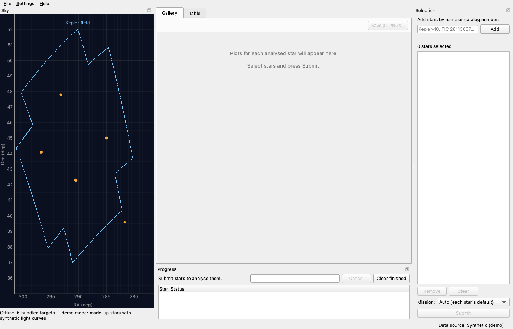

**Summary**

> Set up the project skeleton, the shared data contracts, stub pipeline modules and a headless GUI test harness, and took the first screenshot.
> - `pyproject.toml` and `requirements.txt`, installed editable into `.venv`. Every dependency installed from a Python 3.14 wheel: numpy 2.5.4, scipy 1.18.1, astropy 8.0.2, astroquery 0.4.11, lightkurve 2.6.0, matplotlib 3.11.2, PySide6 6.12.0, pyqtgraph 0.14.0, plus pytest, pytest-qt and pytest-xdist.
> - `.gitignore` now ignores `cache/`, `reports/` and `*.fits`.
> - `transitory/models.py` holds all the contracts, `sources.py` the `LightCurveSource` protocol and `SyntheticSource`, and `synthetic.py` makes made-up light curves (trapezoid transits, odd/even and secondary-eclipse stand-ins for binaries, noise, trend, gaps, outliers) plus 6 demo stars.
> - Pipeline signatures are stubs for clean, search, transit_model, fit and vetting. `pipeline/run.py` `analyze_star` already runs the stages in order: each stage's error goes into `StarAnalysis.errors`, and `AnalysisCancelled` is passed on.
> - The stub `gui/main_window.py` has a Sky dock, a Selection dock and Gallery/Table tabs. `run_dashboard.py --demo` starts it.
> - Test harness: `tests/conftest.py` (offscreen Qt, cache and report folders per test so xdist is safe, network tests skipped), `tests/harness.py` (`main_window` fixture and `shot()`), and `tools/take_shots.py`, which wrote `docs/shots/01-skeleton.png`.
> - The 15 tests in `test_synthetic.py` and `test_harness.py` pass, including under `-n 2`. I also launched the app headless with and without `--demo`.

### T3 pipeline-fetch-clean

- **Origin:** Filed by the Tasks Manager from the plan of T1 python-tool-gives-dashboard, at the user's request
- **Goal:** Exoplanet transit dashboard
- **Ran:** 2026-10-29 08:05 to 2026-10-29 08:28 (21m 41s)
- **Outcome:** done; committed [`04cc17a71e1d`](https://github.com/wingware-dev/transitory/commit/04cc17a71e1d499b4effb7b2445a95469eb55427)
- **Usage:** 2,059 input, 90k output, 7.43M cache read, 154k cache write (claude-haiku-5-5, claude-opus-5-5)

**Prompt**

> Pipeline: fetch/cache and cleaning
>
> Writes `transitory/pipeline/fetch.py` (MastSource via lightkurve `search_lightcurve`: SPOC/TESS-SPOC 2-min/FFI for TESS, Kepler long cadence, `download_dir=cache_dir()`, preferring PDCSAP; credits/DOIs on the LightCurve; serial requests with a descriptive user agent, nothing downloaded twice), `cache.py` (cache index and keys in cache_dir) and `clean.py` (remove quality flags and NaNs, sigma-clip upward outliers, normalise per sector, flatten with a Savitzky–Golay/biweight window about 3× the longest searched duration). Tests with synthetic data cover cleaning, which must keep injected transit depths within 5%, and fetch with lightkurve mocked. Owns `pipeline/fetch.py`, `cache.py`, `clean.py`, `tests/test_clean.py`, `tests/test_fetch.py`. Shared: none beyond models.py (read-only). Full plan: .TASKS/notes/i-d-like-a-python-tool-that-gives-me-a-dashboard-for-find.md
>
> See <project>/.TASKS/notes/pipeline-fetch-cache-and-cleaning.md

**Judgement calls**

1. **Quality flags are dropped in fetch, not clean**
   The shared LightCurve contract has no quality column, so clean cannot see flags. fetch reads every file with lightkurve's default quality bitmask; clean drops non-finite and non-positive points.
   Alternatives: Add a quality array to models.py (a shared file this task may not change)
2. **Flatten with a biweight-weighted local quadratic, not a plain biweight or Savitzky-Golay**
   Measured on synthetic data: a running biweight location or local line misses about 160 ppm of curvature for a 0.2%, 7-day trend over the 39 h window. It is also biased at segment edges. Either way shallow transits lost 6-10% of their depth. The quadratic is guarded against extrapolating: it falls back to a line or a constant in one-sided or sparse windows.
   Alternatives: Plain wotan-style biweight location (fails the 5% depth requirement for shallow and 13 h transits); Savitzky-Golay (not robust to the transits in the window)
3. **Significant dips are left out of the final trend fit**
   Dips are found with matched box filters from a few cadences up to 13 h. Without this, transits that are not outliers point by point were partly flattened away, and transit shoulders were clipped as upward outliers (516 points for a 13 h transit). The step is skipped when dips cover more than 30% of points.
   Alternatives: Window 3× duration only, accepting a 5-6% depth loss on shallow and long transits
4. **With mission 'any', Kepler is tried first when a KIC is known, else TESS first**
   Kepler's 4-year light curves beat TESS for small planets in the Kepler field; TESS covers the rest of the sky. The other mission is the fallback when the first has no data.
   Alternatives: Always TESS first; Fetch both missions and keep the longer baseline
5. **'No data found' results are cached for 7 days**
   This avoids asking MAST again on every submit for a star with no coverage or a mistyped name, while new sectors still show up within a week.
   Alternatives: Never cache negative results; Cache them forever
6. **source_ids use product file names, not obs_id**
   A live check showed all Kepler quarters of a star share one obs_id at MAST, so obs_ids would repeat.
   Alternatives: obs_id with duplicates removed (loses the per-quarter identity)
7. **Ran one small live MAST fetch to verify against the real lightkurve**
   Mocks cannot confirm real column names or the FILENAME metadata. Public data, no account: one TESS sector of Pi Men and one Kepler quarter of Kepler-10, into the scratchpad cache. It worked: a re-fetch made no requests, and the user agent was set.
   Alternatives: Mocked tests only

**Summary**

> Added fetching, caching and cleaning of light curves:
> - `pipeline/fetch.py`: `MastSource` downloads TESS and Kepler light curves from MAST through lightkurve. Per sector it prefers SPOC 2-min, then TESS-SPOC FFI, then SPOC 20 s; Kepler uses long cadence only. It reads PDCSAP flux (SAP if a file has none), drops quality-flagged cadences, normalises each file and stitches them. It attaches mission DOIs, checked at doi.org, plus MAST credit lines. Requests run one at a time across threads, with a transitory user agent, and files go to `cache_dir()`.
> - `pipeline/cache.py`: a JSON cache index (atomic writes, paths relative to the cache) recording which files answer which query, so a second fetch makes no MAST request. Also `save_json`/`load_json` helpers, with timestamps, that other modules can use.
> - `pipeline/clean.py`: implements `clean_light_curve`. It drops bad points, normalises each segment, finds dips and leaves them out of the trend fit, clips upward outliers, and flattens with a 39 h biweight window (3× the longest searched duration).
> - `tests/test_clean.py` and `tests/test_fetch.py` (lightkurve faked, no network): 65 tests. Injected transit depths stay within 4% across 8 shapes × 3 noise seeds (required: 5%). All 67 tests run, including the two harness `analyze_star` tests, pass.

### T4 pipeline-search-fit

- **Origin:** Filed by the Tasks Manager from the plan of T1 python-tool-gives-dashboard, at the user's request
- **Goal:** Exoplanet transit dashboard
- **Ran:** 2026-10-29 08:05 to 2026-10-29 08:22 (15m 46s)
- **Outcome:** done; committed [`8913b09aa35c`](https://github.com/wingware-dev/transitory/commit/8913b09aa35c312fbb0c3878d89cb1ef96e07b41)
- **Usage:** 2,286 input, 64k output, 4.53M cache read, 125k cache write (claude-haiku-5-5, claude-opus-5-5)

**Prompt**

> Pipeline: search, transit model, fit, vetting and analyze_star
>
> Writes `pipeline/search.py` (iterative astropy BoxLeastSquares over a log-spaced period grid 0.3 d up to baseline/2 with SDE/SNR; mask found transits and repeat for up to 3 planets), `transit_model.py` (quadratic limb-darkened model, numerical disk integration in numpy), `fit.py` (`scipy.optimize.least_squares` for t0, P, rp/rs, a/rs, b; T14 derived; errors from the Jacobian covariance), `vetting.py` (SNR, SDE, n_transits ≥ 2, odd/even depth agreement, secondary-eclipse check → confidence) and `run.py` (`analyze_star` over a LightCurveSource). Tests use synthetic light curves with planets injected at known P and depth: single and multiple planets, shallow vs. deep, short vs. long period, too few transits, flat stars giving no detection, and odd/even eclipsing binaries flagged. Recovery must land within stated tolerances on P, Rp/Rs and T14. Owns those files and `tests/test_search.py`, `test_fit.py`, `test_vetting.py`, `test_run.py`. Uses clean.py (task pipeline-fetch-clean) only in run.py through its signature from the skeleton. Full plan: .TASKS/notes/i-d-like-a-python-tool-that-gives-me-a-dashboard-for-find.md
>
> [Tasks Manager, 2026-10-29 08:05] Manager (from T2 skeleton-contracts-harness (2a359f9a)): `pipeline/run.py` already has a working `analyze_star`, so fill in the stubs in search/transit_model/fit/vetting and change run.py rather than starting over. `StarAnalysis.periodograms` is a list holding one PeriodogramResult per search pass. T3 pipeline-fetch-clean is filling in clean.py at the same time, so don't edit it.
>
> See <project>/.TASKS/notes/pipeline-search-transit-model-fit-vetting-and-analyze.md

**Judgement calls**

1. **Added an optional `others` argument to vet_candidate**
   Without it, the Two-Planet demo's inner planet was graded weak because the outer planet's transits looked like a secondary eclipse, and an eclipsing binary's secondary or P/2 alias came back as an extra "planet". The default () keeps the skeleton's signature compatible.
   Alternatives: Mask the other signals in run.py before calling vet_candidate (harmonics would then remove the primary's own transits); Drop repeated periods in search.py (loses the information that the star is an EB)
2. **Vetting measures depths with the median of in-transit points**
   Upward flares inside a transit sit below the trend, so cleaning doesn't clip them. With the mean, one flare made one transit 20% shallow and falsely flagged the real 9.87-day planet as an odd/even eclipsing binary (5.8 sigma).
   Alternatives: Mean depth plus red-noise error inflation
3. **Thresholds: detection needs SDE ≥ 7 and SNR ≥ 7; 'strong' needs SNR ≥ 10 and SDE ≥ 9**
   Tuned on 20 flat synthetic stars: noise peaks reached SDE 6–10 but SNR only 5.1–6.2. SNR therefore does most of the rejecting.
   Alternatives: SDE-only threshold of ~10 (would miss shallow planets that SNR catches)
4. **BLS grid capped at 120,000 periods per pass**
   Keeps multi-year Kepler curves tractable. A 54-day TESS-like curve needs about 30,000 and is unaffected; at the cap the grid gets coarser instead.
   Alternatives: Uncapped grid (very slow on 4-year Kepler data); Bin the data in time first
5. **FitResult.t0 is the transit epoch nearest mid-data, not the BLS epoch**
   t0 and P are least correlated there, so the t0 error is smallest; it is still a valid mid-transit time on the same ephemeris.
   Alternatives: Report the first transit in the data
6. **Added a new shared test helper, tests/pipeline_synth.py**
   Builds trend-free cleaned curves and ideal candidates, so search, fit and vetting are tested apart from clean.py. It isn't in the task's listed files, but no other task owns it.
   Alternatives: Duplicate the helpers in each test file

**Summary**

> Filled in the transit search, transit model, fit and vetting stubs, connected them in analyze_star, and added tests on synthetic light curves:
> - search.py: iterative astropy BoxLeastSquares over a log-spaced grid from 0.3 d to baseline/2, split into octaves so each period range has trial durations that suit it. Reports SDE and SNR, masks each found signal and searches again (up to 3 passes). Corrects half-period aliases when every other transit is empty.
> - transit_model.py: quadratic limb-darkened model by numerical disk integration, with an optional exposure average for 30-min cadence. Matches the exact uniform-disk overlap to about 1e-6. t14_hours() gives the derived T14.
> - fit.py: scipy least_squares fit of t0, P, rp/rs, a/rs and b from a few starting b values. Errors come from the Jacobian covariance; T14 and depth errors are propagated from it.
> - vetting.py: checks SNR, SDE, number of transits, odd/even depths, secondary eclipse, planet size, fitted vs. detected duration, and repeats of a stronger signal (its secondary eclipse or a period alias) → strong/weak/none with reasons.
> - run.py: passes the star's other candidates to vetting, so another planet's transits don't count as a secondary eclipse.
> - Tests: tests/test_search.py, test_fit.py, test_vetting.py, test_run.py and a shared helper, tests/pipeline_synth.py. All 70 pass, plus the two analyze_star tests in test_harness.py.

### T5 catalog-resolve-archive

- **Origin:** Filed by the Tasks Manager from the plan of T1 python-tool-gives-dashboard, at the user's request
- **Goal:** Exoplanet transit dashboard
- **Ran:** 2026-10-29 08:05 to 2026-10-29 08:29 (23m 31s)
- **Outcome:** done; committed [`c2f9930f809e`](https://github.com/wingware-dev/transitory/commit/c2f9930f809e07d553bc9ce67312dda380a0aa31)
- **Usage:** 134 input, 77k output, 5.96M cache read, 136k cache write (claude-opus-5-5)

**Prompt**

> Catalog: name resolution, sky catalog, Exoplanet Archive
>
> Writes `catalog/resolve.py` (TIC/KIC/EPIC numbers, planet and host names, SIMBAD/MAST resolver, cached), `skycatalog.py` (host stars from pscomppars, TIC cone search for zoomed fields, bundled offline JSON of validation targets) and `archive.py` (NASA Exoplanet Archive TAP queries for published planets, KOI and TOI, cached with retrieval date). Tests use recorded responses, no network. Owns `transitory/catalog/*`, `transitory/data/targets_offline.json`, `tests/test_catalog_*.py`. Full plan: .TASKS/notes/i-d-like-a-python-tool-that-gives-me-a-dashboard-for-find.md
>
> See <project>/.TASKS/notes/catalog-name-resolution-sky-catalog-exoplanet-archive.md

**Judgement calls**

1. **Plain HTTP (requests) to the MAST and Exoplanet Archive APIs, not astroquery**
   One transport function to fake makes recorded-response tests simple and exact. Name resolution uses MAST's Mast.Name.Lookup, which queries SIMBAD, NED and the K2 EPIC itself. CDS Sesame and SIMBAD TAP did not answer from this machine, and the archive's alias service hangs about 60 s on unknown names.
   Alternatives: astroquery.mast / astroquery.ipac.nexsci with mocks; SIMBAD TAP directly
2. **Ran free public MAST and Exoplanet Archive queries live to record fixtures and build the offline file**
   The task asks for recorded responses. These services are public, free and need no account. About 40 serial requests were made.
   Alternatives: Hand-written fake responses
3. **Recorded responses live in tests/data/catalog/ (recorded.json plus record.py)**
   Outside the listed ownership (tests/test_catalog_*.py), but a new directory no other task touches. The 42 KB recorded.json was written by record.py through the shell rather than an edit tool.
   Alternatives: Embed the responses as Python literals in the test files
4. **Cache lifetime: archive responses 30 days, MAST (TIC, name lookup) never expire**
   Archive parameters get revised over time; TIC entries and name positions essentially never change. Callers can pass refresh=True.
   Alternatives: Never expire anything; Expire everything after N days
5. **A resolved target keeps the name the user typed; a planet name resolves to its host star**
   'pi Men c' becomes target 'pi Men', not the archive's 'HD 39091'. The archive's capitalisation is used only when it is the same name.
   Alternatives: Always use the archive host name
6. **A bare number is a TIC ID, or a KIC ID when the mission hint is Kepler**
   TESS covers almost the whole sky, so TIC is the more general catalog.
   Alternatives: Reject bare numbers; Try both catalogs
7. **Added KIC 8006161 to the offline file as the one null star**
   The archive has no confirmed planet, KOI or TOI for it. The validation task still chooses its final null stars; build_offline.VALIDATION_TARGETS is the list to edit.
   Alternatives: Bundle planet hosts only
8. **`transitory.catalog.resolve` is the module; the package does not re-export the resolve() function**
   Re-exporting the function would hide the module of the same name. Callers write `from transitory.catalog.resolve import resolve`.
   Alternatives: Rename the function, e.g. resolve_name
9. **TIC cone searches are capped at 1° radius and 5000 rows, with positions rounded to 1e-4°**
   The TIC is dense near the Galactic plane. Rounding lets a slightly moved view reuse the cache.
   Alternatives: No cap; let the sky view decide
10. **host_stars() falls back to the bundled targets when the archive is unreachable**
   The result is flagged offline with a note, and a warning is logged. offline_fallback=False raises instead.
   Alternatives: Always raise

**Summary**

> Add the catalog layer: name resolution, the sky catalog and Exoplanet Archive queries, all cached on disk and tested against recorded responses with no network.
> - `catalog/client.py`: one HTTP client for both services. It sends one request at a time with the project user agent and caches each response as JSON with its retrieval date. Archive entries expire after 30 days and MAST entries never do; an offline mode answers only from the cache. Error replies from either service become `CatalogError` with the service's message.
> - `catalog/resolve.py` and `tic.py`: turn TIC/KIC/EPIC numbers, KOI and TOI names, planet names (resolved to their host star) and any SIMBAD name into a `StarTarget` with TIC, KIC, position, Tmag and radius. `resolve_many` reports bad names without stopping the rest.
> - `catalog/archive.py`: confirmed planets (`pscomppars`), KOIs and TOIs converted to one set of units, with references and retrieval dates. `known_planets()` returns `KnownPlanet`s and `all_signals()` is the check for null stars.
> - `catalog/skycatalog.py`: transiting-planet host stars (falling back to the bundled targets when the archive can't be reached), TIC stars for a zoomed field, and the bundled offline targets.
> - `transitory/data/targets_offline.json`: the 8 validation hosts plus null star KIC 8006161, built from live data by `python -m transitory.catalog.build_offline`.
> - 93 tests in `tests/test_catalog_*.py` replay `tests/data/catalog/recorded.json`; `tests/data/catalog/record.py` re-records it.

### T6 gallery-plots

- **Origin:** Filed by the Tasks Manager from the plan of T1 python-tool-gives-dashboard, at the user's request
- **Goal:** Exoplanet transit dashboard
- **Ran:** 2026-10-29 08:05 to 2026-10-29 08:09 (3m 39s)
- **Outcome:** done; committed [`c6890977798f`](https://github.com/wingware-dev/transitory/commit/c6890977798f47fca21078bd116cb0a954f43634)
- **Usage:** 52 input, 24k output, 1.48M cache read, 76k cache write (claude-opus-5-5)

**Prompt**

> Gallery plots
>
> Writes `transitory/plots.py`: matplotlib figures for raw+cleaned flux, BLS periodogram with marked peaks, and phase-folded data with binned points and the fitted model, one per planet. Each gets a credit footer (from StarAnalysis.credits) and can be saved as PNG. Tests build the figures from a synthetic StarAnalysis. Owns `plots.py`, `tests/test_plots.py`. Full plan: .TASKS/notes/i-d-like-a-python-tool-that-gives-me-a-dashboard-for-find.md
>
> See <project>/.TASKS/notes/gallery-plots.md

**Judgement calls**

1. **Public API: gallery_figures() returns GalleryFigure(key, title, figure); light_curve_figure, periodogram_figure, folded_figure(analysis, index), save_png, save_all**
   Gives the gallery GUI task a single call per star, with keys it can use as stable file names
   Alternatives: Return a dict keyed by figure name; Draw into caller-supplied axes
2. **Folded plots mask the other planets' in-transit points**
   Without this, a deeper planet's transits land in a shallower planet's fold window and corrupt its binned points (seen on the two-planet test star)
   Alternatives: Show all points unmasked
3. **Planet letters b, c, d… come from the planet order, and periodogram passes are matched to planets in order**
   run.py builds planets from the passes' best candidates in pass order, so the colours and letters agree across all three figure types
4. **Fold window is ±3×T14, capped at ±P/2. Bin width is T14/12, but never smaller than one cadence**
   Keeps the transit and some baseline readable for both short and long durations

**Summary**

> Added `transitory/plots.py`, which draws gallery figures from a StarAnalysis, and `tests/test_plots.py` (14 tests) that build those figures from a hand-made synthetic StarAnalysis.
> - The figures are a two-panel light curve (raw flux with the removed trend, and cleaned flux with transit markers for each planet), a BLS periodogram with one panel per search pass marking the peak and its ½× and 2× aliases, and one phase-folded figure per planet showing the data, binned points with error bars, the fitted model and a parameter/vetting panel.
> - Each figure has a credit footer built from StarAnalysis.credits. `save_png` and `save_all` write the figures as `<star-slug>-<key>.png`.
> - Figures are built without pyplot, so they are thread-safe and can be embedded with FigureCanvasQTAgg. If data is missing, the figure shows a message (including the analysis errors) instead of raising.

### T8 dashboard-gallery-table

- **Origin:** Filed by the Tasks Manager from the plan of T1 python-tool-gives-dashboard, at the user's request
- **Goal:** Exoplanet transit dashboard
- **Ran:** 2026-10-29 08:10 to 2026-10-29 08:17 (6m 59s)
- **Outcome:** done; committed [`effe977a0fd6`](https://github.com/wingware-dev/transitory/commit/effe977a0fd627b4759dc30ba5767860cb0f4191)
- **Usage:** 62 input, 41k output, 3.55M cache read, 55k cache write (claude-opus-5-5)

**Prompt**

> Dashboard: results gallery and summary table
>
> Writes `gui/gallery.py` (a scrollable per-star section embedding plots.py figures, with save-all) and `gui/results_table.py` (a sortable table of star, planet #, P±σ, Rp/Rs±σ, Rp in R⊕ when the stellar radius is known, T14, depth, SNR, SDE, confidence and notes, colour-coded by confidence, with CSV export). Tests use a synthetic StarAnalysis. Owns these files and `tests/test_gui_gallery.py`, `tests/test_gui_table.py`. Full plan: .TASKS/notes/i-d-like-a-python-tool-that-gives-me-a-dashboard-for-find.md
>
> [Tasks Manager, 2026-10-29 08:05] Manager: T7 dashboard-sky-selection runs alongside this task. Don't edit `gui/main_window.py`, `tools/take_shots.py` or `tests/test_harness.py`: T9 dashboard-integration does the wiring into MainWindow, registers the screenshots in SHOTS and updates the placeholder check.
>
> [Tasks Manager, 2026-10-29 08:09] Manager (from T6 gallery-plots (dd6f8bf9)): the plots.py API is `gallery_figures(analysis)`, which returns `GalleryFigure(key, title, figure)`, plus `light_curve_figure`, `periodogram_figure`, `folded_figure(analysis, index)`, `save_png` and `save_all`. The figures don't use pyplot, so embed them with FigureCanvasQTAgg; use `save_all` for save-all. Planet letters b, c, d… follow the order of the planets. The T6 session is warm, so this task runs there.
>
> See <project>/.TASKS/notes/dashboard-results-gallery-and-summary-table.md

**Judgement calls**

1. **GalleryCanvas sets matplotlib's private Figure._original_dpi/_set_dpi so the figure keeps its design size in inches**
   The stock FigureCanvasQTAgg keeps dpi fixed and changes the size in inches, which crowds plots.py's point-sized text and footer at gallery widths. Scaling dpi with the width keeps the layout exactly as designed, and setting _original_dpi as well keeps HiDPI rescaling correct.
   Alternatives: Render each figure to a QPixmap and show it in a QLabel (no private API, but no interactive canvas); Accept the stock resize behaviour
2. **Stars with no light curve show only their header and errors, not placeholder figures, and Save skips them**
   The 'No light curve' message figures took a screen of empty plot frames per failed star.
3. **Unknown values (NaN) sort below every real value, so they come first when ascending and last when descending**
   Simple and predictable with QSortFilterProxyModel's role-based sort
   Alternatives: Always put unknowns last regardless of direction (needs a custom lessThan)
4. **CSV columns: star, planet, period_d, period_err_d, rp_rs, rp_rs_err, rp_earth, rp_earth_err, t14_h, t14_err_h, depth_ppm, snr, sde, confidence, notes, with blanks for unknown values**
   Raw numbers with separate sigma columns are what spreadsheets and pandas want, rather than the formatted 'x ± y' text.
   Alternatives: Export the displayed text
5. **Without a fit, the table falls back to the BLS values, with Rp/Rs = sqrt(depth), and says so in Notes**
   Keeps a row informative when fitting fails
6. **The GUI tests import make_analysis from tests/test_plots.py**
   tests/harness.py is not this task's to edit (T9 owns the harness changes), and the shared synthetic StarAnalysis already lives there
   Alternatives: Duplicate the fixture; Move it into harness.py

**Summary**

> Added the results gallery and summary table widgets, ready for T9 to wire into MainWindow:
> - `transitory/gui/gallery.py`: `GalleryWidget`, a scroll area with one collapsible `StarSection` per star. Each section has a header (name, summary, confidence badges, errors, Save PNGs…) and embeds the plots.py figures in a `GalleryCanvas`. The canvas scales the figure with its width so fonts and the credit footer keep their designed layout, and it passes wheel scrolling through to the gallery. The widget also has Save all PNGs… (via `plots.save_all`), `add_analysis` (which replaces a star's section in place), `set_analyses`, `clear` and `scroll_to`. Stars without a light curve show only their errors.
> - `transitory/gui/results_table.py`: `ResultsTable`, a sortable `QTableView` with columns for star, planet letter, P±σ, Rp/Rs±σ, Rp in R⊕ (when the stellar radius is known), T14, depth, SNR, SDE, confidence and notes. Sorting is numeric, rows are tinted by confidence, the confidence cell is solid-coloured, and stars without candidates get a row explaining why. CSV export (Export CSV…) writes the rows in the order shown with raw numbers, and double-clicking a row emits `planetActivated(star, index)`.
> - `tests/test_gui_gallery.py` and `tests/test_gui_table.py`: 18 headless tests driven through pytest-qt, using the synthetic StarAnalysis from `tests/test_plots.py`.

### T7 dashboard-sky-selection

- **Origin:** Filed by the Tasks Manager from the plan of T1 python-tool-gives-dashboard, at the user's request
- **Goal:** Exoplanet transit dashboard
- **Ran:** 2026-10-29 08:30 to 2026-10-29 08:37 (7m 26s)
- **Outcome:** done; committed [`31377d5e21b4`](https://github.com/wingware-dev/transitory/commit/31377d5e21b4472b02ecc091d80e67bfb3e00895)
- **Usage:** 1,859 input, 47k output, 6.18M cache read, 62k cache write (claude-haiku-5-5, claude-opus-5-5)

**Prompt**

> Dashboard: sky view and star selection
>
> Writes `gui/sky_view.py`: a pyqtgraph RA/Dec plot (RA flipped) with zoom and pan, Kepler-field and TESS-CVZ outlines, host and field stars, click-to-select of the nearest star with a highlight, and TIC cone loading on deep zoom in a worker thread. Writes `gui/selection_panel.py`: a name/catalog entry box using catalog/resolve.py, the selected-star list with remove, mission preference and a Submit button. Tests drive clicks and typing through the harness (offline, recorded catalog data). Takes shot docs/shots/02-sky-selection.png. Owns these files and `tests/test_gui_sky.py`, `tests/test_gui_selection.py`. Full plan: .TASKS/notes/i-d-like-a-python-tool-that-gives-me-a-dashboard-for-find.md
>
> [Tasks Manager, 2026-10-29 08:05] Manager: T8 dashboard-gallery-table runs alongside this task. Don't edit `gui/main_window.py`, `tools/take_shots.py` or `tests/test_harness.py`: T9 dashboard-integration does the wiring into MainWindow, registers the screenshots in SHOTS and updates the placeholder check. Take 02-sky-selection.png with the `shot()` helper from tests/harness.py on your own widgets (a test-only host window is fine), and give in your report the SHOTS entry T9 should add.
>
> [Tasks Manager, 2026-10-29 08:29] Manager (from T5 catalog-resolve-archive (e5f50ce0)): runs in T5's warm session. Use `from transitory.catalog.resolve import resolve` (and `resolve_many`, which reports bad names without stopping) and `transitory.catalog.skycatalog` for host stars, TIC cone stars and the bundled offline targets. In the tests, replay `tests/data/catalog/recorded.json` with the client's offline mode. Show `SkyCatalog.retrieved` and the offline/note flags in the sky view's status line. Check that `requests` is declared in pyproject.toml, since the catalog uses it directly.

**Judgement calls**

1. **The committed 02-sky-selection.png uses the live host catalog (3,691 hosts)**
   The recorded fixture has only 32 hosts, which misrepresents the sky. It costs one cached archive query, and host_stars falls back to the bundled targets when offline. The listed stars come from the bundled targets, so the shot does no name lookups. Tests pass the recorded client instead.
   Alternatives: Recorded data (32 hosts): reproducible offline but sparse
2. **Tests replay recorded.json through RecordedTransport, not the client's offline mode**
   Offline mode answers only from a pre-filled cache. RecordedTransport is the replay mechanism T5 built, and it never reaches the network either.
   Alternatives: Pre-fill a cache and use CatalogClient(offline=True)
3. **The Kepler outline is an approximate 21-module footprint with an assumed pitch and roll**
   Pitch 2.6°, roll 61.5°; that roll is the only one that puts all five Kepler validation stars inside. The exact module geometry would need K2fov data. The module comment says it is approximate (the on-screen label just reads "Kepler field").
   Alternatives: Exact footprint from the K2fov package; A simple circle
4. **Plain RA/Dec plot, not an all-sky projection**
   The task asks for an RA/Dec plot with RA flipped. Click picking measures in screen pixels and wraps at RA 0/360, so it matches what the user sees.
   Alternatives: Aitoff/Mollweide projection
5. **A click selects and highlights a star and emits starClicked; adding it to the list happens in the wiring**
   Keeps SkyView independent of the panel. The host window, and later MainWindow, connect starClicked to SelectionPanel.add_star.
   Alternatives: SkyView adds to the panel directly
6. **New files beyond the listed ownership: gui/catalog_jobs.py and tests/sky_selection_host.py**
   The job helper is shared by both widgets; T9 owns gui/workers.py, which is for the analysis runner. The host module holds the wiring and the SHOTS function T9 needs, and test files can't easily be imported by tools.
   Alternatives: Duplicate the job code in each widget; Put the shot function in tools/take_shots.py, which T9 owns
7. **Edited the shared pyproject.toml and requirements.txt to add requests>=2.31**
   The Tasks Manager asked me to check it; it was missing from both.

**Screenshots**

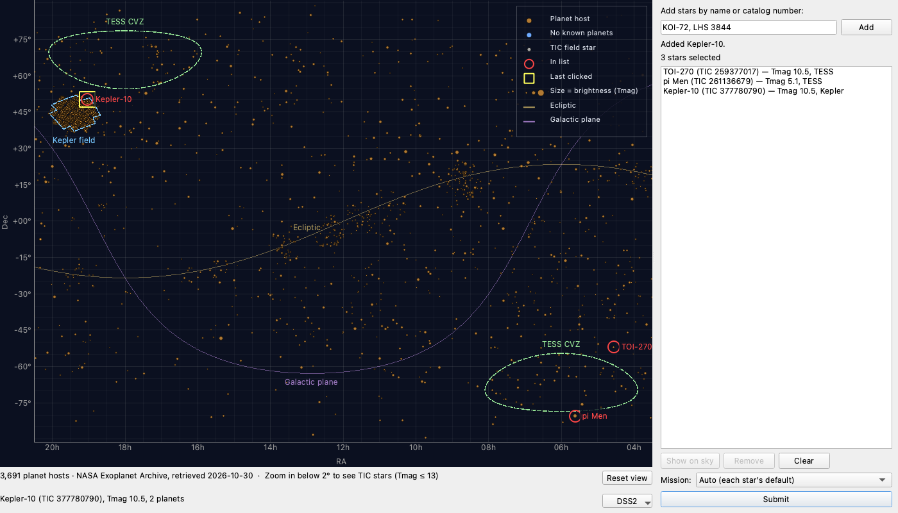

**Summary**

> Add the dashboard's sky view and star-selection panel, both tested headless against recorded catalog data.
> - `gui/sky_view.py`: a pyqtgraph RA/Dec map with RA increasing to the left, drag-to-pan and wheel zoom. It outlines the Kepler field (approximate) and the TESS continuous viewing zones. Planet hosts load in a worker thread; the status line shows the archive retrieval date, or the offline state and its note. A click picks the nearest star within 12 px and highlights it; selected stars get red rings and labels. Below 2° of view, TIC stars (Tmag ≤ 13) load from MAST in a worker thread and are dropped again on zooming out.
> - `gui/selection_panel.py`: an entry box that resolves one name or a comma-separated list through `resolve_many`. Bad names are reported without dropping the rest, and duplicates are caught by TIC. It has a selected-star list with Remove (button or Delete key) and Clear, a mission preference (Auto / TESS / Kepler) and Submit, which emits copies of the targets with the preference applied.
> - `gui/catalog_jobs.py`: a small QThreadPool helper that runs lookups off the GUI thread.
> - `tests/sky_selection_host.py` (a test-only window wired as the dashboard will be), `tests/test_gui_sky.py` and `tests/test_gui_selection.py`: 41 tests that drive clicks and typing.
> - `docs/shots/02-sky-selection.png`, taken with `shot()`.
> - `requests` added to `pyproject.toml` and `requirements.txt`, since the catalog imports it directly.

### T9 dashboard-integration

- **Origin:** Filed by the Tasks Manager from the plan of T1 python-tool-gives-dashboard, at the user's request
- **Goal:** Exoplanet transit dashboard
- **Ran:** 2026-10-29 08:38 to 2026-10-29 09:03 (24m 37s)
- **Outcome:** done; committed [`07adfee42ced`](https://github.com/wingware-dev/transitory/commit/07adfee42ced47341115d89d7812975c26b9bb49)
- **Usage:** 116 input, 50k output, 5.61M cache read, 137k cache write (claude-opus-5-5)

**Prompt**

> Dashboard integration: main window, workers, end-to-end
>
> Writes `gui/workers.py` (a QThreadPool runner for analyze_star with progress, cancel and per-star errors shown in the UI). Wires sky, selection, gallery and table into `gui/main_window.py`, adds Help ▸ Data Credits (`gui/credits_dialog.py`), and lets `run_dashboard.py` choose MastSource or `--demo` SyntheticSource. An end-to-end harness test in demo mode selects 2 stars, submits, waits, and asserts the table rows and gallery plots. Takes shots docs/shots/03-running.png, 04-gallery.png, 05-table.png and 06-credits.png. Owns `workers.py`, `credits_dialog.py`, `tests/test_gui_e2e.py`. Shared: `gui/main_window.py`, `run_dashboard.py`. Full plan: .TASKS/notes/i-d-like-a-python-tool-that-gives-me-a-dashboard-for-find.md
>
> [Tasks Manager, 2026-10-29 08:05] Manager: you own the wiring that T7 and T8 left out. Replace the placeholder widgets in `MainWindow` with the sky view, selection panel, gallery and table. Register every screenshot so far (02-sky-selection from T7's report, plus 03–06) in `SHOTS` in `tools/take_shots.py`. Update the placeholder check in `tests/test_harness.py::test_main_window_layout`. Then regenerate the shots with take_shots.py.
>
> [Tasks Manager, 2026-10-29 08:17] Manager (from T8 dashboard-gallery-table (46d044ca)): replace MainWindow.gallery_page/table_page with GalleryWidget() and ResultsTable(). Feed each finished StarAnalysis to both via add_analysis(). Connect ResultsTable.planetActivated(star_name, index) so it switches to the Gallery tab and calls GalleryWidget.scroll_to(star_name). The galleryPlaceholder/tablePlaceholder labels go away, so update the placeholder check in test_harness.py.
>
> [Tasks Manager, 2026-10-29 08:21] Manager (from T4 pipeline-search-fit (6aeb56bf)): the real pipeline now feeds the gallery and table. Run tests/test_gui_gallery.py, test_gui_table.py and test_plots.py, and fix anything that assumed hand-made values. For example, odd_even_sigma can be NaN when a parity has no data, and the vetting reason texts are new. Each demo star takes about 3–4 s through analyze_star.
>
> [Tasks Manager, 2026-10-29 08:27] Manager (from T3 pipeline-fetch-clean (43aac8d2)): `MastSource(max_products=...)` exists, but nothing sets it yet. A TESS continuous-viewing-zone star can have 40+ sectors, and a Kepler star has 17 quarters (about 5 s to clean). Pick a sensible default cap and offer it as a setting in the selection panel or a menu. Also rerun tests/test_search.py and test_run.py, since analyze_star now uses the real clean_light_curve.
>
> [Tasks Manager, 2026-10-29 08:37] Manager (from T7 dashboard-sky-selection (4b9bb020)): wire MainWindow the way tests/sky_selection_host.py does. SkyView(client) goes in the Sky dock, SelectionPanel(client, resolver) in the Selection dock. Connect sky.starClicked→panel.add_star, panel.targetsChanged→sky.set_selected, panel.targetActivated→sky.center_on(t.ra, t.dec, 3.0), and panel.submitted(list[StarTarget])→start the analyses. Call sky.load_hosts() once the window is shown. In --demo mode, give SelectionPanel a resolver that matches the SyntheticSource targets by name, and choose whether the demo sky uses skycatalog.offline_catalog(). In tools/take_shots.py, add `from sky_selection_host import shot_sky_selection` and the SHOTS entry `"sky-selection": ("02-sky-selection.png", shot_sky_selection)`.
>
> See <project>/.TASKS/notes/dashboard-integration-main-window-workers-end-to-end.md

**Judgement calls**

1. **Default cap of 20 sectors / quarters per star, settable in a Settings menu and with --max-sectors** (report 1)
   20 keeps every Kepler quarter (Q0–Q17), which long periods like Kepler-22 b need, and bounds TESS CVZ stars (40+ sectors) to about 1.5 years. The selection panel belongs to T7, so the setting went in a menu in main_window. It isn't persisted between sessions.
   Alternatives: Cap of 10 or 13 (one TESS year); No cap by default; A spin box in the selection panel
2. **Demo sky shows the synthetic demo stars, not skycatalog.offline_catalog()** (report 1)
   Clicking a star in demo mode then gives the planets the demo is built around. The bundled real targets would only give planet-free synthetic curves. The view starts on the Kepler field, because the demo stars' labels overlap at all-sky zoom.
   Alternatives: offline_catalog() (real validation targets); Both, demo stars highlighted
3. **TIC field-star loading is turned off in demo mode** (report 1)
   SkyView loads fields from MAST on deep zoom, which would break the 'no network in --demo' promise. Setting sky.field_zoom_deg = 0 does this without editing T7's file.
4. **Added a bottom 'Progress' dock and narrowed the side docks (sky 420 px, selection 270 px)** (report 1)
   Progress, cancel and per-star errors needed a visible home. At the earlier widths the gallery figures scrolled sideways and the table was clipped.
5. **Up to 2 analyses run in parallel** (report 1)
   fetch.py already serialises all MAST requests behind a lock, so this only overlaps the number crunching and stays polite to the archive.
6. **New helper module tests/dashboard_host.py (not in the task's owned list)** (report 1)
   The e2e test and take_shots.py both need the same 'select, submit, wait' driving, following the tests/sky_selection_host.py pattern.
7. **Credits dialog imports fetch._MAST_CREDIT (a private name)** (report 1)
   It reuses T3's exact MAST wording instead of copying it. Step 9 will finalise the wording, and could make it public.

**Findings filed**

- T19 table-notes-duplicate-transits: Results table Notes column repeats the transit count

**Screenshots**

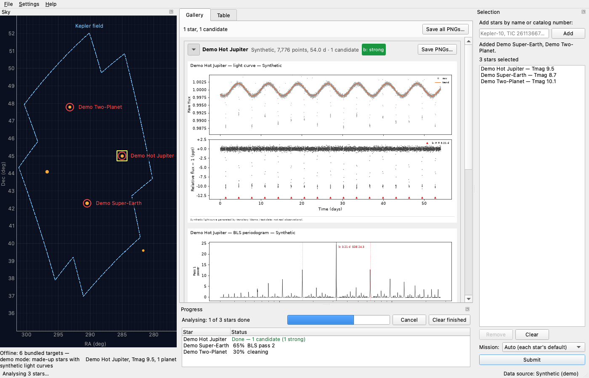

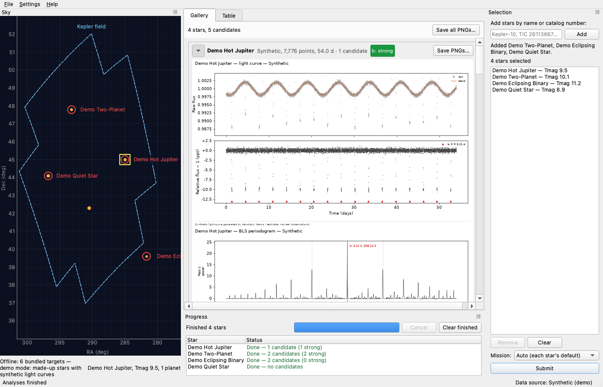

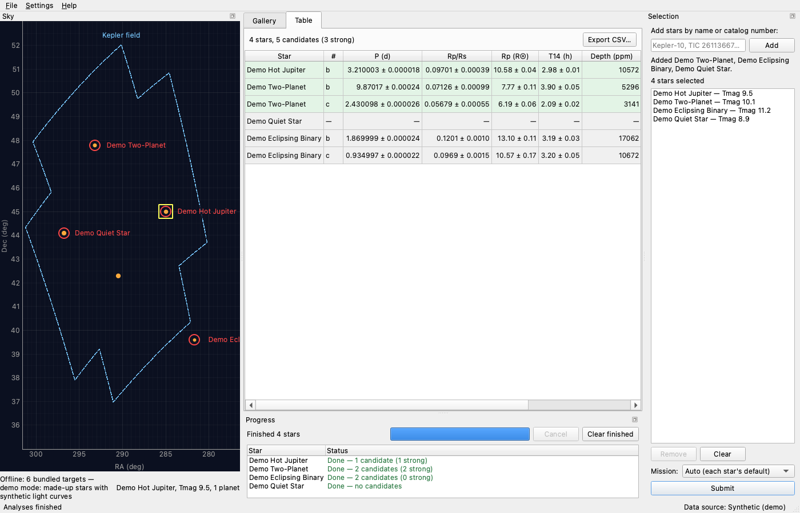

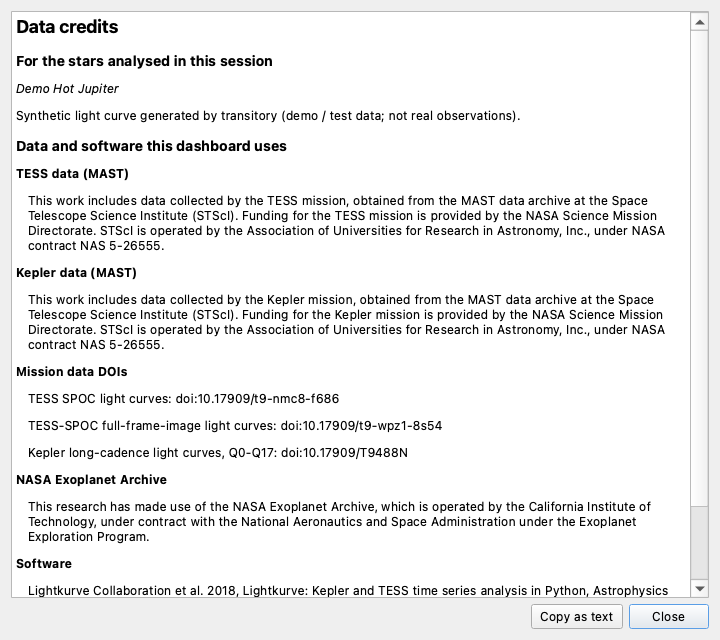

**Summary**

> Wired the dashboard together end to end: the main window now runs the real analyses and shows them, with progress, cancel, per-star errors and a Data Credits dialog. The e2e test passes and shots 01–06 have been regenerated.
> - `gui/workers.py`: `AnalysisRunner` runs `analyze_star` in a QThreadPool (2 workers, duplicate stars skipped; cancel stops queued and running stars). `ProgressPanel` dock shows each star's stage or outcome, with errors in red, plus an overall bar, Cancel and Clear finished.
> - `gui/main_window.py`: sky view, selection panel, gallery and table replace the placeholders, wired as T7 and T8 specified. Finished analyses go to both tabs, a table double-click jumps to the star's plots, and the status bar summarises the run, errors included. Planet hosts load once the window is shown (MAST mode). New menus: File (save PNGs, export CSV), Settings ▸ Sectors / quarters per star (default 20), Help ▸ Data Credits.
> - Demo mode: the sky shows the synthetic stars centred on the Kepler field, typed names resolve against them, and TIC field loading is off, so nothing touches the network.
> - `gui/credits_dialog.py`: credits for this session's analyses plus the MAST TESS/Kepler wording, mission DOIs, Exoplanet Archive and software citations, with Copy as text.
> - `run_dashboard.py` / `main_window.main`: `--demo`, `--targets "Kepler-10, TOI-270"`, `--max-sectors N` (0 = all); MastSource gets the cap.
> - Tests: `tests/test_gui_e2e.py` (15 tests: select 2 stars via a sky click and typing, Submit, assert table rows, gallery figures and progress; table→gallery; errors; credits; MAST-mode host loading with recorded responses; sector menu; cancel; per-star exceptions; close while running). `tests/dashboard_host.py` holds the shared driving helpers and shot functions. `test_main_window_layout` now checks the real widgets and that the placeholders are gone.
> - `tools/take_shots.py` registers 02-sky-selection and 03–06; all shots regenerated (01 now shows the wired window).

### T10 known-planet-validation

- **Origin:** Filed by the Tasks Manager from the plan of T1 python-tool-gives-dashboard, at the user's request
- **Goal:** Exoplanet transit dashboard
- **Ran:** 2026-10-29 09:03 to 2026-10-29 11:52 (2h 47m)
- **Outcome:** done; committed [`bad78f7e264f`](https://github.com/wingware-dev/transitory/commit/bad78f7e264fe6347f74835bf4b7aad983b37eef)
- **Usage:** 3,093 input, 93k output, 16.85M cache read, 399k cache write (claude-haiku-5-5, claude-opus-5-5)

**Prompt**

> Known-planet validation report
>
> Writes `validation/targets.py` (confirmed planets of a range of sizes and periods: Kepler-10 b/c, Kepler-7 b, Kepler-2/HAT-P-7 b, Kepler-22 b (expected hard case), Pi Mensae c, LHS 3844 b, WASP-18 b, TOI-270 b/c/d; plus 3 bright quiet null stars with good Kepler/TESS coverage and no confirmed planets, KOIs or TOIs, e.g. KIC 8006161 and quiet TESS CVZ stars, chosen and checked via catalog/archive.py), `validate.py` (runs analyze_star on each target, matches found planets to published ones by period, including aliases at 1/2× and 2×, and tallies misses and false positives) and `report.py` (Markdown + PNG output to reports/ and the committed copy in docs/validation/; found vs. published P, Rp/Rs and T14 with differences, missed planets with an explanation for each, spurious detections, confidence; published values from TAP pscomppars, cached, retrieval date recorded; data credits included). Adds `python -m transitory.validation` and a GUI Validation menu action that runs it and shows the report. Tests compare logic on synthetic "published" values. Runs the validation live once (public MAST/Exoplanet Archive downloads, free) and commits the report. Takes shot docs/shots/07-validation.png. Owns `transitory/validation/*`, `tests/test_validation.py`, `docs/validation/`. Shared: `gui/main_window.py` (one menu action). Full plan: .TASKS/notes/i-d-like-a-python-tool-that-gives-me-a-dashboard-for-find.md
>
> [Tasks Manager, 2026-10-29 08:22] Manager (from T4 pipeline-search-fit (6aeb56bf)): the SNR and odd/even errors assume white noise, and limb darkening is fixed at Sun-like values. If the live run shows spurious detections on the null stars, or Rp/Rs offsets that trace to these, say so in the report's explanations and file each with report_finding. Drafts T17 red-noise-aware-snr (e0ab1c0a) and T18 mission-limb-darkening (a0c698ec) already describe those fixes. Don't tune the pipeline inside this task.
>
> [Tasks Manager, 2026-10-29 08:29] Manager (from T5 catalog-resolve-archive (e5f50ce0)): get published values with `transitory.catalog.archive.known_planets()`, and check the null stars with `all_signals()` (no confirmed planet, KOI or TOI). The bundled offline file has only one null star, KIC 8006161, so choose and check two more. Put `ArchiveResult.retrieved` and each KnownPlanet's `ref` in the report.
>
> [Tasks Manager, 2026-10-29 09:03] Manager (from T9 dashboard-integration (f38a6406)): runs in T9's warm session. Add the Validation menu action in `MainWindow._build_menus`, alongside the File, Settings and Help menus that already exist. In GUI tests, wait for worker threads with `tests/dashboard_host.wait_until` (or qtbot.waitUntil), never `QTest.qWait`, which starves the workers. Run validation with `max_sectors` 0 (all data), so long periods like Kepler-22 b get every quarter, and note the cap used in the report. Also run tests/test_gui_sky.py, test_gui_selection.py, test_gui_gallery.py and test_gui_table.py once with your change, since main_window now hosts those widgets.
>
> See <project>/.TASKS/notes/known-planet-validation-report.md

**Judgement calls**

1. **Extra null stars: KIC 6106415 (Kepler, 14 quarters) and TIC 31410749 (southern TESS CVZ, Tmag 8.3, 13 sectors)**
   They are bright, dwarf-sized stars with long coverage at MAST and no signal in pscomppars, the KOI table or the TOI table. The archive check runs again on every validation and the report shows it.
   Alternatives: KIC 6225718 or KIC 12258514 (also clean); TIC 31409361 (only 7 FFI sectors)
2. **A new 'duplicate' kind for a recovered planet found again by a later pass**
   HAT-P-7 b and WASP-18 b were re-found at the same period (secondary eclipse / residual). Counting those as false positives would overstate the spurious rate. Matching prefers the earliest pass.
   Alternatives: Count them as rejected by vetting; Count them as spurious
3. **The report's 'What the run shows' findings are computed from the results, not hand-written**
   A rerun, e.g. after T22/T23 or T17/T18, regenerates them consistently. TOI-270's resonance note is added only when TOI-270 is among the period outliers.
4. **Folded light curves saved at 90 dpi (summary at 150) and all 33 committed**
   That brings docs/validation from 5.8 MB to 3.2 MB while staying readable.
   Alternatives: Commit only matched planets' figures; Don't commit figures
5. **The GUI validation uses the window's source and its sector cap; the CLI defaults to all sectors**
   In demo mode the menu validates the synthetic stars (seconds, offline). In MAST mode the user's Settings cap applies and the report records it. The committed report was run with all data, as asked.
   Alternatives: Always force all sectors in the GUI
6. **Kepler-22 was re-run on its own and spliced into the live run**
   Its first attempt failed on transient MAST and archive timeouts (filed as T28). Re-running all 11 stars would have cost about 2.5 more hours for the same results.
7. **Validation GUI code lives in transitory/validation/gui.py, not main_window.py**
   That keeps the shared main_window change to the menu line plus cancel/wait on close.

**Findings filed**

- T22 search-reject-single-events: BLS search accepts single-event candidates and spends its passes on them, missing real planets
- T23 vetting-planetary-secondary: Vetting downgrades hot Jupiters to 'weak' for a planetary-size secondary eclipse
- T24 search-mask-secondary: Later BLS passes re-find an already-found hot Jupiter (residual or secondary eclipse)
- T27 fit-period-errors-too-small: Fit period uncertainties are far too small (up to 500σ from published periods)
- T28 mast-search-timeout: MAST light-curve search has no timeout and can hang a run for many minutes
- T25 red-noise-spurious-evidence: White-noise SNR lets spurious detections through on a null star and planet hosts (live validation)
- T26 limb-darkening-evidence: Rp/Rs and T14 biased high for TOI-270 (M dwarf) with Sun-like limb darkening

**Screenshots**

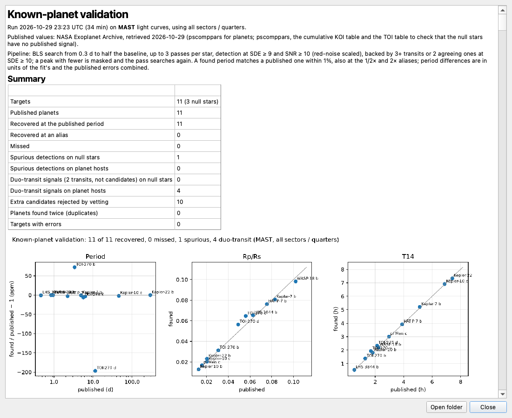

**Summary**

> Added the known-planet validation (CLI, GUI menu, report) and committed the first live report. It recovers 10 of 11 published planets with no aliases. It misses TOI-270 b, and gives 1 spurious detection on the 3 null stars and 5 on planet hosts.
> - `transitory/validation/targets.py`: the 8 planet hosts (11 planets), plus 3 null stars: KIC 8006161, and KIC 6106415 and TIC 31410749 (chosen and checked with `all_signals()`: no planet, KOI or TOI). Includes expectation notes, e.g. Kepler-22 b as the hard case.
> - `validate.py`: runs `analyze_star` per target and matches found to published periods within 1%, including 1/2× and 2× aliases, earliest search pass first. Leftovers are sorted into spurious, rejected-by-vetting or duplicate. Misses are explained from the data (transits covered, expected SNR, period range, exhausted passes, SDE at the published period), spurious ones too (aliases, TESS/Kepler systematic periods, few events, red noise). Published values come from `archive.known_planets()` / `all_signals()`, with retrieval dates and refs; `synthetic_provider` serves demo stars and tests.
> - `report.py`: Markdown with a summary table and computed "What the run shows" findings. Also found vs. published P / Rp/Rs / T14 with differences, missed planets with explanations, other detections, null-star archive checks, per-target data, references and data credits. Output includes `results.json`, `summary.png` and folded PNGs per detection (90 dpi) in `reports/validation/`; `publish()` copies them to `docs/validation/`.
> - `python -m transitory.validation` (`--demo`, `--targets`, `--max-sectors`, default 0 = all, `--out`, `--publish`, `--refresh`).
> - GUI: a Validation menu (Run known-planet validation…, Cancel validation, Show validation report) via `validation/gui.py`, wired into `MainWindow._build_menus`. It runs in a worker thread, shows progress in the status bar, and opens a report dialog with figures fitted to the width. Closing the window cancels the run and waits for it.
> - Live run with all sectors / quarters, 152 min, published values retrieved 2026-10-29. Kepler-22 was re-run after MAST/archive timeouts and is recovered from 4 transits. Results are in `docs/validation/`; shot `docs/shots/07-validation.png`.
> - `tests/test_validation.py` (19 tests: matching, aliases, duplicates, miss/spurious explanations on synthetic stars, report/publish, findings, fake-archive provider, cancel, CLI, GUI run/cancel/no-report).

### T19 table-notes-duplicate-transits

- **Origin:** Found by T9 dashboard-integration
- **Goal:** Exoplanet transit dashboard
- **Ran:** 2026-10-29 09:03 to 2026-10-29 09:04 (0m 48s)
- **Outcome:** done; committed [`f98cad3e69d3`](https://github.com/wingware-dev/transitory/commit/f98cad3e69d3c8db452e4e3db5aa8c1c2ba54023)
- **Usage:** 22 input, 2,904 output, 1.35M cache read, 4,654 cache write (claude-opus-5-5)

**Prompt**

> Results table Notes column repeats the transit count
>
> For every candidate the Notes cell in the results table says the number of transits twice, e.g. "17 transits; SNR 497.6, SDE 24.3, 17 transits, odd/even consistent". gui/results_table.py prefixes "N transits" to the vetting reasons, and the real vetting reasons (pipeline/vetting.py) already include it. The prefix should go, or be added only when the reasons don't mention transits. Update tests/test_gui_table.py to match.
>
> Evidence: Running analyze_star on the SyntheticSource demo stars and calling results_table.rows_for(...).notes gives "17 transits; SNR 497.6, SDE 24.3, 17 transits, odd/even consistent" for Demo Hot Jupiter. Same pattern for every strong candidate.
>
> Suggested next step: fix
>
> See <project>/.TASKS/notes/results-table-notes-column-repeats-the-transit-count.md

**Judgement calls**

1. **Kept the count as a fallback, added only when no reason contains "<N> transit"**
   Unvetted candidates would otherwise lose the count entirely. Matching the exact count rather than the word "transit" means reasons such as "secondary transit" don't suppress it.
   Alternatives: Drop the prefix entirely

**Summary**

> The results table's Notes no longer repeats the transit count: `results_table.planet_row` adds "N transit(s)" only when no vetting reason already states it, as when the candidate wasn't vetted. A new test in `tests/test_gui_table.py` covers the plural, singular and unvetted cases.

### T16 lazy-gallery-figures

- **Origin:** Filed by the Tasks Manager from the plan of T8 dashboard-gallery-table
- **Goal:** Exoplanet transit dashboard
- **Ran:** 2026-10-29 09:04 to 2026-10-29 09:11 (6m 40s)
- **Outcome:** done; committed [`f5135562315d`](https://github.com/wingware-dev/transitory/commit/f5135562315d2a9617d5160a22f93ae7d08836a9)
- **Usage:** 1,777 input, 32k output, 6.66M cache read, 49k cache write (claude-haiku-5-5, claude-opus-5-5)

**Prompt**

> Build gallery figures lazily for large star lists
>
> Every StarSection in transitory/gui/gallery.py builds all its matplotlib figures up front. With dozens of stars, building them only when a section first scrolls into view (or in a worker) would keep adding results responsive. (From T8 dashboard-gallery-table (46d044ca).)
>
> See <project>/.TASKS/notes/build-gallery-figures-lazily-for-large-star-lists.md

**Judgement calls**

1. **Build lazily on the GUI thread, without a worker thread**
   Constructing the figure is the cost, and it is mostly Python under the GIL, so a worker would barely help and would complicate handing the figures to Qt. Building only what's in view, plus neighbours spread over event-loop passes, removes the up-front cost.
   Alternatives: Build figures in a QThreadPool worker and hand them to the GUI thread
2. **Prefetch the immediate neighbour sections by order, not by pixel distance**
   One star's section (about 2100 px) is taller than the view, so a distance margin never reached the next star
3. **`section.canvases` stays empty until the section is built; callers that need the figure list use `figure_keys`**
   Building on access to `canvases` would quietly defeat the laziness
   Alternatives: Make `canvases` a property that builds on demand
4. **Edited `tests/test_gui_e2e.py` (from T9) to check `figure_keys` instead of canvases**
   Its sections can be out of view when it checks them, so with lazy building their canvases don't exist yet

**Summary**

> Gallery figures are now built only when their star's section is in view, plus the section just above and below it, so adding many results stays responsive. In a probe, adding 12 stars took 0.02 s, with one section built.
> - `transitory/gui/gallery.py`: each StarSection starts with canvas-sized "Loading plot…" placeholders and builds its figures in `build()`. GalleryWidget builds the sections in view when it is shown, scrolled, resized or a section is expanded, then the neighbours one per event-loop pass. Hidden tabs and collapsed sections build nothing. Placeholders and new canvases keep the same height, so the layout never jumps. `scroll_to` builds its target and keeps it pinned at the top while layout settles, until the user scrolls. New members: `figure_keys`, `built`, `build_visible()`.
> - `transitory/plots.py`: new `gallery_figure_specs()` lists the figures without building them; `gallery_figures` now uses it.
> - Tests: new lazy-building tests in `tests/test_gui_gallery.py`, and `tests/test_gui_e2e.py` now checks `figure_keys`, since sections out of view have no canvases yet.

### T22 search-reject-single-events

- **Origin:** Found by T10 known-planet-validation
- **Goal:** Exoplanet transit dashboard
- **Ran:** 2026-10-29 11:49 to 2026-10-29 11:56 (7m 17s)
- **Outcome:** done; committed [`06ae5c1ddd2b`](https://github.com/wingware-dev/transitory/commit/06ae5c1ddd2b4a42bf54a457d9dd0d2d6dd77b11)
- **Usage:** 66 input, 27k output, 1.89M cache read, 71k cache write (claude-opus-5-5)

**Prompt**

> BLS search accepts single-event candidates and spends its passes on them, missing real planets
>
> search_transits accepts any peak with SDE ≥ 7 and SNR ≥ 7, even when it covers only 0–2 transits. In the live validation, 19 of the 21 extra candidates cover at most 2 transits (periods 43–840 d), and 3 cover 0 transits by count_transits yet still have SDE 22–40. Each one uses one of the 3 search passes. On TOI-270 this cost a real planet: pass 2 took a 58.6 d single dip, so TOI-270 b (3.36 d, expected SNR 33) was never searched for. The fix belongs in pipeline/search.py: require at least 3 covered transits (or 2 plus a stricter SDE) before a pass counts as a detection, and on a rejected peak mask it and continue, or cap the period range for the pass. The vetting currently rejects these only afterwards.
>
> Evidence: docs/validation/validation.md (live run 2026-10-29): "Missed planets": TOI-270 b, "the search stopped after its 3 passes, which found 5.661 d, 58.601 d, 11.380 d"; SDE at the published period was 24.1 in pass 3's periodogram. "Other detections" table: KIC 8006161 d and KIC 6106415 b show 0 transits with SDE 40.2 and 33.6. Reproduce: python -m transitory.validation --targets TOI-270
>
> Suggested next step: fix
>
> [Tasks Manager, 2026-10-29 11:48] Manager: runs alongside T23 vetting-planetary-secondary (b969bbb2), which owns pipeline/vetting.py and tests/test_vetting.py, so don't edit those. You own pipeline/search.py, tests/test_search.py and, if needed, tests/test_run.py. Prove the fix with synthetic light curves, not downloads: build a TOI-270-like case where a deep single dip used to take a pass and a 3.36 d planet was then missed. T10 known-planet-validation reruns the live check afterwards.
>
> See <project>/.TASKS/notes/bls-search-accepts-single-event-candidates-and-spends-its.md

**Judgement calls**

1. **Peaks with 3+ covered transits must also show the dip in most of them (median per-event depth ≥ 0.5 × depth)**
   count_transits counts epochs that have data, not epochs that show a dip. In the cap test, two deep dips folded with two empty epochs passed as a '4-transit' 13.2 d signal. Without this check, single dips still get through as n≥3. At SNR 7 the check rejects a real planet only at about the 2.8σ level.
   Alternatives: Count only (as the task literally suggested); Require each event to be individually significant (would kill shallow planets)
2. **Two-transit peaks are kept when SDE ≥ 10 and both dips agree, not dropped outright**
   Periods between baseline/3 and baseline/2 can only ever show 2 transits; the existing grid-edge test (a real 20 d planet over 40 d, SDE 21) relies on this. The depth-agreement check is what rejects the TOI-270-like case, where one dip folded with another planet's transit. Live 2-transit spurious peaks had SDE 14–40, so the SDE bar alone would not separate them.
   Alternatives: MIN_TRANSITS=3 with no 2-transit exception; A higher SDE bar such as 20
3. **A rejected peak is masked and re-searched within the same pass (up to 5 total per search), rather than picking the next peak from the same periodogram**
   In live TOI-270, the single dip inflated the SDE normalisation so much that b scored 1.8 in pass 2's periodogram. Only re-running BLS after masking brings b back (24.1 in pass 3). Each retry is a full BLS run, so the cap bounds the extra cost on noisy Kepler stars.
   Alternatives: Cap the period range per pass; Unbounded retries
4. **Secondary masked only when it is detected (>3σ), and the primary widened only for SNR ≥ 100**
   Masking phase 0.5 and wider windows unconditionally would remove up to about half the data on short-period hot Jupiters like WASP-18, hurting the search for smaller planets.
   Alternatives: Always mask phase 0.5; Always mask wider

**Summary**

> BLS search no longer spends passes on single events or on a found planet's secondary eclipse (fixes T22, plus T24 search-mask-secondary (6fbfa247) at the Tasks Manager's request):
> - A peak counts only with ≥3 covered transits whose median per-event depth is at least half the folded depth, or exactly 2 transits with SDE ≥ 10 whose two dips are each >3σ and within 2× in depth.
> - A rejected peak's epochs are masked and the same pass searches again, up to MAX_REJECTED_PEAKS = 5 extra BLS runs per search.
> - After a detection, the secondary eclipse at phase 0.5 is masked too when it shows (>3σ), and transits with SNR ≥ 100 are masked over ±1.5 box durations instead of ±1.
> - New synthetic tests: a TOI-270-like star (a deep one-off dip used to take pass 2, so the 3.36 d planet was missed; now b, c and d are all found), a hot Jupiter with a secondary plus two small planets (all 3 passes go to distinct signals), and the cap on rejected peaks. The single-transit test now requires no candidate at all.

### T23 vetting-planetary-secondary

- **Origin:** Found by T10 known-planet-validation
- **Goal:** Exoplanet transit dashboard
- **Ran:** 2026-10-29 11:49 to 2026-10-29 11:51 (1m 37s)
- **Outcome:** done; committed [`8c137701669b`](https://github.com/wingware-dev/transitory/commit/8c137701669bd58b79dc8f1bc46e7ffe5d04c468)
- **Usage:** 2,146 input, 6,446 output, 640k cache read, 41k cache write (claude-haiku-5-5, claude-opus-5-5)

**Prompt**

> Vetting downgrades hot Jupiters to 'weak' for a planetary-size secondary eclipse
>
> pipeline/vetting.py rates Kepler-7 b, HAT-P-7 b, WASP-18 b and Kepler-10 b only 'weak'. The single reason in each case is "secondary eclipse at phase 0.5: N ppm (… sigma), small enough to be planetary emission". These are confirmed planets with published secondary-eclipse detections, at SNR 200–6000 with hundreds of transits. A secondary eclipse that the vetting itself judges planetary should not lower the confidence: keep 'strong', and list the eclipse as information. Only an eclipse too deep for a planet should downgrade or reject.
>
> Evidence: docs/validation/validation.md, "Planets: found vs. published": Kepler-7 b (SNR 3145), HAT-P-7 b (SNR 6348), WASP-18 b (SNR 1659), Kepler-10 b (SNR 210) are all 'weak', with only the secondary-eclipse reason (e.g. WASP-18: "409 ppm (45.9 sigma), small enough to be planetary emission").
>
> Suggested next step: fix
>
> [Tasks Manager, 2026-10-29 11:48] Manager: runs alongside T22 search-reject-single-events (96af4d33), which owns pipeline/search.py, tests/test_search.py and tests/test_run.py, so don't edit those. You own pipeline/vetting.py and tests/test_vetting.py. Prove the fix with synthetic light curves, not downloads: a hot Jupiter with a planetary-size secondary should stay 'strong', and an eclipsing binary's deep secondary should still downgrade or reject. T10 known-planet-validation reruns the live check afterwards.
>
> See <project>/.TASKS/notes/vetting-downgrades-hot-jupiters-to-weak-for-a-planetary.md

**Judgement calls**

1. **Planetary-eclipse reason is kept, worded as before, on every candidate**
   The task asks for the eclipse to be listed as information. Keeping the text "small enough to be planetary emission" unchanged keeps the existing validation report finding and its test working (`transitory/validation/report.py:226`, which looks for 'weak' plus only this reason). That finding will now simply not fire.
   Alternatives: Drop the reason entirely when strong; Reword it as an informational note
2. **Reasons for a repeated (alias or secondary) signal now hold only the repeat reason**
   Otherwise the new informational note would leak into them; this matches the existing exact-reasons test for aliases.
   Alternatives: Keep notes on repeats too

**Summary**

> A significant secondary eclipse that the vetting itself judges planetary no longer lowers the confidence to 'weak':
> - `pipeline/vetting.py` keeps such candidates 'strong' and lists the eclipse among the reasons, after the strong summary. An eclipse deeper than 10% of the primary still rejects as a likely eclipsing binary.
> - `tests/test_vetting.py` uses synthetic light curves: a hot Jupiter with a 100 ppm secondary stays 'strong'; the same signal with a 1500 ppm secondary is 'none'; a planetary secondary with marginal SNR is still 'weak' for the SNR.

### T25 red-noise-spurious-evidence

- **Origin:** Found by T10 known-planet-validation
- **Goal:** Bug Fixes
- **Ran:**  to 2026-10-29 11:49 ()
- **Outcome:** dismissed
- **Usage:** 0 input, 0 output, 0 cache read, 0 cache write (model not recorded)

**Prompt**

> White-noise SNR lets spurious detections through on a null star and planet hosts (live validation)
>
> The live validation gives 6 spurious detections that pass vetting. One is on a null star with no published signal: KIC 8006161, 442 d, SNR 152, 3 events, rated 'weak'. The other 5 are on planet hosts: Kepler-22 254.9 d 'strong' with SNR 23 and 5 transits; Kepler-7 720 d; Kepler-2 307 d; LHS 3844 115 d and 109 d. All are long-period, few-event dips whose SNR (transit_snr) assumes white noise, so correlated noise and instrumental dips look highly significant. This is the case draft T17 red-noise-aware-snr (e0ab1c0a) describes; this finding adds the live evidence. Fixing T17 should remove most of these. Re-run python -m transitory.validation --publish afterwards.
>
> Evidence: docs/validation/validation.md, "Other detections" (kind spurious) and the "What the run shows" bullet "6 spurious detections passed vetting…"; docs/validation/results.json "others".
>
> Suggested next step: fix

### T26 limb-darkening-evidence

- **Origin:** Found by T10 known-planet-validation
- **Goal:** Bug Fixes
- **Ran:**  to 2026-10-29 11:49 ()
- **Outcome:** dismissed
- **Usage:** 0 input, 0 output, 0 cache read, 0 cache write (model not recorded)

**Prompt**

> Rp/Rs and T14 biased high for TOI-270 (M dwarf) with Sun-like limb darkening
>
> The live validation fits TOI-270 c and d about 18–19% too large in Rp/Rs and 15–17% too long in T14. Their host is an M dwarf (R ≈ 0.38 R_sun), and the fit's limb darkening is fixed at Sun-like values. This is the bias draft T18 mission-limb-darkening (a0c698ec) describes; this finding adds the live evidence. Kepler-10 b (+17%) and Kepler-22 b (+22%) are also high: they are shallow, Sun-like hosts, so the likely cause there is the Rp/Rs–impact parameter degeneracy rather than limb darkening. A prior on a/Rs from stellar density would help those. Re-run the validation after T18.
>
> Evidence: docs/validation/validation.md, "Planets: found vs. published": TOI-270 c Rp/Rs 0.0660 vs 0.0560 (+17.8%), T14 1.97 vs 1.68 h (+16.9%); TOI-270 d 0.0584 vs 0.0491 (+18.9%), T14 +14.7%; Kepler-10 b +17.3%, Kepler-22 b +21.9%. Median |ΔRp/Rs| over all 10 recovered planets: 5.2%.
>
> Suggested next step: fix

### T18 mission-limb-darkening

- **Origin:** Filed by the Tasks Manager from the plan of T4 pipeline-search-fit
- **Goal:** Exoplanet transit dashboard
- **Ran:** 2026-10-29 11:50 to 2026-10-29 12:02 (11m 09s)
- **Outcome:** done; committed [`e8ce182f857a`](https://github.com/wingware-dev/transitory/commit/e8ce182f857a4dbc96f535195da21b2b814da90f)
- **Usage:** 102 input, 38k output, 4.46M cache read, 120k cache write (claude-opus-5-5)

**Prompt**

> Mission-specific limb darkening
>
> transitory/pipeline/fit.py uses fixed Sun-like coefficients (u1=0.40, u2=0.25) for every star. Pick coefficients for the TESS or Kepler bandpass and the star's Teff (and log g if known) when the catalog knows them, falling back to the current values. A small built-in table (e.g. Claret 2017 for TESS, Claret & Bloemen 2011 for Kepler) is fine; cite the source. (From T4 pipeline-search-fit (6aeb56bf).)
>
> Live evidence (T10 known-planet-validation, docs/validation/validation.md): TOI-270 c and d (M dwarf host, R ≈ 0.38 R_sun) come out 18–19% too large in Rp/Rs and 15–17% too long in T14. Kepler-10 b (+17%) and Kepler-22 b (+22%) are also high, but those are shallow transits on Sun-like hosts, so the Rp/Rs–impact parameter degeneracy is the likelier cause there. Add a prior on a/Rs from stellar density when the stellar mass and radius are known.
>
> You own fit.py and tests/test_fit.py. If StarTarget lacks Teff, add an optional field in models.py and fill it from the catalog (catalog/tic.py, resolve.py). Prove the fix with synthetic light curves, not downloads.
>
> [Tasks Manager, 2026-10-29 11:50] Manager: running alongside you are T22 (pipeline/search.py), T23 (pipeline/vetting.py), T28 mast-search-timeout (pipeline/fetch.py, catalog/client.py) and T10 (validation/*). Don't edit those files. T27 fit-period-errors-too-small follows you in fit.py once your work is committed.
>
> See <project>/.TASKS/notes/mission-specific-limb-darkening.md

**Judgement calls**

1. **Limb-darkening table entries are approximate (rounded to 0.01) values for log g 4.5 and solar metallicity, from memory of the cited tables**
   Downloading the Claret tables from VizieR/CDS was refused in this session, so I couldn't check the numbers against the source. The coefficients follow the published trends, and the source comment says they are approximate. Real limb-darkening uncertainty is a few hundredths anyway.
   Alternatives: Stop and ask the user to fetch the VizieR tables first; Keep the fixed Sun-like coefficients
2. **log g is stored on StarTarget but not used in the limb-darkening lookup**
   Across dwarfs, log g moves the coefficients by less than the table's rounding, and a 2-D grid with made-up values would look more precise than it is. Adding it is part of the exact-table follow-up.
   Alternatives: Teff × log g grid
3. **Density prior width is 30% on density (about 10% on a/Rs); it is skipped when the implied a/Rs is outside the fit bounds**
   Covers typical TIC mass/radius errors and modest eccentricity while still breaking the b–a/Rs degeneracy.
   Alternatives: Use catalog-reported errors (not fetched today); A tighter 5% prior
4. **Updated test_run.py's broken_fit stub to accept the new star argument**
   run.py now passes the target, so the 2-argument stub would raise TypeError instead of the error the test means to simulate.
5. **Did not add st_teff/st_mass to the sky catalog's Exoplanet Archive host query**
   Changing the query changes its cache key, which breaks the recorded test responses in tests/data/catalog. Left as a follow-up.

**Summary**

> The transit fit now uses mission- and Teff-specific limb darkening, plus a stellar-density prior on a/Rs.
> - `fit.py`: quadratic (u1, u2) are looked up by bandpass and Teff (TESS: Claret 2017; Kepler: Claret & Bloemen 2011), falling back to the old 0.40/0.25. When the star's mass and radius are known, a Gaussian prior ties a/Rs to the circular-orbit value (30% on density, about 10% on a/Rs). `fit_transit` takes an optional `star`. `FitResult` records the coefficients used and the prior. Reduced χ² counts only the data points, not the prior term.
> - `StarTarget`, `TicStar` and `SkyStar` gain optional `teff_k`, `logg` and `mass_msun`. These are filled from the TIC (`Teff`/`logg`/`mass`) in resolve.py and carried through the offline-target loader and build_offline. `run.py` passes the target to the fit.
> - Synthetic tests: in shallow Sun-like and TOI-270 c-like (M dwarf, 30-min cadence) cases, Rp/Rs is off by up to 10–21% without the prior and stays under 6% with it. That matches the size of the validation excesses. With the Sun-like defaults on an M or K dwarf, Rp/Rs is biased by 2–3% (more than 5σ); the mission table removes that bias.

### T28 mast-search-timeout

- **Origin:** Found by T10 known-planet-validation
- **Goal:** Exoplanet transit dashboard
- **Ran:** 2026-10-29 11:50 to 2026-10-29 11:54 (3m 49s)
- **Outcome:** done; committed [`fc6afe6d26b9`](https://github.com/wingware-dev/transitory/commit/fc6afe6d26b9ab0ca4f8bd6e933723b8d97e6060)
- **Usage:** 64 input, 23k output, 1.85M cache read, 77k cache write (claude-opus-5-5)

**Prompt**

> MAST light-curve search has no timeout and can hang a run for many minutes
>
> MastSource._download calls lightkurve.search_lightcurve with no timeout. In the live validation the Kepler-22 search hung for about 13 minutes and then failed with "Read timed out. (read timeout=None)", so the star got no analysis; a later retry worked at once. The archive TAP query timed out at 60 s in the same window, also without a retry. Both are transient MAST/IPAC slowness, but a GUI user waits with no end in sight. Set a finite timeout on the astroquery session (e.g. 120 s) and retry once with backoff for both MAST and TAP (catalog/client.py requests_transport).
>
> Evidence: Live run log 2026-10-29 11:25: "MAST search for 'KIC 10593626' failed: HTTPSConnectionPool(host='mast.stsci.edu', port=443): Read timed out. (read timeout=None)" after 808 s; and "published values unavailable: …exoplanetarchive.ipac.caltech.edu… Read timed out. (read timeout=60.0)". transitory/pipeline/fetch.py MastSource._download.
>
> Suggested next step: fix
>
> [Tasks Manager, 2026-10-29 11:50] Manager: you own transitory/pipeline/fetch.py, transitory/catalog/client.py and their tests (test_fetch.py, test_catalog_client.py). T18, T22, T23 and T10 run alongside you on other files. Test the timeout and retry with a faked slow transport, not real network calls. The GUI should show a timed-out star as a per-star error, not a hang.
>
> See <project>/.TASKS/notes/mast-light-curve-search-has-no-timeout-and-can-hang-a-run.md

**Judgement calls**

1. **Downloads are retried too, not only the search**
   Downloads go through the same astroquery session and can stall the same way; one retry costs little and avoids failing a star over a single slow file.
   Alternatives: Retry only the search, as the task literally says
2. **Replaced astroquery.mast.utils.requests with a proxy that adds a timeout**
   Name resolution (stars searched by name rather than KIC/TIC) calls requests.get directly, not through the session, so the session timeout would not cover it. The proxy is applied only when the module still holds the real requests module; otherwise a warning is logged.
   Alternatives: Leave name resolution without a timeout; Run the search in a thread with an overall deadline
3. **Kept the archive TAP timeout at 60 s and added one retry**
   The task asked for retries on TAP, not a longer timeout; 60 s plus one retry caps the wait at about 2 minutes.
   Alternatives: Raise the TAP timeout to 120 s to match MAST
4. **Backoff of 10 s for MAST and 5 s for TAP; 5xx replies count as transient**
   A short pause gives a briefly overloaded service a moment to recover without adding much to a GUI user's wait.
   Alternatives: Retry only on timeouts; Longer or exponential backoff

**Summary**

> MAST and Exoplanet Archive requests now time out and are retried once, so a slow service fails one star with an error instead of hanging the run:
> - fetch.py: astroquery's MAST session gets a 120 s timeout (an adapter that fills in the timeout when a request has none), and so does its name-resolver `requests.get`. The light-curve search and each download are tried once more after 10 s on a timeout, a connection error or a 5xx. Progress shows the retry. The final error reads "… timed out or could not connect (tried twice): …".
> - client.py: `requests_transport` tries a timeout, connection error or 500/502/503/504 once more after 5 s. 4xx errors and bad queries are not retried.
> - Tests use fake slow transports and a local server that takes 2 s to answer; there are no network calls. One test checks that a timed-out star comes out of `analyze_star` as a per-star `fetch:` error.

### T31 cap-mast-portal-polling

- **Origin:** Filed by the Tasks Manager from the plan of T28 mast-search-timeout
- **Goal:** Exoplanet transit dashboard
- **Ran:** 2026-10-29 11:55 to 2026-10-29 11:57 (1m 11s)
- **Outcome:** done; committed [`e37bdb090ab5`](https://github.com/wingware-dev/transitory/commit/e37bdb090ab558096230fa1c1edbe2088cc28250)
- **Usage:** 2,064 input, 7,655 output, 782k cache read, 10k cache write (claude-haiku-5-5, claude-opus-5-5)

**Prompt**

> Bound the astroquery portal's overall polling time
>
> astroquery's PortalAPI keeps polling while MAST answers EXECUTING, for up to `conf.timeout` (600 s) in total. The 120 s per-request timeout added by T28 mast-search-timeout (d111ab9a) doesn't limit that loop. In transitory/pipeline/fetch.py, set `Observations._portal_api_connection.TIMEOUT` (or the equivalent for the installed astroquery) to about 180 s so a search stuck in EXECUTING fails that star with the usual per-star error. Test it with a fake portal that keeps answering EXECUTING, with no network calls.

**Judgement calls**

1. **The portal's polling timeout is not retried**
   The search already ran its full 180 s, so a retry would double the wait to over 6 minutes. Request-level timeouts, connection errors and 5xx replies are still retried once. Builtin TimeoutError was only on the retry list for this case, because requests' own timeouts are a separate class.
   Alternatives: Retry it once as well (worst case about 6 minutes); Set a 90 s portal timeout and keep the retry

**Summary**

> A MAST search that keeps answering "still executing" now gives up after 180 s instead of astroquery's 600 s, and the star fails with the usual per-star error:
> - fetch.py sets `Observations._portal_api_connection.TIMEOUT` to the new `MAST_PORTAL_TIMEOUT_SECONDS` (180 s), alongside the existing request timeouts. It logs a warning if the installed astroquery has no such attribute.
> - The portal's `TimeoutError` is no longer retried, and the error reads "MAST search for 'KIC …' timed out: Timeout limit of 180.0 exceeded."
> - A test runs a real astroquery PortalAPI against a fake adapter that always answers EXECUTING, with a fake clock (no network, no real waiting).

### T24 search-mask-secondary

- **Origin:** Found by T10 known-planet-validation
- **Goal:** Exoplanet transit dashboard
- **Ran:**  to 2026-10-29 11:56 ()
- **Outcome:** obsolete
- **Usage:** 0 input, 0 output, 0 cache read, 0 cache write (model not recorded)

**Prompt**

> Later BLS passes re-find an already-found hot Jupiter (residual or secondary eclipse)
>
> After a deep planet is found and its transits are masked, a later pass finds the same period again. On Kepler-2 (HAT-P-7 b) and WASP-18 the second detection sits at the same period; vetting rejects it as "secondary eclipse of the P=… signal". This uses a search pass, and on a multi-planet star it would cost a real planet. search_transits should also mask phase 0.5 of each found signal, plus a wider window around the primary for deep transits, before the next pass.
>
> Evidence: docs/validation/validation.md "Other detections", kind "duplicate": Kepler-2 c at 2.2047 d (65 ppm, SNR 72) and WASP-18 d at 0.9415 d (292 ppm, SNR 60), both "secondary eclipse of the P=… d signal, not a separate planet".
>
> Suggested next step: fix

### T17 red-noise-aware-snr

- **Origin:** Filed by the Tasks Manager from the plan of T4 pipeline-search-fit
- **Goal:** Exoplanet transit dashboard
- **Ran:** 2026-10-29 11:57 to 2026-10-29 12:07 (9m 48s)
- **Outcome:** done; committed [`bad8e55317e6`](https://github.com/wingware-dev/transitory/commit/bad8e55317e65071d14f051a6a8a22b33f69a5d5)
- **Usage:** 2,252 input, 22k output, 3.13M cache read, 39k cache write (claude-haiku-5-5, claude-opus-5-5)

**Prompt**

> Red-noise-aware SNR for real data
>
> transit_snr and the vetting depth errors in transitory/pipeline/search.py and vetting.py assume white noise. On real TESS/Kepler light curves, correlated noise and instrumental dips can look highly significant. Use the scatter of the data binned at the transit duration (Pont et al. 2006, a beta factor) in the SNR and the odd/even errors, and re-tune the thresholds. (From T4 pipeline-search-fit (6aeb56bf).)
>
> Live evidence (T10 known-planet-validation, docs/validation/validation.md, "Other detections", kind spurious): 6 spurious detections pass vetting. One is on the null star KIC 8006161 (442 d, SNR 152, 3 events, 'weak'). The others are on Kepler-22 (254.9 d, 'strong', SNR 23, 5 transits), Kepler-7 (720 d), Kepler-2 (307 d) and LHS 3844 (115 d and 109 d). All are long-period dips with few events.
>
> Make the beta factor available to fit.py too, since T27 fit-period-errors-too-small (e4d14fbc) may use it to scale the fit errors. Prove the fix with synthetic light curves that have correlated (red) noise added. Don't download data; the validation rerun follows separately.
>
> [Tasks Manager, 2026-10-29 11:57] Manager: runs in T22's session, after T22's search fix and T23's vetting fix (both committed). T18 mission-limb-darkening is changing fit.py, models.py and the catalog right now, so don't edit those. Put the beta-factor helper in search.py or a new pipeline/noise.py that fit.py can import later. Several validation null-star detections of at most 2 transits may already be gone after T22, so tune against the red-noise synthetic cases, not those numbers.
>
> See <project>/.TASKS/notes/red-noise-aware-snr-for-real-data.md

**Judgement calls**

1. **Kept SNR_THRESHOLD = 7 and SNR_STRONG = 10 unchanged**
   Re-tuned against red-noise synthetic stars (20 seeds each at 300 ppm/3 h, 300 ppm/8 h and 600 ppm/8 h, threshold disabled): the strongest noise peak's beta-scaled SNR was 5.1, below white noise's 6.2. With the noise now measured correctly, the existing threshold keeps the same false-alarm margin, and a higher one would only cost real shallow planets.
   Alternatives: Raise SNR_THRESHOLD to 8-9 as extra protection against non-Gaussian systematics
2. **Also changed transitory/validation/validate.py's expected-SNR explanation to use beta**
   Its 'expected SNR N, the planet is detectable' sentence for missed planets has to use the same SNR the search applies, or it would call a planet detectable that the red-noise SNR rejects.
   Alternatives: Leave validate.py on white-noise SNR
3. **Vetting uses beta at half the duration; search SNR at the full box duration**
   Each uses the timescale its depth averages over: the vetting depths take the central half of each transit, the SNR the whole box.
   Alternatives: One beta at the full duration for both
4. **Beta measured on all out-of-transit points over the whole light curve, not per transit**
   Simple and stable. A single isolated instrumental dip is still not caught by a global beta; that case is what T22's per-event checks handle.
   Alternatives: Local beta around each transit epoch

**Summary**

> The transit SNR and vetting depth errors now account for correlated (red) noise through a Pont et al. (2006) beta factor:
> - New `transitory/pipeline/noise.py`: `beta_factor(time, flux, timescale)` measures time-averaged binned scatter against white-noise expectation (median over 0.75/1/1.5× the timescale, never below 1). `robust_std` moved there too; `search.robust_std` still works and fit.py can import both.
> - `search.transit_snr` scales its error by beta at the box duration, and so does the 2-transit dip-agreement check. Vetting scales its odd/even and secondary-eclipse errors by beta at half the duration, the window those depths average over.
> - The validation report's expected-SNR explanation for missed planets now uses the same red-noise-aware SNR.
> - `SyntheticStar` gains `red_noise_ppm` / `red_noise_hours` (Ornstein-Uhlenbeck noise, off by default so existing light curves are unchanged).
> - Tests: red-noise flat stars give no detection (previously SNR 14–19 false detections), a planet in red noise is still recovered at under half its white-noise SNR, red noise no longer flags a real planet as an eclipsing binary while a real EB still is, plus unit tests for beta and the generator.

### T27 fit-period-errors-too-small

- **Origin:** Found by T10 known-planet-validation
- **Goal:** Exoplanet transit dashboard
- **Ran:** 2026-10-29 12:02 to 2026-10-29 12:18 (15m 56s)
- **Outcome:** done; committed [`19b9a96ad1ff`](https://github.com/wingware-dev/transitory/commit/19b9a96ad1ffeb3f0a5da8f747849d4452a82b81)
- **Usage:** 2,181 input, 32k output, 5.66M cache read, 47k cache write (claude-haiku-5-5, claude-opus-5-5)

**Prompt**

> Fit period uncertainties are far too small (up to 500σ from published periods)
>
> pipeline/fit.py takes its errors from the Jacobian covariance with white noise. Found periods then disagree with the published ones by 13–512σ, even when the absolute difference is tiny: HAT-P-7 b is 4.6e-6 d off, quoted at 88σ. TOI-270 d differs by 0.0022 d (512σ); that one is partly real transit-timing variation near the 2:1 resonance. The quoted ± values on P, and probably on Rp/Rs and T14 too, are unrealistically small. Options: scale the covariance by the reduced chi² (the red-noise β factor from T17), or estimate period errors from individual transit times.
>
> Evidence: docs/validation/validation.md, "Planets: found vs. published", column "P found, difference": HAT-P-7 b ± 0.00000005 d (88.3σ), pi Men c 16.7σ, WASP-18 b 13.2σ, TOI-270 c 25.7σ, TOI-270 d 511.5σ.
>
> Suggested next step: fix
>
> [Tasks Manager, 2026-10-29 11:50] Manager: runs in fit.py after T18 mission-limb-darkening (a0c698ec) is committed, in its session. Do it independently of T17 red-noise-aware-snr: compute the error scaling in fit.py itself (reduced chi² and/or a time-binned beta factor, or per-transit timing for P). Prove it on synthetic light curves with red noise: the true values should fall within about 1–3σ of the quoted errors.
>
> [Tasks Manager, 2026-10-29 12:02] Manager (from T18 mission-limb-darkening (a0c698ec)): fit.py's covariance now includes the a/Rs prior row in the Jacobian, and reduced χ² is computed from the data residuals only (best.fun[:len(flux)]). Account for both when reworking the errors. T17 red-noise-aware-snr is changing search.py and vetting.py at the same time, so don't edit those.
>
> See <project>/.TASKS/notes/fit-period-uncertainties-are-far-too-small-up-to-500-fr.md

**Judgement calls**

1. **Used T17's noise.beta_factor at the T14 timescale on the whole light curve's residuals, instead of my own ingress-to-T14 version**
   The Tasks Manager asked for it. Residuals from the best model have the transits removed, so every point can count as out of transit, and there are far more of them than in the fit windows.
   Alternatives: My own beta over ingress-to-T14 bin widths (slightly less conservative: rms pull 0.6 against 0.4)
2. **Errors lean conservative under red noise (rms pull about 0.4–0.7 rather than 1)**
   The time-averaging beta inflates every parameter's error by the T14-timescale excess, which is known to be conservative. The task asked for truth within about 1–3σ, and too-large errors are the safer side for the validation comparisons.
   Alternatives: Use beta at the ingress timescale for P/t0 only; Residual-permutation (prayer-bead) errors, which cost more
3. **The P/t0 error is the larger of the covariance error and the per-transit timing-line error**
   This catches TTVs and per-transit systematics that the global fit can't see. Transits are used only when both edges are sampled, the time isn't at its bound, and the timing error is under 10% of T14; at least 4 transits are needed.
   Alternatives: Always use the timing error; Bootstrap over transits

**Summary**

> Fit uncertainties now account for red noise and transit-timing scatter, so the quoted errors cover the truth on synthetic light curves.
> - `fit.py` scales the data rows of the Jacobian by √χ²_red × β before forming the covariance; β is T17's `noise.beta_factor` on the full light curve's residuals, at the T14 timescale. The a/Rs prior row stays unscaled.
> - The errors on P and t0 are at least those of a weighted line through individually fitted transit times, inflated by that line's reduced χ²; this also covers TTVs. T14 and depth errors propagate through the adjusted covariance.
> - `FitResult` gains `beta`. New synthetic tests check red-noise coverage, TTV coverage of the period, that white-noise errors are not inflated, and the timing-line errors. With the scaling turned off, the red-noise and TTV tests fail (truth up to ~4–6σ away); with it on, every truth is within 1.8σ.

### T34 sky-hosts-stellar-params

- **Origin:** Filed by the Tasks Manager from the plan of T18 mission-limb-darkening
- **Goal:** Exoplanet transit dashboard
- **Ran:** 2026-10-29 12:02 to 2026-10-29 12:07 (4m 35s)
- **Outcome:** done; committed [`1dbb131fcd51`](https://github.com/wingware-dev/transitory/commit/1dbb131fcd5106e0d61cdb09f24a70403aeafbeb)
- **Usage:** 1,872 input, 6,848 output, 703k cache read, 37k cache write (claude-haiku-5-5, claude-opus-5-5)

**Prompt**

> Carry stellar Teff, log g and mass through the sky-view host list
>
> Add st_teff, st_logg and st_mass to `HOST_QUERY` in transitory/catalog/skycatalog.py and `hosts_from_rows`, so hosts picked in the dashboard's sky view get the mission limb darkening and the stellar-density prior added by T18 mission-limb-darkening (a0c698ec). The demo SkyStar in gui/main_window.py could pass the fields too. Re-record tests/data/catalog/recorded.json with tests/data/catalog/record.py (free public Exoplanet Archive queries) and keep the catalog and sky-view tests passing offline. Also run `python -m transitory.catalog.build_offline` to regenerate transitory/data/targets_offline.json with teff_k/logg/mass_msun, so the validation targets get the new fit too. Don't edit pipeline/fit.py, search.py or vetting.py, which other tasks are changing.
>
> See <project>/.TASKS/notes/carry-stellar-teff-log-g-and-mass-through-the-sky-view-h.md

**Judgement calls**

1. **Added Teff/logg/mass to TIC_KEEP in tests/data/catalog/record.py**
   The recorder dropped these TIC columns, so recorded field-star and resolve responses would have had no stellar parameters even though tic.py reads them.
   Alternatives: Leave the TIC trim as it was and record only the host query's new columns

**Summary**

> Sky-view hosts now carry stellar Teff, log g and mass, so the fit can use mission limb darkening and the stellar-density prior for them.
> - `HOST_QUERY` selects st_teff/st_logg/st_mass, and `hosts_from_rows` maps them to teff_k/logg/mass_msun.
> - The demo SkyStar in gui/main_window.py passes the fields through.
> - record.py keeps the TIC Teff/logg/mass columns. recorded.json was re-recorded and targets_offline.json regenerated, so all 9 validation targets now have teff_k/logg/mass_msun.
> - Added assertions to tests/test_catalog_sky.py. The catalog, sky-view and validation tests pass offline (143 passed).

### T29 rerun-live-validation

- **Origin:** Filed by the Tasks Manager from the plan of T10 known-planet-validation
- **Goal:** Exoplanet transit dashboard
- **Ran:** 2026-10-29 12:20 to 2026-10-29 17:24 (3h 07m)
- **Outcome:** done; committed [`e9652238f1e8`](https://github.com/wingware-dev/transitory/commit/e9652238f1e838690b072ed35e04deb14e521a21)
- **Usage:** 5,189 input, 40k output, 7.78M cache read, 444k cache write (claude-haiku-5-5, claude-opus-5-5)

**Prompt**

> Rerun the live known-planet validation after the pipeline fixes
>
> Once these fixes for T10 known-planet-validation (cb536fee)'s findings are committed: T22 search-reject-single-events (with T24), T23 vetting-planetary-secondary, T17 red-noise-aware-snr, T18 mission-limb-darkening, T27 fit-period-errors-too-small and T28 mast-search-timeout.
>
> 1. Run tests/test_validation.py, test_run.py and test_search.py. Fix any validation tests that assumed the old pipeline behaviour, in transitory/validation/* and tests/test_validation.py only. If one shows a pipeline bug, file it with report_finding.
> 2. Run `python -m transitory.validation --publish` with all sectors. This is a live run of free public MAST and Exoplanet Archive downloads, as the original request asks; the cache from T10's run should make it faster than 2.5 h.
> 3. Retake shot docs/shots/07-validation.png.
> 4. Check that the report's "What the run shows" findings and the explanations of misses and spurious detections read correctly for the new results. In your report, compare the new summary with T10's: 10/11 recovered, TOI-270 b missed, 1 spurious on null stars, 5 on hosts, median |ΔRp/Rs| 5.2%, period errors up to 512σ.
>
> File anything still wrong with report_finding; don't tune the pipeline in this task.
>
> [Tasks Manager, 2026-10-29 11:54] Manager: this also serves as the regression sweep for the pipeline-fix stretch. Before the live run, run one test_run over tests/test_fetch.py, test_catalog_client.py, test_gui_e2e.py, test_run.py, test_search.py, test_vetting.py, test_fit.py, test_plots.py, test_gui_table.py and test_validation.py. File each failure that isn't a validation-test assumption with report_finding (next_step fix), not fixed here. Also wait for T31 cap-mast-portal-polling (0903a930) to be committed.
>
> [Tasks Manager, 2026-10-29 11:56] Manager (from T22 search-reject-single-events (96af4d33)): expect TOI-270 b to be found now, with fewer extras of at most 2 transits, and the Kepler-2 and WASP-18 duplicates gone. If HAT-P-7 b is still found twice at 1× its period on Kepler, say so: Draft T33 refine-period-before-masking describes the likely fix (a coarse period grid on long baselines).
>
> [Tasks Manager, 2026-10-29 12:07] Manager (from T17 red-noise-aware-snr (e0ab1c0a)): transit SNRs will drop on stars with correlated noise. Watch the spurious long-period detections (Kepler-22 254.9 d, KIC 8006161 442 d, …). T17 also changed validate.py's expected-SNR explanation to use beta, so check that the miss explanations still read correctly.
>
> See <project>/.TASKS/notes/rerun-the-live-known-planet-validation-after-the-pipeline.md

**Messages from the Tasks Manager**

- 2026-10-29 12:27: , which arrived as you finished: Manager: your turn ended while the live validation run was still going (last word: "Kepler-10 is done"), so Wing saw the task as finished with no report. Keep the task open until all of it is done. Wait on the run with a Monitor until-loop rather than ending your turn. Then do steps 3–4: retake docs/shots/07-validation.png and check the report text. Call task_report only at the end, with the comparison against T10's summary. If the run is no longer going, restart it; the cache keeps finished stars fast. Carry on with the task if this changes anything, and end with task_report again.
- 2026-10-29 13:57: , which arrived as you finished: Manager: your last turn ended on an agent server error. Pick up where you left off. Check whether the live validation run finished, is still going, or died; restart it if needed, since cached stars go fast. Then finish steps 3–4, and call task_report with the comparison against T10's summary. Carry on with the task if this changes anything, and end with task_report again.
- 2026-10-29 15:29: , which arrived as you finished: Manager: your turn ended again: the machine went to sleep mid-response, which also likely caused the test-run timeout. The live run's results are already written, so don't rerun it. Pick up from your report and test edits in validate.py, report.py and tests/test_validation.py. Rerun test_validation.py once, file the findings from the new results, retake docs/shots/07-validation.png, and check the report text. Then call task_report with the comparison against T10's summary. Keep each wait short, so another sleep loses little work. Carry on with the task if this changes anything, and end with task_report again.
- 2026-10-29 17:21: , which arrived as you finished: Manager: the user is keeping the Mac awake now, so carry on. The live run's results are already written, so don't rerun it. First check your edits to validate.py, report.py and tests/test_validation.py: the sleep may have cut one off partway. Then rerun test_validation.py once, file the findings from the new results with report_finding, retake docs/shots/07-validation.png, check the report text, and call task_report with the comparison against T10's summary. Carry on with the task if this changes anything, and end with task_report again.

**Judgement calls**

1. **Period σ in the report combines the fit's and the published period errors**
   Published periods are often rounded (HAT-P-7 b: 2.20474 ± 0.000017 d), so dividing by the fit's tiny error alone gave 63–245σ 'disagreements' that were really the published values' imprecision. Combined, only TOI-270 d (20σ, TTVs) stays above 5σ.
   Alternatives: Keep fit-only σ and explain the rounding in the text
2. **Did not rerun the live validation after the wording changes, as the Tasks Manager said**
   The committed docs/validation/validation.md and the 07-validation shot were written by the old wording code during the live run: their 'What the run shows' still says SNRs assume white noise and limb darkening is fixed at Sun-like values, and period σ uses the fit's error only. The new code writes the corrected text on the next run.
   Alternatives: Rerun from cache (~47 min) to republish with the new text; Hand-edit the generated Markdown

**Findings filed**

- T43 null-star-stellar-params: Extra validation null stars have no Teff, log g or mass, so they fit with Sun-like limb darkening and no density prior
- T40 reject-two-transit-false-positives: Show two-transit signals as a separate duo-transit class, not as planet candidates
- T41 marginal-candidates-after-rejected-peaks: Searching on past rejected peaks finds marginal noise candidates on a quiet TESS null star
- T42 toi270-rprs-t14-bias: TOI-270 c and d fit 15% too large in Rp/Rs and 11–16% too long in T14
- Two-transit long-period candidates pass vetting as 'weak' and now make up most false positives

**Screenshots**

**Summary**

> Reran the live known-planet validation after the pipeline fixes and updated the validation report's explanations to match the new pipeline.
> - Regression sweep: all 214 tests passed (fetch, catalog client, GUI e2e, run, search, vetting, fit, plots, GUI table, validation). The live run (`python -m transitory.validation --publish`, all sectors, 47 min from cache) republished docs/validation. Retook docs/shots/07-validation.png.
> - New summary vs. T10's: 11/11 recovered (was 10/11; TOI-270 b now found). Spurious detections: 4 on null stars (was 1) and 5 on hosts (unchanged). 7 rejected by vetting (was 15) and 1 duplicate (was 2). Median |ΔRp/Rs| 3.4% (was 5.2%). Every planet is now 'strong' (4 hot Jupiters were 'weak'). Kepler-22's 254.9 d spurious detection is gone; KIC 8006161's 442 d one remains (SNR 151 → 102).
> - Period outliers: by the fit's error alone, the worst are 245σ (TOI-270 b) and 205σ (TOI-270 d), down from 512σ. Much of that came from rounded published periods (e.g. HAT-P-7 b at 2.20474 ± 0.000017 d), so the report now divides by the fit's and the published errors combined. With that, everything is within 5σ except TOI-270 d (20σ, consistent with its TTVs).
> - validate.py/report.py: the explanations no longer say SNRs and period errors assume white noise, or that limb darkening is fixed at Sun-like values. The single-dip and duplicate findings match the new search; alias explanations name a planet once ("1/3×", not "0.333333×" twice). tests/test_validation.py was updated, with tests for the combined period error and the alias wording.

### T41 marginal-candidates-after-rejected-peaks

- **Origin:** Found by T29 rerun-live-validation
- **Goal:** Exoplanet transit dashboard
- **Ran:** 2026-10-29 17:24 to 2026-10-29 18:33 (35m 35s)
- **Outcome:** done
- **Usage:** 2,150 input, 21k output, 1.79M cache read, 77k cache write (claude-haiku-5-5, claude-opus-5-5)

**Prompt**

> Searching on past rejected peaks finds marginal noise candidates on a quiet TESS null star
>
> On null star TIC 31410749 (13 TESS sectors, CVZ) the live validation rerun now reports two spurious 'weak' candidates that T10's run did not: 57.63 d (145 ppm, SNR 9.4, SDE 10.5, 4 transits) and 96.63 d (142 ppm, SNR 8.3, SDE 8.8, 3 transits). Both are just above the SNR 7 / SDE 7 thresholds. They appear after the search masks rejected single-dip peaks and searches again (up to MAX_REJECTED_PEAKS = 5 times per search), giving the periodogram more tries at noise. Each extra search is another look-elsewhere trial, which the fixed SDE >= 7 threshold doesn't account for. Research whether the thresholds should rise with the number of searches, or with the 4-year TESS baseline's grid size, without losing pi Men c (SDE 14.4) or TOI-270 c (SDE 15.5).
>
> Evidence: docs/validation/validation.md: TIC 31410749 b and c, both "vetting: marginal SNR"; T10's report (commit bad78f7) had no detections on TIC 31410749 that passed vetting. Live log: "BLS pass 1: P=57.63143 d depth=145 ppm SDE=10.5 SNR=9.4 n=4". transitory/pipeline/search.py search_transits loop.
>
> Suggested next step: research
>
> See <project>/.TASKS/notes/searching-on-past-rejected-peaks-finds-marginal-noise-can.md

**Judgement calls**

1. **Recommend fixed higher thresholds (SDE 9 / SNR 10), not scaling by search count or grid size**
   Mirrored-flux runs show noise passes SDE 7 / SNR 7 on the very first search. A ln(k) look-elsewhere shift (about +1.4 at the 57.63 d candidate's k = 4) can't reach its SDE of 10.5. All three long-baseline grids hit the same 120k-period cap, so grid-size scaling can't tell them apart.
   Alternatives: Threshold rising with the number of rejected-peak searches; Per-star noise floor from a mirrored-flux search (costs one extra BLS per star; margin too thin on TIC 31410749); Lower MAX_REJECTED_PEAKS (would lose pi Men c, found after 2 rejections)
2. **Ran offline BLS experiments on cached data from the scratchpad, in plan mode**
   Runtime evidence was needed to tell the two hypotheses apart. The runs only read the cache and wrote to the session scratchpad; no project files changed.

**Summary**

> Researched offline, on the cached TESS data, why TIC 31410749 now gives marginal noise candidates. Raising the thresholds with the number of searches or with grid size would not remove them. Noise reaches SDE 10.5 / SNR 9.4 (12.3 on TOI-270), and does so even on the first search. The validation planets sit at SDE ≥ 14.4 and SNR ≥ 27.9.
> - Recommendation: raise the detection thresholds to SDE ≥ 9 and SNR ≥ 10 and keep MAX_REJECTED_PEAKS, because pi Men c is only found after two rejected peaks.

### T43 null-star-stellar-params

- **Origin:** Found by T29 rerun-live-validation
- **Goal:** Exoplanet transit dashboard
- **Ran:** 2026-10-29 17:25 to 2026-10-29 17:26 (1m 10s)
- **Outcome:** done; committed [`c95c9857211e`](https://github.com/wingware-dev/transitory/commit/c95c9857211e8f7256d376aa17e99a5a918d5876)
- **Usage:** 1,919 input, 4,026 output, 476k cache read, 31k cache write (claude-haiku-5-5, claude-opus-5-5)

**Prompt**

> Extra validation null stars have no Teff, log g or mass, so they fit with Sun-like limb darkening and no density prior
>
> transitory/validation/targets.py EXTRA_NULL_STARS (KIC 6106415, TIC 31410749) are hand-written StarTargets with only radius_rsun, not teff_k / logg / mass_msun. Commit 1dbb131 added those fields to targets_offline.json for the bundled targets only. Their spurious candidates are therefore fitted with the default limb darkening and no a/Rs prior, which affects their rp/rs (e.g. 'rp/rs 0.27 is large for a planet' on KIC 6106415 c) and vetting. Fill the TIC Teff, log g and mass for both stars (from the TIC at MAST, as build_offline does), or move them into the offline target build.
>
> Evidence: transitory/validation/targets.py lines ~45-50 (EXTRA_NULL_STARS); transitory/pipeline/fit.py limb_darkening() falls back to DEFAULT_U1/U2 when teff_k is None, and a_rs_from_density() returns None without a mass.
>
> Suggested next step: fix
>
> See <project>/.TASKS/notes/extra-validation-null-stars-have-no-teff-log-g-or-mass.md

**Judgement calls**

1. **Hard-coded the TIC values in EXTRA_NULL_STARS rather than moving the stars into the offline target build**
   Smallest change that matches how the stars' other identifiers are already recorded there; moving them into build_offline would mean regenerating targets_offline.json and changing the 'bundled' set's meaning.
   Alternatives: Add both stars to build_offline's VALIDATION_TARGETS and regenerate targets_offline.json

**Summary**

> Gave the two extra validation null stars (KIC 6106415, TIC 31410749) their TIC Teff, log g and mass, so their candidates now fit with mission/Teff limb darkening and the stellar-density a/Rs prior like the bundled targets.
> - Values from a live MAST TIC lookup (tic_by_id), rounded as build_offline rounds them: KIC 6106415 6007 K / 4.275 / 1.11 M_sun; TIC 31410749 5927 K / 4.3 / 1.08 M_sun.

### T40 reject-two-transit-false-positives

- **Origin:** Found by T29 rerun-live-validation
- **Goal:** Exoplanet transit dashboard
- **Ran:** 2026-10-29 17:26 to 2026-10-29 18:10 (42m 20s)
- **Outcome:** done; committed [`241528203db3`](https://github.com/wingware-dev/transitory/commit/241528203db38995434e15321d44286965fab57b)
- **Usage:** 2,991 input, 33k output, 5.29M cache read, 124k cache write (claude-haiku-5-5, claude-opus-5-5)

**Prompt**

> Show two-transit signals as a separate duo-transit class, not as planet candidates
>
> In the live validation rerun after the pipeline fixes (docs/validation/validation.md, 2026-10-29 16:24 UTC), spurious detections went from 6 (1 on null stars, 5 on hosts) to 9 (4 on null stars, 5 on hosts). 7 of the 9 cover exactly 2 transits at 22–733 d. The search accepts 2 dips that agree at SDE >= 10 (search.SDE_TWO_TRANSITS, from T22 search-reject-single-events), and vetting rates them 'weak' ('only 2 transits observed') instead of rejecting them. Several sit near 2× the Kepler orbit (Kepler-7 c 720 d, Kepler-22 d 733 d) or on bright asteroseismic null stars (KIC 6106415 c 486 d, rp/rs 0.27). Their SNRs (17–128) already include the red-noise beta factor, so the SNR does not separate them.
>
> Decision (Tasks Manager): keep 2-transit signals visible as their own class rather than dropping them, since a real long-period planet may show only two transits in TESS.
> 1. Give the vetting result a distinct 'duo-transit' class or verdict. Show it in the results table and gallery with that label and a low confidence, and don't count it as a planet candidate.
> 2. Reject a 2-transit signal outright when it fails the checks a 3-transit signal must pass, plus a shape check: the fitted T14 must agree with the dip's observed width. WASP-18 d's fitted T14 is 13.9 h against a 3.6 h dip.
> 3. In transitory/validation, count duo-transit signals separately from both recoveries and spurious detections. List them in the report with a short explanation.
> 4. Keep Kepler-22 b (3 transits) and every other validation planet found, and keep the existing tests passing. Add synthetic tests for a duo-transit signal and for the T14 mismatch.
> 5. Rerun `python -m transitory.validation --publish` with all sectors (cached, about 47 min; free public MAST and Exoplanet Archive data, as the original request asks). Retake docs/shots/07-validation.png. Report the new counts against T29 rerun-live-validation (82c6cdde)'s: 11/11 recovered, 4 spurious on null stars, 5 on hosts.
>
> Evidence: docs/validation/validation.md "Other detections": Kepler-7 c (720 d, 2 transits, weak), Kepler-7 d (435 d, 2), Kepler-22 c (477 d, 2), Kepler-22 d (733 d, 2), WASP-18 d (21.9 d, 2, fitted T14 13.9 h vs 3.6 h dip), KIC 6106415 c (486 d, 2), plus KIC 8006161 b (442 d, 3, rp/rs 0.31). Code: transitory/pipeline/search.py SDE_TWO_TRANSITS / _enough_transits; transitory/pipeline/vetting.py, where 'only N transits observed' gives 'weak'.
>
> [Tasks Manager, 2026-10-29 17:24] Manager: T29 rerun-live-validation (82c6cdde) changed the report wording in transitory/validation/report.py and validate.py after its live run. Your step 5 republish carries those changes into docs/validation, so check that "What the run shows" reads correctly. T43 null-star-stellar-params runs just before you and gives the null stars Teff, log g and mass. T41 marginal-candidates-after-rejected-peaks is researching search thresholds in parallel; leave search thresholds other than the two-transit rule alone.
>
> [Tasks Manager, 2026-10-29 17:26] Manager: T43 null-star-stellar-params gave KIC 6106415 and TIC 31410749 their TIC Teff, log g and mass. In your report, also say whether their spurious candidates' rp/rs and vetting changed, for example KIC 6106415 c's "rp/rs 0.27 is large for a planet".
>
> See <project>/.TASKS/notes/show-two-transit-signals-as-a-separate-duo-transit-class.md

**Judgement calls**

1. **Made 'duo-transit' a new Confidence value, not a separate class field**
   Every consumer that only knows strong/weak/none then treats it as not strong and never as a candidate by mistake. The label shows in the table and gallery through the existing confidence column and badges.
   Alternatives: Keep confidence 'weak' and add a Vetting.kind field that every consumer must check
2. **A 2-transit signal with any marginal finding is rejected, not shown as duo-transit**
   Duo-transit is already the lowest kept grade, so there is no room below it. A marginal SNR or SDE, a large rp/rs or a failed fit (no shape check possible) therefore rejects it. A 3-transit signal with the same finding stays 'weak'.
   Alternatives: Reject only on the fatal checks plus the T14 mismatch
3. **Duo T14 shape check: fitted T14 within a factor of 2 of the BLS box, either way**
   The BLS box is the detected dip's width (on a coarse 1.3× duration grid, about 0.8× T14 for a real transit). The existing 3× rule for all signals is kept.
   Alternatives: Only check a fit longer than the dip; Measure the dip width directly from the data
4. **Kept the published live-validation results although the Manager later said to skip the rerun**
   The run had already finished and published when the message arrived. It reflects the current code and the final rerun will overwrite it. As instructed, docs/shots/07-validation.png was not retaken, so it still shows the previous report.
   Alternatives: Revert docs/validation to HEAD
5. **Matched duo-transits still count as recoveries**
   Only unmatched duo-transits are counted apart. A published planet found with 2 transits is a recovery, and its confidence column shows 'duo-transit'.
   Alternatives: Count a matched duo-transit as a partial recovery

**Summary**

> Two-transit signals now get their own 'duo-transit' vetting class instead of 'weak'. They are kept but not counted as planet candidates, and they are rejected on any doubt or a T14/dip-width mismatch:
> - Vetting (pipeline/vetting.py, models.py): a 2-transit signal that passes every check, with a fitted T14 within 2× of the detected dip either way, is 'duo-transit'. Any fatal or marginal finding, including a failed fit, rejects it ('none').
> - GUI: the table and gallery show a 'duo-transit' badge and colour, ranked between weak and none. Duo-transits are counted apart from candidates ("4 candidates, 1 duo-transit (3 strong)").
> - Validation: a new duo-transit kind, with duo_null and duo_host tally rows kept apart from recoveries and spurious detections. The report adds a finding, an explanation in the Other detections intro and a console count.
> - Tests: synthetic duo-transit (vetting and end to end), T14 mismatch in both directions plus a WASP-18 d-like broad dip, validation tally and report, and table and gallery labels. 65 targeted tests pass.
> - The live validation was rerun and published to docs/validation before the Manager's change to step 5 arrived: 11/11 recovered; spurious 3 on null stars and 0 on hosts (T29 rerun-live-validation (82c6cdde): 4 and 5); 4 duo-transits, all on hosts (Kepler-7 c and d, Kepler-22 c and d); 9 rejected (was 7), including WASP-18 d and KIC 6106415 c.

### T44 raise-detection-thresholds

- **Origin:** Filed by the Tasks Manager from the plan of T41 marginal-candidates-after-rejected-peaks, at the user's request
- **Goal:** Exoplanet transit dashboard
- **Ran:** 2026-10-29 18:10 to 2026-10-29 18:33 (22m 37s)
- **Outcome:** done; committed [`9c5306578300`](https://github.com/wingware-dev/transitory/commit/9c530657830031254025690f435c28afedc762e6)
- **Usage:** 66 input, 14k output, 3.24M cache read, 37k cache write (claude-opus-5-5)

**Prompt**

> Raise the BLS detection thresholds to SDE 9 / SNR 10 and re-tier vetting confidence
>
> From T41 marginal-candidates-after-rejected-peaks (2737725c); its full findings are in .TASKS/notes/searching-on-past-rejected-peaks-finds-marginal-noise-can.md. On mirrored-flux (pure noise) runs of the cached TIC 31410749, pi Men and TOI-270 light curves, noise passes SDE 7 / SNR 7 about once every 3 searches, even on the first search, so a look-elsewhere scaling by search count or grid size doesn't help. No noise peak had both SDE >= 9 and SNR >= 10. All 11 validation planets have SDE >= 14.4 (pi Men c) and SNR >= 27.9 (TOI-270 b).
>
> Changes:
> - transitory/pipeline/search.py: SDE_THRESHOLD 7 -> 9 and SNR_THRESHOLD 7 -> 10, with a comment citing the mirrored-flux noise levels. Keep SDE_TWO_TRANSITS (10) >= SDE_THRESHOLD, and keep MAX_REJECTED_PEAKS = 5 (pi Men c is found on the 3rd search).
> - transitory/pipeline/vetting.py: move SNR_STRONG / SDE_STRONG above the new detection levels (proposed SNR 15, SDE 12), so 'weak' still means a near-threshold band and pi Men c (SDE 14.4) stays strong.
> - transitory/validation/report.py and validate.py read the constants; check that the report text follows.
>
> Tests: update tests/test_search.py and tests/test_vetting.py wherever a synthetic injection or hand-made candidate sits in the SNR 7–10 / SDE 7–9 band. Add a test that a candidate at SNR 9.4 / SDE 10.5 is no longer a detection. Rerun T41's trace script (in its scratchpad, named in the notes) on the cached data, if it's still there, to confirm that TIC 31410749 finds nothing and that pi Men c and TOI-270 b, c and d are still found.
>
> Don't run the live validation: a final rerun follows T33 refine-period-before-masking.

**Judgement calls**

1. **Kept SDE 7 as the floor for masking and searching past a peak that too few transits back (new SDE_REJECT_MIN)**
   Running the real search_transits on the cached TOI-270 data with the thresholds alone raised showed pass 2 stopping at a 58.6 d single dip (SDE 7.6, SNR 67.5), losing TOI-270 d and b. The floor only decides whether to keep searching; detections still need SDE >= 9 and SNR >= 10. The masking gate now also needs SNR >= 10 instead of 7.
   Alternatives: Drop the SDE requirement for masking altogether (mask any peak with SNR >= 10 that too few transits back); Keep SDE 9 everywhere and accept losing planets behind low-SDE single dips
2. **Vetting strong levels set to SNR 15 / SDE 12, as T41 proposed**
   This keeps 'weak' as a band just above the detection thresholds. pi Men c (SDE 14.4) stays strong.

**Summary**

> Raised the BLS detection thresholds to SDE 9 / SNR 10 and re-tiered vetting confidence (strong at SNR ≥ 15, SDE ≥ 12), so the noise level found by mirrored-flux searches no longer counts as a detection.
> - search.py: a peak that too few transits back is still masked and searched past from SDE 7 (new SDE_REJECT_MIN), as long as its SNR is ≥ 10. With the SDE 9 threshold alone, TOI-270's 58.6 d single dip (SDE 7.6) ended pass 2 and TOI-270 d and b were lost.
> - Tests: vetting threshold cases moved to the new bands, including TIC 31410749's 57.63 d peak (SNR 9.4 / SDE 10.5 → none). Two new search tests: a well-backed peak at SDE 8 is not a detection, and a single dip at SDE 7.6 is still searched past.
> - Checked on the cached real data with the real search_transits: TIC 31410749 finds nothing, pi Men c is still found on the 3rd search, and TOI-270 c, d and b are all found.

### T33 refine-period-before-masking

- **Origin:** Filed by the Tasks Manager from the plan of T22 search-reject-single-events
- **Goal:** Exoplanet transit dashboard
- **Ran:** 2026-10-29 18:33 to 2026-10-29 18:44 (9m 54s)
- **Outcome:** done; committed [`f82555674618`](https://github.com/wingware-dev/transitory/commit/f82555674618a15bbe1407d62b2a9cf5770c855d)
- **Usage:** 42 input, 15k output, 2.68M cache read, 22k cache write (claude-opus-5-5)

**Prompt**

> Reject repeats and harmonics of earlier-found periods in later BLS passes
>
> Refine the period before masking a found signal
>
> On long Kepler baselines the BLS grid in transitory/pipeline/search.py is capped (MAX_GRID_PERIODS), so a found period can be coarse enough that transits drift out of the mask by the baseline ends. That leaves residuals that later passes find again at 1× the period. Refining the period locally (a fine BLS around the peak) before masking would fix it at the root, rather than relying on the wider deep-transit window. Needed only if T29 rerun-live-validation (82c6cdde) still shows HAT-P-7 b found twice at the same period. (From T22 search-reject-single-events (96af4d33).)
>
> [Tasks Manager, 2026-10-29 17:24] From T29 rerun-live-validation (82c6cdde): still needed. In the 2026-10-29 rerun, HAT-P-7 b was found twice at 1× its period on Kepler (Kepler-2 d: 2.2047 d, 13 ppm, SNR 12.3, 614 transits, a 'duplicate' that vetting calls a repeat). The other Kepler-2 and WASP-18 duplicates from T10 went away; WASP-18 now gives a 1/3-period alias (0.3138 d), which vetting rejects.
>
> See <project>/.TASKS/notes/refine-the-period-before-masking-a-found-signal.md

**Judgement calls**

1. **Rejected repeats of earlier-found periods in the search instead of refining the period before masking**
   On the cached Kepler-2 data, HAT-P-7 b's pass-1 period was already accurate (0.07 h drift across 1470 d), so refining it couldn't move the mask. The repeat is the phase-curve trough, about 9 h from transit. Rejecting repeats and harmonics at search time fixes this and also WASP-18's 1/3-period alias, and doesn't depend on how wide the mask is.
   Alternatives: Fine BLS period refinement before masking (as the task proposed; no effect here); Widen the mask for very high-SNR signals to cover the phase curve (ad hoc width)
2. **Moved HARMONICS, HARMONIC_TOLERANCE and the harmonic check from vetting.py to search.py as public harmonic_of**
   vetting.py already imports from search.py, so search.py importing from vetting.py would be circular. Vetting's behaviour is unchanged.

**Summary**

> A later BLS pass no longer takes a signal at the period of an earlier pass's signal, or at a harmonic of it: the peak is masked and the pass searches again, as for single-dip peaks. This removes HAT-P-7 b's repeat on Kepler-2 and WASP-18 b's 1/3-period alias. Refining the period before masking wouldn't have helped: the cause is the planet's phase curve, not a coarse period.
> - search.py: harmonic_of (moved from vetting.py, which now imports it) checks each significant peak against the signals found in earlier passes. A match counts as a rejected peak, within MAX_REJECTED_PEAKS.
> - Diagnosis on the cached Kepler-2 data: pass 1's period drifts only 0.07 h across the baseline. The repeat sits 9 h before transit, on HAT-P-7 b's phase-curve trough (-13 ppm at 4–6 h, -4 ppm at 8–10 h), beyond the ±5.3 h mask.
> - Tests: a synthetic hot Jupiter with a dip at its period 9.6 h before transit no longer takes the pass from a 7.7 d planet (this test fails without the fix), plus unit cases for harmonic_of.

### T45 final-live-validation

- **Origin:** Filed by the Tasks Manager
- **Goal:** Exoplanet transit dashboard
- **Ran:** 2026-10-29 18:44 to 2026-10-29 19:59 (1h 14m)
- **Outcome:** done; committed [`280153b9e0a1`](https://github.com/wingware-dev/transitory/commit/280153b9e0a17a952dcd733b2f46325b56d68416)
- **Usage:** 3,008 input, 18k output, 3.24M cache read, 74k cache write (claude-haiku-5-5, claude-opus-5-5)

**Prompt**

> Final live validation rerun after the duo-transit, threshold and period-refinement changes
>
> After these are committed: T40 reject-two-transit-false-positives, T44 raise-detection-thresholds and T33 refine-period-before-masking.
> 1. Run tests/test_validation.py, test_search.py, test_vetting.py, test_run.py, test_fit.py, test_gui_table.py and test_gui_e2e.py in one test_run. File each failure with report_finding (next_step fix) instead of fixing it here, unless it's a validation-test assumption in transitory/validation/* or tests/test_validation.py.
> 2. Run `python -m transitory.validation --publish` with all sectors (about 47 min from cache; free public MAST and Exoplanet Archive data, as the original request asks).
> 3. Retake docs/shots/07-validation.png with `python tools/take_shots.py validation`.
> 4. Check that the report's "What the run shows" findings and the explanations of misses, duo-transit signals and spurious detections read correctly. That includes T29's wording changes, the duo-transit class, the new SDE 9 / SNR 10 thresholds, and KIC 6106415 c's rp/rs now that T43 gave the null stars stellar parameters. Also check what T40's report says to look at.
> 5. In your report, compare with T29 rerun-live-validation (82c6cdde)'s summary: 11/11 recovered, 4 spurious on null stars, 5 on hosts, 1 duplicate (HAT-P-7 b found twice), median |ΔRp/Rs| 3.4%, everything within 5σ in period except TOI-270 d at 20σ.
>
> File anything still wrong with report_finding; don't tune the pipeline here. Keep the task open until all of it is done: wait on the run with a Monitor until-loop rather than ending your turn.
>
> [Tasks Manager, 2026-10-29 18:10] Manager (from T40 reject-two-transit-false-positives (3e721140)): T40's own live run, before the threshold and period changes, gave 11/11 recovered, 3 spurious on null stars, 0 on hosts, and 4 duo-transits on hosts (Kepler-7 c 720 d and d 435 d, Kepler-22 c 477 d and d 733 d). 9 were rejected, including KIC 6106415 c, whose rp/rs rose to 0.31 and whose T14 is 1.2 h against a 3.4 h dip. Compare with that as well. Also soften the first "What the run shows" item if it still calls every extra signal with two or fewer transits systematics, when the next item says four duo-transits may be long-period planets (transitory/validation/report.py).
>
> [Tasks Manager, 2026-10-29 18:33] Manager (from T44 raise-detection-thresholds (43d5b172)): detection now needs SDE >= 9 and SNR >= 10, and 'strong' needs SNR >= 15 and SDE >= 12. Peaks with too few transits are still searched past from SDE 7 (SDE_REJECT_MIN). Add tests/test_gui_gallery.py and tests/test_plots.py to step 1. If a synthetic test planet in test_run.py, test_validation.py or test_gui_table.py now falls below the new thresholds, raise its injected depth in the test rather than filing it.
>
> [Tasks Manager, 2026-10-29 18:44] Manager (from T33 refine-period-before-masking (ec701774)): later BLS passes now reject peaks at the period of an earlier signal, or at 1/2, 2, 1/3 or 3 times it (search.harmonic_of). The HAT-P-7 b duplicate came from its phase curve, not a coarse period. On cached data the freed passes find 2-transit signals: Kepler-2 162.7 d (SDE 17.3, SNR 11.3) and WASP-18 21.9 d and 37.7 d (SDE 10.0, SNR 13.0). Check that they're classed as duo-transit or rejected, and that the report counts and explains them correctly.
>
> See <project>/.TASKS/notes/final-live-validation-rerun-after-the-duo-transit-thresh.md

**Judgement calls**

1. **Ran the 34-min live validation a second time after fixing the report wording** (report 1)
   There is no way to re-render the report from results.json, and a generated report should not be hand-edited. The second run gave the same tallies as the first. Data comes from the cache (free public MAST and Archive data).
2. **Hand-edited one word ("them") in docs/validation/validation.md instead of a third run** (report 1)
   The last grammar fix came after the second run. The edit makes the published text match exactly what report.py now generates.
   Alternatives: Rerun the validation a third time (34 min)
3. **Did not file KIC 8006161 b (rp/rs 0.31, 3 transits) as a finding** (report 1)
   Vetting deliberately treats rp/rs above RP_RS_PLANET_MAX as marginal (weak) and only rejects it above RP_RS_STELLAR, so the 'weak' rating is by design. Rejecting it would mean tuning the pipeline, which this task excludes.

**Screenshots**

**Summary**

> Committed as 280153b: republished the live validation (11/11 recovered, 1 spurious on a null star, 4 duo-transits on hosts, 10 rejected, no duplicates) with docs/shots/07-validation.png, and fixed the report's wording for duo-transits and a single spurious detection.

### T11 entry-point-readme-credits

- **Origin:** Filed by the Tasks Manager from the plan of T1 python-tool-gives-dashboard, at the user's request
- **Goal:** Exoplanet transit dashboard
- **Ran:** 2026-10-29 19:59 to 2026-10-29 20:05 (6m 03s)
- **Outcome:** done; committed [`b0911e42ac1d`](https://github.com/wingware-dev/transitory/commit/b0911e42ac1dfe8632e6bc49e02ab5d803b9e5fa)
- **Usage:** 122 input, 43k output, 3.74M cache read, 193k cache write (claude-haiku-5-5, claude-opus-5-5)

**Prompt**

> Wing entry point, README and data credits
>
> Sets `main_entry_point` to `run_dashboard.py` with `project_set` and confirms it launches. Writes `README.md` (install, run, demo mode, cache location, validation, platform notes for macOS/Linux/Windows) and `docs/CREDITS.md`, with the MAST and NASA Exoplanet Archive acknowledgement wording checked against their current pages (TESS/Kepler MAST acknowledgement, mission DOIs, Exoplanet Archive acknowledgement, citations for lightkurve, astropy, astroquery). Takes the final screenshot docs/shots/08-final.png. Owns `README.md`, `docs/CREDITS.md`. Shared: `gui/credits_dialog.py` (uses the final wording). Full plan: .TASKS/notes/i-d-like-a-python-tool-that-gives-me-a-dashboard-for-find.md
>
> [Tasks Manager, 2026-10-29 08:05] Manager (from T2 skeleton-contracts-harness (2a359f9a)): once README.md exists, add `readme = "README.md"` back to the [project] table in pyproject.toml. T2 left it out because the editable install failed without the file.
>
> [Tasks Manager, 2026-10-29 08:27] Manager (from T3 pipeline-fetch-clean (43aac8d2)): `transitory/pipeline/fetch.py` holds draft MAST acknowledgement text (`_MAST_CREDIT`, `LIGHTKURVE_CREDIT`) and DOI titles. Check them against MAST's current "Citing MAST data" page, and update fetch.py and the credits dialog to match docs/CREDITS.md.
>
> [Tasks Manager, 2026-10-29 09:03] Manager (from T9 dashboard-integration (f38a6406)): in the README, document `--demo`, `--targets`, `--max-sectors` (default 20, 0 = all) and the Settings ▸ Sectors / quarters menu. The credits dialog builds its text from `fetch._MAST_CREDIT`, `DOI_TITLES`, `archive.ARCHIVE_CREDIT` and `credits_dialog.SOFTWARE_CREDITS`, so finalise the wording in those constants. Rename `_MAST_CREDIT` to a public name, since the dialog imports it. The catalog uses plain HTTP, not astroquery, so cite what is actually used.
>
> [Tasks Manager, 2026-10-29 19:59] Manager (2026-10-29 19:59): the final validation (T45 final-live-validation, docs/validation/validation.md): 11/11 known planets recovered, 1 spurious detection on the null stars (KIC 8006161) and 0 on hosts, 4 duo-transit signals on hosts, median |ΔRp/Rs| 3.4%. Put these in the README with a link to the report. Also document that detection needs SDE >= 9 and SNR >= 10, that confidence is strong / weak / duo-transit (two transits only, not counted as a candidate) / none, and that SNRs are red-noise scaled. Show the sector cap and the Settings ▸ Sectors menu. Check what the current code actually does before writing.
>
> See <project>/.TASKS/notes/wing-entry-point-readme-and-data-credits.md

**Judgement calls**

1. **Used MAST's separate TESS and Kepler texts verbatim instead of one templated sentence**
   MAST's mission-acknowledgements page gives different wording for each mission (TESS: NASA Explorer Program; Kepler: Science Mission Directorate). The old shared template misstated the TESS funding source.
   Alternatives: Keep a single {mission} template
2. **Wrote the contract as 'NAS5-26555' with an ASCII hyphen**
   The page uses an en dash. An ASCII hyphen copies cleanly into LaTeX and plot fonts. CREDITS.md quotes the page's en dash.
   Alternatives: Use the en dash in the dialog and on plots too
3. **Show DOIs as https://doi.org URLs followed by the sectors / quarters used**
   MAST's DOI page asks for the doi.org URL form and, for TESS, the sector range next to the DOI. The light curve already records its sectors.
   Alternatives: Keep the 'doi:...' form with no sectors
4. **Added a TESS Input Catalog credit (Stassun et al. 2019) and the Exoplanet Archive paper and table DOIs**
   The dashboard takes stellar parameters from the TIC through the MAST API. The archive's pages ask authors to cite Christiansen et al. 2025 and the DOIs of the tables used (the TOI table has none). The Stassun reference is from memory, not checked against a live page.
   Alternatives: Credit only the mission data and the archive acknowledgement
5. **Kept astroquery in the software credits**
   Per the Manager, the catalog uses plain HTTP, but fetch.py calls astroquery.mast directly and lightkurve uses it for MAST searches, so it is actually used.
6. **08-final.png shows all six demo stars on the Table tab**
   It shows the whole dashboard at once (sky, results, progress, selection) with strong, rejected and empty results, and the README uses it as its picture.

**Screenshots**

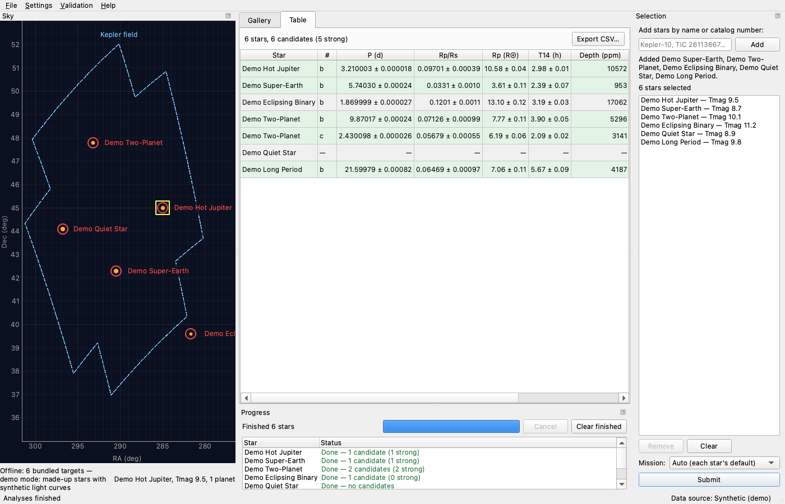

**Summary**

> Set Wing's main entry point to run_dashboard.py and wrote the README and data credits, with the acknowledgement wording checked against the MAST, Exoplanet Archive and package citation pages on 2026-10-29.
> - Main entry point is `run_dashboard.py` (project .venv). Checked that it launches headless with `--demo` and with `--targets Kepler-10 --max-sectors 5`.
> - `README.md` covers install, run (`--demo`, `--targets`, `--max-sectors`, default 20, 0 = all), the Settings ▸ Sectors / quarters menu, demo mode, how detections are graded (SDE ≥ 9 / SNR ≥ 10, red-noise-scaled SNR, strong / weak / duo-transit / none), the final validation numbers with a link to the report, the cache location and env vars, tests, and notes for macOS, Linux and Windows. Added `readme = "README.md"` back to pyproject.toml.
> - `docs/CREDITS.md` has the verbatim TESS and Kepler MAST acknowledgements, the mission DOIs with their landing-page titles, the TIC reference, the Exoplanet Archive acknowledgement plus Christiansen et al. 2025 and the table DOIs, the Lightkurve / Astropy / astroquery citations, and the method references.
> - Code changes: `_MAST_CREDIT` is replaced by a public `MAST_CREDITS` dict holding each mission's official text (the TESS and Kepler wording differ). DOI lines are now `title: https://doi.org/...` with the sectors or quarters used, as MAST asks. Added `archive.ARCHIVE_REFERENCES`, and `credits_dialog.TIC_CREDIT` and `SOFTWARE_CREDITS` now use the citation pages' wording. Tests were updated for the new wording.
> - Added the `final` shot to tools/take_shots.py and took docs/shots/08-final.png (all six demo stars, Table tab).

### T46 validation-report-archive-dois

- **Origin:** Filed by the Tasks Manager from the plan of T11 entry-point-readme-credits
- **Goal:** Exoplanet transit dashboard
- **Ran:** 2026-10-29 20:06 to 2026-10-29 20:07 (0m 57s)
- **Outcome:** done; committed [`c1181196184d`](https://github.com/wingware-dev/transitory/commit/c1181196184d70056bdef98a3da52fee01153b4f)
- **Usage:** 2,620 input, 4,817 output, 1.55M cache read, 14k cache write (claude-haiku-5-5, claude-opus-5-5)

**Prompt**

> Put the archive paper and table DOIs in the validation report
>
> The validation report (transitory/validation/report.py) credits only `archive.ARCHIVE_CREDIT`. Also list `archive.ARCHIVE_REFERENCES` (Christiansen et al. 2025, the pscomppars DOI 10.26133/NEA13 and the KOI cumulative DOI 10.26133/NEA4), as the NASA Exoplanet Archive's acknowledgement page asks. Add a test assertion in tests/test_validation.py. Don't rerun the live validation: regenerate only the credits section of docs/validation/validation.md, or patch it by hand to match what report.py now generates. (From T11 entry-point-readme-credits (ba8dc281).)
>
> See <project>/.TASKS/notes/put-the-archive-paper-and-table-dois-in-the-validation-re.md

**Judgement calls**

1. **Left the committed report's MAST and Lightkurve credit lines in their old wording**
   Those lines are the per-star credits recorded by the live run, before T11 changed the wording. Today's code would add each star's sector numbers, which the committed report and results.json don't record, so I can't regenerate them faithfully without rerunning, which the task rules out.
   Alternatives: Rewrite them by hand to the new wording without sector ranges; Rebuild the sector lists from the local download cache

**Summary**

> The validation report's Data credits now list the Exoplanet Archive paper (Christiansen et al. 2025) and the pscomppars and KOI cumulative table DOIs (`archive.ARCHIVE_REFERENCES`) after the archive acknowledgement, whenever archive values were used.
> - Added a test in tests/test_validation.py; the demo-run test still confirms a synthetic report has no archive credits.
> - Added the three lines by hand to the credits section of docs/validation/validation.md, without rerunning the live validation.

### T47 star-credits-archive-tic

- **Origin:** Filed by the Tasks Manager from the plan of T11 entry-point-readme-credits
- **Goal:** Exoplanet transit dashboard
- **Ran:** 2026-10-29 20:06 to 2026-10-29 20:10 (3m 15s)
- **Outcome:** done; committed [`524dd87c579b`](https://github.com/wingware-dev/transitory/commit/524dd87c579b5ea8de200f6d15c551b59eb426f4)
- **Usage:** 1,801 input, 21k output, 2.39M cache read, 80k cache write (claude-haiku-5-5, claude-opus-5-5)

**Prompt**

> Add the archive and TIC credits to each star's session credits
>
> The per-star credits and plot footers list MAST, the mission DOIs and Lightkurve. When a star's analysis used published planets from the NASA Exoplanet Archive or TESS Input Catalog stellar parameters, also add `archive.ARCHIVE_CREDIT` and `credits_dialog.TIC_CREDIT`, as T11 entry-point-readme-credits (ba8dc281) set them up. Find where the session credits are built: fetch.mission_credits and the pipeline run or GUI code that collects them. Add tests for both cases. If a constant has to move to avoid a GUI import from the pipeline, move it.

**Judgement calls**

1. **Carry catalog credits on StarTarget rather than inferring them in analyze_star** (report 1)
   The pipeline cannot tell where a target's stellar parameters came from; only the code that builds the target knows (TIC lookup, archive host table, bundled file). A list on the target travels with it through the GUI and validation without the pipeline importing catalog or GUI code.
   Alternatives: A provenance enum ("tic"/"archive") on StarTarget mapped to credits in the pipeline; Have the GUI add the credits after analysis
2. **TIC credit only when the TIC row has stellar parameters** (report 1)
   The credit's wording is "Stellar parameters from the TESS Input Catalog"; a TIC star without radius/Teff/logg/mass gave only an identifier and position.
   Alternatives: Credit the TIC for every TIC-resolved star
3. **Archive host stars from the sky view always carry the archive credit** (report 1)
   The star, its planets and its stellar parameters (pscomppars st_rad/st_teff/...) all come from the archive.
   Alternatives: Credit the archive only when the host row has stellar parameters
4. **Made a one-line change to the archive-credit line in validation/report.py that another task has also edited** (report 1)
   With the archive credit now in each star's credits, the report would have listed it twice. I kept the other task's ARCHIVE_REFERENCES addition and only skip lines already listed.
   Alternatives: Leave the duplicate in the report

**Summary**

> Committed as 524dd87: each star's credits and plot footers now add the TESS Input Catalog and NASA Exoplanet Archive credits when its target used their data, with TIC_CREDIT moved from the GUI to catalog/tic.py.

### T49 republish-validation-credits

- **Origin:** Filed by the Tasks Manager from the plan of T46 validation-report-archive-dois
- **Goal:** Exoplanet transit dashboard
- **Ran:** 2026-10-29 20:10 to 2026-10-29 20:48 (37m 38s)
- **Outcome:** done; committed [`6b9bed987851`](https://github.com/wingware-dev/transitory/commit/6b9bed9878510ccc1d3920161972ae6598f55e6c)
- **Usage:** 72 input, 9,935 output, 1.51M cache read, 55k cache write (claude-opus-5-5)

**Prompt**

> Republish the validation report with the current data credits
>
> After T47 star-credits-archive-tic (867f710e) is committed. docs/validation/validation.md still has the old per-star MAST credit lines: the shared template that gave TESS the wrong funding source, the `doi:` form instead of https://doi.org links with sector ranges, and the old Lightkurve line. T47 also adds archive and TIC credits per star. Saved results don't record sectors, so rerun `python -m transitory.validation --publish` with all sectors (about 34–47 min from cache; free public MAST and Exoplanet Archive data, as the original request asks). Retake docs/shots/07-validation.png with `python tools/take_shots.py validation`.
>
> Check that the credits section matches docs/CREDITS.md, and that the results match T45 final-live-validation (dee7b332): 11/11 recovered, 1 spurious on null stars (KIC 8006161), 0 on hosts, 4 duo-transits, median |ΔRp/Rs| 3.4%. Report any change in the results. Don't tune the pipeline.
>
> Before the run, also run tests/test_gui_e2e.py, test_fetch.py, test_validation.py, test_run.py, test_plots.py and test_gui_gallery.py in one test_run, as the regression sweep for the credits work in T11, T46 and T47. File failures with report_finding (next_step fix) instead of fixing them here. Wait on the run with a Monitor until-loop rather than ending your turn.
>
> [Tasks Manager, 2026-10-29 20:09] Manager (from T47 star-credits-archive-tic (867f710e)): StarTarget and SkyStar now carry a `credits` list. The TIC credit (moved to catalog/tic.py) is added only when the TIC gave stellar parameters, and the archive credit for archive hosts. analyze_star appends them after the mission credits, and report.py drops duplicate lines. Add tests/test_catalog_resolve.py, test_catalog_sky.py and test_gui_table.py to the sweep. In the republished report, check that each star's credits list TIC and archive once each, after the mission lines.

**Judgement calls**

1. **Corrected the TIC_CREDIT code pointer in docs/CREDITS.md**
   T47 moved the constant to transitory.catalog.tic; the doc's 'In code:' line was stale, and checking CREDITS.md against the report was part of this task.
   Alternatives: File it as a finding instead
2. **Published the report as generated, despite the unlabelled merged credits list**
   The task is a republish without pipeline changes. The grouping problem in report.py is filed as T50 group-validation-report-credits (7876c9ed), which includes another republish.
   Alternatives: Fix report.py's credits grouping here before publishing

**Findings filed**

- T50 group-validation-report-credits: Validation report's Data credits list is an unlabelled, out-of-order merge of every star's credits

**Screenshots**

**Summary**

> Republished the live validation report with the current data credits and retook its screenshot. The results are unchanged from T45:
> - Ran `python -m transitory.validation --publish` with all sectors (34 min from cache). It updated docs/validation/validation.md, results.json and figures/. 11/11 recovered, 1 spurious on null stars (KIC 8006161), 0 on hosts, 4 duo-transits, median |ΔRp/Rs| 3.4%. Only the run timestamp and per-star timings changed.
> - The credits now use the MAST mission wording (correct TESS funding source), https://doi.org links with sector/quarter ranges, the current Lightkurve line, and the TIC and Exoplanet Archive credits. The wording matches docs/CREDITS.md. Each star's figure lists TIC and archive once each, after the mission lines (checked on TOI-270 b and KIC 8006161 b).
> - Retook docs/shots/07-validation.png.
> - Fixed docs/CREDITS.md, which still said TIC_CREDIT lives in gui.credits_dialog; T47 moved it to catalog/tic.py.
> - Regression sweep (e2e, fetch, validation, run, plots, gallery, catalog_resolve, catalog_sky, gui_table): 190/190 passed.

### T50 group-validation-report-credits

- **Origin:** Found by T49 republish-validation-credits
- **Goal:** Exoplanet transit dashboard
- **Ran:** 2026-10-29 20:48 to 2026-10-29 20:55 (6m 52s)
- **Outcome:** done; committed [`e76138da8ec8`](https://github.com/wingware-dev/transitory/commit/e76138da8ec84f7ae7a7243435ab8a4cad7f9d64)
- **Usage:** 2,300 input, 32k output, 4.83M cache read, 68k cache write (claude-haiku-5-5, claude-opus-5-5)

**Prompt**

> Validation report's Data credits list is an unlabelled, out-of-order merge of every star's credits
>
> report.py builds "## Data credits" by concatenating each star's analysis.credits and dropping exact-duplicate lines. With per-star sector ranges (T11/T47), the published docs/validation/validation.md now shows:
> - Five "TESS Light Curves - All Sectors" lines and three "Kepler LC, Q0-Q17" lines, each with a different sector/quarter range and no star name, so a reader can't tell which range belongs to which star.
> - The TIC and Exoplanet Archive acknowledgements land in the middle of the list, after Kepler-10's lines and before the TESS mission acknowledgement, because the first star contributes them.
> docs/CREDITS.md says "For a paper covering several stars, combine their sector ranges", which the report doesn't do. Suggested fix: group the section into mission acknowledgements, one DOI line per product with the union of sectors/quarters (or a per-star sub-list labelled by star), then Lightkurve, TIC and archive lines with the archive references. Add a test in tests/test_validation.py, then rerun `python -m transitory.validation --publish` and retake docs/shots/07-validation.png.
>
> Evidence: transitory/validation/report.py:463-470 (credits merge); docs/validation/validation.md "## Data credits" section after the T49 republish; docs/CREDITS.md "TESS and Kepler data (MAST)" section, last paragraph.
>
> Suggested next step: fix
>
> [Tasks Manager, 2026-10-29 20:47] Manager: runs after T49 republish-validation-credits (2821dc73) is committed. Avoid another 45-minute live run if you can: if the saved results (docs/validation/results.json) or the cache hold enough to rebuild the report, regenerate it without fetching, adding that ability to transitory.validation if it's small. Otherwise rerun `--publish`.
>
> [Tasks Manager, 2026-10-29 20:48] Manager (from T49 republish-validation-credits (2821dc73)): saved results don't keep each star's credit list, so a rebuild without fetching may need results.json to record credits or sectors per star. If you add that, the live rerun you then need also fills it in for later rebuilds.

**Judgement calls**

1. **Rebuilt the credits from saved results and the cache instead of a 45-minute live run**
   The Manager asked to avoid the live run if possible. Only the Data credits section and the new results.json fields changed; the backfilled per-star lines match the T49 run's lines (same sectors), apart from the corrected SPOC/TESS-SPOC split.
   Alternatives: Rerun `--publish` live (~45 min)
2. **Combined DOI line plus a per-star sub-list**
   CREDITS.md asks for combined ranges, and the per-star lines keep each star's sectors traceable.
   Alternatives: Combined line only; Per-star sub-lists only
3. **Fixed the per-DOI sector bug here (fetch.py, models.py, clean.py)**
   TIC 31410749's SPOC and TESS-SPOC DOIs each listed all 13 sectors, though SPOC covers 5 and TESS-SPOC 8. The credits being republished would have been wrong, and the fix is small. The dashboard's per-star credits use the same function.
   Alternatives: File it separately and republish wrong ranges
4. **Left docs/shots/07-validation.png unchanged**
   Retaken as asked, it came out byte-identical because the shot shows only the report's top. The credits section isn't visible in the dialog anyway: filed as T51.

**Findings filed**

- T51 report-dialog-hides-trailing-sections: Validation report dialog doesn't show the References and Data credits sections after the folded light-curve figures

**Summary**

> Grouped the validation report's data credits by mission and data product, and republished them without a new live run:
> - report.py: the Data credits section now lists the mission acknowledgements first. Then comes one line per DOI with the combined sectors/quarters, each star's ranges listed under it. Lightkurve, TIC and the Exoplanet Archive credit and references follow, each once.
> - results.json now records each star's credits and per-DOI sectors. New `python -m transitory.validation --rebuild-credits [--publish]` rewrites only the credits section from it, reading the light-curve cache for older reports. It republished docs/validation in 6 s.
> - Fixed the credited sectors for stars with both SPOC and TESS-SPOC data. Each DOI listed every sector; now each lists its own (new LightCurve.doi_sectors). In the published report this only changes TIC 31410749.
> - Tests in test_validation.py and test_fetch.py; README and CREDITS.md note the new option and the grouping.

### T51 report-dialog-hides-trailing-sections

- **Origin:** Found by T50 group-validation-report-credits
- **Goal:** Exoplanet transit dashboard
- **Ran:** 2026-10-29 20:55 to 2026-10-29 21:00 (3m 54s)
- **Outcome:** done; committed [`2337b29b2457`](https://github.com/wingware-dev/transitory/commit/2337b29b2457edcb770cc3dc433f85e556f2ab6f)
- **Usage:** 2,444 input, 14k output, 1.44M cache read, 54k cache write (claude-haiku-5-5, claude-opus-5-5)

**Prompt**

> Validation report dialog doesn't show the References and Data credits sections after the folded light-curve figures
>
> Validation ▸ Show validation report (transitory/validation/gui.py ReportDialog) renders docs/validation/validation.md in a QTextBrowser. When scrolled to the end, the view shows the last folded light-curve figure (KIC 6106415 d) and then blank space. The "References for published values" and "Data credits" sections never appear, though they are in the document's text. In the document layout, every block after the figures has height 0 (blockBoundingRect tops 6 px apart, e.g. References at y=19212, Data credits at y=19266, document height 19408). So the credits MAST and the archive ask for, and the published-value references, are invisible in the dashboard's view of the report. This was found offscreen (QT_QPA_PLATFORM=offscreen), so first confirm on a real display. Likely suspects: fit_images rewriting image formats after layout, or QTextDocument's lazy layout around large images. Fix it, then add a test that the credits block has non-zero height and becomes visible when scrolled to.
>
> Evidence: Offscreen script: ReportDialog(DOCS_DIR / REPORT_NAME), resize(1100, 900), show, process events for 2 s; then doc.documentLayout().blockBoundingRect(...) for the blocks before "Data credits" gives height 0.0 at tops 19242, 19248, 19254, 19260. A grab after scrolling to the end shows only the last figure. The markdown file itself has both sections (docs/validation/validation.md, end of file).
>
> Suggested next step: research
>
> [Tasks Manager, 2026-10-29 20:55] Manager: work and verify offscreen (QT_QPA_PLATFORM=offscreen) and don't open windows on the user's screen. Treat the offscreen layout result as real unless you find evidence that it's specific to offscreen. Diagnose with the debugger and the layout values, then fix it in transitory/validation/gui.py. Add the test in a GUI test file, not tests/test_validation.py. Retake docs/shots/07-validation.png only if it shows the dialog and changes.
>
> [Tasks Manager, 2026-10-29 20:55] Manager: T50 group-validation-report-credits (7876c9ed) regrouped the Data credits section with per-star sub-lists and added per-DOI sector ranges. After your fix, run one test_run over your new test plus tests/test_gui_gallery.py, test_plots.py and test_gui_e2e.py, which show the new credit lines. File failures outside your change with report_finding.

**Judgement calls**

1. **Treated the offscreen result as real and didn't confirm on a display**
   The Tasks Manager said not to open windows and to treat offscreen as real unless evidence showed otherwise. Lines are missing from the document's own layout, which doesn't depend on the platform plugin.
2. **Test uses the committed docs/validation/validation.md**
   The bug needs many large figures before the trailing sections, and the committed report has them. Building a synthetic report that big would duplicate the report writer.
   Alternatives: Generate a synthetic report with large PNGs in tmp_path
3. **Retook 07-validation.png for a scroll-bar-only change**
   The Manager said to retake it if it changes. The thumb is 48 pixels smaller because the document is now taller; the content is the same.

**Screenshots**

**Summary**

> The validation report dialog now shows the References and Data credits sections after the folded light-curve figures.
> - Cause: `ReportDialog.fit_images` resized each figure with its own `setCharFormat` edit. Each edit started a separate relayout, and the blocks after the figures were never laid out (no lines, 0 height). The same happened to blocks after some tables, such as the "Missed planets" and "Other detections" headings.
> - Fix: `fit_images` now makes all its format changes in one edit block. Offscreen, all 481 blocks now lay out and the document height is 20162 (it was 19408). Scrolled to the end, both sections are visible.
> - New test `tests/test_gui_validation.py`: checks that every block has lines, that the credits and references headings have height, and that the credits heading is in view when scrolled to the end. Run with the old `fit_images`, it fails (times out).
> - Retook `docs/shots/07-validation.png`: only the scroll-bar thumb changed, because the document is now taller.

### T52 mouse-stars-details-section

- **Origin:** Written by the user
- **Goal:** Ungrouped Tasks
- **Ran:**  to 2026-10-30 10:28 ()
- **Outcome:** obsolete
- **Usage:** 0 input, 0 output, 0 cache read, 0 cache write (model not recorded)

**Prompt**

> When I mouse over stars, the details section at bottom expands and collapses, which also shifts the stars, making it impossible to actually hover/select specific stars.  Also can't scroll or zoom on the sky and in general that view seems to need improvement.  There are some suggested draft tasks that might be part of that.

### T53 sky-hover-details-jitter

- **Origin:** Filed by the Tasks Manager, at the user's request
- **Goal:** Exoplanet transit dashboard
- **Ran:** 2026-10-30 10:28 to 2026-10-30 10:31 (3m 06s)
- **Outcome:** done; committed [`0085f291053b`](https://github.com/wingware-dev/transitory/commit/0085f291053b16437bc0ec2ac584778362358a73)
- **Usage:** 68 input, 13k output, 1.39M cache read, 62k cache write (claude-opus-5-5)

**Prompt**

> Hovering stars makes the details section jump and shifts the stars
>
> User: "When I mouse over stars, the details section at bottom expands and collapses, which also shifts the stars, making it impossible to actually hover/select specific stars."
>
> The sky view is transitory/gui/sky_view.py, and the selection and details panel is transitory/gui/selection_panel.py, laid out in transitory/gui/main_window.py. Keep the details area's size fixed whatever is hovered, for example with a fixed or minimum height, or by eliding text, so the sky plot never moves. Reproduce it with the offscreen harness (tests/sky_selection_host.py, tests/dashboard_host.py) by sending hover events over several stars and checking the plot's geometry stays the same, and add that as a test. Don't open windows on the user's screen.
>
> See <project>/.TASKS/notes/hovering-stars-makes-the-details-section-jump-and-shifts.md

**Judgement calls**

1. **Status and hover text on separate single lines, elided, instead of side by side**
   In the 420 px dock the two can't share a line, and wrapping is what made the height change. Eliding keeps the footer at a fixed two lines whatever the text. The status line, which used to wrap, is now cut off at narrow widths (e.g. the demo-mode note); its full text is in the tooltip.
   Alternatives: Keep the status word-wrapped on its own line (it could still change height when a field load changes the status); One row with fixed-width shares for each label
2. **Hover text is left-aligned on its own line (was right-aligned beside the status)**
   It has the full width to itself now; the left edge keeps the RA/Dec in the same place.

**Summary**

> Hovering stars no longer resizes the sky view's footer or moves the plot:
> - The status and hover lines under the sky plot are now one line each, in a new `ElidedLabel` whose size never follows its text; long text is elided, with the full text as tooltip and from `text()`.
> - Before, the hover label never wrapped, so it widened the 420 px sky dock (to 495 px), and the word-wrapped status beside it re-wrapped, so the plot height swung between 805 and 670 px.
> - Added `hover_star` to tests/dashboard_host.py, which sends real mouse moves, and a test that hovers each demo star in the dashboard and checks that the plot, view box and dock geometry stay the same.

### T55 sky-view-improvements

- **Origin:** Filed by the Tasks Manager, at the user's request
- **Goal:** Exoplanet transit dashboard
- **Ran:** 2026-10-30 10:28 to 2026-10-30 11:58 (3m 30s)
- **Outcome:** done
- **Usage:** 1,876 input, 18k output, 1.10M cache read, 96k cache write (claude-haiku-5-5, claude-opus-5-5)

**Prompt**

> Plan improvements to the sky view
>
> User: "in general that view seems to need improvement. There are some suggested draft tasks that might be part of that."
>
> Research only: look at the sky view (transitory/gui/sky_view.py, selection_panel.py and their place in main_window.py) as a user would, using offscreen grabs (tools/take_shots.py, tests/sky_selection_host.py), and propose concrete improvements as separate steps. Include the related Drafts where they fit, especially T12 hips-sky-background (a HiPS survey image behind the stars), and say which other Drafts in the Found goal touch the sky view. Separate tasks already fix the hover jitter in the details section and the missing scroll and zoom, so don't plan those again, but plan around them. Report a plan whose steps can each be run and committed on their own.
>
> See <project>/.TASKS/notes/plan-improvements-to-the-sky-view.md

**Passed to the user by the Tasks Manager**

- 2026-10-30 10:32, question : Suggested: run all the steps except the optional S7 (ecliptic, galactic plane and RA wrap). S1–S5 fix what offscreen grabs show: a stretched map, RA in decimal degrees, no legend, field stars that never appear when you go to a star, and clicks that can only add. S6a/S6b is your Draft T12 (a DSS2/2MASS image behind the stars, from the free CDS hips2fits service). All steps after T54 run one at a time, since they share sky_view.py; only S6a can run alongside.

**Judgement calls**

1. **Kept plain RA/Dec (plate carrée) with an aspect lock, not a true sky projection**
   This fixes the visible stretching cheaply, keeps every coordinate API and test as it is, and lets HiPS cutouts line up through a CAR WCS. A gnomonic or Hammer projection would rewrite picking, outlines, center_on and the field loader.
   Alternatives: Gnomonic projection around the view centre for zoomed views, plus Hammer–Aitoff for the all-sky view
2. **Clicking a listed star removes it, instead of a click that only inspects plus a separate add**
   The original request says to select stars by clicking. A toggle keeps that and fixes accidental adds, and the right-click menu covers looking at a star without adding it.
   Alternatives: Click only inspects; double-click or a button adds
3. **HiPS background on by default (DSS2) when zoomed in**
   The user asked for it, and it is what makes a zoomed view readable.
   Alternatives: Off by default, with a chooser to turn it on
4. **Kept the sky as a left dock rather than moving it into the central tabs**
   This is outside what the user asked about. S1's aspect lock makes the narrow dock usable.
   Alternatives: Make Sky a central tab next to Gallery and Table
5. **Split T12 into a standalone fetch module (S6a) and a view integration step (S6b)**
   The fetch, WCS and cache code shares no files with the other steps, so it can run in parallel. Only the small integration step waits in the sky_view.py queue.
   Alternatives: Keep T12 as one step after S5

**Summary**

> Planned the sky view improvements as nine steps that can each be committed on their own, all to run after T53 sky-hover-details-jitter (3abe476f) and T54 sky-scroll-zoom (d88c75c8):
> - Correct aspect ratio and RA in hours.
> - A legend and lighter markers.
> - TIC field stars that actually show up when you go to a star.
> - Click to toggle a star, plus hover and right-click.
> - Showing a star on the sky.
> - Draft T12 hips-sky-background (dabe4957), split into a fetch module and a view step.
> - Optional ecliptic and galactic lines.
> - A final screenshot refresh.

### T54 sky-scroll-zoom

- **Origin:** Filed by the Tasks Manager, at the user's request
- **Goal:** Exoplanet transit dashboard
- **Ran:** 2026-10-30 10:32 to 2026-10-30 10:37 (4m 41s)
- **Outcome:** done; committed [`b4cc5a9509c2`](https://github.com/wingware-dev/transitory/commit/b4cc5a9509c254bf05b3cab9da081388d593d28d)
- **Usage:** 62 input, 27k output, 2.52M cache read, 43k cache write (claude-opus-5-5)

**Prompt**

> Can't scroll or zoom the sky view
>
> User: "Also can't scroll or zoom on the sky".
>
> The sky view (transitory/gui/sky_view.py, pyqtgraph) should zoom with the mouse wheel or trackpad and pan by dragging, as the original request asked ("a sky view with zoom and clicking"). Find out why it doesn't: mouse interaction disabled on the ViewBox, locked ranges, or click handling eating drags. Fix it so that clicking a star still selects it, and that a reset-view control or shortcut exists. Test offscreen with tests/sky_selection_host.py by sending wheel and drag events and checking the view range changes and a click still selects. Don't open windows on the user's screen. Runs after the hover-details fix, in the same files.
>
> [Tasks Manager, 2026-10-30 10:31] Manager (from T53 sky-hover-details-jitter (3abe476f)): the status and hover lines under the sky plot are now single elided lines (ElidedLabel), so the status gets cut off in the narrow dock, for example the demo-mode note. While you're in sky_view.py, give the status line a fixed height of two lines, word-wrapped and elided after the second line, so it stays readable and its height never changes. Extend T53's hover test so it also checks that the plot doesn't move when the status changes.
>
> See <project>/.TASKS/notes/can-t-scroll-or-zoom-the-sky-view.md

**Judgement calls**

1. **On a trackpad, two-finger scroll pans and pinch zooms; the mouse wheel still zooms**
   The user said they couldn't scroll or zoom. On a Mac trackpad, pinch did nothing and scrolling zoomed. Panning on scroll and zooming on pinch is how map views behave on a trackpad. Trackpad scrolls are told apart from mouse wheels by their scroll phase and pixel delta.
   Alternatives: Keep pyqtgraph's scroll-to-zoom and only add pinch; A setting to choose
2. **Reset view returns to a configurable home (all sky, or the demo's Kepler field)**
   In demo mode the starting view is the Kepler field, because all-sky the demo stars' labels overlap; resetting to all sky there would be unhelpful.
   Alternatives: Always reset to all sky
3. **Reset view is a small button at the right of the status line, plus the Home key**
   The view's right-click menu is disabled, and a visible button is easy to find. It sits beside the two-line status, so the footer's height stays fixed.
4. **Didn't update the docs/shots screenshots**
   02-sky-selection.png is a snapshot of an earlier step in the run's trace and is taken from the live archive; rewriting it or adding a new numbered shot seemed outside this task.
   Alternatives: Regenerate 02-sky-selection.png; Add a new shot of the sky footer

**Summary**

> The sky view now pans and zooms with a trackpad, has a Reset view button and Home key, and its status line has a fixed height of two lines:
> - Offscreen, the mouse wheel already zoomed and dragging already panned; nothing disabled or locked the view. What a MacBook trackpad sends was not handled: pinch arrives as a native gesture that pyqtgraph ignores, and two-finger scrolling zoomed instead of panning. The hover jitter fixed in T53 also resized the plot under every mouse move, which would have disrupted drags and wheel zooms.
> - A new `TrackpadNavigator` on the plot's viewport makes pinch zoom about the pointer and two-finger scroll pan. The mouse wheel, and Ctrl/Cmd + scroll, still zoom through pyqtgraph.
> - A "Reset view" button beside the status, and the Home key, return to the home view: all sky, or the region set with `set_home`. The demo dashboard uses `set_home`, so it returns to the Kepler field.
> - `ElidedLabel` takes a `lines` count; the status uses 2 lines: it wraps and is elided only after the second line. Its height never changes.
> - Tests: real wheel, drag, trackpad-scroll, pinch, Ctrl+scroll and click events in the sky/selection host. They check that the view range changes, a drag selects nothing, and a click afterwards still adds the star. They also test the Reset view button and Home key. The T53 hover test now also changes the status and checks that the plot doesn't move.

### T12 hips-sky-background

- **Origin:** Filed by the Tasks Manager from the plan of T1 python-tool-gives-dashboard
- **Goal:** Found
- **Ran:**  to 2026-10-30 10:33 ()
- **Outcome:** obsolete
- **Usage:** 0 input, 0 output, 0 cache read, 0 cache write (model not recorded)

**Prompt**

> Later idea: HiPS sky background images
>
> Shows DSS/2MASS HiPS cutouts (CDS hips2fits) behind the star plot when zoomed in, cached in cache/. Owns `gui/sky_background.py`; shared `gui/sky_view.py`.

### T61 hips-cutout-fetch

- **Origin:** Filed by the Tasks Manager from the plan of T55 sky-view-improvements, at the user's request
- **Goal:** Exoplanet transit dashboard
- **Ran:** 2026-10-30 10:34 to 2026-10-30 10:44 (10m 18s)
- **Outcome:** done; committed [`2f6aa1d1ded9`](https://github.com/wingware-dev/transitory/commit/2f6aa1d1ded905d8587ab4118167f2633ab0af3e)
- **Usage:** 2,118 input, 28k output, 1.15M cache read, 93k cache write (claude-haiku-5-5, claude-opus-5-5)

**Prompt**

> Fetch and cache HiPS sky cutouts (T12, part 1)
>
> Step S6a of T55 sky-view-improvements' plan (.TASKS/notes/plan-improvements-to-the-sky-view.md). Owns only new files, so it can run alongside the other steps. `CatalogClient` / `requests_transport` (catalog/client.py) return text only, so the image bytes need their own small fetch and cache.
> - **New module `transitory/catalog/hips.py`:**
>   - a function `view_wcs(ra_range, dec_range, width_px, height_px)` that builds a CAR WCS (CRVAL2 = 0, CRPIX offset) whose pixels follow plain RA/Dec plot coordinates, so no reprojection is needed
>   - `fetch_cutout(survey, wcs)`, which calls CDS hips2fits (`alasky.cds.unistra.fr/hips-image-services/hips2fits`) with `wcs=` and `format=jpg`, using the same timeout and retry policy as `requests_transport`
>   - a binary cache under `config.cache_dir()/hips`
>   - a SURVEYS table: DSS2 colour, 2MASS colour, PanSTARRS DR1 colour (North only)
> - **Files:** owns `catalog/hips.py` and `tests/test_hips.py`, plus a small recorded JPEG fixture in `tests/data/catalog/`. Recording it is a free public CDS request.
> - **Tests:** no network: WCS round-trips, cache hits, error handling.
> - Note the CDS hips2fits, DSS, 2MASS and PanSTARRS acknowledgement wording it finds for step S6b's credits.
>
> See <project>/.TASKS/notes/fetch-and-cache-hips-sky-cutouts-t12-part-1.md

**Judgement calls**

1. **Committed a synthetic stand-in JPEG fixture instead of a real DSS2 recording** (report 1)
   Every request to alasky.cds.unistra.fr (and alaskybis) timed out from this machine, even outside the sandbox, while MAST answered. The tests only need a valid JPEG of a known size. Running `tests/data/catalog/record_hips.py` with no flag replaces it with a real 64x32 DSS2 cutout around Kepler-10, and `--stand-in` makes the synthetic one again.
   Alternatives: Block the task until CDS is reachable; Ship no fixture
2. **fetch_cutout returns raw JPEG bytes, not a decoded image** (report 1)
   This keeps catalog/ free of Qt. S6b can decode the bytes with QImage.fromData and place the image over the RA/Dec rectangle it asked for.
   Alternatives: Return a numpy array via Pillow; Return a dataclass with the bytes and the retrieval date
3. **Copied the retry loop into hips.py rather than refactoring requests_transport** (report 1)
   The task owns only new files, and client.py may be touched by other tasks. hips.py reads the timeout, backoff and transient-status constants from client.py at call time, so the two transports stay in step. A later cleanup could merge the two loops.
   Alternatives: Factor a shared _send_with_retry helper into client.py
4. **Cache entries never expire** (report 1)
   Survey images don't change. The cache key hashes the hips2fits URL, the survey ID and the full WCS header.
   Alternatives: Expire entries after N days like ARCHIVE_MAX_AGE

**Summary**

> Added `transitory/catalog/hips.py`, which fetches HiPS sky cutouts from CDS hips2fits and caches them, for S6b's sky background:
> - `view_wcs()` builds a CAR WCS (CRVAL2 = 0, offset CRPIX2, RA increasing to the left) whose pixels follow plain RA/Dec plot coordinates.
> - `fetch_cutout(survey, wcs)` asks hips2fits for `format=jpg` through `requests_bytes_transport`, which copies `requests_transport`'s timeout and retry-once policy. It checks the reply is a JPEG and caches it under `cache_dir()/hips`. It also has an `offline` mode like `CatalogClient`.
> - `SURVEYS` covers DSS2, 2MASS and PanSTARRS DR1 colour; PanSTARRS only reaches Dec > -30°.
> - New `tests/test_hips.py` (27 tests, no network) covers WCS round trips and linearity, cache hits, and transport and service errors. The fixture `tests/data/catalog/hips_cutout.jpg` is a synthetic stand-in for now, because CDS could not be reached from this machine. `record_hips.py` records a real one.

### T56 sky-aspect-and-hours

- **Origin:** Filed by the Tasks Manager from the plan of T55 sky-view-improvements, at the user's request
- **Goal:** Exoplanet transit dashboard
- **Ran:** 2026-10-30 10:38 to 2026-10-30 10:45 (6m 02s)
- **Outcome:** done; committed [`89a5bfde4545`](https://github.com/wingware-dev/transitory/commit/89a5bfde4545923fc9baf791cddebc05762f80a3)
- **Usage:** 1,835 input, 34k output, 4.30M cache read, 55k cache write (claude-haiku-5-5, claude-opus-5-5)

**Prompt**

> Sky view: correct aspect ratio and RA in hours
>
> Step S1 of T55 sky-view-improvements' plan (.TASKS/notes/plan-improvements-to-the-sky-view.md). Runs after T54 sky-scroll-zoom.
> - **Aspect:** lock the plot's x/y pixel scale to 1/cos(Dec at the view centre), and update the lock as the view pans. Circles then look round and the Kepler field keeps its shape at any dock width. `center_on` and `view_region` keep their meaning.
> - **Axes and readout:** label the RA axis in hours (h m, adding seconds when zoomed in) and Dec in d m, through a custom `pg.AxisItem`. Show the coordinates readout in sexagesimal, with decimal degrees as well.
> - **Files:** owns the new `gui/sky_axes.py` (the axis class and pure formatting functions, unit-tested). Shares `gui/sky_view.py`.
> - **Tests:** add to `tests/test_gui_sky.py`: the formatting functions, and an offscreen check that a CVZ circle's on-screen width and height match.
> Work offscreen; don't open windows on the user's screen.
>
> See <project>/.TASKS/notes/sky-view-correct-aspect-ratio-and-ra-in-hours.md

**Judgement calls**

1. **center_on's size_deg now fits a square in the shorter side, not the visible height** (report 1)
   With the aspect locked, the height and width can't both be set. Fitting the square keeps what was asked for in view at any widget shape. In the tall, narrow dashboard dock, setting the height would cut off the sides: the Kepler field start view would be only 10° wide. The demo now starts 18° wide by 36° tall.
   Alternatives: Keep size_deg as the visible height
2. **All-sky shows pole to pole and only part of the RA in narrow widgets** (report 1)
   A true-aspect sky is 2:1, so it can't fit all of RA in a tall, narrow dock without distortion. Panning reaches the rest.
   Alternatives: Relax the aspect lock when fully zoomed out
3. **The hover readout takes two fixed lines: position, then the star** (report 1)
   The sexagesimal readout with decimal degrees is about 55 characters, which would have elided the star's name in the 420 px dock. The footer is one line taller, still fixed in height (T53's test still passes).
   Alternatives: One line, with the star elided; Drop the decimal degrees
4. **Panning re-locks the aspect while keeping the Dec range** (report 1)
   pyqtgraph's own re-lock picks an axis to stretch, so the Dec zoom drifted as you panned in Dec.

**Summary**

> The sky view now draws the sky at its true aspect and labels RA in hours and Dec in degrees, sexagesimal:
> - **Aspect:** the plot's x/y pixel scale is locked to cos(Dec) at the view's centre, floored at 0.05. The lock follows the view as it pans, keeping the Dec range so panning never zooms; only the RA width changes. Circles and the Kepler field keep their shape at any dock width.
> - **`center_on(ra, dec, size)`** now fits a `size`-degree square (true degrees) in the view's shorter side. `view_region` is unchanged. `show_all_sky` shows pole to pole and as much RA as the widget's shape allows.
> - **Axes:** new `gui/sky_axes.py` has pure `format_ra` / `format_dec` / `tick_steps` functions and the `RaAxis` / `DecAxis` axis classes. Ticks fall on whole hours, minutes or seconds of time (or whole degrees, arcminutes or arcseconds of Dec), labelled only as precisely as the step needs.
> - **Readout:** the hover readout shows `RA 19h02m43.0s  Dec +50°14′29″  (285.679°, +50.241°)` on one line and the hovered star on a second, fixed line. `ElidedLabel` now honours explicit line breaks.
> - **Tests:** formatting, tick steps, axis labels, a CVZ circle measured round on screen in wide and tall widgets, the lock following a pan, and `center_on` fitting. Existing tests changed where the true aspect changes what they assert: the hover readout, the demo start view, the all-sky reset, and a field-reload test whose 1° view is now really 1.7° wide.

### T57 sky-legend-and-markers

- **Origin:** Filed by the Tasks Manager from the plan of T55 sky-view-improvements, at the user's request
- **Goal:** Exoplanet transit dashboard
- **Ran:** 2026-10-30 10:45 to 2026-10-30 10:52 (6m 08s)
- **Outcome:** done; committed [`88a8fb285ee6`](https://github.com/wingware-dev/transitory/commit/88a8fb285ee66b2999cd10846fae6e58c1140324)
- **Usage:** 2,161 input, 28k output, 2.92M cache read, 94k cache write (claude-haiku-5-5, claude-opus-5-5)

**Prompt**

> Sky view: legend, lighter markers, tidier labels
>
> Step S2 of T55 sky-view-improvements' plan (.TASKS/notes/plan-improvements-to-the-sky-view.md). Runs after S1 sky-aspect-and-hours.
> - **Legend:** add a small overlay legend in a corner of the plot, covering host (orange), no known planets (blue), TIC field star (grey), in list (red ring), last clicked (yellow square), and "size = brightness (Tmag)".
> - **Markers:** scale marker sizes with zoom (smaller when all-sky). Make host markers slightly translucent so the Kepler field shows its CCD module pattern instead of a solid blob.
> - **Outline labels:** place them outside their outlines and give them a lower z than the selection labels, so "Kepler field" no longer hides a selected star's name.
> - **Files:** `gui/sky_view.py`.
> - **Tests:** a test that the legend lists every marker kind, plus an offscreen grab check.
>
> [Tasks Manager, 2026-10-30 10:45] Manager (from T53, T54 and T56): earlier sky-view work you build on.
> - **T53:** the footer uses ElidedLabel and is a fixed height.
> - **T54:** TrackpadNavigator, Reset view and the Home key, with click-versus-drag handling.
> - **T56:** the true-aspect lock (x/y scale = cos(Dec) at the view centre, re-locked on pan), RA/Dec axes in gui/sky_axes.py, and center_on fitting a square in the view's shorter side.
> Size the markers by the true degrees per pixel. Put the legend where it doesn't cover the Reset view button or the axes.

**Judgement calls**

1. **Legend in the plot's top-right corner, always shown**
   Inside the view box it covers neither axis nor the footer's Reset view button. All-sky, that corner (RA 0–3h, Dec +60–90) has few hosts. In a 420 px dock it covers about a third of the top band.
   Alternatives: A toggle button to hide it; Bottom-right corner; Put it outside the plot in the footer
2. **Kepler label below its field, CVZ labels above their circles**
   Grabs showed east-side labels clipped at the all-sky view's left edge. A label below the southern CVZ landed on pi Men's ring. Kepler-10 sits near the top of the Kepler field.
   Alternatives: Label beside each outline's east edge; Label on each CVZ's poleward side
3. **Only orange host markers are translucent; blue no-planet stars stay opaque**
   The task asked for translucent host markers. The blue stars are few and are validation targets worth keeping vivid.
   Alternatives: Make both host-catalog kinds translucent
4. **Rings and the last-clicked square keep a fixed size**
   They are highlights, so they should stay easy to see when zoomed out. Only star markers scale.
   Alternatives: Scale them with the markers

**Summary**

> The sky view now has a legend, lighter markers that scale with zoom, and outline labels that keep out of the way of the list's star names.
> - **Legend:** a fixed, non-draggable legend sits in the plot's top-right corner, inside the axes and clear of the Reset view button. It covers planet host, no known planets, TIC field star, in list, last clicked, and "Size = brightness (Tmag)". Its swatches are drawn the same way as the markers, and clicks on it don't select the stars under it.
> - **Markers:** sizes now scale with the true degrees per pixel: full size up to 0.02°/px (about 10° across), down to half size all-sky, in 0.05 steps so panning doesn't resize them. Host markers are translucent (alpha 175), so the Kepler field shows its module grid all-sky instead of a solid blob.
> - **Outline labels:** "Kepler field" now sits under its outline, away from Kepler-10, and the CVZ labels sit over their circles. All three are at a lower z than the list's name labels.
> - **Tests:** added to tests/test_gui_sky.py: the legend lists every marker kind, an offscreen grab check that the legend draws inside the plot at both widget shapes, legend clicks, the marker scale, translucency and label placement. 18 tests run (the new ones plus the click, label, field and shot tests), all passing.

### T58 sky-field-stars-on-zoom

- **Origin:** Filed by the Tasks Manager from the plan of T55 sky-view-improvements, at the user's request
- **Goal:** Exoplanet transit dashboard
- **Ran:** 2026-10-30 10:53 to 2026-10-30 10:59 (5m 29s)
- **Outcome:** done; committed [`13b02cac7696`](https://github.com/wingware-dev/transitory/commit/13b02cac7696a0a214ff9f62612661d2fe6e6ba5)
- **Usage:** 86 input, 19k output, 2.40M cache read, 73k cache write (claude-opus-5-5)

**Prompt**

> Sky view: make TIC field stars show up
>
> Step S3 of T55 sky-view-improvements' plan (.TASKS/notes/plan-improvements-to-the-sky-view.md). Runs after S2 sky-legend-and-markers.
> - **Zoom level:** make `TARGET_ZOOM_DEG` (main_window.py, and the hard-coded 3.0 in tests/sky_selection_host.py) smaller than `FIELD_ZOOM_DEG`, for example 1.5° against 2°. Going to a star then loads its field. The cone stays within `MAX_CONE_RADIUS_DEG = 1.0`.
> - **Status hints:** when zoomed out, the status line says "Zoom in below 2° to see TIC stars (Tmag ≤ 13)". While a cone loads, it shows a clear loading state.
> - **Files:** `gui/sky_view.py`, `gui/main_window.py`, `tests/sky_selection_host.py`.
> - **Tests:** a test that `_target_activated` leads to a field load, using the recorded client.
>
> [Tasks Manager, 2026-10-30 10:44] Manager (from T56 sky-aspect-and-hours (294ca7e9)): the sky view now draws at true aspect, so its width is often larger than its height. A 1.5° view in a wide widget is about 2.5° across. `_maybe_load_field` tests max(width, height) against FIELD_ZOOM_DEG, so compare against min(width, height) instead, or pick a TARGET_ZOOM_DEG small enough for the widest view. The cone radius stays capped at 1°. `center_on(ra, dec, size)` now fits a size-degree square in the view's shorter side.
>
> [Tasks Manager, 2026-10-30 10:52] Manager (from T57 sky-legend-and-markers (397cacf1)): marker sizes now scale with zoom and host markers are translucent; keep that when field stars load. Before finishing, also run tests/test_gui_sky.py and tests/test_gui_selection.py, which T57 left for later.
>
> See <project>/.TASKS/notes/sky-view-make-tic-field-stars-show-up.md

**Judgement calls**

1. **The e2e test serves the recorded Kepler-10 cone for any TIC cone request**
   recorded.json only has a 0.1° cone. Going to a star asks for a 1° cone, which the plain recorded client rejects as not recorded. Wrapping the recorded client's transport keeps the test offline without recording new MAST data.
   Alternatives: Record a 1° Kepler-10 cone from live MAST into recorded.json; Only assert that the request went out and failed
2. **The zoom hint is part of the status line from start-up, so status assertions expect it**
   The task asked for the hint whenever the view is zoomed out. That includes the all-sky start view, so three exact-match status tests now include it.
   Alternatives: Show the hint only after the first pan or zoom

**Summary**

> Going to a star now loads its TIC field stars, and the sky status line says how far to zoom in and when a field is loading.
> - `TARGET_ZOOM_DEG` is now 1.5° (was 3°), below `FIELD_ZOOM_DEG` (2°). The test host imports this constant instead of hard-coding 3.0.
> - `_maybe_load_field` now compares the view's shorter side with `FIELD_ZOOM_DEG`, so wide views still load. The cone stays capped at 1°.
> - Zoomed out, the status says "Zoom in below 2° to see TIC stars (Tmag ≤ 13)". There is no hint in demo mode, where field loading is off. While a cone loads, it says "Loading TIC stars (Tmag ≤ 13) within 1.00° from MAST…".
> - New tests: the e2e test sends a Kepler-10 targetActivated signal through a MAST-mode MainWindow using the recorded client, and a field load follows. Also new: a test for the shorter-side rule on a wide view, and one for the zoom hint. Existing status and zoom checks are updated.

### T59 sky-click-hover-menu

- **Origin:** Filed by the Tasks Manager from the plan of T55 sky-view-improvements, at the user's request
- **Goal:** Exoplanet transit dashboard
- **Ran:** 2026-10-30 10:59 to 2026-10-30 11:03 (3m 34s)
- **Outcome:** done; committed [`54583f4f33d4`](https://github.com/wingware-dev/transitory/commit/54583f4f33d4738a7cce9426b6634d98134a48eb)
- **Usage:** 52 input, 19k output, 2.61M cache read, 37k cache write (claude-opus-5-5)

**Prompt**

> Sky view: click toggles, hover highlights, right-click menu
>
> Step S4 of T55 sky-view-improvements' plan (.TASKS/notes/plan-improvements-to-the-sky-view.md). Runs after S3 sky-field-stars-on-zoom, and uses T54 sky-scroll-zoom's click-versus-drag handling.
> - **Hover:** a ring on the star nearest the cursor, drawn in the plot. This adds feedback without changing the layout, so it builds on T53 sky-hover-details-jitter's fixed details area.
> - **Click:** clicking a star already in the list removes it. This needs a new `SelectionPanel.remove_target(target)`.
> - **Right-click:** a menu with Add / Remove, Centre here, and Copy name / TIC.
> - **Files:** `gui/sky_view.py` (a new `starToggled` signal, or the existing `starClicked` plus an "is listed" check), `gui/selection_panel.py`, the wiring in `gui/main_window.py` and `tests/sky_selection_host.py`.
> - **Tests:** in `test_gui_sky.py` and `test_gui_selection.py`.

**Judgement calls**

1. **One starToggled signal; the selection panel decides add or remove**
   The panel's list is the authority on what is listed, so the sky never acts on a stale copy. The menu's Add/Remove label uses SkyView.is_listed from the last set_selected. starClicked still fires on a click, for the last-clicked marker.
   Alternatives: Separate addRequested / removeRequested signals from the sky view; The existing starClicked plus an is-listed check in the window
2. **Copy TIC ID copies "TIC 123456", not the bare number**
   The selection entry box resolves that form, so the copied text can be pasted straight back in.
   Alternatives: Copy only the digits
3. **Right-click on empty sky shows a menu with only Centre here**
   Centring on a spot is still useful there, and showing no menu at all would feel broken.
   Alternatives: No menu on empty sky
4. **The hover ring is not in the legend**
   It is transient pointer feedback, not a kind of marker.
   Alternatives: Add an 'Under the pointer' legend entry
5. **Fixed T58's demo-mode hint regression in this task**
   test_gui_e2e's hover test failed because, in demo mode, the zoom hint stayed until the debounce timer fired. The bug came from my T58 change in the same file.
   Alternatives: File it as a separate finding

**Summary**

> The sky view now rings the star under the pointer, clicking a star toggles it in the selection list, and right-click opens a star menu.
> - Hover: a white 14 px ring, drawn in the plot inside the list's red ring, so the layout never moves. It clears when the pointer leaves the plot or the star goes, such as when a field is cleared.
> - Click: a new `SkyView.starToggled` signal goes to a new `SelectionPanel.toggle_star`, which adds the star or removes it if listed ("Removed X."). This uses the new `SelectionPanel.remove_target(target)`, which matches by TIC or name. Wired in main_window.py and tests/sky_selection_host.py.
> - Right-click: Add to / Remove from the list, Centre here (keeps the zoom), Copy name and Copy TIC ID. On empty sky the menu has only Centre here.
> - Also fixed a regression from T58: in demo mode the "Zoom in below 2°" hint showed until the debounce timer fired. `field_zoom_deg` is now a property whose setter updates the hint at once.

### T60 sky-go-to-star

- **Origin:** Filed by the Tasks Manager from the plan of T55 sky-view-improvements, at the user's request
- **Goal:** Exoplanet transit dashboard
- **Ran:** 2026-10-30 11:03 to 2026-10-30 11:06 (2m 02s)
- **Outcome:** done; committed [`5ae4830f199c`](https://github.com/wingware-dev/transitory/commit/5ae4830f199cae3bd7b5d7ac30f8ee9b3b2e0e84)
- **Usage:** 2,226 input, 7,070 output, 1.58M cache read, 13k cache write (claude-haiku-5-5, claude-opus-5-5)

**Prompt**

> Sky view: show listed and typed stars on the sky
>
> Step S5 of T55 sky-view-improvements' plan (.TASKS/notes/plan-improvements-to-the-sky-view.md). Runs after S4 sky-click-hover-menu.
> - **Typed names:** when typing adds exactly one star, centre the sky on it at the target zoom.
> - **Button:** add a "Show on sky" button under the list for the selected row, so the double-click is no longer the only way.
> - **Files:** `gui/selection_panel.py`, `gui/main_window.py`, `tests/sky_selection_host.py`.
> - **Tests:** in `test_gui_selection.py`.

**Judgement calls**

1. **Reused targetActivated rather than adding a new signal**
   Double-click, the button and typing all mean the same thing, "show this star on the sky", and the window already handles that signal.
   Alternatives: A separate showOnSky signal wired in main_window.py and the host
2. **Centre when exactly one star is newly added, even if other typed names were duplicates or not found**
   The task says "when typing adds exactly one star". A single new star is unambiguous whatever else was typed.
   Alternatives: Centre only when exactly one name was typed and it resolved
3. **Show on sky is disabled with several rows selected, or for a star with no position**
   Which star to show would be unclear with several rows, and a star with no position can't be shown.
   Alternatives: Show the current (focused) row of a multi-selection
4. **Button order: Show on sky, Remove, Clear**
   The non-destructive action comes first, and the row still fits the panel's width.
   Alternatives: Show on sky after Clear

**Summary**

> The sky now centres on a typed star when typing adds exactly one, and a new "Show on sky" button under the selection list centres it on the selected row.
> - Both send the panel's existing `targetActivated` signal, which main_window.py and tests/sky_selection_host.py already connect to centring at TARGET_ZOOM_DEG. Neither of those files needed changing.
> - The button is enabled only when one row with a known position is selected.
> - New tests in test_gui_selection.py cover the button, typing one star, and typing several stars or one already listed.

### T62 hips-sky-background-2

- **Origin:** Filed by the Tasks Manager from the plan of T55 sky-view-improvements, at the user's request
- **Goal:** Exoplanet transit dashboard
- **Ran:** 2026-10-30 11:06 to 2026-10-30 11:23 (16m 35s)
- **Outcome:** done; committed [`d1c8475468a8`](https://github.com/wingware-dev/transitory/commit/d1c8475468a8def1edc2f0aace1c0bb20b9a84a6)
- **Usage:** 122 input, 52k output, 5.12M cache read, 137k cache write (claude-haiku-5-5, claude-opus-5-5)

**Prompt**

> Show the HiPS survey image behind the sky-view stars (T12, part 2)
>
> Step S6b of T55 sky-view-improvements' plan (.TASKS/notes/plan-improvements-to-the-sky-view.md). Runs after S5 sky-go-to-star and S6a hips-cutout-fetch.
> - **Image:** a new `gui/sky_background.py` holding an `ImageItem` at z = −1. It loads through `JobRunner`, debounced like the field loader, when the view is narrower than about 10°. It drops stale replies, as `_field_done` does.
> - **Controls:** a Background chooser (Off / DSS2 / 2MASS / PanSTARRS) in the sky footer or toolbar, on with DSS2 by default.
> - **Readability:** stars keep their contrast over the image (outlined markers).
> - **Credits:** add the CDS hips2fits, DSS and 2MASS acknowledgements to `general_credits()` in `gui/credits_dialog.py`, and to docs/CREDITS.md.
> - **Files:** owns `gui/sky_background.py`. Shares `gui/sky_view.py` and `gui/credits_dialog.py`.
> - **Tests:** offscreen, with the recorded fixture.
>
> [Tasks Manager, 2026-10-30 10:44] Manager (from T61 hips-cutout-fetch (087509ac)): use `hips.view_wcs` and `hips.fetch_cutout`, which return raw JPEG bytes; decode them with QImage.fromData. CDS was unreachable from T61's machine, so:
> - Run `tests/data/catalog/record_hips.py` to replace the synthetic stand-in fixture with a real DSS2 cutout.
> - Check against that real cutout that the JPEG's top row is north, and flip it if not.
> - Confirm the hips2fits acknowledgement on the CDS site. The usual form is "This research has made use of the hips2fits service, provided by CDS."
> If CDS is still unreachable, say so in your report and keep the stand-in.
> The DSS, 2MASS and PanSTARRS wording, already checked against their sites, is in .TASKS/notes/fetch-and-cache-hips-sky-cutouts-t12-part-1.md. Add PanSTARRS to the credits as well.
>
> [Tasks Manager, 2026-10-30 11:06] Manager (from T57–T60, committed): the sky view now has a legend (SkyView._make_legend / SkyLegend), zoom-scaled translucent host markers, a white hover ring, click-to-toggle, a right-click menu, and a two-line status footer with Reset view. Put the Background chooser in that footer without changing its fixed height (T53 sky-hover-details-jitter's no-jitter rule; tests/dashboard_host.py hover_star checks it). Field stars load below 2° (FIELD_ZOOM_DEG) via a debounced JobRunner job with stale-reply dropping in _field_done; follow the same pattern. Before finishing, run tests/test_gui_sky.py, test_gui_selection.py, test_gui_e2e.py and test_hips.py.
>
> See <project>/.TASKS/notes/show-the-hips-survey-image-behind-the-sky-view-stars-t12.md

**Judgement calls**

1. **Used the astroquery-documented hips2fits acknowledgement, not the 'usual form'**
   The only published text found (astroquery hips2fits docs, written by its CDS author) reads: "This research has made use of the hips2fits, a tool developed at CDS, Strasbourg, France aiming at extracting FITS images from HiPS sky maps with respect to a WCS." CDS's own site could not be reached to confirm it; CREDITS.md says so.
   Alternatives: "This research has made use of the hips2fits service, provided by CDS."
2. **Chooser is a short-text menu button under Reset view, not a combo in the status row**
   In the dashboard's 420 px sky dock, a 'Background' label plus combo box left the status label 154 px, so the demo status elided (test_hovering_stars_never_moves_the_sky_plot failed). A grid puts Reset view over the chooser beside the two label lines: the footer height is unchanged, the status keeps ~329 px, and the position line still fits. Button text is the short name (DSS2, 2MASS, PS1, 'Sky off'), and its tooltip names it the Background chooser.
   Alternatives: Combo box with a 'Background' label in the status row; 'Sky: DSS2' button text (7 px wider, which elides the position line in the narrow dock)
3. **Background status appears on the sky status line while loading or on failure**
   hips2fits can take up to two 60 s tries, so the user should see it working and why an image is missing; never silently swallowed.
   Alternatives: Tooltip only
4. **Disabled the sky image in demo mode (main_window.py)**
   Demo mode promises no network, and its stars sit at made-up positions.
   Alternatives: Leave DSS2 on in demo mode
5. **Put the credit constants in catalog/hips.py**
   Follows TIC_CREDIT / ARCHIVE_CREDIT living beside their service; credits_dialog and CREDITS.md cite them.
   Alternatives: Constants in credits_dialog.py
6. **Dark outlines on host and field markers at every zoom**
   Simplest way to keep contrast over the image; invisible on the plain dark sky.
   Alternatives: Outline only while an image is shown

**Summary**

> The sky view now shows a HiPS survey image behind the stars when zoomed in below 10°, with a Background chooser in its footer.
> - New `gui/sky_background.py` (`SkyBackground`): an `ImageItem` at z = −1, fetched via `hips.view_wcs` / `hips.fetch_cutout` on its own JobRunner. Loads are debounced, take a 25% margin so small pans don't reload, refetch when the image is too coarse, and drop stale replies. Loading, failure and PanSTARRS's southern limit are reported on the status line.
> - Background chooser: a button under Reset view (Off / DSS2 / 2MASS / PanSTARRS menu, DSS2 by default). The footer stays 72 px tall and the status label keeps its width. Demo mode turns the image off and disables the chooser.
> - Host and field star markers (and their legend swatches) have dark outlines for contrast over the image.
> - Credits: `hips.HIPS2FITS_CREDIT` and `SURVEY_CREDITS` (DSS2, 2MASS, Pan-STARRS1) added to `general_credits()` and docs/CREDITS.md.
> - Tests: offscreen tests in test_gui_sky.py; a conftest guard serves the recorded cutout so no test reaches CDS. 145 passed in test_gui_sky, test_gui_selection, test_gui_e2e and test_hips.
> - CDS was unreachable again (TLS handshake timeouts on alasky and alaskybis), so the stand-in fixture stays. North-up was checked only against the stand-in, not a real DSS2 cutout.

### T67 sky-close-not-blocked

- **Origin:** Filed by the Tasks Manager from the plan of T62 hips-sky-background-2
- **Goal:** Exoplanet transit dashboard
- **Ran:** 2026-10-30 11:24 to 2026-10-30 11:26 (1m 59s)
- **Outcome:** done; committed [`79e6fd6bad9c`](https://github.com/wingware-dev/transitory/commit/79e6fd6bad9c64c825450c767751b388f942ede1)
- **Usage:** 28 input, 9,286 output, 1.80M cache read, 13k cache write (claude-opus-5-5)

**Prompt**

> Don't block close on a slow sky-image fetch
>
> Follow-up of T62 hips-sky-background-2 (06bb3294).
> SkyView.closeEvent waits up to 30 s on each runner (`JobRunner.wait`); a hips2fits request stalled on its 60 s timeout can hold up closing the window. Consider a shorter timeout for sky images, or letting the job finish after close. Add an offscreen test with a transport that stalls, checking the window closes promptly.
>
> See <project>/.TASKS/notes/don-t-block-close-on-a-slow-sky-image-fetch.md

**Judgement calls**

1. **Let the fetch finish after close, on a daemon thread, rather than shorten the timeout**
   Not waiting in closeEvent alone isn't enough: QThreadPool's destructor waits for running jobs, so deleting the view or quitting would still block. A shorter timeout would only shorten the hang, and would break large legitimate hips2fits cutouts.
   Alternatives: Shorter timeout for sky images; Keep JobRunner and stop waiting only in closeEvent

**Summary**

> Closing the sky view no longer waits for a sky-image fetch that has stalled.
> - New `DetachedJobRunner` in gui/catalog_jobs.py: runs jobs in order on a daemon thread that exists only while there are jobs. A reply for a deleted runner is dropped with a debug log.
> - `SkyBackground` uses it; `stop()` drops queued fetches and leaves the one under way. Its late reply is dropped, as stale replies already were.
> - Offscreen tests with a transport that stalls check that close takes under 1 s and that a reply arriving after the view is deleted is dropped cleanly. 120 tests in test_gui_sky, test_gui_selection and test_gui_e2e pass.

### T70 catalog-close-not-blocked

- **Origin:** Filed by the Tasks Manager from the plan of T67 sky-close-not-blocked
- **Goal:** Exoplanet transit dashboard
- **Ran:** 2026-10-30 11:27 to 2026-10-30 11:29 (2m 03s)
- **Outcome:** done; committed [`9aa6f8eef074`](https://github.com/wingware-dev/transitory/commit/9aa6f8eef07496870e38ef607839692e41b1e3e4)
- **Usage:** 2,588 input, 9,840 output, 2.14M cache read, 17k cache write (claude-haiku-5-5, claude-opus-5-5)

**Prompt**

> Don't block close on a stalled TIC field or name lookup
>
> Follow-up of T67 sky-close-not-blocked (87a7d038).
> SkyView.closeEvent and SelectionPanel's close still call `JobRunner.wait()` (up to 30 s), and QThreadPool teardown waits for running MAST requests too. A stalled MAST cone search or name lookup can hold up closing the same way. Moving those runners to `DetachedJobRunner` (gui/catalog_jobs.py, added by T67; their replies are already guarded against staleness) would fix it. Add stalling-transport tests like T67's in tests/test_gui_sky.py and tests/test_gui_selection.py.
>
> See <project>/.TASKS/notes/don-t-block-close-on-a-stalled-tic-field-or-name-lookup.md

**Judgement calls**

1. **discard() now drops the in-flight job's result too**
   The task said these replies were already stale-guarded, but only the TIC field's was: a late host catalog would still call set_catalog on the closed view, and a late name lookup would add stars to the closed panel. Dropping them in the runner guards all three in one place; the sky image's reply was already dropped by its own check, so its behaviour is unchanged.
   Alternatives: Add a closed flag to each widget's callbacks

**Summary**

> Closing the sky view or the selection panel no longer waits for a stalled MAST request (TIC field, host catalog or name lookup).
> - SkyView and SelectionPanel now use `DetachedJobRunner`, and their closeEvents discard outstanding jobs instead of `JobRunner.wait()`.
> - `DetachedJobRunner.discard()` now also drops the result of the job under way, so no callback from before the close runs (the host catalog and name lookup replies were not guarded against staleness). A discarded job's failure is logged as a warning.
> - Closing the panel mid-lookup re-enables its entry and clears the "Looking up…" message.
> - Stalling-transport tests for the TIC field, host catalog and name lookup check close takes under 1 s and the late reply is dropped. 123 tests in test_gui_sky, test_gui_selection and test_gui_e2e pass.

### T63 sky-reference-lines

- **Origin:** Filed by the Tasks Manager from the plan of T55 sky-view-improvements, at the user's request
- **Goal:** Exoplanet transit dashboard
- **Ran:** 2026-10-30 11:29 to 2026-10-30 11:40 (9m 54s)
- **Outcome:** done; committed [`0616d51e811c`](https://github.com/wingware-dev/transitory/commit/0616d51e811c67b6b7d3ee5dfde4168ad3e4643d)
- **Usage:** 2,282 input, 49k output, 6.54M cache read, 129k cache write (claude-haiku-5-5, claude-opus-5-5)

**Prompt**

> Sky view: ecliptic, galactic plane and panning across 0h
>
> Step S7 of T55 sky-view-improvements' plan (.TASKS/notes/plan-improvements-to-the-sky-view.md). Runs after S6b hips-sky-background.
> - **Lines:** draw the ecliptic and the galactic plane as faint labelled curves next to the Kepler and CVZ outlines, with a toggle, and add them to S2's legend.
> - **RA wrap:** let panning cross 0h by adding copies of points within a few degrees of the edge, so the map wraps.
> - **Files:** `gui/sky_view.py`.
> - **Tests:** in `tests/test_gui_sky.py`.
>
> [Tasks Manager, 2026-10-30 10:52] Manager (from T57 sky-legend-and-markers (397cacf1)): add the ecliptic and galactic-plane lines to the legend with SkyLegend.add_entry(LegendSample(...), text) in SkyView._make_legend. Place their labels with _add_outline's above= argument, the way the Kepler and CVZ labels are kept clear of star names (outline labels sit at a lower z than the list's name labels).
>
> [Tasks Manager, 2026-10-30 11:29] Manager (from T62 hips-sky-background-2 (06bb3294) and T67/T70): the sky view now has a HiPS image behind the stars below 10° (gui/sky_background.py, z = −1, view_wcs per view range). RA wrap must keep the background, the TIC field and the hover/click lookup consistent across 0h, or limit wrap copies to markers and outlines and say so. Put any toggle for the lines in the fixed-height footer without changing its height, or in the right-click menu. Catalog jobs now run on DetachedJobRunner. Before finishing, run tests/test_gui_sky.py, test_gui_selection.py and test_gui_e2e.py.

**Judgement calls**

1. **Wrap copies cover 60° either side of 0h, not "a few degrees"**
   With only a few degrees, any view wider than about twice that would stop at the edge. In a check, a 40°-tall view stopped when 30° was used. With 60°, views up to 120° wide pan round without end, at the cost of drawing about a third of the stars twice.
   Alternatives: A few degrees (only deep zooms wrap); 180° (every star copied once; all views wrap)
2. **The toggle is in the right-click menu, on by default and not saved**
   The fixed-height footer has no room for a third button without getting taller. The background chooser isn't saved either.
   Alternatives: A button in the footer beside Reset view (wider footer); Save the setting
3. **Line labels sit at 13h (ecliptic, above) and under the galactic plane's southernmost point, not at the northernmost points**
   In the default all-sky view, both northernmost points (6h and 0h51m) sat under the legend or were cut off at the edge. I added a label_ra option to _add_outline next to above=.
   Alternatives: Label both lines at their top points, as the manager suggested
4. **Edited sky_background.py and test_gui_selection.py, beyond the step's listed files**
   To keep the HiPS image right across 0h, the background had to move with the view. The two right-click menu tests list every menu item, so they needed the new toggle; I renamed one of them to match.
   Alternatives: Wrap only markers and outlines, and drop the background when the view jumps
5. **Legend entries for the lines stay when the lines are hidden**
   This keeps the legend's layout fixed. pyqtgraph's legend has no simple way to hide a single row.

**Summary**

> Sky view: added faint, labelled ecliptic and galactic-plane lines (in the legend, with a right-click toggle), and made the map wrap so panning crosses 0h.
> - Lines are drawn under the stars as solid faint curves, labelled in open sky clear of the legend, and keyed in the legend. "Show ecliptic and galactic plane" is a checkable item at the end of every right-click menu (the footer is unchanged).
> - RA wrap: stars, rings, the hover ring, the last-clicked square, list labels and the lines within WRAP_DEG (60°) of 0h are also drawn a turn away. A view up to 120° wide jumps a turn when its centre crosses 0h, so panning never ends; wider views stop 60° past 0h.
> - The HiPS image (shown, or still loading) moves with the view, so it doesn't reload (`SkyBackground.shift_ra`, `same_sky`). TIC fields and hover/click lookups already measure RA modulo 360, and cone requests stay in [0, 360).
> - Tests: 12 new in test_gui_sky.py (geometry checked against astropy, labels, toggle, on-screen pixels, panning across 0h, wide-view limit, image and TIC field across 0h). test_gui_sky, test_gui_selection and test_gui_e2e: 133 passed. Also checked by eye in offscreen screenshots of the all-sky view and of a view panned across 0h.

### T66 record-tic-cone-1deg

- **Origin:** Filed by the Tasks Manager from the plan of T58 sky-field-stars-on-zoom
- **Goal:** Exoplanet transit dashboard
- **Ran:** 2026-10-30 11:40 to 2026-10-30 11:48 (7m 46s)
- **Outcome:** done; committed [`aff3dc8e438a`](https://github.com/wingware-dev/transitory/commit/aff3dc8e438afa92c4204fda4f0e51f1dd0b5515)
- **Usage:** 1,984 input, 26k output, 2.91M cache read, 81k cache write (claude-haiku-5-5, claude-opus-5-5)

**Prompt**

> Record a full-size TIC cone for the sky tests
>
> Follow-up of T58 sky-field-stars-on-zoom (bcac7229).
> recorded.json only has a 0.1° Kepler-10 cone. With the 1.5° target zoom, the sky-selection screenshot host and tests/test_gui_selection.py ask for a 1° cone, so they show "TIC stars unavailable: no recorded response". Recording a 1° Kepler-10 cone (free public MAST), or a fake cone transport in sky_selection_host, would let those show a real field. T58's e2e test currently serves the 0.1° recording for any cone request; switch it to the real 1° cone once recorded. Keep the recording small enough to commit (Tmag ≤ 13).
>
> [Tasks Manager, 2026-10-30 11:30] Manager (2026-10-30 11:30): the user is on a train with on-and-off connectivity. Try recording the 1° Kepler-10 cone from MAST a few times; if MAST stays unreachable, use the task's other option instead (a fake cone transport in tests/sky_selection_host.py that serves a generated or the recorded field), and say which you did in your report.
>
> See <project>/.TASKS/notes/record-a-full-size-tic-cone-for-the-sky-tests.md

**Judgement calls**

1. **Recorded the cone from MAST instead of a fake cone transport**
   MAST answered on the first try, and the task preferred a real recording.
2. **Added a `same_as` entry type to the recording format**
   The cone at the host-catalog position and the cone at the TIC position are 0.6 arcsec apart and hold the same 978 rows, only in a different order. Storing the rows once halves the file, from 411 KB to 229 KB. `record.py` checks that the sorted rows really are identical before sharing them.
   Alternatives: Store both bodies in full (411 KB); Record only one position, leaving the other GUI path unrecorded
3. **Rounded the values in 1° cones only (ra/dec to 6 decimals, others to 3)**
   This keeps the file small. Recordings already in the file, and the smaller cones, are unchanged.
   Alternatives: No rounding
4. **Added a `fields` mode to `record.py` that re-records only the field cones**
   Re-recording everything would refresh archive values that other tests compare exactly. I checked that every other entry in `recorded.json` is unchanged.

**Summary**

> Recorded the real 1° Kepler-10 TIC field (Tmag ≤ 13, 978 rows) from MAST, which answered on the first try, so the sky tests now show a real field when going to Kepler-10.
> - `tests/data/catalog/record.py` records the field at both positions the sky view asks for: the host-catalog position (clicked or listed) and the TIC position (typed). Values are rounded, and the new `record.py fields` mode re-records only these cones and keeps the rest of `recorded.json` as it was.
> - The two cones hold the same 978 stars, so the second is stored as `same_as` the first. `RecordedTransport` follows `same_as`, which keeps `recorded.json` at 229 KB (it was 46 KB).
> - The e2e test `test_going_to_a_listed_star_loads_its_tic_field` now uses the real 1° cone. A new test, `test_typing_one_star_shows_its_tic_field`, checks that typing Kepler-10 b shows its field. `test_gui_sky`'s `ConeTransport` now picks the 0.1° cone explicitly, and a client test covers `same_as`.

### T64 sky-shots-and-docs

- **Origin:** Filed by the Tasks Manager from the plan of T55 sky-view-improvements, at the user's request
- **Goal:** Exoplanet transit dashboard
- **Ran:** 2026-10-30 11:48 to 2026-10-30 11:58 (9m 35s)
- **Outcome:** done; committed [`89cc1e1198ac`](https://github.com/wingware-dev/transitory/commit/89cc1e1198acb0290de0e71ac9bbadac561d341e)
- **Usage:** 84 input, 20k output, 2.75M cache read, 85k cache write (claude-opus-5-5)

**Prompt**

> Refresh the sky-view screenshots and README
>
> Step S8 of T55 sky-view-improvements' plan (.TASKS/notes/plan-improvements-to-the-sky-view.md). Runs last, after S7 sky-reference-lines.
> - **Screenshots:** re-take 01-skeleton and 02-sky-selection with `tools/take_shots.py`, and add a zoomed shot with the HiPS background and field stars (live, free public services).
> - **README:** update the description of the sky controls: legend, click to toggle, right-click, Show on sky, Background, scroll/zoom and reset view.
> - **Files:** `tools/take_shots.py`, `tests/sky_selection_host.py`, `docs/shots/`, `README.md`.
> - Before finishing, run one test_run over tests/test_gui_sky.py, test_gui_selection.py, test_gui_e2e.py, test_hips.py and the sky-background test, as the regression sweep for the sky-view work.
>
> [Tasks Manager, 2026-10-30 10:37] Manager (from T54 sky-scroll-zoom (d88c75c8)): make sure the retaken 02-sky-selection.png, or a new shot, shows the sky footer: the two-line status and the Reset view button. In the README, describe the trackpad controls: pinch zooms, two-finger scroll pans, and the mouse wheel or Ctrl/Cmd + scroll zooms. Note that on a Windows touchpad without scroll phases, two-finger scroll zooms instead.
>
> [Tasks Manager, 2026-10-30 10:52] Manager (from T57 sky-legend-and-markers (397cacf1)): the retaken 02-sky-selection shot should show the new legend in the top-right corner and the smaller, translucent host markers. In the README, mention the legend (host, no known planets, TIC field star, in list, last clicked, size = Tmag).
>
> [Tasks Manager, 2026-10-30 10:59] Manager (from T58 sky-field-stars-on-zoom (bcac7229)): going to a star now zooms to 1.5° and loads its TIC field; the status line shows "Zoom in below 2° to see TIC stars (Tmag ≤ 13)" when zoomed out. T66 record-tic-cone-1deg (1b346458) runs before this and records a 1° Kepler-10 cone, so the screenshot host can show a real field offline. Mention the zoom hint in the README.
>
> [Tasks Manager, 2026-10-30 11:23] Manager (from T62 hips-sky-background-2 (06bb3294)): the Background chooser is a menu button under Reset view (DSS2 / 2MASS / PS1 / Sky off), and the image shows below 10°; demo mode disables it. Describe it in the README. CDS was unreachable from this machine during T61 and T62; if it still is, take the zoomed shot without the background (or with the stand-in fixture, clearly not as a real sky) and say so in your report. Add test_hips.py's sky-background tests in test_gui_sky.py to the sweep.
>
> [Tasks Manager, 2026-10-30 11:30] Manager (2026-10-30 11:30): the user is on a train with on-and-off connectivity, and T68 hips-real-fixture (fcc86da6) is held until they're on a stable network. Try the live zoomed shot a few times; if CDS or MAST stay unreachable, keep the existing shots for those parts and name what's missing in your report, so the live shot can be retaken later.
>
> See <project>/.TASKS/notes/refresh-the-sky-view-screenshots-and-readme.md

**Judgement calls**

1. **Named the new shot 09-sky-zoomed.png**
   Adding it at the end keeps the existing numbered shot names and README links unchanged.
   Alternatives: 02b-sky-zoomed.png, next to the other sky shot; Renumber the later shots
2. **Kept 02-sky-selection all-sky and put the Kepler-10 zoom in the new shot**
   The all-sky shot is the one that shows the reference lines, the outlines and the footer's zoom hint; the field and background need a 1.5° view, so the two states can't share one picture.
   Alternatives: Make 02 itself the zoomed view
3. **Took the zoomed shot with Sky off when CDS doesn't answer, instead of using the stand-in image**
   The Manager asked that docs never show the stand-in gradient as real sky. The status button reads "Sky off", so the picture is honest.
   Alternatives: Skip the zoomed shot until CDS is reachable
4. **Embedded 02 and 09 in the README's new sky-map section**
   The section describes what the pictures show; until now the README embedded only 08-final.
   Alternatives: Describe the controls in text only

**Findings filed**

- T71 purge-stand-in-hips-cache: Project hips cache holds stand-in fixture cutouts that show as a real sky

**Screenshots**

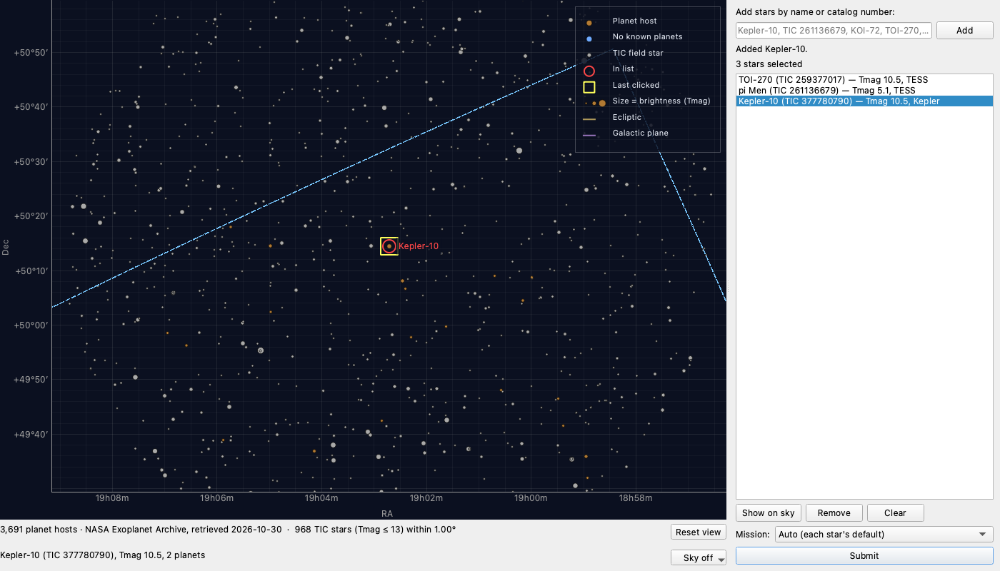

**Summary**

> Retook the sky screenshots, added a zoomed Kepler-10 shot and described the sky map's controls in the README.
> - docs/shots: retook 01-skeleton and 02-sky-selection (all sky with the legend, the ecliptic and galactic plane, smaller translucent host markers, and the two-line footer with Reset view and Background). Added 09-sky-zoomed: Kepler-10 shown from the list at 1.5°, with its live TIC field from MAST (968 stars, Tmag ≤ 13). CDS hips2fits timed out on all three tries, so this shot has the background off ("Sky off").
> - tools/take_shots.py: registered the sky-zoomed shot. A shot whose live service doesn't answer (ShotUnavailable) is skipped and its old file kept, and the script then exits 1.
> - tests/sky_selection_host.py: added shot_sky_zoomed (it activates Kepler-10 through Show on sky, waits for the field, tries the sky image 3 times, then falls back to no background) and a live_sky option. The host window now always uses a fresh temporary hips cache, so the stand-in cutout can't get into the user's cache and a live shot can't show it.
> - README: new "The sky map" section covering the legend entries, clicking to toggle, the right-click menu (including the ecliptic / galactic-plane toggle), panning across 0h, mouse and trackpad zoom and pan (including the Windows-touchpad caveat), Reset view / Home, Show on sky, the zoom hint, the Background chooser, and demo mode. Also listed cache/hips/ under Cache, and noted that the sky shots are live.
> - Regression sweep (test_gui_sky, test_gui_selection, test_gui_e2e, test_hips, test_catalog_client, test_catalog_sky): 199 passed.

### T71 purge-stand-in-hips-cache

- **Origin:** Found by T64 sky-shots-and-docs
- **Goal:** Exoplanet transit dashboard
- **Ran:** 2026-10-30 11:59 to 2026-10-30 12:00 (0m 47s)
- **Outcome:** done; committed [`f09fc27dc7ae`](https://github.com/wingware-dev/transitory/commit/f09fc27dc7ae8fb7dbe082f0e3e17c00dcdc0af8)
- **Usage:** 3,094 input, 3,921 output, 1.05M cache read, 8,346 cache write (claude-haiku-5-5, claude-opus-5-5)

**Prompt**

> Project hips cache holds stand-in fixture cutouts that show as a real sky
>
> ./cache/hips (the default CutoutCache, $TRANSITORY_CACHE_DIR or ./cache) has two cutouts that are byte-identical to the test stand-in tests/data/catalog/hips_cutout.jpg (a colour gradient). They were written at 2026-10-30 11:42 by something run outside pytest (conftest isolates the cache for tests). Most likely an ad-hoc run of tests/sky_selection_host.py's window, which used RecordedHipsTransport with the default cache until task T64 sky-shots-and-docs (aab259e0) gave it a temporary cache. One of them is the Kepler-10 view at 1.5°, so the live dashboard shows the gradient there as if it were DSS2. Those two files should be deleted (they are only a cache). It's also worth checking whether anything else can write the stand-in into the real cache.
>
> Evidence: md5 of cache/hips/23ed6bedd01cb8f8b4c41115d3e1886a.jpg and cache/hips/486801477a9670383bcef68a25c6d89b.jpg = 7fa8e18e483575623016b31467db67b9 = md5 of tests/data/catalog/hips_cutout.jpg; both 857 bytes, mtime Oct 30 11:42. A live take_shots.py sky-zoomed run with the default cache drew the gradient behind Kepler-10.
>
> Suggested next step: fix

**Judgement calls**

1. **Deleted only the two cache files that match the fixture byte for byte**
   The task named them, and they're only cache. Other cache entries (catalog, light curves) weren't touched.
   Alternatives: Clear all of cache/hips

**Summary**

> Deleted the two stand-in cutouts from the project's sky-image cache and added a regression test so the stand-in can't get there again.
> - cache/hips/: removed 23ed6bed….jpg and 48680147….jpg, both byte-identical to tests/data/catalog/hips_cutout.jpg; the cache is not tracked, so this isn't in the diff. The live dashboard will fetch real DSS2 cutouts for those views.
> - tests/test_gui_sky.py: new test_sky_zoomed_shot_keeps_the_stand_in_out_of_the_cache. It runs the zoomed Kepler-10 shot offline (recorded field and cutout) and asserts that the field and image load, and that the window's cutout cache is not the default one and the default stays empty. It and test_sky_selection_shot pass.
> - Other writers: in pytest, conftest gives each test its own cache directory. Outside it, the only code that used the recorded transport with the default cache was the screenshot host window (tests/sky_selection_host.py), which already uses a temporary cache since T64 sky-shots-and-docs (aab259e0).

### T68 hips-real-fixture

- **Origin:** Filed by the Tasks Manager from the plan of T62 hips-sky-background-2
- **Goal:** Exoplanet transit dashboard
- **Ran:** 2026-10-30 17:10 to 2026-10-30 17:36 (6m 16s)
- **Outcome:** blocked
- **Usage:** 2,037 input, 6,471 output, 424k cache read, 52k cache write (claude-haiku-5-5, claude-opus-5-5)

**Prompt**

> Record a real DSS2 fixture and check orientation
>
> Follow-up of T62 hips-sky-background-2 (06bb3294).
> CDS (alasky and alaskybis) timed out from this machine. When it is reachable, run `.venv/bin/python tests/data/catalog/record_hips.py`, check that the real cutout's top row is north in the sky view (compare with a DSS image of Kepler-10), and replace the stand-in. test_zoomed_in_the_survey_image_shows_north_up_east_left checks against the stand-in's red-top/green-left gradient, so it will need a different check with the real image. Also confirm the hips2fits acknowledgement on alasky.cds.unistra.fr (CREDITS.md currently says it is unconfirmed).
>
> [Tasks Manager, 2026-10-30 17:10] Manager (2026-10-30 17:10): the user is now on a stable network. Since T71 purge-stand-in-hips-cache (a02a89ed), tests/test_gui_sky.py::test_sky_zoomed_shot_keeps_the_stand_in_out_of_the_cache and conftest keep the fixture out of the real cache; keep that true with the new fixture. Keep the fixture small enough to commit. If you confirm or correct the hips2fits wording, update hips.HIPS2FITS_CREDIT and docs/CREDITS.md and drop the "unconfirmed" remark. Before finishing, run tests/test_hips.py and tests/test_gui_sky.py.
>
> See <project>/.TASKS/notes/record-a-real-dss2-fixture-and-check-orientation.md

**Summary**

> Couldn't record the real DSS2 fixture: this machine still can't reach any CDS host, so nothing was changed. Every host on CDS's network (130.79.x.x) times out: alasky, alaskybis, alasky.u-strasbg.fr, simbad and cds.unistra.fr, over https and http, and ping gets no replies. Other sites respond fine (archive.stsci.edu, google.com, www.unistra.fr), and fetching through WebFetch from another route was refused too (ECONNREFUSED 130.79.128.175:443). So the blockage is between this network and CDS, not the network in general.

### T72 retake-sky-zoomed-dss2

- **Origin:** Filed by the Tasks Manager from the plan of T64 sky-shots-and-docs
- **Goal:** Exoplanet transit dashboard
- **Ran:**  to 2026-10-30 17:31 ()
- **Outcome:** obsolete
- **Usage:** 0 input, 0 output, 0 cache read, 0 cache write (model not recorded)

**Prompt**

> Retake 09-sky-zoomed with the DSS2 background once CDS is reachable
>
> Follow-up of T64 sky-shots-and-docs (aab259e0).
> Run `python tools/take_shots.py sky-zoomed` on a stable network. CDS hips2fits timed out (60 s, three tries) from the train on 2026-10-30, so the committed shot has the background off. The script uses a fresh cache, so it fetches a real cutout. Check that the footer button reads DSS2 and that the image is a real star field. Run alongside or after T68 hips-real-fixture (fcc86da6), which needs the same network.

### T73 remove-sky-background-chooser

- **Origin:** Filed by the Tasks Manager
- **Goal:** Exoplanet transit dashboard
- **Ran:** 2026-10-30 17:31 to 2026-10-30 17:36 (4m 37s)
- **Outcome:** done; committed [`ac2326ed4c69`](https://github.com/wingware-dev/transitory/commit/ac2326ed4c69b7d6f85ca4b642506480b012a927)
- **Usage:** 2,226 input, 22k output, 2.95M cache read, 84k cache write (claude-haiku-5-5, claude-opus-5-5)

**Prompt**

> Remove the sky view's Background chooser while CDS is down
>
> The user, on the Questions tab: "The sky view is probably good enough for now so I guess nothing needed. There is the \"Sky Off\" etc popup that does nothing right now, though, so presumably should be removed."
>
> CDS hips2fits (alasky.cds.unistra.fr), the only source for the HiPS background added by T62 hips-sky-background-2 (06bb3294), doesn't respond, even from a browser.
> - Remove the Background button (DSS2 / 2MASS / PS1 / Sky off) from the sky footer, keeping the footer's fixed height and layout (T53's no-jitter rule; tests/dashboard_host.py hover_star).
> - The sky view must no longer fetch or show a background, so it makes no CDS requests and shows no fetch-failure status. Simplest is a single module-level switch (off) that keeps gui/sky_background.py and catalog/hips.py for when CDS works again; don't leave dead UI.
> - Keep the dark marker outlines.
> - Drop the hips2fits / DSS2 / 2MASS / Pan-STARRS acknowledgements from the Data Credits dialog and docs/CREDITS.md while the images aren't shown (keep the wording in a comment or the notes so it can come back).
> - README: remove the Background chooser from "The sky map" section and the cache/hips/ entry if nothing writes it now.
> - Screenshots: retake docs/shots/02-sky-selection.png and 09-sky-zoomed.png with `tools/take_shots.py` so the footer no longer shows the button (MAST for the zoomed field is reachable).
> - Tests: update the background tests in tests/test_gui_sky.py (keep tests/test_hips.py). Before finishing, run tests/test_gui_sky.py, test_gui_selection.py, test_gui_e2e.py and test_hips.py.
>
> See <project>/.TASKS/notes/remove-the-sky-view-s-background-chooser-while-cds-is-down.md

**Judgement calls**

1. **Put the switch in gui/sky_background.py, not sky_view.py**
   Both the sky view and the credits dialog read it, so turning it back on brings back the background, the chooser and the credits together.
   Alternatives: A switch in sky_view.py, with the credits removed by hand
2. **Kept the background tests, running them with the switch turned on**
   The task asks to keep sky_background.py and hips.py for when CDS works again. Running their tests with the switch on keeps that code from rotting. New tests cover the off state.
   Alternatives: Delete the background tests
3. **Also retook docs/shots/06-credits.png**
   The credits dialog got shorter, so only its scrollbar changed. The sky credits were below the fold anyway. Retaking it keeps the shot true to the app.
   Alternatives: Leave the old credits shot
4. **Removed the CDS mention from the README's screenshot notes**
   With the switch off, the zoomed shot no longer fetches a sky image, so the sentence about taking it without one no longer applied.

**Screenshots**

**Summary**

> Turned off the sky view's HiPS background while CDS hips2fits is down, with one switch, `sky_background.SKY_IMAGES = False`:
> - The sky view no longer builds the background or the Background button. Reset view stays alone in the footer, and the footer is the same height. With the switch off the view makes no CDS requests and shows no image status. The dark marker outlines are unchanged.
> - The Data Credits dialog leaves out the hips2fits, DSS2, 2MASS and Pan-STARRS credits while the switch is off. In docs/CREDITS.md that section is now an HTML comment so it can come back. The README no longer mentions the Background chooser or `cache/hips/`.
> - The background tests now turn the switch on, so the code stays tested for when CDS returns. New tests check the off state: no button, no requests across zoom and the 0h wrap, footer height, credits and the zoomed shot.
> - Retook docs/shots/02-sky-selection.png and 09-sky-zoomed.png (and 06-credits.png) with tools/take_shots.py.

### T75 nothing-seems-work-anymore

- **Origin:** Written by the user
- **Goal:** Ungrouped Tasks
- **Ran:** 2026-10-30 17:47 to 2026-10-30 18:04 (17m 21s)
- **Outcome:** done; committed [`7e213150d3c1`](https://github.com/wingware-dev/transitory/commit/7e213150d3c1576f528f9bcf5295f82326877262)
- **Usage:** 132 input, 21k output, 3.79M cache read, 79k cache write (claude-opus-5-5)

**Prompt**

> Nothing seems to work anymore.   All the stars I tried raise an exception that there is no MAST data, even one in the Kepler field.  That one said could not connect.  I wonder if we're hitting a maximum free use limit or something.
>
> [Tasks Manager, 2026-10-30 17:47] Manager (2026-10-30 17:47): first tell apart a MAST outage or network block from a regression. Earlier today CDS (alasky.cds.unistra.fr) stopped answering from this machine and browser while archive.stsci.edu still worked, so check MAST directly (curl mast.stsci.edu/api/v0/invoke, a lightkurve search) and MAST's status page. Code changed today that MAST requests go through: transitory/catalog/client.py (T66 record-tic-cone-1deg, RecordedTransport same_as), gui/catalog_jobs.py DetachedJobRunner (T67, T70), and the light-curve fetch in pipeline/fetch.py (T28/T31 timeouts, earlier). Reproduce through the real dashboard (run_dashboard.py, offscreen), with a Kepler-field star such as Kepler-10. Free public MAST requests are fine. MAST has no free-use quota for these queries, but it does rate-limit and can block; look for HTTP 429/503 in the replies. If it's an outage, say so and make the error message the user sees say that clearly rather than "no MAST data".
>
> See <project>/.TASKS/notes/nothing-seems-to-work-anymore-all-the-stars-i-tried-ra.md

**Judgement calls**

1. **HTTP 429 is no longer retried**
   MAST asking us to slow down should not get an immediate second request; the user is told to wait instead.
   Alternatives: Retry 429 once after a longer backoff
2. **Kept the original exception text in parentheses at the end of the message**
   The plain-language cause comes first for the user; the raw error stays for diagnosis.
   Alternatives: Log the raw error only
3. **Filed K2 support as task T76 support-k2-light-curves (d361996a) instead of adding it here**
   It needs a new mission through fetch, credits, DOIs and limb darkening, which is beyond diagnosing the outage.

**Findings filed**

- T76 support-k2-light-curves: K2 host stars are searched as Kepler and always come back "No light curves at MAST"

**Summary**

> Nothing regressed: MAST's observation search (CAOM, which lightkurve uses) is hanging from this machine, and K2 host stars were never supported. The MAST failure message now says the problem is on MAST's side, not that the star has no data.
> - Diagnosis: direct curl to mast.stsci.edu/api/v0/invoke. TIC cone and name lookup answer in under 1 s and the file-download endpoint redirects normally. Mast.Caom.Cone and Mast.Caom.Filtered.Position send no bytes for 60–90 s, with no 429 or 503. A raw lightkurve K2 search hit astroquery's 600 s polling limit. That is a MAST outage or slowdown, not a quota (no rate-limit replies).
> - Reproduced in the real dashboard (offscreen, empty cache): Kepler-10 fails with two 120 s read timeouts, the user's "could not connect". With the existing cache, Kepler-10 analyses fine, so the code path works.
> - The "no MAST data" stars were K2 hosts (K2-334, K2-374, K2-272 in the cache index today). The sky catalog sends them to the Kepler mission search, which correctly finds nothing. That bug is older than today's changes; it is filed as T76 support-k2-light-curves.
> - pipeline/fetch.py: timeouts and connection failures now read "MAST is down or cannot be reached from this network: … This is not a lack of data for the star: try again later." A 5xx says "MAST is having problems (HTTP n)". The portal polling limit says "MAST is overloaded or down". HTTP 429 says "MAST is limiting requests from this machine" and is no longer retried. Checked in the dashboard: the Progress panel and status bar show the new wording. tests/test_fetch.py: updated 2 tests, added 2; 39 pass.

### T76 support-k2-light-curves

- **Origin:** Found by T75 nothing-seems-work-anymore
- **Goal:** Exoplanet transit dashboard
- **Ran:** 2026-10-30 18:05 to 2026-10-30 18:11 (6m 23s)
- **Outcome:** done; committed [`b909d796bab8`](https://github.com/wingware-dev/transitory/commit/b909d796bab879f272e457b0f7de27617256762c)
- **Usage:** 108 input, 31k output, 6.13M cache read, 127k cache write (claude-haiku-5-5, claude-opus-5-5)

**Prompt**

> K2 host stars are searched as Kepler and always come back "No light curves at MAST"
>
> skycatalog._hint_for_facility maps a disc_facility starting with "K2" to mission_hint "Kepler", and MastSource only knows TESS and Kepler: it searches lightkurve with mission="Kepler", author="Kepler", so a K2 host (K2-334, K2-374, K2-272, ...) finds nothing, fails with "No light curves at MAST for K2-334: searched Kepler (K2-334)", and that empty result is cached for NEGATIVE_CACHE_DAYS (7 days). Users picking K2 hosts on the sky view take this for MAST being broken. Fix: add K2 as its own mission (lightkurve mission="K2", the K2 pipeline's long-cadence light curves by campaign, with their own DOI and acknowledgement checked at the source pages, limb darkening as Kepler's band), map K2 facilities to it, and make sure the stale "lightcurve:kepler:k2-*" negative entries don't block it. Until then at least say "K2 data is not supported yet" instead of "No light curves". An empty-host TIC search for those stars may also be worth trying in TESS first.
>
> Evidence: cache/index.json: lightcurve:kepler:k2-334 / k2-374 / k2-272 created 2026-10-30T21:38-21:39 with products []. transitory/catalog/skycatalog.py:70-76 (_hint_for_facility), transitory/pipeline/fetch.py _mission_order / _download (mission="Kepler", author=KEPLER_AUTHOR).
>
> Suggested next step: fix
>
> [Tasks Manager, 2026-10-30 18:04] Manager (from T75 nothing-seems-work-anymore (d7ba1c05), 2026-10-30 18:05): MAST's CAOM observation search (Mast.Caom.Cone / Filtered.Position, which lightkurve uses) is hanging from this machine; the TIC cone, name lookup and file downloads still work. So a live K2 search may not finish today: try once, then verify with recorded or stand-in search results and say in your report what was checked live. T75 also changed fetch.py's MAST failure messages ("MAST is down or cannot be reached…"); keep those. The K2 DOI and acknowledgement must be checked at their source pages (web tool granted).
>
> See <project>/.TASKS/notes/k2-host-stars-are-searched-as-kepler-and-always-come-back.md

**Judgement calls**

1. **A star with no KIC and no mission hint searches TESS, then K2 (no longer Kepler)**
   K2 targets never have KICs, and Kepler-field stars almost always get one from the TIC cross-match. This keeps the same two searches, but typed K2 hosts like "K2-18" now find K2 data.
   Alternatives: TESS, then K2, then Kepler (three searches for a star with no data); Leave the order as TESS, then Kepler, and rely on hints only
2. **A K2 hint searches K2 only, with no TESS fallback**
   Same as the Kepler hint, which also comes from the Mission menu, where a user choosing K2 means K2 only.
   Alternatives: K2, then TESS for sky-catalog K2 hosts
3. **K2 is credited with MAST's Kepler acknowledgement, given once when both missions are used**
   MAST's acknowledgements page has a single "Kepler/K2" block covering both; I did not write a K2 variant of it.
4. **Added K2 systematic periods (0.245 d thruster firings, 80 d campaigns) to the validation alias checks**
   Same purpose as Kepler's orbit, quarter and momentum-dump entries; the values are the well-known K2 approximations, not from a cited source.
   Alternatives: Leave K2 without systematic-period checks
5. **Gave MAST's RemoteServiceError the "MAST-side, not a lack of data" wording**
   The live K2 check hit it: MAST's own "Request failed" message otherwise reads as a plain failure, the confusion T75 set out to remove.

**Summary**

> K2 is now its own mission: K2 hosts are searched as mission="K2" with the K2 pipeline's long-cadence light curves, one per campaign or campaign half, and credited with K2's own DOI.
> - fetch.py: K2 search and selection. Campaigns 9–11 keep both halves. DOI 10.17909/T9WS3R "K2 Light Curves (all)" and MAST's shared "Kepler and K2" acknowledgement, both checked at archive.stsci.edu. Units are "campaigns". A star with no KIC and no mission hint now tries TESS then K2 instead of TESS then Kepler. MAST's own server error (astroquery RemoteServiceError) now reads "MAST reported an error on its side … not a lack of data".
> - models.py: "K2" added to Mission and MissionHint. skycatalog.py: facility "K2" gives hint K2. resolve.py: EPIC numbers get hint K2, and a bare number with the K2 hint is an EPIC.
> - fit.py: Kepler-band limb darkening for K2. plots.py, validate.py: BKJD time and the BJD offset for K2. validate.py also flags signals near K2's ~6 h thruster firings and ~80 d campaigns. report.py: "campaign" counts, and the shared acknowledgement listed once. credits_dialog.py: "Kepler and K2 data". selection_panel.py: K2 added to the Mission menu.
> - The old "lightcurve:kepler:k2-*" no-data entries no longer block anything: K2 searches use their own cache keys (tested).
> - Tests: 6 new, 4 updated; the 90 affected tests pass. Offscreen dashboard check: a sky K2 host shows as "K2-334 (TIC 5) — K2", and the Mission menu lists K2. Live check: one real K2-334 search sent the new K2 query, but MAST's CAOM search answered "Request failed" after 93 s, so no real K2 download was verified today.

### T77 mast-outage-fail-fast

- **Origin:** Filed by the Tasks Manager from the plan of T75 nothing-seems-work-anymore
- **Goal:** Exoplanet transit dashboard
- **Ran:** 2026-10-30 18:12 to 2026-10-30 18:14 (2m 08s)
- **Outcome:** done; committed [`7bf97d8e04f0`](https://github.com/wingware-dev/transitory/commit/7bf97d8e04f09ff6154f6d924314c15627cc3d77)
- **Usage:** 11k input, 13k output, 3.15M cache read, 24k cache write (claude-haiku-5-5, claude-opus-5-5)

**Prompt**

> Fail fast when MAST's search is down
>
> Follow-up of T75 nothing-seems-work-anymore (d7ba1c05).
> A stalled CAOM search costs about 4.5 minutes per star (two 120 s read timeouts plus a 10 s backoff) before the user sees the error, and every queued star repeats it. Once one star's search has timed out twice, later stars in the same run could fail at once with the same outage message ("MAST is down or cannot be reached from this network…"), or a quick health probe could run first. Keep a later run free to try again. Related Draft: T32 cancel-interrupts-mast-wait (a23ecd42), letting Cancel interrupt a MAST wait.

**Judgement calls**

1. **A run ends when the analysis runner goes idle; a 600 s cap also lifts the hold**
   Matches what the user sees as one Submit batch. The cap covers command-line validation runs, which have no runner, and very long batches.
   Alternatives: Time-only hold; A quick MAST health probe before each run
2. **HTTP 429 also holds off the rest of the run**
   When MAST asks us to slow down, sending more stars' searches is impolite and will be refused anyway.
3. **Only search failures start the hold, not download failures**
   In T75's outage, searches hung while downloads still worked; a download failure may concern one file.

**Summary**

> Once a MAST search finds MAST down, the other stars in the same run fail at once with the same outage message instead of each waiting about 4.5 minutes; stars already cached still load, and the next run asks MAST again.
> - fetch.py: MastSource records the outage when a search fails twice by timing out or not connecting, gets a 5xx twice, hits the polling limit, or gets HTTP 429. Later searches in the run fail with "MAST is down or cannot be reached from this network: MAST was not asked for 'TIC 12', as an earlier search in this run found it unusable. This is not a lack of data for the star: try again later." The check runs once the network lock is held, so stars queued behind the failing search fail as soon as it does. Errors about one star (unknown name, a bad table, MAST's "Request failed") don't stop the others. The hold ends with MastSource.new_run() or after MAST_OUTAGE_HOLD_SECONDS (600 s). The T75 failure messages are unchanged; _failure now builds them from a shared _outage() helper.
> - gui/workers.py: AnalysisRunner.submit calls the source's new_run() when it is idle, so Submit on an idle dashboard tries MAST again. Stars added to a busy run join it.
> - Tests: 6 new fetch tests and 1 runner test; 52 pass. Offscreen dashboard check against a stalled-MAST stand-in: Star A searched twice and failed; B and C failed with the new message without a search, in 2.6 s in all; a second Submit (Star D) asked MAST again.

### T80 regression-mast-fixes

- **Origin:** Filed by the Tasks Manager
- **Goal:** Ungrouped Tasks
- **Ran:** 2026-10-30 18:14 to 2026-10-30 18:15 (1m 04s)
- **Outcome:** done
- **Usage:** 1,704 input, 794 output, 126k cache read, 17k cache write (claude-haiku-5-5, claude-opus-5-5)

**Prompt**

> Regression tests for the MAST failure fixes
>
> A sweep under wing_guide topic 'research', after T75 nothing-seems-work-anymore (d7ba1c05), T76 support-k2-light-curves (d361996a) and T77 mast-outage-fail-fast (50678da0). One test_run over tests/test_fetch.py, tests/test_validation.py and tests/test_gui_e2e.py (T76 changed Mission/MissionHint, report.py's credit dedup and product selection's _seq_key). File each failure with report_finding (next_step fix); don't fix it.

**Summary**

> Ran tests/test_fetch.py, tests/test_validation.py and tests/test_gui_e2e.py in one test_run after task T75 nothing-seems-work-anymore (d7ba1c05), T76 support-k2-light-curves (d361996a) and T77 mast-outage-fail-fast (50678da0). All 97 tests passed (51.2s), so no findings were filed and nothing was changed.

### T81 resilient-data-path

- **Origin:** Filed by the Tasks Manager
- **Goal:** Ungrouped Tasks
- **Ran:** 2026-10-30 18:38 to 2026-10-30 20:38 (8m 30s)
- **Outcome:** done
- **Usage:** 2,399 input, 30k output, 1.88M cache read, 91k cache write (claude-haiku-5-5, claude-opus-5-5)

**Prompt**

> Plan a resilient light-curve data path
>
> The user, after MAST's CAOM observation search and CDS hips2fits both failed on 2026-10-30: "If the data sources are this flaky it sounds to me like this whole app is useless. Is there a better approach or do we give up?" They chose to research a more resilient data path (Questions tab, Q13).
>
> What failed: lightkurve's search (Mast.Caom.Cone / Filtered.Position) hung for minutes, while MAST's TIC cone, name lookup and file downloads kept working (see T75 nothing-seems-work-anymore (d7ba1c05) and .TASKS/notes/nothing-seems-to-work-anymore-all-the-stars-i-tried-ra.md). Current code: transitory/pipeline/fetch.py (MastSource, lightkurve search and download, timeouts from T28/T31, outage hold from T77, K2 from T76), pipeline/cache.py, catalog/client.py.
>
> Plan, verified live where reachable (free public services are fine), with:
> - Sources that find light-curve files without the CAOM search: STScI's static Kepler and K2 archive directories (by KIC/EPIC and campaign), TESS per-sector bulk-download scripts / file lists (SPOC 2-min and TESS-SPOC FFI light curves), the STScI public datasets on AWS open data (S3 paths, anonymous access, whether lightkurve/astroquery cloud support helps), and any other mirror (e.g. NASA Exoplanet Archive time series). For each: how to map a TIC/KIC/EPIC to file URLs, which sectors/quarters/campaigns a star has (TIC sector lookup, e.g. tess-point or TESScut's sector query), size of any index, how fresh, and its credit/DOI.
> - How fetch.py would try sources in order with fallback and fast failure, keeping the cache-first and offline behaviour, and how the user sees which source was used.
> - The sky background: an alternative to CDS hips2fits for DSS2 (e.g. STScI's DSS cutout service, which answered today) so T74 restore-sky-background (f4ca2aa5) has a fallback.
> - Steps as separate tasks that can run side by side where they touch different files, each with owned and shared files and tests (offline, with recorded fixtures).
>
> See <project>/.TASKS/notes/plan-a-resilient-light-curve-data-path.md

**Passed to the user by the Tasks Manager**

- 2026-10-30 18:47, question : Checked live during today's outage. STScI's static archive folders, Amazon's copy of the STScI data (stpubdata) and NASA SkyView all answered. The MAST search and CDS were still down. Suggested answer: accept the plan. Four steps run side by side: TESS sector lookup, finding files on the static archive and the Amazon copy, carrying the EPIC number, and a SkyView fallback for the sky background. Next comes the source chain in fetch.py, then showing which source each light curve came from. SkyView's DSS2 images may be greyscale only, and PanSTARRS isn't on SkyView.

**Judgement calls**

1. **Static STScI files first, AWS mirror second, CAOM search last**
   Static directories and S3 have no database behind them and answered in about 0.15 s throughout the outage; the CAOM search is the part that fails. The search stays as the last resort for name-only targets.
   Alternatives: Keep the CAOM search first and use static files only on failure (slower: each outage costs a timeout per run); Use S3 first (independent of STScI, but has no TESS-SPOC)
2. **Plain HTTPS to S3, no boto3/s3fs/astroquery cloud**
   Anonymous ListObjectsV2 and GET work over plain HTTPS; astroquery's cloud mode still needs the CAOM search, so it doesn't help.
   Alternatives: astroquery enable_cloud_dataset; s3fs (installed already)
3. **TESS sectors from the S3 footprint JSON, with TESScut as fallback**
   420 KB, updated daily, works offline once cached; tess-point needs a release for each new sector.
   Alternatives: tess-point; TESScut only
4. **SkyView for the sky fallback, not STScI dss_search**
   SkyView returns JPEG on the exact CAR WCS the sky view uses; STScI DSS is plate-projection greyscale that would need reprojecting.
   Alternatives: STScI dss_search plus reprojection; Wait for CDS

**Summary**

> The app isn't useless: only MAST's CAOM *search* is fragile. The light-curve files can be found and downloaded without it, from STScI's static archive directories and the AWS open-data mirror. Both answered in under 0.2 s while CAOM and CDS were down, and NASA SkyView can stand in for hips2fits pixel for pixel.
> - The plan has six tasks; four can run side by side.
>   - Run in parallel: TESS sector lookup, static-archive file finder, an EPIC number on targets, SkyView sky fallback.
>   - Then: a source chain in fetch.py with per-source fast failure.
>   - Then: showing the data source in the GUI and credits.

### T82 tess-sectors

- **Origin:** Filed by the Tasks Manager from the plan of T81 resilient-data-path, at the user's request
- **Goal:** Resilient data sources
- **Ran:** 2026-10-30 18:48 to 2026-10-30 18:51 (2m 43s)
- **Outcome:** done; committed [`e722d30ca139`](https://github.com/wingware-dev/transitory/commit/e722d30ca1397d12d21262a3bce1f6337cfdac52)
- **Usage:** 2,148 input, 18k output, 1.26M cache read, 53k cache write (claude-haiku-5-5, claude-opus-5-5)

**Prompt**

> TESS sector lookup without CAOM
>
> Step tess-sectors of T81 resilient-data-path's plan (.TASKS/notes/plan-a-resilient-light-curve-data-path.md). Runs alongside static-archive-files, epic-on-target and skyview-sky-fallback.
> New module `transitory/pipeline/tess_sectors.py`: `sectors_for(ra, dec, *, transport=None, offline=False) -> list[int]`.
> - Downloads `https://stpubdata.s3.amazonaws.com/tess/public/footprints/tess_ffi_footprint_cache.json` into `cache_dir()/tess/` (refresh after 7 days, use a stale copy when offline or unreachable).
> - Tests point-in-polygon on the `s_region` POLYGONs (RA wrap at 0/360, polar sectors) and drops sequence numbers > 1000.
> - Falls back to TESScut's `/tesscut/api/v0.1/sector` endpoint.
> - Owns: `transitory/pipeline/tess_sectors.py`, `tests/test_tess_sectors.py`, `tests/data/tess_sectors/` (a trimmed footprint fixture plus a recorded TESScut reply).
> - Shared: none.
> - Tests: pi Men gives the 23 sectors TESScut listed (1, 4, 8, 11-13, 27, 28, 31, 35, 38, 39, 61, 62, 65-68, 88, 89, 93-95) within the fixture's sector range; a point at RA 359.9/0.1; a stale cache used offline; falls back to TESScut when S3 fails.
> - Tests are offline with recorded fixtures; pytest-xdist runs test files concurrently, so this test file owns its own fixtures directory.
>
> See <project>/.TASKS/notes/tess-sector-lookup-without-caom.md

**Judgement calls**

1. **pi Men expects 25 sectors, not the 23 in the task**
   TESScut, checked live today, lists 34 and 64 as well as the task's 23 sectors. The footprint polygon test gives exactly the same 25, so the test compares against the recorded TESScut reply.
   Alternatives: Hard-code the task's 23 and exclude 34 and 64
2. **Polygon test on the sphere (gnomonic projection at the star), not a flat RA/Dec test**
   Great-circle edges become straight lines in that projection, so RA wrap and polar CCDs need no special cases. It matched TESScut for pi Men (Dec -80), for RA 359.9 and 0.1 at Dec -30, and it handles a polygon around the pole.
   Alternatives: Flat RA/Dec ray casting with RA unwrapping
3. **The default transport is catalog.client's requests_transport with a 15 s timeout, which still retries once**
   This reuses the project's HTTP policy. The no-retry fast-failure policy belongs to fetch-source-chain, which can pass its own transport.
   Alternatives: A separate no-retry transport in this module
4. **Offline with no cached footprint file raises instead of asking TESScut**
   Offline means no network at all, which is how the rest of the pipeline treats it.

**Summary**

> Added `transitory/pipeline/tess_sectors.py`, which finds the TESS sectors covering a position without MAST's CAOM search:
> - `sectors_for(ra, dec, *, transport=None, offline=False)` reads MAST's FFI footprint file from S3 and caches it in `cache_dir()/tess/`. It refreshes the file after 7 days and falls back to a stale copy when offline or when S3 fails. The polygon test runs on the sphere, so RA 0/360 and the poles need no special cases, and sequence numbers over 1000 are dropped.
> - If no footprint file can be had, it asks TESScut's `/tesscut/api/v0.1/sector` instead. If both fail it raises `SectorLookupError` (a `CatalogError`).
> - Added `tests/test_tess_sectors.py` (14 tests, offline) with fixtures in `tests/data/tess_sectors/`: a footprint file trimmed to 466 polygons, a recorded TESScut reply, and `record.py` to re-record them.

### T83 static-archive-files

- **Origin:** Filed by the Tasks Manager from the plan of T81 resilient-data-path, at the user's request
- **Goal:** Resilient data sources
- **Ran:** 2026-10-30 18:48 to 2026-10-30 18:56 (7m 19s)
- **Outcome:** done; committed [`6367ca609787`](https://github.com/wingware-dev/transitory/commit/6367ca60978710b0fb6bbedee35626db3b5ff847)
- **Usage:** 2,478 input, 37k output, 2.56M cache read, 101k cache write (claude-haiku-5-5, claude-opus-5-5)

**Prompt**

> Find light-curve files from STScI static directories and the AWS mirror
>
> Step static-archive-files of T81 resilient-data-path's plan (.TASKS/notes/plan-a-resilient-light-curve-data-path.md; see its Findings table for verified paths). Runs alongside tess-sectors, epic-on-target and skyview-sky-fallback.
> New module `transitory/pipeline/archive_files.py`. It turns a KIC, EPIC or TIC (plus sectors from an injected `sectors_for`) into product records in fetch.py's shape (`file`, `author`, `exptime`, `seq`, `obs_id`, `product`, `target_name`, plus `url` and `source`).
> - Two mirrors behind one interface:
>   - archive.stsci.edu, by parsing Apache HTML index pages.
>   - stpubdata S3 (`https://stpubdata.s3.amazonaws.com/{tess,kepler,k2}/public/...`, anonymous HTTPS), by parsing ListObjectsV2 XML (`?list-type=2&prefix=...`).
> - Layouts:
>   - Kepler `missions/kepler/lightcurves/{kic9[:4]}/{kic9}/*_llc.fits` (quarter from the FITS `QUARTER` header; timestamps sort in quarter order).
>   - K2 `missions/k2/lightcurves/c{N}/{epic[:4]}00000/{epic[4:6]}000/` across c0-c19, c102, c111, c112.
>   - TESS SPOC `missions/tess/tid/s{SSSS}/{tic16 split 4×4}/` (`s_lc` 2-min, `a_fast-lc` 20-s).
>   - TESS-SPOC `hlsps/tess-spoc/s{SSSS}/target/...`, STScI only (not on S3).
> - Per-sector ranking matches `select_products` (SPOC 2-min > TESS-SPOC > SPOC 20-s).
> - Distinguishes 404 (absent) from unreachable (raises a `SourceUnavailable`).
> - Includes a streaming `download(url, dest)` with the user agent and timeouts.
> - Owns: `transitory/pipeline/archive_files.py`, `tests/test_archive_files.py`, `tests/data/archive_files/` (recorded listings for Kepler-10, K2-18 c01, pi Men s0001 SPOC and TESS-SPOC, the matching S3 XML, a 404).
> - Shared: none (reads `config.USER_AGENT`).
> - Tests: URL building, both parsers, ranking, a missing directory versus a timeout, campaign 10's halves.

**Judgement calls**

1. **Kepler quarter comes from a fixed table of time stamps, not from sort position** (report 1)
   Kepler-10 has no Q8, Q12 or Q16 files (CCD module 3 failed), so counting files in time order would label every later quarter wrong. I read the QUARTER headers of four stars' files with range requests and found the same stamps for all of them. Q4 has two stamps: stars on module 3 got a shorter file. A file with an unknown stamp is skipped with a warning.
   Alternatives: Download each file and read its QUARTER header; Count position in time order (the plan's suggestion)
2. **K2 probes 20 campaign directories, not about 22** (report 1)
   The archive's listing has c0-c8, c102, c111, c112 and c12-c19. There are no c9, c10, c11, c101, c91 or c92 directories. c102 is campaign 10's second half ('10b', as lightkurve labels it), and c111/c112 are 11a and 11b.
   Alternatives: Also probe c9/c10/c11, which always 404
3. **TESS takes a `sectors` list rather than an injected `sectors_for` callable** (report 1)
   The caller (fetch-source-chain) has the coordinates and calls tess_sectors.sectors_for. Passing the list keeps this module free of coordinates and the footprint cache.
   Alternatives: Accept sectors_for(ra, dec) plus ra/dec
4. **Records gain `half` and `label`; `file` is `archive/<mission>/<filename>`** (report 1)
   `half` keeps campaign 11's two halves apart. `label` matches lightkurve's mission label, for progress text. `file` follows the plan's cache layout, relative to cache_dir().
   Alternatives: Leave `file` for fetch.py to fill in after downloading
5. **TESS-SPOC is listed only for sectors with no SPOC 2-minute file** (report 1)
   SPOC 2-minute files rank first, so a TESS-SPOC file could never be chosen in those sectors, and skipping its listing saves a GET per sector.
6. **Every failure other than 404/410 counts as unavailable, including 403 and a 404 for the S3 bucket listing itself** (report 1)
   Anything that is not a clean 'not there' should fall through to the next source rather than be cached as no data.
   Alternatives: Treat other 4xx as hard errors
7. **Recorded replies are kept in one JSON file keyed by URL, tracked with git add** (report 1)
   The K2 probes alone made about 70 small reply files. One file keyed by URL lets the tests replay the real URLs the code builds. Since the recorder generated the file, I added it with `git add` instead of create_tracked_file.
   Alternatives: One file per reply

**Summary**

> Added `transitory/pipeline/archive_files.py`, which finds Kepler, K2 and TESS light-curve files by path on archive.stsci.edu and the AWS `stpubdata` bucket, without the MAST search:
> - `find_products(mission, number, mirror=, sectors=, transport=)` returns product records in fetch.py's shape (plus `url`, `source`, `half`, `label`), one per quarter, campaign half or sector, ranked as `select_products` ranks them.
> - A 404 or empty S3 listing means no data. Timeouts, connection errors and other HTTP failures raise `SourceUnavailable`, a `SourceError` subclass. `download(url, dest)` streams the file with the user agent and timeouts, and leaves no partial file behind.
> - 33 offline tests run against replies recorded live from both mirrors (`tests/data/archive_files/recorded.json`; `record.py` re-records them). I also downloaded K2-18's c01 file live from both mirrors and checked its header.

### T84 epic-on-target

- **Origin:** Filed by the Tasks Manager from the plan of T81 resilient-data-path, at the user's request
- **Goal:** Resilient data sources
- **Ran:** 2026-10-30 18:48 to 2026-10-30 18:52 (3m 00s)
- **Outcome:** done; committed [`61e1eb883667`](https://github.com/wingware-dev/transitory/commit/61e1eb8836670974eb023e7ad72ad7beb9db4250)
- **Usage:** 66 input, 14k output, 1.65M cache read, 65k cache write (claude-opus-5-5)

**Prompt**

> Carry the EPIC number on StarTarget
>
> Step epic-on-target of T81 resilient-data-path's plan (.TASKS/notes/plan-a-resilient-light-curve-data-path.md). Runs alongside tess-sectors, static-archive-files and skyview-sky-fallback; before fetch-source-chain.
> - Add `epic: int | None` to `StarTarget` (and its `label`).
> - Fill it in `catalog/resolve.py` for EPIC input, and for K2 hosts resolved by name (from the name lookup's identifiers, or the Exoplanet Archive `k2pandc` table's `epic_hostname`; decide after looking at the replies).
> - Make `_query_for` in fetch.py use `EPIC n` for K2 when known (one line).
> - Owns: `transitory/catalog/resolve.py`, `tests/test_catalog_resolve.py` and its fixtures.
> - Shared: `transitory/models.py` (fetch-source-chain also edits it and runs after this).
> - Tests: `EPIC 201912552` and `K2-18` resolve with an epic; the label.

**Judgement calls**

1. **EPIC for name-resolved hosts comes from k2pandc, not the name lookup**
   MAST's Mast.Name.Lookup reply for K2-18 (SIMBAD) has only a canonical name and coordinates, with no identifiers. The archive's k2pandc table gives epic_hostname directly (K2-18 gives EPIC 201912552, WASP-47 gives EPIC 206103150).
   Alternatives: Query SIMBAD identifiers separately; TIC cross-match (the TIC has no EPIC column)
2. **Ask k2pandc for every archive host without a KIC, not only K2 discoveries**
   K2 also observed hosts found elsewhere (WASP-47 and others). Gating on disc_facility would miss them. It costs one cached TAP query per new name.
   Alternatives: Only when a planet's disc_facility is K2
3. **Put the k2pandc query in catalog/archive.py, outside this task's owned files**
   Every other Exoplanet Archive query lives in archive.py. The change only adds a function and a logger.
   Alternatives: Call client.tap directly from resolve.py
4. **Added one test to tests/test_fetch.py for the EPIC K2 query**
   This task changed _query_for. The test is additive and sits next to the existing TESS-then-K2 test.
5. **The label keeps TIC, then KIC, ahead of EPIC**
   Resolved K2 stars nearly always have a TIC, so their label is unchanged. EPIC shows only when it is the sole catalog number.

**Summary**

> StarTarget now carries the K2 EPIC number, and resolution fills it in:
> - `StarTarget.epic`, shown in `label` as "(EPIC n)" when there is no TIC or KIC to show.
> - `resolve.py` sets it for EPIC input, and for archive hosts without a KIC from the Exoplanet Archive's `k2pandc.epic_hostname` (new `archive.epic_for_host`).
> - `_query_for` searches K2 as `EPIC n` when the EPIC is known.
> - Recorded the new replies into `tests/data/catalog/recorded.json` (additions only); added tests for EPIC 201912552, K2-18, the label and the K2 query.

### T87 skyview-sky-fallback

- **Origin:** Filed by the Tasks Manager from the plan of T81 resilient-data-path, at the user's request
- **Goal:** Resilient data sources
- **Ran:** 2026-10-30 18:48 to 2026-10-30 19:08 (19m 47s)
- **Outcome:** done; committed [`7a2420cab67a`](https://github.com/wingware-dev/transitory/commit/7a2420cab67a672dbfd5c2ffe807f77d6178cf61)
- **Usage:** 36k input, 63k output, 8.84M cache read, 167k cache write (claude-haiku-5-5, claude-opus-5-5)

**Prompt**

> NASA SkyView when CDS hips2fits fails
>
> Step skyview-sky-fallback of T81 resilient-data-path's plan (.TASKS/notes/plan-a-resilient-light-curve-data-path.md, "Sky background"). Runs alongside tess-sectors, static-archive-files and epic-on-target.
> In `transitory/catalog/hips.py`:
> - Add a SkyView request for the same CAR WCS (`https://skyview.gsfc.nasa.gov/current/cgi/runquery.pl?Survey=DSS2+Red&Position=<ra>,<dec>&Size=<w>,<h>&Pixels=<W>,<H>&Projection=Car&RefCoords=<crval1>,0&Return=JPEG`). Its header matched `view_wcs` exactly in a live check.
> - Give each `Survey` a SkyView name ("DSS2 Red", which is grey; get the DSS2 RGB composite `Survey=DSS2 IR,DSS2 Red,DSS2 Blue&RGB=1` working or accept grey; "2MASS-K" or a 2MASS RGB; none for PanSTARRS).
> - `fetch_cutout` tries hips2fits, then SkyView, with a shorter first timeout. It caches under a key that includes the service, so a grey fallback isn't mistaken for colour later.
> - Add a SkyView acknowledgement (find the official text on SkyView's help/acknowledgement page) and a status line naming the service used.
> - Owns: `transitory/catalog/hips.py`, `tests/test_hips.py`, `tests/data/catalog/` (a recorded SkyView JPEG and FITS header).
> - Shared: `transitory/gui/sky_background.py` (status text), `transitory/gui/credits_dialog.py`, docs/CREDITS.md.
> - The background is switched off (`sky_background.SKY_IMAGES = False`, from T73 remove-sky-background-chooser (767b797e)); leave it off. T74 restore-sky-background (f4ca2aa5) turns it back on later. Keep tests that run with the switch on passing.
> - Tests: the request parameters for a `view_wcs`; falls back on a hips2fits timeout; north-up/east-left orientation on the recorded image.
>
> See <project>/.TASKS/notes/nasa-skyview-when-cds-hips2fits-fails.md

**Judgement calls**

1. **Built the colour images from three grey SkyView bands**
   SkyView's RGB=1 mode returned a 200x150 'no data' picture for every parameter form I tried. Three grey bands merged locally give colour, so a fallback image doesn't look grey next to hips2fits.
   Alternatives: Accept grey DSS2 Red / 2MASS-K; Use the SkyView Java client
2. **Stretched each band locally; flattened 2MASS with a 15 px median filter**
   Unstretched, the merged DSS2 sky was beige and 2MASS was nearly black, with coloured tile blocks. I checked the result offscreen in the real sky view. 2MASS still shows faint tile-edge lines.
   Alternatives: Use SkyView's images unprocessed; Fetch FITS and scale it ourselves (much larger downloads)
3. **Still ask hips2fits first even when a SkyView image is cached**
   That way the better hips2fits image replaces the fallback once CDS is back. The cost is one 15 s try per new view during an outage; there is no outage hold.
   Alternatives: Use a cached SkyView image without asking hips2fits; Remember a hips2fits outage for a few minutes
4. **Status line only when the image came from SkyView**
   The usual hips2fits case keeps the status clear, as before; the fallback names both services.
   Alternatives: Always name the service
5. **Un-ignored *.fits under tests/data in .gitignore**
   `*.fits` was ignored repo-wide, and the orientation test needs the recorded FITS pixels as well as its header.
   Alternatives: Force-add the one file; Store the header as text and the pixels as .npy

**Summary**

> When CDS hips2fits fails, the sky background now falls back to NASA SkyView. The background stays off (`SKY_IMAGES = False`).
> - `hips.fetch_sky_image` gives hips2fits one 15 s try with no retry, then asks SkyView for the same CAR WCS. A live check matched SkyView's header to `view_wcs` exactly. It returns the image with the service that supplied it; `fetch_cutout` still returns bytes.
> - SkyView's own RGB mode only returns a "no data" placeholder. So DSS2 (IR/Red/Blue) and 2MASS (K/H/J) are fetched as three grey bands in parallel, stretched so the sky is dark, and merged into a colour JPEG. 2MASS uses `Scaling=LogLog` and a median-filter background flatten, because SkyView's raw tile mosaic shows coloured blocks. PanSTARRS has no SkyView fallback.
> - SkyView images are cached under their own key. A view seen during an outage gets the hips2fits image once CDS answers again; offline, either cached image is used.
> - The sky status reads e.g. "DSS2 colour sky image from NASA SkyView (CDS hips2fits unavailable)". If both services fail, the error names both.
> - Added the SkyView acknowledgement from its FAQ to `SKYVIEW_CREDIT`, the credits dialog and the commented-out section of docs/CREDITS.md.
> - Recorded SkyView DSS2 band JPEGs and the DSS2 Red FITS as fixtures. Tests cover the request parameters, a fallback on a hips2fits timeout, north-up/east-left orientation against the FITS, separate caching, the short first try, both services failing and the 2MASS flatten. `.gitignore` gains `!tests/data/**/*.fits` so the fixture is tracked.

### T85 fetch-source-chain

- **Origin:** Filed by the Tasks Manager from the plan of T81 resilient-data-path, at the user's request
- **Goal:** Resilient data sources
- **Ran:** 2026-10-30 18:56 to 2026-10-30 20:30 (1h 33m)
- **Outcome:** done; committed [`4c3fdf6df8d1`](https://github.com/wingware-dev/transitory/commit/4c3fdf6df8d168c8aa099a055fe2416aebdaf206)
- **Usage:** 88 input, 49k output, 6.26M cache read, 114k cache write (claude-opus-5-5)

**Prompt**

> Try static archive, AWS mirror, then the MAST search, with fast failure
>
> Step fetch-source-chain of T81 resilient-data-path's plan (.TASKS/notes/plan-a-resilient-light-curve-data-path.md, "Design: how fetch.py tries sources"). Runs after tess-sectors, static-archive-files and epic-on-target.
> Rework `transitory/pipeline/fetch.py`'s `MastSource._download` into an ordered chain.
> - Order:
>   - static STScI (`archive_files`, with `tess_sectors.sectors_for`)
>   - S3 mirror
>   - the lightkurve CAOM search, only for name-only targets or when both mirrors are unreachable
>   - `TRANSITORY_LC_SOURCES` (e.g. `static,s3,search`) overrides the order.
> - Make T77 mast-outage-fail-fast's outage hold per source.
> - "No data" versus "unreachable": an authoritative miss (Kepler directory 404, no sector directories on a working mirror) is no data and the 7-day negative cache applies; timeout, connection error, 5xx or 429 falls through to the next source. The star fails only when every source is unusable; the message lists each source and why, and says it is not a lack of data.
> - The cache-first lookup, index key `lightcurve:<mission>:<query>` and negative cache are unchanged; product records gain `source` and `url`; downloaded files go to `cache_dir()/archive/<mission>/<filename>`. Offline and cached stars never touch the network.
> - Fast-failure timeouts: listings about 15 s with no retry (the next mirror is the retry), downloads as now (120 s, one retry), CAOM as fallback about 60 s with no retry.
> - Add `LightCurve.source` (models.py) and progress messages naming the source and why the earlier ones were skipped (e.g. "MAST search unavailable; using STScI archive files").
> - Update the module docstring.
> - Owns: `transitory/pipeline/fetch.py`, `tests/test_fetch.py`.
> - Shared: `transitory/models.py` (after epic-on-target).
> - Tests (with fake transports): the static path is used and cached; static unreachable falls back to S3, then to search; a 404 is cached as no data and does not fall through; a per-source outage hold; cached stars work with every source down; the existing lightkurve tests still pass with `TRANSITORY_LC_SOURCES=search`.
> - Live (free public services): run the known-planet validation (`python -m transitory.validation`) on an empty cache with `TRANSITORY_LC_SOURCES=static` and with `=s3`, and compare with the last report.
>
> [Tasks Manager, 2026-10-30 18:51] Manager (from T82 tess-sectors (1453a052)): call `tess_sectors.sectors_for(ra, dec, transport=..., offline=...)`. It raises `SectorLookupError` (a CatalogError) only when both the footprint file and TESScut fail. Its default transport keeps requests_transport's single retry, so pass a no-retry transport for the fast-failure policy. Offline with no cached footprint file, it raises rather than asking TESScut. T82 also suggests calling `tess_sectors.footprints()` once at the start of a run, so the 420 KB download isn't charged to one star's listing budget and a stale-copy warning shows once per run. Do that here if it fits.
>
> [Tasks Manager, 2026-10-30 18:51] Manager (from T84 epic-on-target (16304397)): `_query_for` already returns `EPIC n` for K2 when target.epic is set, so that one-line step is done. StarTarget.epic sits right after kic in models.py. archive.epic_for_host (k2pandc) fills it for hosts without a KIC.
>
> [Tasks Manager, 2026-10-30 18:56] Manager (from T83 static-archive-files (4b3d54d6)): use `archive_files.find_products(mission, number, mirror=, sectors=, transport=)`. TESS takes a `sectors` list, so look the sectors up with tess_sectors first. Notes for the chain:
> - S3 has no TESS-SPOC files (`Mirror.has_tess_spoc` is False), so a TESS sector with no files on S3 doesn't prove there is no data. Only STScI's answer counts for TESS.
> - `download()` doesn't retry, so add the one retry in the chain. A 404 from it raises a plain SourceError; other failures raise SourceUnavailable.
> - Records already carry `seq`, `half` and `label`, and `file` is `archive/<mission>/<filename>`. There's no need to read the Kepler QUARTER header.
>
> See <project>/.TASKS/notes/try-static-archive-aws-mirror-then-the-mast-search-wit.md

**Judgement calls**

1. **Use S3's TESS files when it finds some, even though it lacks TESS-SPOC**
   When STScI is unreachable, S3's SPOC sectors beat failing the star. In the s3 validation, TIC 31410749 got 5 SPOC sectors instead of 13. The cache keeps that partial set, as it keeps any positive entry. An S3 answer with no files at all is not taken as no data; the search is tried next.
   Alternatives: Treat any S3 TESS answer as inconclusive and fall through to the search; Use S3's files but don't cache them
2. **A sector-footprint result with no sectors counts as no TESS data, without listing**
   The footprint file is MAST's own FFI coverage, so a star on no CCD has no TESS light curves.
3. **A listed file that 404s on download skips to the next source without a hold**
   That means the mirror is inconsistent, not down, so other stars can still use it.
4. **Read the footprint file once a run in MastSource, not via sectors_for each star**
   As T82 suggested: when S3 is down, a stale copy would otherwise mean a failed download attempt for every star.
5. **Added `source=lc.source` to clean.py's LightCurve copy**
   Without it, cleaned light curves lose the field that show-data-source needs. One line, outside the files this task owns.
6. **Search-only tests pin TRANSITORY_LC_SOURCES=search in the fake_lk fixture**
   The task asked for that; a new `mirrors` fixture clears it for the chain tests.

**Summary**

> MastSource now gets light-curve files from STScI's static archive first, then the AWS S3 mirror, then the MAST search, failing fast on a source that is down:
> - `TRANSITORY_LC_SOURCES` overrides the order. The search is used for stars with no KIC/EPIC/TIC (or no position for TESS), or when both mirrors can't be reached.
> - An empty answer from a mirror is cached as no data. An empty S3 answer for TESS is not, since S3 lacks TESS-SPOC files. A source that is down is held off per source for the run, and when every source fails the error names each one and says it is not a lack of data.
> - TESS sectors come from the footprint file, read once a run with a no-retry transport, else from TESScut. Listings get 15 s and no retry. Downloads get one retry and reuse a file another mirror already fetched. A fallback search gets 60 s and one try.
> - New `LightCurve.source` (also carried through clean.py). Progress messages name the source and the ones skipped. Product records gain `source` and `url`, and mirror files go to `archive/<mission>/`.
> - Live validation on empty caches: `static` matched the last report exactly. `s3` matched except the null star TIC 31410749, which lost its 8 TESS-SPOC sectors; all 11 planets were still recovered.

### T86 show-data-source

- **Origin:** Filed by the Tasks Manager from the plan of T81 resilient-data-path, at the user's request
- **Goal:** Resilient data sources
- **Ran:** 2026-10-30 20:30 to 2026-10-30 20:38 (7m 24s)
- **Outcome:** done; committed [`c487044cd062`](https://github.com/wingware-dev/transitory/commit/c487044cd06263a0ce77707e3b46820b729eb891)
- **Usage:** 1,951 input, 26k output, 8.95M cache read, 55k cache write (claude-haiku-5-5, claude-opus-5-5)

**Prompt**

> Show where each light curve came from
>
> Step show-data-source of T81 resilient-data-path's plan (.TASKS/notes/plan-a-resilient-light-curve-data-path.md). Runs after fetch-source-chain.
> - Show `LightCurve.source` in the results-table notes and gallery header.
> - Add a "Retrieved from ..." credit line (credits dialog, `fetch.mission_credits`), e.g. "Retrieved from STScI archive files / AWS Open Data (stpubdata)", and update README and docs/CREDITS.md. The DOIs and mission acknowledgements stay as they are (same MAST products).
> - Take a screenshot under docs/shots/.
> - Owns: the GUI results and credits files (`transitory/gui/...`), docs.
> - Shared: `transitory/pipeline/fetch.py` (`mission_credits`, after fetch-source-chain).
> - Tests: the relevant `tests/test_gui_*.py` and the `test_fetch.py` credits test.
>
> [Tasks Manager, 2026-10-30 20:30] Manager (from T85 fetch-source-chain (96dc67db), committed 4c3fdf6): `LightCurve.source` is set by fetch.py and carried through clean.py's copy. Product records carry `source` and `url`. Progress messages already name the source and any skipped ones. A star whose TESS files came from S3 can lack its TESS-SPOC sectors; T88 fill-missing-tess-spoc-sectors handles that, so it isn't yours to do.
>
> See <project>/.TASKS/notes/show-where-each-light-curve-came-from.md

**Judgement calls**

1. **Credit line for every source, the MAST search included, with the retrieval date** (report 1)
   It makes each star's credits say plainly which copy was used. The date is what AWS's citation needs. The DOIs and acknowledgements are unchanged.
   Alternatives: Only add a line for the mirrors, leaving search-fetched stars as before
2. **Added LightCurve.retrieved (YYYY-MM-DD, UTC, from the cache index entry's created time)** (report 1)
   AWS's "How to Cite" asks for the access date. The date is the oldest file's download, so it stays the same when the star is read again from the cache.
   Alternatives: Use today's date at credit time, which would be wrong for cached data
3. **AWS citation in AWS's own wording, from the mast-tess / mast-kepler / mast-k2 registry pages** (report 1)
   Checked on registry.opendata.aws on 2026-10-30; the plan's registry.opendata.aws/tess style URLs return 404.
4. **Table notes end with "data from <source>" on every row of a star** (report 1)
   The task asked for the source in the notes column. It also lands in the CSV export.
5. **The data-source shot uses live services and an empty temporary cache** (report 1)
   Demo stars are synthetic and have no archive source to show. With the user's cache, the shot would show whichever source cached pi Men earlier. If a service is down, the shot is skipped and the old file kept, as with the sky shots.

**Findings filed**

- T89 s3-has-tess-spoc: TESS-SPOC light curves are on the AWS mirror after all, under stpubdata/mast/hlsp/tess-spoc

**Screenshots**

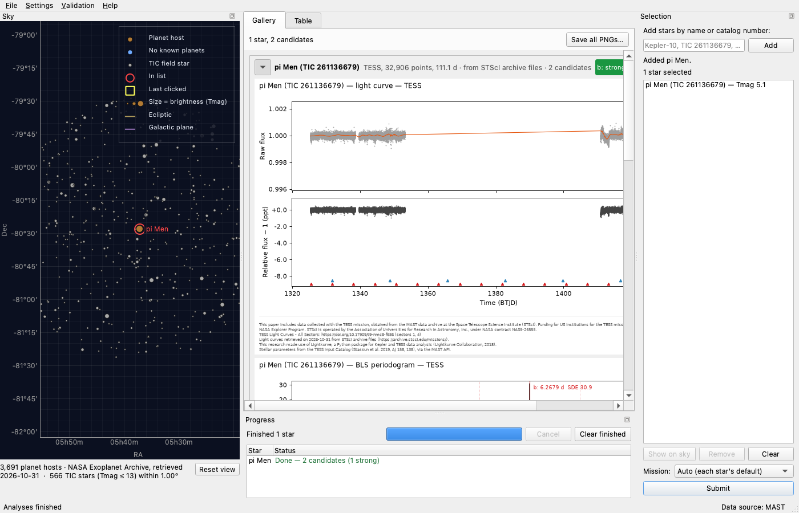

**Summary**

> Each star now shows where its light curve came from:
> - The gallery header ("· from STScI archive files ·") and the table notes ("data from …").
> - A credit line, "Light curves retrieved on <date> from …", in `fetch.mission_credits`. Files from AWS also get the Registry of Open Data's "How to Cite" line for the mission.
> - New `LightCurve.retrieved` date, from the cache index entry, carried through clean.py.
> - The credits dialog has a "Where the light-curve files come from" section. README has a "Where light curves come from" section plus cache paths, and docs/CREDITS.md has the new wording.
> - New screenshot docs/shots/10-data-source.png (pi Men, live, from STScI archive files), with a `data-source` shot in tools/take_shots.py.

### T88 fill-missing-tess-spoc-sectors

- **Origin:** Filed by the Tasks Manager from the plan of T85 fetch-source-chain
- **Goal:** Resilient data sources
- **Ran:**  to 2026-10-30 20:32 ()
- **Outcome:** obsolete
- **Usage:** 0 input, 0 output, 0 cache read, 0 cache write (model not recorded)

**Prompt**

> Fill in TESS-SPOC sectors missing from an S3-only fetch
>
> Follow-up from T85 fetch-source-chain (96dc67db). Sometimes STScI is down, so the TESS files come from the S3 mirror instead. That mirror has no TESS-SPOC files, so the star is missing those sectors: TIC 31410749 got only 5 of its 13. The cache then keeps that partial set for good. Mark such cache entries as partial in transitory/pipeline/fetch.py. A later fetch, with STScI reachable, should list only the missing sectors and add them. Tests use fake transports in tests/test_fetch.py.

### T89 s3-has-tess-spoc

- **Origin:** Found by T86 show-data-source
- **Goal:** Resilient data sources
- **Ran:** 2026-10-30 20:38 to 2026-10-30 20:42 (4m 07s)
- **Outcome:** done; committed [`ab06c0f00264`](https://github.com/wingware-dev/transitory/commit/ab06c0f002648f9aea9a6726a1d922937b5d919e)
- **Usage:** 2,794 input, 21k output, 3.18M cache read, 82k cache write (claude-haiku-5-5, claude-opus-5-5)

**Prompt**

> TESS-SPOC light curves are on the AWS mirror after all, under stpubdata/mast/hlsp/tess-spoc
>
> archive_files' S3 mirror has no "tess-spoc" root, on the belief that S3 holds no TESS-SPOC light curves (Mirror.has_tess_spoc is False). As a result, a TESS star fetched from S3 while STScI is down loses its TESS-SPOC sectors: in the s3 validation, TIC 31410749 got 5 sectors instead of 13. An S3 answer with no SPOC files is also never taken as no data. In fact the Registry of Open Data lists TESS-SPOC on S3 (https://registry.opendata.aws/mast-tess-spoc/, ARN arn:aws:s3:::stpubdata/mast/hlsp/tess-spoc), with the same layout as STScI's hlsps/tess-spoc. Adding `"tess-spoc": "mast/hlsp/tess-spoc"` to MIRRORS["s3"].roots would likely fix both. It would also make task T88 fill-missing-tess-spoc-sectors largely unnecessary. Its "How to Cite" asks for "TESS-SPOC was accessed on DATE from https://registry.opendata.aws/mast-tess-spoc. Please cite Caldwell et al. 2020", which the S3 retrieval credit in fetch.py would then need.
>
> Evidence: curl "https://stpubdata.s3.amazonaws.com/?list-type=2&prefix=mast/hlsp/tess-spoc/s0001/target/0000/0002/6113/6679/" lists hlsp_tess-spoc_tess_phot_0000000261136679-s0001_tess_v1_lc.fits (pi Men, s0001), checked 2026-10-30. Code: transitory/pipeline/archive_files.py MIRRORS["s3"].roots.
>
> Suggested next step: fix
>
> [Tasks Manager, 2026-10-30 20:32] Manager: T85 fetch-source-chain (4c3fdf6) treats S3 as lacking TESS-SPOC, so with this fix, also:
> - Update `Mirror.has_tess_spoc` in archive_files.py.
> - Let an empty S3 answer for TESS count as no data, as STScI's does.
> - Correct the fetch.py docstring and comments that say S3 lacks TESS-SPOC.
> - Add the Registry's TESS-SPOC citation to the S3 retrieval credit. T86 show-data-source adds that credit, so build on its committed wording.
> Test with fake transports in tests/test_archive_files.py and tests/test_fetch.py. A live check with TRANSITORY_LC_SOURCES=s3 on TIC 31410749 (free AWS) should list all 13 sectors.
>
> [Tasks Manager, 2026-10-30 20:38] Manager (from T86 show-data-source, committed c487044):
> - `fetch.mission_credits` now adds "Light curves retrieved on <date> from …" for every star. When the files came from AWS, it also adds the Registry of Open Data's "How to Cite" line for that mission.
> - Those citations come from the /mast-tess/, /mast-kepler/ and /mast-k2/ registry pages. Add the /mast-tess-spoc/ citation (Caldwell et al. 2020) when TESS-SPOC files come from S3.
> - Also update the "Where the light-curve files come from" section of the credits dialog, the README section "Where light curves come from", and docs/CREDITS.md.
>
> See <project>/.TASKS/notes/tess-spoc-light-curves-are-on-the-aws-mirror-after-all-u.md

**Judgement calls**

1. **Removed fetch.py's 'mirror lacks TESS-SPOC' check** (report 1)
   Both mirrors now hold TESS-SPOC, so the check could never fire. Leaving it would be untested dead code.
   Alternatives: Keep it as a guard for a future mirror without TESS-SPOC
2. **Choose the TESS dataset citations from the light curve's DOIs** (report 1)
   The mast-tess citation goes with SPOC files and mast-tess-spoc with TESS-SPOC ones. A light curve that mixes STScI and S3 files may over-cite, because sources are not recorded per DOI.
   Alternatives: Record the source for each DOI in LightCurve (a persisted format change)
3. **Give Caldwell et al. 2020 as a full reference line with its DOI** (report 1)
   The Registry's How to Cite asks to 'cite Caldwell et al. 2020'. The reference was checked against doi.org (RNAAS 4, 201, 10.3847/2515-5172/abc9b3).
   Alternatives: Add only 'Please cite Caldwell et al. 2020' to the access line

**Summary**

> TESS-SPOC light curves now come from the AWS mirror (stpubdata/mast/hlsp/tess-spoc) as well as STScI, so a TESS star fetched from S3 keeps its full-frame-image sectors and credits the Registry's TESS-SPOC dataset.
> - archive_files: added the S3 "tess-spoc" root (Mirror.has_tess_spoc is now true for both mirrors); docstring corrected; recorded S3 TESS-SPOC listings for pi Men added to the test data.
> - fetch: an empty S3 answer for TESS is now no data, like STScI's (removed the check that sent it on to the search); docstring corrected.
> - Credits: S3 retrievals cite the TESS dataset for SPOC files and the TESS-SPOC dataset plus Caldwell et al. 2020 for full-frame-image ones (AWS_DATASETS["TESS-SPOC"], TESS_SPOC_REFERENCE, aws_datasets()); credits dialog, docs/CREDITS.md and README updated.
> - Live check with TRANSITORY_LC_SOURCES=s3 on TIC 31410749 found all 13 sectors (SPOC 2, 9, 12, 29, 39; TESS-SPOC 6, 36, 61-62, 66-69), the same as the validation run.

### T90 regression-resilient-data-sources

- **Origin:** Filed by the Tasks Manager
- **Goal:** Resilient data sources
- **Ran:** 2026-10-30 20:43 to 2026-10-30 20:45 (1m 39s)
- **Outcome:** done
- **Usage:** 1,831 input, 1,629 output, 195k cache read, 20k cache write (claude-haiku-5-5, claude-opus-5-5)

**Prompt**

> Regression tests for resilient data sources
>
> A regression sweep (wing_guide topic 'research') over the resilient-data-sources work:
> - T82 tess-sectors
> - T83 static-archive-files
> - T84 epic-on-target
> - T85 fetch-source-chain
> - T86 show-data-source
> - T87 skyview-sky-fallback
> - T89 s3-has-tess-spoc
>
> Run these tests in one `test_run` call (~90 s):
> - tests/test_run.py
> - tests/test_harness.py
> - tests/test_gui_e2e.py
> - tests/test_validation.py
> - tests/test_catalog_resolve.py
>
> These go through the whole analysis, so they cover the new LightCurve fields (source, retrieved), the changed fetch progress text, and the new credit and citation lines. File each failure with `report_finding` (next_step `fix`) and don't fix it. Use stand-ins only: no live services.

**Summary**

> Regression sweep over the resilient-data-sources work (T82–T87, T89): ran test_run.py, test_harness.py, test_gui_e2e.py, test_validation.py and test_catalog_resolve.py in one test_run. All 125 passed in 77 s, using stand-ins only (no live services). No findings filed, nothing changed.

### T78 verify-k2-end-to-end

- **Origin:** Filed by the Tasks Manager from the plan of T76 support-k2-light-curves
- **Goal:** Exoplanet transit dashboard
- **Ran:** 2026-10-30 20:45 to 2026-10-30 20:50 (2m 56s)
- **Outcome:** done
- **Usage:** 46 input, 9,439 output, 910k cache read, 45k cache write (claude-opus-5-5)

**Prompt**

> Verify K2 end to end once MAST's search is back
>
> Follow-up of T76 support-k2-light-curves (d361996a).
> Analyse K2-334 or K2-18 from the dashboard with a fresh cache. Confirm the campaign files download, the stitched light curve looks sane, and the credits show "K2 Light Curves (all) … (campaigns …)". Today this was checked only with stand-in search results, because MAST's CAOM search was failing. Also check the selection list shows the star's real TIC number (T76's offscreen check showed "K2-334 (TIC 5)", likely a stand-in). Check first that MAST's search answers: a lightkurve search_lightcurve for Kepler-10 should return in under a minute.
>
> [Tasks Manager, 2026-10-30 20:45] Manager, 2026-10-30: you no longer need MAST's search for this. T84 epic-on-target, T85 fetch-source-chain and T89 s3-has-tess-spoc (ab06c0f) get K2 files from STScI's static archive or the AWS mirror, by EPIC number.
> - Skip the Kepler-10 search check.
> - Run the dashboard check with a fresh cache, and confirm the source shown is "STScI archive files" or AWS.
> - Also confirm the credits show the K2 DOI line and the new "Light curves retrieved on … from …" line.
> These are free public services. Drive the app offscreen (tests/dashboard_host.py or tools/take_shots.py), not on the user's screen.
>
> See <project>/.TASKS/notes/verify-k2-end-to-end-once-mast-s-search-is-back.md

**Findings filed**

- T91 k2-roll-systematics-cleaning: K2-18 b is missed: K2 Campaign 1 roll systematics survive cleaning

**Summary**

> Verified K2 end to end with live data and no code changes. I drove the real dashboard (MastSource, max 20 products) offscreen against K2-334 and K2-18, each with a fresh empty cache and Mission set to K2.
> - The selection list shows the real TIC numbers: "K2-334 (TIC 330687113)" and "K2-18 (TIC 388804061)". T76's "TIC 5" was a stand-in.
> - The campaign files downloaded from "STScI archive files": ktwo211730024-c16_llc.fits and ktwo201912552-c01_llc.fits. These are the only campaigns the archive holds for those EPICs; I checked that c05/c18 and c14 return 404.
> - The credits show "K2 Light Curves (all): https://doi.org/10.17909/T9WS3R (campaigns 16)" and "(campaigns 1)", plus "Light curves retrieved on 2026-10-31 from STScI archive files (https://archive.stsci.edu/missions/)". The date is UTC.
> - K2-334's light curve looks right, and candidate b is found at 5.1145 d (SDE 29.8), matching the published planet. K2-18's C1 light curve keeps 5–10 ppt roll systematics after cleaning, and K2-18 b is missed. Filed as T91 k2-roll-systematics-cleaning (ba783e08).
> - With Mission left on Auto, K2-334 uses TESS sectors 44–46 and 72, since TESS comes before K2 for non-Kepler stars. That is as designed.

### T79 k2-detrended-light-curves

- **Origin:** Filed by the Tasks Manager from the plan of T76 support-k2-light-curves
- **Goal:** Found
- **Ran:**  to 2026-10-30 20:48 ()
- **Outcome:** dismissed
- **Usage:** 0 input, 0 output, 0 cache read, 0 cache write (model not recorded)

**Prompt**

> Consider K2SFF or EVEREST light curves for K2
>
> Follow-up of T76 support-k2-light-curves (d361996a).
> The K2 pipeline's PDCSAP light curves carry the ~6 h roll systematics. The community K2SFF or EVEREST light curves (lightkurve author="K2SFF" / "EVEREST") detrend those and find small planets far better. This needs their own DOIs and citations.

### T91 k2-roll-systematics-cleaning

- **Origin:** Found by T78 verify-k2-end-to-end
- **Goal:** Exoplanet transit dashboard
- **Ran:** 2026-10-30 20:48 to 2026-10-30 21:07 (18m 57s)
- **Outcome:** done; committed [`2b6329dd19e6`](https://github.com/wingware-dev/transitory/commit/2b6329dd19e69d6912d5489694c9bb7d8e426fec)
- **Usage:** 2,432 input, 46k output, 5.63M cache read, 128k cache write (claude-haiku-5-5, claude-opus-5-5)

**Prompt**

> K2-18 b is missed: K2 Campaign 1 roll systematics survive cleaning
>
> Analysing K2-18 with Mission = K2 (fresh cache, live data from STScI archive files, ktwo201912552-c01_llc.fits) returns 2 candidates, neither strong. The known planet K2-18 b (P ≈ 32.94 d, depth ≈ 2.9 ppt) is not recovered. In the cleaned light curve, from about BKJD 1985 to 2015, the flux keeps dropping 5–10 ppt with a sawtooth look. These are K2's 6-hour thruster-firing / roll systematics left in the PDCSAP flux, and the time-windowed biweight flattening in transitory/pipeline/clean.py doesn't follow them. That likely limits K2 results for many stars. K2-334 (C16, quieter PDCSAP) works: b is found at 5.1145 d, SDE 29.8. Research a K2-specific fix: a roll-decorrelation (K2SFF-style, e.g. lightkurve's SFFCorrector on centroids), community high-level light curves (EVEREST / K2SFF, both on MAST), or a quality-mask / outlier step for thruster-firing cadences. Then check that K2-18 b is recovered.
>
> Evidence: Offscreen run of MainWindow(make_source(False, 20)) with TRANSITORY_CACHE_DIR set to an empty temporary directory: type "K2-18", choose Mission K2, Submit. Result: K2, 3,518 points, 80.0 d, from STScI archive files, 2 candidates (0 strong). Screenshot: <scratchpad>/out/K2-18-K2-Gallery.png. Flux column: fetch.py:900 (pdcsap_flux, quality_bitmask="default").
>
> Suggested next step: research
>
> Merged in by the Manager, original in History (Proposed by the Manager, 2026-10-30 18:11:45): Consider K2SFF or EVEREST light curves for K2
>
> See <project>/.TASKS/notes/k2-18-b-is-missed-k2-campaign-1-roll-systematics-survive.md

**Questions**

1. The plan is ready, in <project>/.TASKS/notes/k2-18-b-is-missed-k2-campaign-1-roll-systematics-survive.md. Implement Plan has the Tasks Manager carry it out, as this task or as separate tasks; Revise Plan has it changed first.
   - **Answer, from the user:** Go ahead: carry out the plan as this task

**Judgement calls**

1. **Recommended in-pipeline SFF on PDCSAP over the K2SFF/EVEREST light curves** (report 1)
   It was the most robust variant on both stars (6/6 settings found K2-18 b), needs no new source, DOI or archive paths, and works from the S3 fallback, which doesn't hold the community light curves.
   Alternatives: Fetch K2SFF light curves from STScI or the MAST search; Fetch EVEREST light curves (cleanest scatter, but quality bits are fiddly)
2. **Proposed restore_trend=True so the raw panel keeps the star's slow variability** (report 1)
   Recovery was unchanged (K2-18 SDE 26.9, K2-334 32.9), and the raw plot stays recognisable.
   Alternatives: restore_trend=False (lightkurve's default), which flattens the raw panel too
3. **Marked task k2-detrended-light-curves as carried out by this plan** (report 1)
   The Manager merged it into this task. The plan meets its goal (roll-cleaned K2 light curves) without fetching the HLSPs; that path stays as an optional follow-up.
   Alternatives: Keep k2-detrended-light-curves open as separate work
4. **Recommended in-pipeline SFF on PDCSAP over the K2SFF/EVEREST light curves** (report 2)
   It was the most robust variant on both stars (6/6 settings found K2-18 b), needs no new source, DOI or archive paths, and works from the S3 fallback, which doesn't hold the community light curves. This also answers the merged-in T79 k2-detrended-light-curves request.
   Alternatives: Fetch K2SFF light curves from STScI or the MAST search; Fetch EVEREST light curves (cleanest scatter, but quality bits are fiddly)
5. **Correct K2 flux with lightkurve's SFF on read, not fetch K2SFF/EVEREST** (report 3)
   In the research runs it was the most robust option on both stars (found K2-18 b under 6/6 settings). It needs no new source, DOI or archive paths, and it works from the S3 fallback too.
   Alternatives: Fetch K2SFF light curves (STScI and MAST search only); Fetch EVEREST light curves (quality bits are fiddly)
6. **Kept the star's slow variability in the raw panel (restore_trend=True)** (report 3)
   Recovery was the same either way, and the raw plot stays recognisable.
   Alternatives: lightkurve's default, which also flattens the raw panel
7. **Also correct a K2 file that fell back to SAP flux** (report 3)
   SFF on SAP flux was less reliable than on PDCSAP in the research runs, but uncorrected SAP flux has the full roll signal.
   Alternatives: Leave SAP fallbacks uncorrected
8. **Added a README paragraph and a docs/shots screenshot, taken by a new take_shots.py entry** (report 3)
   The project asks for a committed screenshot of each major visible change. A K2-18 b detection plus the new credit line counts as one.
   Alternatives: No screenshot
9. **Tracked the new PNG with git add on that one path** (report 3)
   create_tracked_file only writes text, so it can't create a binary screenshot.

**Screenshots**

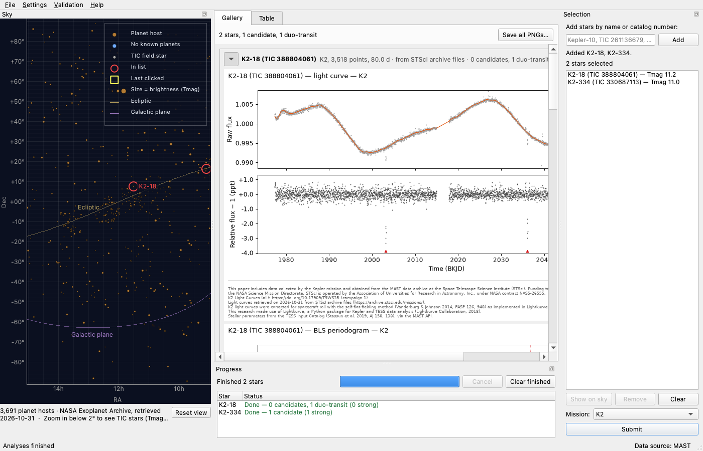

**Summary**

> K2 light curves are now corrected for spacecraft roll when read, so the dashboard finds K2-18 b in K2 Campaign 1.
> - `transitory/pipeline/fetch.py`: new `roll_correct` runs lightkurve's self-flat-fielding (SFF) correction on each K2 campaign file. If it fails, the error is logged and the uncorrected flux is used. The source label says "K2 (SFF roll-corrected)", and the credits cite Vanderburg & Johnson 2014. TESS and Kepler files are unchanged.
> - Checked offscreen in the real dashboard with live STScI data and an empty cache. K2-18 b: P 32.941 ± 0.004 d, depth 2830 ppm, Rp 2.46 R⊕, SDE 26.9, reported as a duo-transit (2 transits in the campaign); before the fix it was missed. K2-334 b: still strong, P 5.1139 d, SDE 32.9, SNR 100.
> - Tests: fake-reader tests in `tests/test_fetch.py` for K2-only correction, labelling and the failure fallback, plus an offline synthetic test where the search misses a 33-day planet under a K2-style roll sawtooth without correction and finds it with correction.
> - New screenshot `docs/shots/11-k2-roll-correction.png`, with a README paragraph. `tools/take_shots.py` has a `k2-roll` shot, sharing a live-run helper with the `data-source` shot.

### T92 singular-period-in-credits

- **Origin:** Filed by the Tasks Manager from the plan of T78 verify-k2-end-to-end
- **Goal:** Exoplanet transit dashboard
- **Ran:** 2026-10-30 20:49 to 2026-10-30 20:50 (1m 06s)
- **Outcome:** done; committed [`5cdec721e565`](https://github.com/wingware-dev/transitory/commit/5cdec721e565bb059320afab4bab0cbeadf88060)
- **Usage:** 2,043 input, 4,914 output, 1.12M cache read, 19k cache write (claude-haiku-5-5, claude-opus-5-5)

**Prompt**

> Singular period unit in credits for one sector/quarter/campaign
>
> Follow-up from T78 verify-k2-end-to-end (264f39fb). `mission_credits` (transitory/pipeline/fetch.py) prints "(campaigns 16)" and "(campaigns 1)" when only one campaign was used, and the same applies to sectors and quarters. Use "campaign 16", "sector 44" and so on when there is a single period. Update the credits tests in tests/test_fetch.py and any doc text showing the format.

**Judgement calls**

1. **Replaced sector_unit with periods_used(mission, numbers), which returns the whole unit-and-ranges text**
   Singular vs plural depends on how many periods there are, so the helper needs the numbers. Both callers (fetch.mission_credits and validation/report.py) built the same 'unit ranges' string, and now share it.
   Alternatives: Keep sector_unit and add a count argument

**Summary**

> Credits now name a single observing period in the singular ("campaign 16", "sector 6", "quarter 3") and keep the plural for several.
> - `sector_unit` in transitory/pipeline/fetch.py is replaced by `periods_used(mission, numbers)`. It is used for each star's credits and for the validation report's combined and per-star lines.
> - Tests in tests/test_fetch.py and tests/test_validation.py are updated, with new single-campaign and single-quarter checks.
> - docs/CREDITS.md now shows a one-campaign example.

### T93 k2-validation-targets

- **Origin:** Filed by the Tasks Manager from the plan of T91 k2-roll-systematics-cleaning
- **Goal:** Exoplanet transit dashboard
- **Ran:** 2026-10-30 21:08 to 2026-10-30 21:11 (3m 24s)
- **Outcome:** done; committed [`453927474d9a`](https://github.com/wingware-dev/transitory/commit/453927474d9a7076a0f4f0855261537acd561e0d)
- **Usage:** 70 input, 15k output, 5.54M cache read, 43k cache write (claude-opus-5-5)

**Prompt**

> Add K2-18 and K2-334 to the known-planet validation set
>
> Follow-up from T91 k2-roll-systematics-cleaning (ba783e08). `transitory/validation/targets.py` has no K2 stars, so K2 results are never checked against published values. Add K2-18 b (32.94 d, 2.9 ppt) and K2-334 b (5.1145 d) with mission K2, and update the offline fixture data if the validation tests need it.
>
> See <project>/.TASKS/notes/add-k2-18-and-k2-334-to-the-known-planet-validation-set.md

**Judgement calls**

1. **Regenerated targets_offline.json with build_offline rather than hand-adding entries**
   The regeneration command keeps the file reproducible. A diff against the old file showed only the two new stars, `epic` fields and the date changed.
   Alternatives: Hand-add the two entries and keep the 2026-10-29 date
2. **Gave the builder a per-star mission override (MISSIONS) for the K2 hosts**
   Both stars also have TESS data, and the KIC rule would have picked TESS. The builder fails loudly if a K2 star has no EPIC in k2pandc.
   Alternatives: A third element in each VALIDATION_TARGETS tuple
3. **Fixed the report's Data column, which repeated the mission for labelled authors**
   T91's 'K2 (SFF roll-corrected)' label made the column read 'K2 K2 (…)', and Kepler's SAP fallback had the same problem. Seen in the live run.
   Alternatives: Leave it for a separate finding

**Summary**

> Added K2-18 and K2-334 to the known-planet validation set, validated on their K2 campaigns by EPIC number.
> - `transitory/catalog/build_offline.py` lists both stars with mission K2 (a new `MISSIONS` override) and records each target's EPIC. `transitory/data/targets_offline.json` was regenerated with it: only the two new stars and `epic` fields were added, and the retrieval date is now 2026-10-31.
> - `SkyStar` carries `epic` through to `StarTarget`, and the bundled targets read it.
> - `transitory/validation/targets.py` explains what each K2 star checks. K2-18 b is expected as a duo-transit, since Campaign 1 holds only 2 transits.
> - The validation report's Data column no longer repeats the mission ("K2 K2 (SFF roll-corrected)" is now "K2 (SFF roll-corrected)").
> - Live run of just the two stars: both found. K2-18 b: P 32.941 ± 0.004 d (0.3σ from published), Rp/Rs −5.7%. K2-334 b: P 5.11387 d (1.2σ), Rp/Rs +9.4%. No spurious detections.

### T96 regression-k2-roll-correction

- **Origin:** Filed by the Tasks Manager from the plan of T93 k2-validation-targets
- **Goal:** Exoplanet transit dashboard
- **Ran:** 2026-10-30 21:12 to 2026-10-30 21:15 (2m 26s)
- **Outcome:** done
- **Usage:** 1,753 input, 3,871 output, 309k cache read, 25k cache write (claude-haiku-5-5, claude-opus-5-5)

**Prompt**

> Regression tests for the K2 roll correction
>
> A regression sweep (wing_guide topic 'research') over these tasks:
> - T91 k2-roll-systematics-cleaning
> - T92 singular-period-in-credits
> - T93 k2-validation-targets
>
> Run these tests in one `test_run`:
> - tests/test_fetch.py
> - tests/test_validation.py
> - tests/test_run.py
> - tests/test_harness.py
> - tests/test_catalog_sky.py
> - tests/test_gui_sky.py
> - tests/test_gui_validation.py
>
> File each failure with `report_finding` (next_step `fix`), and don't fix it. Use stand-ins only: no live services.

**Findings filed**

- T97 update-tests-for-k2-bundled-targets: Two tests still assume the 9-target bundled set after K2-18 and K2-334 were added

**Summary**

> Ran a regression sweep after tasks T91, T92 and T93 over seven test files in one test_run, with no live services: 237 passed and 2 failed, both from a single cause.
> - Filed task T97 update-tests-for-k2-bundled-targets (48a2fe5e). T93 grew the bundled set from 9 to 11 targets with K2-18 and K2-334, but two tests still expect the old set. test_catalog_sky::test_offline_file_matches_the_recorded_archive fails with KeyError 'K2-18' because the recorded host list has no K2 hosts. test_gui_sky::test_offline_catalog_says_so still expects "Offline: 9 bundled targets".
> - Fixed nothing in place, and no other failures were found.

### T97 update-tests-for-k2-bundled-targets

- **Origin:** Found by T96 regression-k2-roll-correction
- **Goal:** Exoplanet transit dashboard
- **Ran:** 2026-10-30 21:14 to 2026-10-30 21:15 (0m 21s)
- **Outcome:** done; committed [`8c284248b77f`](https://github.com/wingware-dev/transitory/commit/8c284248b77f18b049d6b6f2c5a72eaee88c7511)
- **Usage:** 14 input, 1,555 output, 1.12M cache read, 4,187 cache write (claude-opus-5-5)

**Prompt**

> Two tests still assume the 9-target bundled set after K2-18 and K2-334 were added
>
> Commit 4539274 (task T93 k2-validation-targets) added K2-18 and K2-334 to transitory/data/targets_offline.json, so 11 targets are now bundled, not 9. It updated test_offline_targets_are_the_validation_set but not two other tests that depend on the bundled set, and both now fail:
>
> 1. tests/test_catalog_sky.py::test_offline_file_matches_the_recorded_archive — KeyError: 'K2-18' at test_catalog_sky.py:163 (`host = by_name[entry["name"]]`). The test checks every bundled target against the recorded host-list response for HOST_QUERY (skycatalog.py:30) in tests/data/catalog/recorded.json (key a89e4074a70932bb36a9ef81f759f437). That recording has 36 rows covering 32 hosts, and K2-18 and K2-334 are not among them. The K2-18 row that is in recorded.json belongs to a different (per-planet) query.
> 2. tests/test_gui_sky.py::test_offline_catalog_says_so — at test_gui_sky.py:121, `assert text.startswith("Offline: 9 bundled targets (archive data of ")` fails because the text is now 'Offline: 11 bundled targets (archive data of 2026-10-31) — Exoplanet Archive unreachable (connection refused); ...'.
>
> Fix: change the expected count in test_gui_sky.py:121 to 11. For test_catalog_sky, either skip K2-18 and K2-334 in the loop with a comment saying they are not in the recorded host list, or add their pscomppars rows (from the planet rows already in recorded.json) to the recorded HOST_QUERY body. Adding rows changes the recorded host count from 32 to 34, which breaks other assertions that expect 32, such as the "32 planet hosts" status text and the `len(sky.host_item.data) == 32 + near_0h` check in tests/test_gui_sky.py. Those would need updating too, so skipping the two targets is the smaller fix. Our product code is fine; only the tests are stale.
>
> Evidence: Found by the regression sweep for task T96 regression-k2-roll-correction (7ca43d76). test_run over tests/test_fetch.py, test_validation.py, test_run.py, test_harness.py, test_catalog_sky.py, test_gui_sky.py, test_gui_validation.py: 237 passed, 2 failed (run 1793409132056). Both failures are deterministic data mismatches. Reproduce with test_specs ["tests/test_catalog_sky.py::test_offline_file_matches_the_recorded_archive", "tests/test_gui_sky.py::test_offline_catalog_says_so"]. No env or live services needed.
>
> Suggested next step: fix

**Judgement calls**

1. **Skipped K2-18 and K2-334 in the recorded-archive check instead of adding them to the recording**
   The recorded host list predates them. Adding their rows would change the 32-host count that several sky tests assert.
   Alternatives: Add their pscomppars rows to recorded.json and update the 32-host assertions

**Summary**

> Updated two tests for the 11-target bundled set: test_offline_file_matches_the_recorded_archive skips K2-18 and K2-334, which aren't in the recorded host list, and test_offline_catalog_says_so expects "11 bundled targets". Both pass.

### T95 republish-validation-report

- **Origin:** Filed by the Tasks Manager from the plan of T93 k2-validation-targets
- **Goal:** Exoplanet transit dashboard
- **Ran:** 2026-10-30 21:15 to 2026-10-30 21:50 (35m 06s)
- **Outcome:** done; committed [`995f60ddcb27`](https://github.com/wingware-dev/transitory/commit/995f60ddcb27a98cd228a39f1fb3aa6f9aec8fd7)
- **Usage:** 54 input, 6,163 output, 860k cache read, 44k cache write (claude-opus-5-5)

**Prompt**

> Republish the full live validation report with the K2 stars
>
> Follow-up from T93 k2-validation-targets (17265962). `docs/validation/` and the README's Validation table (11 targets, retrieved 2026-10-29) predate K2-18 and K2-334 and the K2 roll correction from T91 k2-roll-systematics-cleaning. Rerun `python -m transitory.validation --publish` (live, free public STScI/AWS/MAST services, all sectors, ~30+ min), then update the README table's counts (13 targets, 13 planets) and the 07-validation screenshot (tools/take_shots.py). Report any target whose result changed from the 2026-10-29 run.
>
> See <project>/.TASKS/notes/republish-the-full-live-validation-report-with-the-k2-stars.md

**Judgement calls**

1. **Noted in the README that K2-18 b was recovered from 2 transits**
   The 13/13 count includes K2-18 b, which the report marks as a duo-transit (the expected result for Campaign 1). Without the note, readers could take it for a periodic detection like the others.
   Alternatives: Leave the row as plain 13 / 13
2. **README now says 'all sectors / quarters / campaigns'**
   The run now includes K2 campaigns.

**Screenshots**

**Summary**

> Republished the full live validation report (13 targets, 34 min, all sectors/quarters/campaigns) with K2-18 and K2-334 and the K2 roll correction, and updated the README Validation table and the 07-validation screenshot.
> - 13/13 published planets recovered, none missed or at an alias: K2-18 b at 32.94099 d (0.3σ, duo-transit, 2 transits in Campaign 1) and K2-334 b at 5.113865 d (1.2σ, strong).
> - No result changed for the 11 targets from the 2026-10-29 run: same planets, periods, confidences and extra signals. The tally is otherwise unchanged (1 spurious on KIC 8006161, 4 duo-transits on hosts, 10 rejected).
> - Median |ΔRp/Rs| rose from 3.4% to 4.6% only because of the two K2 planets (−5.7% and +9.4%).
> - Added docs/validation/figures/k2-18-b.png and k2-334-b.png to git. The other figures were regenerated by the run.

### T98 validation-report-campaigns-wording

- **Origin:** Filed by the Tasks Manager from the plan of T95 republish-validation-report
- **Goal:** Exoplanet transit dashboard
- **Ran:** 2026-10-30 21:50 to 2026-10-30 21:52 (1m 52s)
- **Outcome:** done; committed [`901a1f4d8095`](https://github.com/wingware-dev/transitory/commit/901a1f4d80950a15dfa660b874d66b4310dfeebd)
- **Usage:** 1,767 input, 7,678 output, 1.52M cache read, 28k cache write (claude-haiku-5-5, claude-opus-5-5)

**Prompt**

> Say "sectors / quarters / campaigns" in the validation report when K2 is included
>
> Follow-up from T95 republish-validation-report (9acc6789). The generated report header and the summary caption still say "using all sectors / quarters" and "(MAST, all sectors / quarters)", though K2 campaigns are included now. Make them say "sectors / quarters / campaigns" when any target is K2 (transitory/validation/report.py). Bring the published docs/validation/validation.md and summary.png in line, without another 30-minute live run: regenerate them from docs/validation/results.json if report.py can do that, else correct the text by hand. Add a test in tests/test_validation.py.

**Judgement calls**

1. **Redrew summary.png with a one-off scratchpad script instead of adding a rebuild function to report.py**
   report.py can't regenerate a report from results.json, apart from the credits section. Splitting the figure code into `_summary_figure(rows, tally, caption, retrieved)` was enough to redraw the PNG from results.json without adding public API for a one-time fix. The script is <scratchpad>/redraw_summary.py.
   Alternatives: Add a public rebuild_summary(directory) to report.py, like rebuild_credits; Leave summary.png until the next live run
2. **Also retook docs/shots/07-validation.png**
   The screenshot shows the report header and the summary figure, so it would otherwise still show the old wording.
3. **The capped wording also says campaigns: "at most N sectors / quarters / campaigns per star"**
   --max-sectors caps K2 campaigns as well.

**Screenshots**

**Summary**

> When any star is on K2, the validation report header and the summary figure's caption now say "sectors / quarters / campaigns". The published report has been brought in line without a new live run.
> - report.py: `_cap` takes the cap and the missions used. `summary_figure` now draws through a data-driven `_summary_figure`, so the figure can be redrawn from results.json.
> - docs/validation/summary.png was redrawn from results.json; only the caption differs. The header line of validation.md was corrected by hand, and docs/shots/07-validation.png was retaken.
> - New test `test_report_names_campaigns_when_a_star_is_on_k2` in tests/test_validation.py. All 34 tests in that file pass.

## Tasks Manager

### Questions to the user

Q4. Your Mac went to sleep three times while T29 rerun-live-validation (82c6cdde) was running. Each time, the agent's turn ended with "Your computer went to sleep mid-response". It's been resumed. The rest of this stretch (T29's finish, then T11 entry-point-readme-credits (ba8dc281)) will go faster if the Mac stays awake: set it not to sleep while plugged in, or run `caffeinate -i` in a terminal until the work finishes. (2026-10-29 15:34)

   **Answer:** Will keep it awake

Q8. The CDS sky-image service (alasky.cds.unistra.fr and its mirror alaskybis) timed out from this Mac in tasks T61 and T62, with TLS handshake timeouts. So the new sky background is tested only against a synthetic image, and nobody has checked that real images are drawn north-up. Task T68 hips-real-fixture (fcc86da6) records a real image and checks orientation, and T64 sky-shots-and-docs (aab259e0) wants a live screenshot with the background. Can this machine reach https://alasky.cds.unistra.fr (check VPN, firewall or proxy)? (2026-10-30 11:24)

   **Answer:** I'm in a train and connectivity comes and goes

Q9. Two tasks need a steady connection to the CDS sky-image service (alasky.cds.unistra.fr), which kept timing out on the train. T68 hips-real-fixture (fcc86da6) records a real sky image as the test fixture and checks that real images are drawn north-up. T72 retake-sky-zoomed-dss2 (98e0dca9) retakes the docs/shots/09-sky-zoomed.png screenshot with the DSS2 background, which is off in the committed shot. Answer once you're on a stable network, and both will run. (2026-10-30 11:58)

   **Answer:** On a stable network now

Q10. T68 hips-real-fixture (fcc86da6) still can't reach CDS, even on your current network. Every CDS server (alasky.cds.unistra.fr, alaskybis, simbad, cds.unistra.fr, all on 130.79.x.x) times out or refuses connections, while archive.stsci.edu, google.com and www.unistra.fr respond. So either CDS is down or something between this network and CDS blocks it. Try opening https://alasky.cds.unistra.fr/hips-image-services/hips2fits in a browser, or connect through another network or VPN. T68 (record a real sky image and check north-up) and T72 retake-sky-zoomed-dss2 (98e0dca9) (retake the zoomed screenshot with DSS2) both rerun once it works. (2026-10-30 17:16)

   **Answer:** Does not respond when tried in browser. It just says "connecting..." endlessly.  So something is wrong with that site and it cannot be used.

Q11. CDS hips2fits, the only source of the sky view's background images (from T62 hips-sky-background-2), doesn't respond, so the Background chooser can't show anything right now. It defaults to DSS2, so every zoom below 10° tries CDS and ends with a failure on the status line. What should happen? (a) Switch the DSS2 background to STScI's DSS cutout service (archive.stsci.edu, which responds from here), keeping CDS for 2MASS/PanSTARRS when it's back. (b) Leave the code as is, default the background to Off until CDS is reachable, and park T68 hips-real-fixture (fcc86da6) and T72 retake-sky-zoomed-dss2 (98e0dca9). (c) Just park T68 and T72 and change nothing. (2026-10-30 17:27)

   **Answer:** The sky view is probably good enough for now so I guess nothing needed.  There is the "Sky Off" etc popup that does nothing right now, though, so presumably should be removed.

Q12. MAST's observation search (the one that finds light curves) was hanging from this machine on 2026-10-30. T78 verify-k2-end-to-end (264f39fb) analyses a K2 star (K2-334 or K2-18) for real, to confirm the new K2 support from T76 works beyond stand-in data. Tell me when MAST works again, for example when a new Kepler-10 analysis with an empty cache succeeds, and I'll run it. (2026-10-30 18:11)

   **Answer:** If the data sources are this flaky it sounds to me like this whole app is useless.  Is there a better approach or do we give up?

Q13. Today's failures were in two separate services, each a single point of failure for one feature: CDS for the sky background, and MAST's observation search (CAOM) for finding light curves. Other MAST services and STScI's file downloads kept working all day. The light-curve files themselves sit at fixed, predictable places that don't need that search: STScI's static Kepler, K2 and TESS archive directories, TESS's per-sector bulk-download file lists, and (likely) the STScI public data copy on Amazon's open-data cloud. Should a research task plan a more resilient data path? It would look for light curves without the fragile search, with automatic fallback between sources, and keep the cache-first offline mode. The plan would come back to you before any code changes. (2026-10-30 18:37)

   **Answer:** Yes, research a resilient data path

### Decisions

| Time | Change | Task | Detail |
|---|---|---|---|
| 2026-10-29 07:54 | annotate_task | T1 python-tool-gives-dashboard | Added a note: Manager: running this as a research task first, since the project is empty and the request is large. Plan it as steps that can run side by side: settle the shared contracts early (package layout, data models, cache location), then give each feature its own files. Name each step's owned |
| 2026-10-29 07:55 | queue_assign | T1 python-tool-gives-dashboard | Queued in Research: Exoplanet dashboard plan |
| 2026-10-29 07:58 | propose_tasks | T2 skeleton-contracts-harness | Filed Ready from the plan of T1 python-tool-gives-dashboard (54079648) |
| 2026-10-29 07:58 | propose_tasks | T3 pipeline-fetch-clean | Filed Ready from the plan of T1 python-tool-gives-dashboard (54079648) |
| 2026-10-29 07:58 | propose_tasks | T4 pipeline-search-fit | Filed Ready from the plan of T1 python-tool-gives-dashboard (54079648) |
| 2026-10-29 07:58 | propose_tasks | T5 catalog-resolve-archive | Filed Ready from the plan of T1 python-tool-gives-dashboard (54079648) |
| 2026-10-29 07:58 | propose_tasks | T6 gallery-plots | Filed Ready from the plan of T1 python-tool-gives-dashboard (54079648) |
| 2026-10-29 07:58 | propose_tasks | T7 dashboard-sky-selection | Filed Ready from the plan of T1 python-tool-gives-dashboard (54079648) |
| 2026-10-29 07:58 | propose_tasks | T8 dashboard-gallery-table | Filed Ready from the plan of T1 python-tool-gives-dashboard (54079648) |
| 2026-10-29 07:58 | propose_tasks | T9 dashboard-integration | Filed Ready from the plan of T1 python-tool-gives-dashboard (54079648) |
| 2026-10-29 07:58 | propose_tasks | T10 known-planet-validation | Filed Ready from the plan of T1 python-tool-gives-dashboard (54079648) |
| 2026-10-29 07:58 | propose_tasks | T11 entry-point-readme-credits | Filed Ready from the plan of T1 python-tool-gives-dashboard (54079648) |
| 2026-10-29 07:58 | propose_tasks | T1 python-tool-gives-dashboard | Split its plan into 10 Ready tasks |
| 2026-10-29 07:58 | propose_tasks | T12 hips-sky-background | Proposed as a Draft |
| 2026-10-29 07:58 | queue_assign | T2 skeleton-contracts-harness | Queued in Skeleton and harness |
| 2026-10-29 08:05 | annotate_task | T4 pipeline-search-fit | Added a note: Manager (from T2 skeleton-contracts-harness (2a359f9a)): `pipeline/run.py` already has a working `analyze_star`, so fill in the stubs in search/transit_model/fit/vetting and change run.py rather than starting over. `StarAnalysis.periodograms` is a list holding one PeriodogramResult per |
| 2026-10-29 08:05 | annotate_task | T7 dashboard-sky-selection | Added a note: Manager: T8 dashboard-gallery-table runs alongside this task. Don't edit `gui/main_window.py`, `tools/take_shots.py` or `tests/test_harness.py`: T9 dashboard-integration does the wiring into MainWindow, registers the screenshots in SHOTS and updates the placeholder check. Take 02-sky-s |
| 2026-10-29 08:05 | annotate_task | T8 dashboard-gallery-table | Added a note: Manager: T7 dashboard-sky-selection runs alongside this task. Don't edit `gui/main_window.py`, `tools/take_shots.py` or `tests/test_harness.py`: T9 dashboard-integration does the wiring into MainWindow, registers the screenshots in SHOTS and updates the placeholder check. |
| 2026-10-29 08:05 | annotate_task | T11 entry-point-readme-credits | Added a note: Manager (from T2 skeleton-contracts-harness (2a359f9a)): once README.md exists, add `readme = "README.md"` back to the [project] table in pyproject.toml. T2 left it out because the editable install failed without the file. |
| 2026-10-29 08:05 | annotate_task | T9 dashboard-integration | Added a note: Manager: you own the wiring that T7 and T8 left out. Replace the placeholder widgets in `MainWindow` with the sky view, selection panel, gallery and table. Register every screenshot so far (02-sky-selection from T7's report, plus 03–06) in `SHOTS` in `tools/take_shots.py`. Update the p |
| 2026-10-29 08:05 | queue_assign | T3 pipeline-fetch-clean | Queued in Pipeline fetch and cleaning |
| 2026-10-29 08:05 | queue_assign | T4 pipeline-search-fit | Queued in Pipeline search and fit |
| 2026-10-29 08:05 | queue_assign | T5 catalog-resolve-archive | Queued in Star catalog and archive |
| 2026-10-29 08:05 | queue_assign | T6 gallery-plots | Queued in Gallery plots |
| 2026-10-29 08:09 | annotate_task | T8 dashboard-gallery-table | Added a note: Manager (from T6 gallery-plots (dd6f8bf9)): the plots.py API is `gallery_figures(analysis)`, which returns `GalleryFigure(key, title, figure)`, plus `light_curve_figure`, `periodogram_figure`, `folded_figure(analysis, index)`, `save_png` and `save_all`. The figures don't use pyplot, so |
| 2026-10-29 08:10 | queue_assign | T8 dashboard-gallery-table | Queued in Gallery plots |
| 2026-10-29 08:17 | annotate_task | T9 dashboard-integration | Added a note: Manager (from T8 dashboard-gallery-table (46d044ca)): replace MainWindow.gallery_page/table_page with GalleryWidget() and ResultsTable(). Feed each finished StarAnalysis to both via add_analysis(). Connect ResultsTable.planetActivated(star_name, index) so it switches to the Gallery tab |
| 2026-10-29 08:17 | propose_tasks | T16 lazy-gallery-figures | Proposed as a Draft |
| 2026-10-29 08:21 | propose_tasks | T17 red-noise-aware-snr | Proposed as a Draft |
| 2026-10-29 08:21 | propose_tasks | T18 mission-limb-darkening | Proposed as a Draft |
| 2026-10-29 08:21 | annotate_task | T9 dashboard-integration | Added a note: Manager (from T4 pipeline-search-fit (6aeb56bf)): the real pipeline now feeds the gallery and table. Run tests/test_gui_gallery.py, test_gui_table.py and test_plots.py, and fix anything that assumed hand-made values. For example, odd_even_sigma can be NaN when a parity has no data, and |
| 2026-10-29 08:22 | annotate_task | T10 known-planet-validation | Added a note: Manager (from T4 pipeline-search-fit (6aeb56bf)): the SNR and odd/even errors assume white noise, and limb darkening is fixed at Sun-like values. If the live run shows spurious detections on the null stars, or Rp/Rs offsets that trace to these, say so in the report's explanations and f |
| 2026-10-29 08:27 | annotate_task | T9 dashboard-integration | Added a note: Manager (from T3 pipeline-fetch-clean (43aac8d2)): `MastSource(max_products=...)` exists, but nothing sets it yet. A TESS continuous-viewing-zone star can have 40+ sectors, and a Kepler star has 17 quarters (about 5 s to clean). Pick a sensible default cap and offer it as a setting in  |
| 2026-10-29 08:27 | annotate_task | T11 entry-point-readme-credits | Added a note: Manager (from T3 pipeline-fetch-clean (43aac8d2)): `transitory/pipeline/fetch.py` holds draft MAST acknowledgement text (`_MAST_CREDIT`, `LIGHTKURVE_CREDIT`) and DOI titles. Check them against MAST's current "Citing MAST data" page, and update fetch.py and the credits dialog to match d |
| 2026-10-29 08:29 | annotate_task | T7 dashboard-sky-selection | Added a note: Manager (from T5 catalog-resolve-archive (e5f50ce0)): runs in T5's warm session. Use `from transitory.catalog.resolve import resolve` (and `resolve_many`, which reports bad names without stopping) and `transitory.catalog.skycatalog` for host stars, TIC cone stars and the bundled offlin |
| 2026-10-29 08:29 | annotate_task | T10 known-planet-validation | Added a note: Manager (from T5 catalog-resolve-archive (e5f50ce0)): get published values with `transitory.catalog.archive.known_planets()`, and check the null stars with `all_signals()` (no confirmed planet, KOI or TOI). The bundled offline file has only one null star, KIC 8006161, so choose and che |
| 2026-10-29 08:30 | queue_assign | T7 dashboard-sky-selection | Queued in Star catalog and archive |
| 2026-10-29 08:37 | annotate_task | T9 dashboard-integration | Added a note: Manager (from T7 dashboard-sky-selection (4b9bb020)): wire MainWindow the way tests/sky_selection_host.py does. SkyView(client) goes in the Sky dock, SelectionPanel(client, resolver) in the Selection dock. Connect sky.starClicked→panel.add_star, panel.targetsChanged→sky.set_selected, p |
| 2026-10-29 08:38 | queue_assign | T9 dashboard-integration | Queued in Dashboard integration and validation |
| 2026-10-29 09:02 | mark_ready | T19 table-notes-duplicate-transits | Made Ready as a follow-up of 'Dashboard integration: main window, workers, end-to-end': Bug in the results table from T8 dashboard-gallery-table (46d044ca), found by T9 dashboard-integration (f38a6406) while wiring in the real pipeline. |
| 2026-10-29 09:02 | move_task | T19 table-notes-duplicate-transits | Moved from Bug Fixes to goal 'Exoplanet transit dashboard' |
| 2026-10-29 09:03 | annotate_task | T10 known-planet-validation | Added a note: Manager (from T9 dashboard-integration (f38a6406)): runs in T9's warm session. Add the Validation menu action in `MainWindow._build_menus`, alongside the File, Settings and Help menus that already exist. In GUI tests, wait for worker threads with `tests/dashboard_host.wait_until` (or q |
| 2026-10-29 09:03 | annotate_task | T11 entry-point-readme-credits | Added a note: Manager (from T9 dashboard-integration (f38a6406)): in the README, document `--demo`, `--targets`, `--max-sectors` (default 20, 0 = all) and the Settings ▸ Sectors / quarters menu. The credits dialog builds its text from `fetch._MAST_CREDIT`, `DOI_TITLES`, `archive.ARCHIVE_CREDIT` and  |
| 2026-10-29 09:03 | queue_assign | T10 known-planet-validation | Queued in Dashboard integration and validation |
| 2026-10-29 09:03 | queue_assign | T19 table-notes-duplicate-transits | Queued in Gallery plots and results views |
| 2026-10-29 09:04 | queue_assign | T16 lazy-gallery-figures | Queued in Gallery plots and results views |
| 2026-10-29 11:48 | mark_ready | T22 search-reject-single-events | Made Ready as a follow-up of 'Known-planet validation report': Bug in the search code from T4 pipeline-search-fit (6aeb56bf), found by T10 known-planet-validation (cb536fee): it costs a real planet (TOI-270 b) in the validation. |
| 2026-10-29 11:48 | mark_ready | T23 vetting-planetary-secondary | Made Ready as a follow-up of 'Known-planet validation report': Bug in the vetting code from T4 pipeline-search-fit (6aeb56bf), found by T10 known-planet-validation (cb536fee): confirmed hot Jupiters are wrongly rated 'weak'. |
| 2026-10-29 11:48 | move_task | T22 search-reject-single-events | Moved from Bug Fixes to goal 'Exoplanet transit dashboard' |
| 2026-10-29 11:48 | move_task | T23 vetting-planetary-secondary | Moved from Bug Fixes to goal 'Exoplanet transit dashboard' |
| 2026-10-29 11:48 | annotate_task | T22 search-reject-single-events | Added a note: Manager: runs alongside T23 vetting-planetary-secondary (b969bbb2), which owns pipeline/vetting.py and tests/test_vetting.py, so don't edit those. You own pipeline/search.py, tests/test_search.py and, if needed, tests/test_run.py. Prove the fix with synthetic light curves, not download |
| 2026-10-29 11:48 | annotate_task | T23 vetting-planetary-secondary | Added a note: Manager: runs alongside T22 search-reject-single-events (96af4d33), which owns pipeline/search.py, tests/test_search.py and tests/test_run.py, so don't edit those. You own pipeline/vetting.py and tests/test_vetting.py. Prove the fix with synthetic light curves, not downloads: a hot Jup |
| 2026-10-29 11:48 | queue_assign | T22 search-reject-single-events | Queued in Pipeline search and fit |
| 2026-10-29 11:48 | queue_assign | T23 vetting-planetary-secondary | Queued in Vetting fixes |
| 2026-10-29 11:49 | merge_findings | T25 red-noise-spurious-evidence | Merged into 'Red-noise-aware SNR for real data' and moved to History |
| 2026-10-29 11:49 | merge_findings | T26 limb-darkening-evidence | Merged into 'Mission-specific limb darkening' and moved to History |
| 2026-10-29 11:49 | revise_task | T17 red-noise-aware-snr | Rewrote it: Adds the live-validation evidence from the merged finding. |
| 2026-10-29 11:49 | revise_task | T18 mission-limb-darkening | Rewrote it: Adds the live-validation evidence from the merged finding. |
| 2026-10-29 11:49 | mark_ready | T17 red-noise-aware-snr | Made Ready as a follow-up of 'Pipeline: search, transit model, fit, vetting and analyze...': The live validation in T10 known-planet-validation (cb536fee) shows this white-noise flaw in T4's search/vetting code causing spurious detections, including one on a star with no planets. |
| 2026-10-29 11:49 | mark_ready | T18 mission-limb-darkening | Made Ready as a follow-up of 'Pipeline: search, transit model, fit, vetting and analyze...': The live validation in T10 known-planet-validation (cb536fee) shows T4's fixed limb darkening making planet sizes 18–19% too large for M-dwarf hosts. |
| 2026-10-29 11:49 | mark_ready | T24 search-mask-secondary | Made Ready as a follow-up of 'Known-planet validation report': Bug in T4's search code, found by T10 known-planet-validation (cb536fee): later passes re-find the same planet and waste a search pass. |
| 2026-10-29 11:49 | mark_ready | T27 fit-period-errors-too-small | Made Ready as a follow-up of 'Known-planet validation report': Bug in T4's fit code, found by T10 known-planet-validation (cb536fee): the quoted uncertainties are unrealistically small, which undermines the confidence shown to the user. |
| 2026-10-29 11:49 | mark_ready | T28 mast-search-timeout | Made Ready as a follow-up of 'Known-planet validation report': Bug in T3's fetch code and T5's catalog client, found by T10 known-planet-validation (cb536fee): a MAST search with no timeout hung a run for 13 minutes. |
| 2026-10-29 11:50 | move_task | T24 search-mask-secondary | Moved from Bug Fixes to goal 'Exoplanet transit dashboard' |
| 2026-10-29 11:50 | move_task | T27 fit-period-errors-too-small | Moved from Bug Fixes to goal 'Exoplanet transit dashboard' |
| 2026-10-29 11:50 | move_task | T28 mast-search-timeout | Moved from Bug Fixes to goal 'Exoplanet transit dashboard' |
| 2026-10-29 11:50 | mark_carried | T24 search-mask-secondary | Being done by task T22 search-reject-single-events (96af4d33): Same code in pipeline/search.py as T22 search-reject-single-events (96af4d33), which is now fixing both. |
| 2026-10-29 11:50 | annotate_task | T18 mission-limb-darkening | Added a note: Manager: running alongside you are T22 (pipeline/search.py), T23 (pipeline/vetting.py), T28 mast-search-timeout (pipeline/fetch.py, catalog/client.py) and T10 (validation/*). Don't edit those files. T27 fit-period-errors-too-small follows you in fit.py once your work is committed. |
| 2026-10-29 11:50 | annotate_task | T28 mast-search-timeout | Added a note: Manager: you own transitory/pipeline/fetch.py, transitory/catalog/client.py and their tests (test_fetch.py, test_catalog_client.py). T18, T22, T23 and T10 run alongside you on other files. Test the timeout and retry with a faked slow transport, not real network calls. The GUI should sh |
| 2026-10-29 11:50 | annotate_task | T27 fit-period-errors-too-small | Added a note: Manager: runs in fit.py after T18 mission-limb-darkening (a0c698ec) is committed, in its session. Do it independently of T17 red-noise-aware-snr: compute the error scaling in fit.py itself (reduced chi² and/or a time-binned beta factor, or per-transit timing for P). Prove it on synthet |
| 2026-10-29 11:50 | queue_assign | T18 mission-limb-darkening | Queued in Fit accuracy |
| 2026-10-29 11:50 | queue_assign | T28 mast-search-timeout | Queued in Network timeouts |
| 2026-10-29 11:51 | propose_tasks | T29 rerun-live-validation | Proposed as a Draft |
| 2026-10-29 11:51 | mark_ready | T29 rerun-live-validation | Made Ready as a follow-up of 'Known-planet validation report': Carries out T10 known-planet-validation (cb536fee)'s planned follow-up: the committed report must reflect the pipeline fixes its findings led to. |
| 2026-10-29 11:54 | propose_tasks | T31 cap-mast-portal-polling | Proposed as a Draft |
| 2026-10-29 11:54 | mark_ready | T31 cap-mast-portal-polling | Made Ready as a follow-up of 'MAST light-curve search has no timeout and can hang a run...': Needed for the fix in T28 mast-search-timeout (d111ab9a) to fully work: a MAST query stuck in EXECUTING can still hang for 600 s. |
| 2026-10-29 11:54 | annotate_task | T29 rerun-live-validation | Added a note: Manager: this also serves as the regression sweep for the pipeline-fix stretch. Before the live run, run one test_run over tests/test_fetch.py, test_catalog_client.py, test_gui_e2e.py, test_run.py, test_search.py, test_vetting.py, test_fit.py, test_plots.py, test_gui_table.py and test_ |
| 2026-10-29 11:55 | queue_assign | T31 cap-mast-portal-polling | Queued in Network timeouts |
| 2026-10-29 11:56 | propose_tasks | T33 refine-period-before-masking | Proposed as a Draft |
| 2026-10-29 11:56 | annotate_task | T29 rerun-live-validation | Added a note: Manager (from T22 search-reject-single-events (96af4d33)): expect TOI-270 b to be found now, with fewer extras of at most 2 transits, and the Kepler-2 and WASP-18 duplicates gone. If HAT-P-7 b is still found twice at 1× its period on Kepler, say so: Draft T33 refine-period-before-maski |
| 2026-10-29 11:57 | queue_assign | T17 red-noise-aware-snr | Queued in Pipeline search and fit |
| 2026-10-29 11:57 | annotate_task | T17 red-noise-aware-snr | Added a note: Manager: runs in T22's session, after T22's search fix and T23's vetting fix (both committed). T18 mission-limb-darkening is changing fit.py, models.py and the catalog right now, so don't edit those. Put the beta-factor helper in search.py or a new pipeline/noise.py that fit.py can imp |
| 2026-10-29 12:02 | propose_tasks | T34 sky-hosts-stellar-params | Proposed as a Draft |
| 2026-10-29 12:02 | mark_ready | T34 sky-hosts-stellar-params | Made Ready as a follow-up of 'Mission-specific limb darkening': Needed for T18 mission-limb-darkening (a0c698ec)'s fix to reach dashboard users: stars picked in the sky view carry no Teff or mass, so they get neither the mission limb darkening nor the density prior. |
| 2026-10-29 12:02 | annotate_task | T27 fit-period-errors-too-small | Added a note: Manager (from T18 mission-limb-darkening (a0c698ec)): fit.py's covariance now includes the a/Rs prior row in the Jacobian, and reduced χ² is computed from the data residuals only (best.fun[:len(flux)]). Account for both when reworking the errors. T17 red-noise-aware-snr is changing sea |
| 2026-10-29 12:02 | queue_assign | T27 fit-period-errors-too-small | Queued in Fit accuracy |
| 2026-10-29 12:02 | queue_assign | T34 sky-hosts-stellar-params | Queued in Catalog stellar parameters |
| 2026-10-29 12:07 | annotate_task | T29 rerun-live-validation | Added a note: Manager (from T17 red-noise-aware-snr (e0ab1c0a)): transit SNRs will drop on stars with correlated noise. Watch the spurious long-period detections (Kepler-22 254.9 d, KIC 8006161 442 d, …). T17 also changed validate.py's expected-SNR explanation to use beta, so check that the miss exp |
| 2026-10-29 12:19 | queue_assign | T29 rerun-live-validation | Queued in Dashboard integration and validation |
| 2026-10-29 12:27 | tell_worker | T29 rerun-live-validation | Reopened it from Review: Manager: your turn ended while the live validation run was still going (last word: "Kepler-10 is done"), so Wing saw the task as finished with no report. Keep the task open until all of it is done. Wait on the run with a Monitor until-loop rather than ending your turn. Then  |
| 2026-10-29 13:57 | tell_worker | T29 rerun-live-validation | Replied for you on the Questions tab: Manager: your last turn ended on an agent server error. Pick up where you left off. Check whether the live validation run finished, is still going, or died; restart it if needed, since cached stars go fast. Then finish steps 3–4, and call task_report with the co |
| 2026-10-29 15:29 | tell_worker | T29 rerun-live-validation | Replied for you on the Questions tab: Manager: your turn ended again: the machine went to sleep mid-response, which also likely caused the test-run timeout. The live run's results are already written, so don't rerun it. Pick up from your report and test edits in validate.py, report.py and tests/test |
| 2026-10-29 17:21 | tell_worker | T29 rerun-live-validation | Replied for you on the Questions tab: Manager: the user is keeping the Mac awake now, so carry on. The live run's results are already written, so don't rerun it. First check your edits to validate.py, report.py and tests/test_validation.py: the sleep may have cut one off partway. Then rerun test_val |
| 2026-10-29 17:23 | revise_task | T40 reject-two-transit-false-positives | Rewrote it: Decided the open design point (what a 2-transit signal is), and added the validation rerun its change needs. |
| 2026-10-29 17:23 | mark_ready | T40 reject-two-transit-false-positives | Made Ready as a follow-up of 'Rerun the live known-planet validation after the pipeline...': False positives on null stars went up from 1 to 4 because of T22 search-reject-single-events' two-transit rule, found by T29 rerun-live-validation's run. |
| 2026-10-29 17:24 | move_task | T43 null-star-stellar-params | Moved from Bug Fixes to goal 'Exoplanet transit dashboard' |
| 2026-10-29 17:24 | mark_ready | T43 null-star-stellar-params | Made Ready as a follow-up of 'Rerun the live known-planet validation after the pipeline...': Bug in the validation targets that T29 rerun-live-validation worked on: the null stars' fits fall back to default limb darkening and no density prior. Run before T40's validation rerun so that run uses the r |
| 2026-10-29 17:24 | mark_ready | T41 marginal-candidates-after-rejected-peaks | Made Ready as a follow-up of 'Rerun the live known-planet validation after the pipeline...': False positives on the null star TIC 31410749 that came from T22 search-reject-single-events' re-search past rejected peaks; found by T29 rerun-live-validation. |
| 2026-10-29 17:24 | annotate_task | T42 toi270-rprs-t14-bias | Added a note: Manager: Draft T38 ttv-aware-shape-fit (931db75a) covers the TTV-smearing cause. T27 fit-period-errors-too-small measured TTVs biasing Rp/Rs and T14 by 10–13σ on synthetic data. |
| 2026-10-29 17:24 | annotate_task | T33 refine-period-before-masking | Added a note: From T29 rerun-live-validation (82c6cdde): still needed. In the 2026-10-29 rerun, HAT-P-7 b was found twice at 1× its period on Kepler (Kepler-2 d: 2.2047 d, 13 ppm, SNR 12.3, 614 transits, a 'duplicate' that vetting calls a repeat). The other Kepler-2 and WASP-18 duplicates from T10 w |
| 2026-10-29 17:24 | annotate_task | T40 reject-two-transit-false-positives | Added a note: Manager: T29 rerun-live-validation (82c6cdde) changed the report wording in transitory/validation/report.py and validate.py after its live run. Your step 5 republish carries those changes into docs/validation, so check that "What the run shows" reads correctly. T43 null-star-stellar-pa |
| 2026-10-29 17:24 | queue_assign | T41 marginal-candidates-after-rejected-peaks | Queued in Research: Search false-alarm thresholds |
| 2026-10-29 17:24 | mark_ready | T33 refine-period-before-masking | Made Ready as a follow-up of 'BLS search accepts single-event candidates and spends its...': Its condition is met: T29 rerun-live-validation's run still shows HAT-P-7 b found twice at the same period, a duplicate in the validation that T22 search-reject-single-events' fix left behind. |
| 2026-10-29 17:25 | queue_assign | T43 null-star-stellar-params | Queued in Validation false positives |
| 2026-10-29 17:26 | annotate_task | T40 reject-two-transit-false-positives | Added a note: Manager: T43 null-star-stellar-params gave KIC 6106415 and TIC 31410749 their TIC Teff, log g and mass. In your report, also say whether their spurious candidates' rp/rs and vetting changed, for example KIC 6106415 c's "rp/rs 0.27 is large for a planet". |
| 2026-10-29 17:26 | queue_assign | T40 reject-two-transit-false-positives | Queued in Validation false positives |
| 2026-10-29 18:01 | propose_tasks | T44 raise-detection-thresholds | Filed Ready from the plan of T41 marginal-candidates-after-rejected-peaks (2737725c) |
| 2026-10-29 18:01 | propose_tasks | T41 marginal-candidates-after-rejected-peaks | Split its plan into 1 Ready tasks |
| 2026-10-29 18:01 | propose_tasks | T45 final-live-validation | Proposed as a Draft |
| 2026-10-29 18:01 | mark_ready | T45 final-live-validation | Made Ready as a follow-up of 'Show two-transit signals as a separate duo-transit class,...': One live rerun after T40, T44 and T33, instead of one after each: their search and vetting changes all alter the published validation. |
| 2026-10-29 18:10 | annotate_task | T45 final-live-validation | Added a note: Manager (from T40 reject-two-transit-false-positives (3e721140)): T40's own live run, before the threshold and period changes, gave 11/11 recovered, 3 spurious on null stars, 0 on hosts, and 4 duo-transits on hosts (Kepler-7 c 720 d and d 435 d, Kepler-22 c 477 d and d 733 d). 9 were r |
| 2026-10-29 18:10 | queue_assign | T44 raise-detection-thresholds | Queued in Validation false positives |
| 2026-10-29 18:33 | annotate_task | T45 final-live-validation | Added a note: Manager (from T44 raise-detection-thresholds (43d5b172)): detection now needs SDE >= 9 and SNR >= 10, and 'strong' needs SNR >= 15 and SDE >= 12. Peaks with too few transits are still searched past from SDE 7 (SDE_REJECT_MIN). Add tests/test_gui_gallery.py and tests/test_plots.py to st |
| 2026-10-29 18:33 | queue_assign | T33 refine-period-before-masking | Queued in Validation false positives and search tuning |
| 2026-10-29 18:44 | retitle_task | T33 refine-period-before-masking | Retitled it: The worker found that the duplicate came from HAT-P-7 b's phase curve, not a coarse period, and fixed it by rejecting repeats in the search. |
| 2026-10-29 18:44 | annotate_task | T45 final-live-validation | Added a note: Manager (from T33 refine-period-before-masking (ec701774)): later BLS passes now reject peaks at the period of an earlier signal, or at 1/2, 2, 1/3 or 3 times it (search.harmonic_of). The HAT-P-7 b duplicate came from its phase curve, not a coarse period. On cached data the freed passe |
| 2026-10-29 18:44 | queue_assign | T45 final-live-validation | Queued in Validation false positives and search tuning |
| 2026-10-29 19:59 | annotate_task | T11 entry-point-readme-credits | Added a note: Manager (2026-10-29 19:59): the final validation (T45 final-live-validation, docs/validation/validation.md): 11/11 known planets recovered, 1 spurious detection on the null stars (KIC 8006161) and 0 on hosts, 4 duo-transit signals on hosts, median \|ΔRp/Rs\| 3.4%. Put these in the README |
| 2026-10-29 19:59 | queue_assign | T11 entry-point-readme-credits | Queued in Dashboard integration and validation |
| 2026-10-29 20:05 | propose_tasks | T46 validation-report-archive-dois | Proposed as a Draft |
| 2026-10-29 20:05 | mark_ready | T46 validation-report-archive-dois | Made Ready as a follow-up of 'Wing entry point, README and data credits': The first two complete the archive's credit terms, which the original request requires; the third needs Linux and Windows machines and stays a Draft. |
| 2026-10-29 20:05 | propose_tasks | T47 star-credits-archive-tic | Proposed as a Draft |
| 2026-10-29 20:05 | mark_ready | T47 star-credits-archive-tic | Made Ready as a follow-up of 'Wing entry point, README and data credits': The first two complete the archive's credit terms, which the original request requires; the third needs Linux and Windows machines and stays a Draft. |
| 2026-10-29 20:06 | queue_assign | T46 validation-report-archive-dois | Queued in Dashboard integration and validation |
| 2026-10-29 20:06 | queue_assign | T47 star-credits-archive-tic | Queued in Per-star data credits |
| 2026-10-29 20:07 | propose_tasks | T49 republish-validation-credits | Proposed as a Draft |
| 2026-10-29 20:07 | mark_ready | T49 republish-validation-credits | Made Ready as a follow-up of 'Put the archive paper and table DOIs in the validation re...': The committed validation report still credits TESS with the wrong funding source, from before T11 entry-point-readme-credits. Republishing after T47 star-credits-archive-tic writes the current credits. |
| 2026-10-29 20:09 | annotate_task | T49 republish-validation-credits | Added a note: Manager (from T47 star-credits-archive-tic (867f710e)): StarTarget and SkyStar now carry a `credits` list. The TIC credit (moved to catalog/tic.py) is added only when the TIC gave stellar parameters, and the archive credit for archive hosts. analyze_star appends them after the mission  |
| 2026-10-29 20:10 | queue_assign | T49 republish-validation-credits | Queued in Dashboard integration and validation |
| 2026-10-29 20:47 | move_task | T50 group-validation-report-credits | Moved from Bug Fixes to goal 'Exoplanet transit dashboard' |
| 2026-10-29 20:47 | mark_ready | T50 group-validation-report-credits | Made Ready as a follow-up of 'Republish the validation report with the current data cre...': Caused by the per-star credits from T11 entry-point-readme-credits and T47 star-credits-archive-tic: the published report's credits now don't say which star each sector range belongs to. |
| 2026-10-29 20:47 | annotate_task | T50 group-validation-report-credits | Added a note: Manager: runs after T49 republish-validation-credits (2821dc73) is committed. Avoid another 45-minute live run if you can: if the saved results (docs/validation/results.json) or the cache hold enough to rebuild the report, regenerate it without fetching, adding that ability to transito |
| 2026-10-29 20:48 | annotate_task | T50 group-validation-report-credits | Added a note: Manager (from T49 republish-validation-credits (2821dc73)): saved results don't keep each star's credit list, so a rebuild without fetching may need results.json to record credits or sectors per star. If you add that, the live rerun you then need also fills it in for later rebuilds. |
| 2026-10-29 20:48 | queue_assign | T50 group-validation-report-credits | Queued in Dashboard integration and validation |
| 2026-10-29 20:55 | move_task | T51 report-dialog-hides-trailing-sections | Moved from Found to goal 'Exoplanet transit dashboard' |
| 2026-10-29 20:55 | mark_ready | T51 report-dialog-hides-trailing-sections | Made Ready as a follow-up of 'Validation report's Data credits list is an unlabelled, o...': Bug that T50 group-validation-report-credits found in the dashboard's view of the report it is fixing: the required data credits never appear in the dialog. |
| 2026-10-29 20:55 | annotate_task | T51 report-dialog-hides-trailing-sections | Added a note: Manager: work and verify offscreen (QT_QPA_PLATFORM=offscreen) and don't open windows on the user's screen. Treat the offscreen layout result as real unless you find evidence that it's specific to offscreen. Diagnose with the debugger and the layout values, then fix it in transitory/va |
| 2026-10-29 20:55 | annotate_task | T51 report-dialog-hides-trailing-sections | Added a note: Manager: T50 group-validation-report-credits (7876c9ed) regrouped the Data credits section with per-star sub-lists and added per-DOI sector ranges. After your fix, run one test_run over your new test plus tests/test_gui_gallery.py, test_plots.py and test_gui_e2e.py, which show the new  |
| 2026-10-29 20:55 | queue_assign | T51 report-dialog-hides-trailing-sections | Queued in Dashboard integration and validation |
| 2026-10-30 10:28 | split_task | T52 mouse-stars-details-section | Split into 3 tasks: Two concrete sky-view bugs, each its own fix, plus a broad request to improve the view, which needs a plan first. |
| 2026-10-30 10:28 | queue_assign | T53 sky-hover-details-jitter | Queued in Sky view fixes |
| 2026-10-30 10:28 | queue_assign | T55 sky-view-improvements | Queued in Research: Sky view improvements |
| 2026-10-30 10:31 | annotate_task | T54 sky-scroll-zoom | Added a note: Manager (from T53 sky-hover-details-jitter (3abe476f)): the status and hover lines under the sky plot are now single elided lines (ElidedLabel), so the status gets cut off in the narrow dock, for example the demo-mode note. While you're in sky_view.py, give the status line a fixed heig |
| 2026-10-30 10:32 | queue_assign | T54 sky-scroll-zoom | Queued in Sky view fixes |
| 2026-10-30 10:32 | escalate | T55 sky-view-improvements | Passed to you on the Questions tab |
| 2026-10-30 10:33 | propose_tasks | T56 sky-aspect-and-hours | Filed Ready from the plan of T55 sky-view-improvements (468f7eed) |
| 2026-10-30 10:33 | propose_tasks | T57 sky-legend-and-markers | Filed Ready from the plan of T55 sky-view-improvements (468f7eed) |
| 2026-10-30 10:33 | propose_tasks | T58 sky-field-stars-on-zoom | Filed Ready from the plan of T55 sky-view-improvements (468f7eed) |
| 2026-10-30 10:33 | propose_tasks | T59 sky-click-hover-menu | Filed Ready from the plan of T55 sky-view-improvements (468f7eed) |
| 2026-10-30 10:33 | propose_tasks | T60 sky-go-to-star | Filed Ready from the plan of T55 sky-view-improvements (468f7eed) |
| 2026-10-30 10:33 | propose_tasks | T61 hips-cutout-fetch | Filed Ready from the plan of T55 sky-view-improvements (468f7eed) |
| 2026-10-30 10:33 | propose_tasks | T62 hips-sky-background-2 | Filed Ready from the plan of T55 sky-view-improvements (468f7eed) |
| 2026-10-30 10:33 | propose_tasks | T63 sky-reference-lines | Filed Ready from the plan of T55 sky-view-improvements (468f7eed) |
| 2026-10-30 10:33 | propose_tasks | T64 sky-shots-and-docs | Filed Ready from the plan of T55 sky-view-improvements (468f7eed) |
| 2026-10-30 10:33 | propose_tasks | T55 sky-view-improvements | Split its plan into 9 Ready tasks |
| 2026-10-30 10:33 | set_obsolete | T12 hips-sky-background | Made obsolete and moved to History: Folded into T55 sky-view-improvements' plan as T61 hips-cutout-fetch and T62 hips-sky-background-2. |
| 2026-10-30 10:33 | queue_assign | T61 hips-cutout-fetch | Queued in HiPS sky cutouts |
| 2026-10-30 10:37 | annotate_task | T64 sky-shots-and-docs | Added a note: Manager (from T54 sky-scroll-zoom (d88c75c8)): make sure the retaken 02-sky-selection.png, or a new shot, shows the sky footer: the two-line status and the Reset view button. In the README, describe the trackpad controls: pinch zooms, two-finger scroll pans, and the mouse wheel or Ctrl |
| 2026-10-30 10:38 | queue_assign | T56 sky-aspect-and-hours | Queued in Sky view fixes and improvements |
| 2026-10-30 10:44 | annotate_task | T58 sky-field-stars-on-zoom | Added a note: Manager (from T56 sky-aspect-and-hours (294ca7e9)): the sky view now draws at true aspect, so its width is often larger than its height. A 1.5° view in a wide widget is about 2.5° across. `_maybe_load_field` tests max(width, height) against FIELD_ZOOM_DEG, so compare against min(width, |
| 2026-10-30 10:44 | annotate_task | T62 hips-sky-background-2 | Added a note: Manager (from T61 hips-cutout-fetch (087509ac)): use `hips.view_wcs` and `hips.fetch_cutout`, which return raw JPEG bytes; decode them with QImage.fromData. CDS was unreachable from T61's machine, so: - Run `tests/data/catalog/record_hips.py` to replace the synthetic stand-in fixture w |
| 2026-10-30 10:45 | annotate_task | T57 sky-legend-and-markers | Added a note: Manager (from T53, T54 and T56): earlier sky-view work you build on. - **T53:** the footer uses ElidedLabel and is a fixed height. - **T54:** TrackpadNavigator, Reset view and the Home key, with click-versus-drag handling. - **T56:** the true-aspect lock (x/y scale = cos(Dec) at the vi |
| 2026-10-30 10:45 | queue_assign | T57 sky-legend-and-markers | Queued in Sky view fixes and improvements |
| 2026-10-30 10:52 | annotate_task | T64 sky-shots-and-docs | Added a note: Manager (from T57 sky-legend-and-markers (397cacf1)): the retaken 02-sky-selection shot should show the new legend in the top-right corner and the smaller, translucent host markers. In the README, mention the legend (host, no known planets, TIC field star, in list, last clicked, size = |
| 2026-10-30 10:52 | annotate_task | T63 sky-reference-lines | Added a note: Manager (from T57 sky-legend-and-markers (397cacf1)): add the ecliptic and galactic-plane lines to the legend with SkyLegend.add_entry(LegendSample(...), text) in SkyView._make_legend. Place their labels with _add_outline's above= argument, the way the Kepler and CVZ labels are kept cl |
| 2026-10-30 10:52 | annotate_task | T58 sky-field-stars-on-zoom | Added a note: Manager (from T57 sky-legend-and-markers (397cacf1)): marker sizes now scale with zoom and host markers are translucent; keep that when field stars load. Before finishing, also run tests/test_gui_sky.py and tests/test_gui_selection.py, which T57 left for later. |
| 2026-10-30 10:53 | queue_assign | T58 sky-field-stars-on-zoom | Queued in Sky view fixes and improvements |
| 2026-10-30 10:59 | propose_tasks | T66 record-tic-cone-1deg | Proposed as a Draft |
| 2026-10-30 10:59 | mark_ready | T66 record-tic-cone-1deg | Made Ready as a follow-up of 'Sky view: make TIC field stars show up': T58's move to a 1.5° target zoom left the test host and selection tests without a recorded cone of the size they now request; T64's screenshots need a real field. |
| 2026-10-30 10:59 | annotate_task | T64 sky-shots-and-docs | Added a note: Manager (from T58 sky-field-stars-on-zoom (bcac7229)): going to a star now zooms to 1.5° and loads its TIC field; the status line shows "Zoom in below 2° to see TIC stars (Tmag ≤ 13)" when zoomed out. T66 record-tic-cone-1deg (1b346458) runs before this and records a 1° Kepler-10 cone, |
| 2026-10-30 10:59 | queue_assign | T59 sky-click-hover-menu | Queued in Sky view fixes and improvements |
| 2026-10-30 11:03 | queue_assign | T60 sky-go-to-star | Queued in Sky view fixes and improvements |
| 2026-10-30 11:06 | annotate_task | T62 hips-sky-background-2 | Added a note: Manager (from T57–T60, committed): the sky view now has a legend (SkyView._make_legend / SkyLegend), zoom-scaled translucent host markers, a white hover ring, click-to-toggle, a right-click menu, and a two-line status footer with Reset view. Put the Background chooser in that footer wi |
| 2026-10-30 11:06 | queue_assign | T62 hips-sky-background-2 | Queued in Sky view fixes and improvements |
| 2026-10-30 11:23 | propose_tasks | T67 sky-close-not-blocked | Proposed as a Draft |
| 2026-10-30 11:23 | propose_tasks | T68 hips-real-fixture | Proposed as a Draft |
| 2026-10-30 11:23 | mark_ready | T67 sky-close-not-blocked | Made Ready as a follow-up of 'Show the HiPS survey image behind the sky-view stars (T12...': Bug introduced by T62 hips-sky-background-2 (06bb3294): a stalled sky-image fetch can delay closing the window by up to 30 s. |
| 2026-10-30 11:23 | mark_ready | T68 hips-real-fixture | Made Ready as a follow-up of 'Show the HiPS survey image behind the sky-view stars (T12...': What T62 hips-sky-background-2 (06bb3294)'s change needs to be verified: a real cutout fixture and a north-up check. |
| 2026-10-30 11:23 | annotate_task | T64 sky-shots-and-docs | Added a note: Manager (from T62 hips-sky-background-2 (06bb3294)): the Background chooser is a menu button under Reset view (DSS2 / 2MASS / PS1 / Sky off), and the image shows below 10°; demo mode disables it. Describe it in the README. CDS was unreachable from this machine during T61 and T62; if it |
| 2026-10-30 11:24 | queue_assign | T67 sky-close-not-blocked | Queued in Sky view fixes and improvements |
| 2026-10-30 11:26 | propose_tasks | T70 catalog-close-not-blocked | Proposed as a Draft |
| 2026-10-30 11:26 | mark_ready | T70 catalog-close-not-blocked | Made Ready as a follow-up of 'Don't block close on a slow sky-image fetch': Same close-hang T67 fixed for sky images, still present for TIC field and name lookups in the code it worked on. |
| 2026-10-30 11:27 | queue_assign | T70 catalog-close-not-blocked | Queued in Sky view fixes and improvements |
| 2026-10-30 11:29 | annotate_task | T63 sky-reference-lines | Added a note: Manager (from T62 hips-sky-background-2 (06bb3294) and T67/T70): the sky view now has a HiPS image behind the stars below 10° (gui/sky_background.py, z = −1, view_wcs per view range). RA wrap must keep the background, the TIC field and the hover/click lookup consistent across 0h, or li |
| 2026-10-30 11:29 | queue_assign | T63 sky-reference-lines | Queued in Sky view fixes and improvements |
| 2026-10-30 11:30 | annotate_task | T64 sky-shots-and-docs | Added a note: Manager (2026-10-30 11:30): the user is on a train with on-and-off connectivity, and T68 hips-real-fixture (fcc86da6) is held until they're on a stable network. Try the live zoomed shot a few times; if CDS or MAST stay unreachable, keep the existing shots for those parts and name what' |
| 2026-10-30 11:30 | annotate_task | T66 record-tic-cone-1deg | Added a note: Manager (2026-10-30 11:30): the user is on a train with on-and-off connectivity. Try recording the 1° Kepler-10 cone from MAST a few times; if MAST stays unreachable, use the task's other option instead (a fake cone transport in tests/sky_selection_host.py that serves a generated or th |
| 2026-10-30 11:40 | task_brief | T64 sky-shots-and-docs | Brief for its worker: From T63 sky-reference-lines (1b393aeb): the README's sky controls section should also mention the ecliptic and galactic-plane lines (with their right-click toggle) and that panning wraps across 0h. The retaken all-sky shot will now show the two lines. |
| 2026-10-30 11:40 | queue_assign | T66 record-tic-cone-1deg | Queued in Sky view fixes and improvements |
| 2026-10-30 11:48 | task_brief | T64 sky-shots-and-docs | Brief for its worker: From T63 sky-reference-lines (1b393aeb): the README's sky controls section should also mention the ecliptic and galactic-plane lines (with their right-click toggle) and that panning wraps across 0h. The retaken all-sky shot will now show the two lines.  From T66 record-tic-cone |
| 2026-10-30 11:48 | queue_assign | T64 sky-shots-and-docs | Queued in Sky view fixes and improvements |
| 2026-10-30 11:53 | move_task | T71 purge-stand-in-hips-cache | Moved from Bug Fixes to goal 'Exoplanet transit dashboard' |
| 2026-10-30 11:53 | mark_ready | T71 purge-stand-in-hips-cache | Made Ready as a follow-up of 'Refresh the sky-view screenshots and README': Bug in the sky-view work: the stand-in test cutout leaked into the real HiPS cache and shows as DSS2 behind Kepler-10. |
| 2026-10-30 11:58 | propose_tasks | T72 retake-sky-zoomed-dss2 | Proposed as a Draft |
| 2026-10-30 11:58 | mark_ready | T72 retake-sky-zoomed-dss2 | Made Ready as a follow-up of 'Refresh the sky-view screenshots and README': T64's zoomed screenshot had to be taken with the background off because CDS was unreachable. |
| 2026-10-30 11:59 | queue_assign | T71 purge-stand-in-hips-cache | Queued in Sky view fixes and improvements |
| 2026-10-30 17:10 | annotate_task | T68 hips-real-fixture | Added a note: Manager (2026-10-30 17:10): the user is now on a stable network. Since T71 purge-stand-in-hips-cache (a02a89ed), tests/test_gui_sky.py::test_sky_zoomed_shot_keeps_the_stand_in_out_of_the_cache and conftest keep the fixture out of the real cache; keep that true with the new fixture. Kee |
| 2026-10-30 17:10 | queue_assign | T68 hips-real-fixture | Queued in Sky view fixes and improvements |
| 2026-10-30 17:31 | propose_tasks | T73 remove-sky-background-chooser | Proposed as a Draft |
| 2026-10-30 17:31 | mark_ready | T73 remove-sky-background-chooser | Made Ready as a follow-up of 'Show the HiPS survey image behind the sky-view stars (T12...': The user asked on the Questions tab to remove the Background chooser that does nothing while CDS is down. |
| 2026-10-30 17:31 | queue_assign | T73 remove-sky-background-chooser | Queued in Sky view fixes and improvements |
| 2026-10-30 17:31 | set_obsolete | T72 retake-sky-zoomed-dss2 | Made obsolete and moved to History: The Background chooser is being removed while CDS is down, and T73 retakes 09-sky-zoomed without it. |
| 2026-10-30 17:36 | set_obsolete | T68 hips-real-fixture | Made obsolete and moved to History: Changed nothing; its real-fixture and north-up work is folded into T74 restore-sky-background, which runs once CDS answers. |
| 2026-10-30 17:47 | annotate_task | T75 nothing-seems-work-anymore | Added a note: Manager (2026-10-30 17:47): first tell apart a MAST outage or network block from a regression. Earlier today CDS (alasky.cds.unistra.fr) stopped answering from this machine and browser while archive.stsci.edu still worked, so check MAST directly (curl mast.stsci.edu/api/v0/invoke, a li |
| 2026-10-30 17:47 | queue_assign | T75 nothing-seems-work-anymore | Queued in MAST connection failures |
| 2026-10-30 17:55 | move_task | T76 support-k2-light-curves | Moved from Bug Fixes to goal 'Exoplanet transit dashboard' |
| 2026-10-30 17:55 | mark_ready | T76 support-k2-light-curves | Made Ready as a follow-up of 'Nothing seems to work anymore.   All the stars I tried ra...': Bug T75's worker found in the light-curve fetch it is diagnosing: K2 hosts are searched as Kepler and always fail, which is part of what the user reported. |
| 2026-10-30 18:04 | propose_tasks | T77 mast-outage-fail-fast | Proposed as a Draft |
| 2026-10-30 18:04 | mark_ready | T77 mast-outage-fail-fast | Made Ready as a follow-up of 'Nothing seems to work anymore.   All the stars I tried ra...': During the MAST outage T75 diagnosed, each queued star waits about 4.5 minutes before failing. |
| 2026-10-30 18:04 | annotate_task | T76 support-k2-light-curves | Added a note: Manager (from T75 nothing-seems-work-anymore (d7ba1c05), 2026-10-30 18:05): MAST's CAOM observation search (Mast.Caom.Cone / Filtered.Position, which lightkurve uses) is hanging from this machine; the TIC cone, name lookup and file downloads still work. So a live K2 search may not fini |
| 2026-10-30 18:05 | queue_assign | T76 support-k2-light-curves | Queued in MAST connection failures |
| 2026-10-30 18:11 | propose_tasks | T78 verify-k2-end-to-end | Proposed as a Draft |
| 2026-10-30 18:11 | propose_tasks | T79 k2-detrended-light-curves | Proposed as a Draft |
| 2026-10-30 18:11 | mark_ready | T78 verify-k2-end-to-end | Made Ready as a follow-up of 'K2 host stars are searched as Kepler and always come back...': Verifies T76 support-k2-light-curves (d361996a), which could only be checked against stand-ins while MAST's search was down. |
| 2026-10-30 18:11 | propose_tasks | T80 regression-mast-fixes | Proposed as a Draft |
| 2026-10-30 18:12 | queue_assign | T77 mast-outage-fail-fast | Queued in MAST connection failures |
| 2026-10-30 18:14 | mark_ready | T80 regression-mast-fixes | Made Ready as a follow-up of 'Nothing seems to work anymore.   All the stars I tried ra...': Regression sweep for the MAST-failure stretch (T75, T76, T77), the wider tests their workers left for later. |
| 2026-10-30 18:14 | queue_assign | T80 regression-mast-fixes | Queued in MAST connection failures |
| 2026-10-30 18:38 | propose_tasks | T81 resilient-data-path | Proposed as a Draft |
| 2026-10-30 18:38 | mark_ready | T81 resilient-data-path | Made Ready as a follow-up of 'Nothing seems to work anymore.   All the stars I tried ra...': The user asked on Q13 to research a data path that survives MAST search and CDS outages. |
| 2026-10-30 18:38 | queue_assign | T81 resilient-data-path | Queued in Research: Resilient data path |
| 2026-10-30 18:47 | escalate | T81 resilient-data-path | Passed to you on the Questions tab |
| 2026-10-30 18:48 | propose_tasks | T82 tess-sectors | Filed Ready from the plan of T81 resilient-data-path (c3718f09) |
| 2026-10-30 18:48 | propose_tasks | T83 static-archive-files | Filed Ready from the plan of T81 resilient-data-path (c3718f09) |
| 2026-10-30 18:48 | propose_tasks | T84 epic-on-target | Filed Ready from the plan of T81 resilient-data-path (c3718f09) |
| 2026-10-30 18:48 | propose_tasks | T85 fetch-source-chain | Filed Ready from the plan of T81 resilient-data-path (c3718f09) |
| 2026-10-30 18:48 | propose_tasks | T86 show-data-source | Filed Ready from the plan of T81 resilient-data-path (c3718f09) |
| 2026-10-30 18:48 | propose_tasks | T87 skyview-sky-fallback | Filed Ready from the plan of T81 resilient-data-path (c3718f09) |
| 2026-10-30 18:48 | propose_tasks | T81 resilient-data-path | Split its plan into 6 Ready tasks |
| 2026-10-30 18:48 | queue_assign | T82 tess-sectors | Queued in TESS sector lookup |
| 2026-10-30 18:48 | queue_assign | T83 static-archive-files | Queued in Archive file listing |
| 2026-10-30 18:48 | queue_assign | T84 epic-on-target | Queued in Light-curve source chain |
| 2026-10-30 18:48 | queue_assign | T87 skyview-sky-fallback | Queued in SkyView sky fallback |
| 2026-10-30 18:51 | annotate_task | T85 fetch-source-chain | Added a note: Manager (from T82 tess-sectors (1453a052)): call `tess_sectors.sectors_for(ra, dec, transport=..., offline=...)`. It raises `SectorLookupError` (a CatalogError) only when both the footprint file and TESScut fail. Its default transport keeps requests_transport's single retry, so pass a  |
| 2026-10-30 18:51 | annotate_task | T85 fetch-source-chain | Added a note: Manager (from T84 epic-on-target (16304397)): `_query_for` already returns `EPIC n` for K2 when target.epic is set, so that one-line step is done. StarTarget.epic sits right after kic in models.py. archive.epic_for_host (k2pandc) fills it for hosts without a KIC. |
| 2026-10-30 18:56 | annotate_task | T85 fetch-source-chain | Added a note: Manager (from T83 static-archive-files (4b3d54d6)): use `archive_files.find_products(mission, number, mirror=, sectors=, transport=)`. TESS takes a `sectors` list, so look the sectors up with tess_sectors first. Notes for the chain: - S3 has no TESS-SPOC files (`Mirror.has_tess_spoc` i |
| 2026-10-30 18:56 | queue_assign | T85 fetch-source-chain | Queued in Light-curve source chain |
| 2026-10-30 20:30 | propose_tasks | T88 fill-missing-tess-spoc-sectors | Proposed as a Draft |
| 2026-10-30 20:30 | mark_ready | T88 fill-missing-tess-spoc-sectors | Made Ready as a follow-up of 'Try static archive, AWS mirror, then the MAST search, wit...': Fixes a gap that T85 fetch-source-chain's change creates: an S3-only fetch caches a partial set of TESS sectors. |
| 2026-10-30 20:30 | annotate_task | T86 show-data-source | Added a note: Manager (from T85 fetch-source-chain (96dc67db), committed 4c3fdf6): `LightCurve.source` is set by fetch.py and carried through clean.py's copy. Product records carry `source` and `url`. Progress messages already name the source and any skipped ones. A star whose TESS files came from S |
| 2026-10-30 20:30 | queue_assign | T86 show-data-source | Queued in Light-curve source chain |
| 2026-10-30 20:32 | move_task | T89 s3-has-tess-spoc | Moved from Bug Fixes to goal 'Resilient data sources' |
| 2026-10-30 20:32 | mark_ready | T89 s3-has-tess-spoc | Made Ready as a follow-up of 'Show where each light curve came from': This is a bug in archive_files' S3 mirror, the code this work just built. Because of it, an S3 fetch loses a star's TESS-SPOC sectors. |
| 2026-10-30 20:32 | set_obsolete | T88 fill-missing-tess-spoc-sectors | Made obsolete and moved to History: The S3 mirror does hold TESS-SPOC files after all. With T89 adding its tess-spoc root, an S3 fetch gets every sector, so no cache entries are left partial and need filling in. |
| 2026-10-30 20:32 | annotate_task | T89 s3-has-tess-spoc | Added a note: Manager: T85 fetch-source-chain (4c3fdf6) treats S3 as lacking TESS-SPOC, so with this fix, also: - Update `Mirror.has_tess_spoc` in archive_files.py. - Let an empty S3 answer for TESS count as no data, as STScI's does. - Correct the fetch.py docstring and comments that say S3 lacks TE |
| 2026-10-30 20:38 | annotate_task | T89 s3-has-tess-spoc | Added a note: Manager (from T86 show-data-source, committed c487044): - `fetch.mission_credits` now adds "Light curves retrieved on <date> from …" for every star. When the files came from AWS, it also adds the Registry of Open Data's "How to Cite" line for that mission. - Those citations come from t |
| 2026-10-30 20:38 | queue_assign | T89 s3-has-tess-spoc | Queued in Light-curve source chain |
| 2026-10-30 20:43 | propose_tasks | T90 regression-resilient-data-sources | Proposed as a Draft |
| 2026-10-30 20:43 | mark_ready | T90 regression-resilient-data-sources | Made Ready as a follow-up of 'TESS sector lookup without CAOM': Wider tests that T85, T86 and T89 left for later, run once for this stretch of work. |
| 2026-10-30 20:43 | queue_assign | T90 regression-resilient-data-sources | Queued in Light-curve source chain |
| 2026-10-30 20:45 | annotate_task | T78 verify-k2-end-to-end | Added a note: Manager, 2026-10-30: you no longer need MAST's search for this. T84 epic-on-target, T85 fetch-source-chain and T89 s3-has-tess-spoc (ab06c0f) get K2 files from STScI's static archive or the AWS mirror, by EPIC number. - Skip the Kepler-10 search check. - Run the dashboard check with a  |
| 2026-10-30 20:45 | queue_assign | T78 verify-k2-end-to-end | Queued in MAST connection failures |
| 2026-10-30 20:48 | merge_findings | T79 k2-detrended-light-curves | Merged into 'K2-18 b is missed: K2 Campaign 1 roll systematics survive...' and moved to History |
| 2026-10-30 20:48 | move_task | T91 k2-roll-systematics-cleaning | Moved from Found to goal 'Exoplanet transit dashboard' |
| 2026-10-30 20:48 | mark_ready | T91 k2-roll-systematics-cleaning | Made Ready as a follow-up of 'Verify K2 end to end once MAST's search is back': This is a bug in the K2 support from T76 support-k2-light-curves, found by T78's end-to-end check: K2-18 b, a known planet, isn't found. |
| 2026-10-30 20:48 | queue_assign | T91 k2-roll-systematics-cleaning | Queued in Research: K2 roll systematics |
| 2026-10-30 20:48 | propose_tasks | T92 singular-period-in-credits | Proposed as a Draft |
| 2026-10-30 20:48 | mark_ready | T92 singular-period-in-credits | Made Ready as a follow-up of 'Verify K2 end to end once MAST's search is back': A wording bug in the credits that T78's check of them found. |
| 2026-10-30 20:48 | queue_assign | T92 singular-period-in-credits | Queued in MAST connection failures |
| 2026-10-30 21:01 | propose_tasks | T93 k2-validation-targets | Proposed as a Draft |
| 2026-10-30 21:01 | mark_ready | T93 k2-validation-targets | Made Ready as a follow-up of 'K2-18 b is missed: K2 Campaign 1 roll systematics survive...': This checks T91 k2-roll-systematics-cleaning's K2 fix: today no K2 star is ever checked against published values. |
| 2026-10-30 21:08 | queue_assign | T93 k2-validation-targets | Queued in K2 roll systematics |
| 2026-10-30 21:11 | propose_tasks | T95 republish-validation-report | Proposed as a Draft |
| 2026-10-30 21:11 | mark_ready | T95 republish-validation-report | Made Ready as a follow-up of 'K2-18 b is missed: K2 Campaign 1 roll systematics survive...': T93 made the published validation report and README table out of date. The sweep runs the wider tests T91 and T93 left for later. |
| 2026-10-30 21:11 | propose_tasks | T96 regression-k2-roll-correction | Proposed as a Draft |
| 2026-10-30 21:11 | mark_ready | T96 regression-k2-roll-correction | Made Ready as a follow-up of 'K2-18 b is missed: K2 Campaign 1 roll systematics survive...': T93 made the published validation report and README table out of date. The sweep runs the wider tests T91 and T93 left for later. |
| 2026-10-30 21:12 | queue_assign | T96 regression-k2-roll-correction | Queued in K2 roll correction and validation |
| 2026-10-30 21:14 | move_task | T97 update-tests-for-k2-bundled-targets | Moved from Bug Fixes to goal 'Exoplanet transit dashboard' |
| 2026-10-30 21:14 | mark_ready | T97 update-tests-for-k2-bundled-targets | Made Ready as a follow-up of 'Regression tests for the K2 roll correction': These two tests broke because of T93 k2-validation-targets' change, which added two stars to the bundled set. |
| 2026-10-30 21:14 | queue_assign | T97 update-tests-for-k2-bundled-targets | Queued in K2 roll correction and validation |
| 2026-10-30 21:15 | queue_assign | T95 republish-validation-report | Queued in K2 roll correction and validation |
| 2026-10-30 21:50 | propose_tasks | T98 validation-report-campaigns-wording | Proposed as a Draft |
| 2026-10-30 21:50 | mark_ready | T98 validation-report-campaigns-wording | Made Ready as a follow-up of 'Republish the full live validation report with the K2 stars': The report T95 just published, now with K2 stars, still says \"sectors / quarters\" and leaves out campaigns. |
| 2026-10-30 21:50 | queue_assign | T98 validation-report-campaigns-wording | Queued in K2 roll correction and validation |

## What went wrong

- 2026-10-29 09:11 **T10 known-planet-validation**: The Manager redirected the worker: FYI from the Tasks Manager: T16 lazy-gallery-figures (ec2e2ff6) has just been committed. Gallery sections now build their figures only when scrolled into view, so `StarSection.canvases` stays empty until then. In any test or shot that checks a star's gallery fig...
- 2026-10-29 11:49 **T10 known-planet-validation**: The Manager redirected the worker: From the Tasks Manager: your two findings are now running as their own tasks. T22 search-reject-single-events (96af4d33) changes pipeline/search.py, and T23 vetting-planetary-secondary (b969bbb2) changes pipeline/vetting.py. Don't edit either file or wait for th...
- 2026-10-29 11:49 **T25 red-noise-spurious-evidence**: Ended dismissed
- 2026-10-29 11:49 **T26 limb-darkening-evidence**: Ended dismissed
- 2026-10-29 11:50 **T22 search-reject-single-events**: The Manager redirected the worker: From the Tasks Manager: please also fix the closely related bug T24 search-mask-secondary (6fbfa247) in this task, since it's the same code in pipeline/search.py. After a deep planet is found, later BLS passes find the same period again, from its residual or its...
- 2026-10-29 11:56 **T24 search-mask-secondary**: Ended obsolete
- 2026-10-29 12:07 **T27 fit-period-errors-too-small**: The Manager redirected the worker: From the Tasks Manager: T17 red-noise-aware-snr is being committed now. The beta factor is available as `transitory.pipeline.noise.beta_factor(time, flux, timescale)`: pass out-of-transit points, with the timescale in days. `robust_std` sits alongside it. You ca...
- 2026-10-29 12:20 **T29 rerun-live-validation**: Started 2 times
- 2026-10-29 12:27 **T29 rerun-live-validation**: The Manager redirected the worker: Manager: your turn ended while the live validation run was still going (last word: "Kepler-10 is done"), so Wing saw the task as finished with no report. Keep the task open until all of it is done. Wait on the run with a Monitor until-loop rather than ending you...
- 2026-10-29 12:28 **T29 rerun-live-validation**: The Manager redirected the worker: Manager: the user says they pressed arrow keys in this session by accident, and that may have stopped your monitor. Make sure the `python -m transitory.validation --publish` process is still running and its log is still growing. If the process is still running, ...
- 2026-10-29 13:48 **T29 rerun-live-validation**: The Manager redirected the worker: Manager: your last turn ended on an agent server error. Pick up where you left off. Check whether the live validation run finished, is still going, or died; restart it if needed, since cached stars go fast. Then finish steps 3–4, and call task_report with the co...
- 2026-10-29 15:29 **T29 rerun-live-validation**: The Manager redirected the worker: Manager: your turn ended again: the machine went to sleep mid-response, which also likely caused the test-run timeout. The live run's results are already written, so don't rerun it. Pick up from your report and test edits in validate.py, report.py and tests/test...
- 2026-10-29 17:21 **T29 rerun-live-validation**: The Manager redirected the worker: Manager: the user is keeping the Mac awake now, so carry on. The live run's results are already written, so don't rerun it. First check your edits to validate.py, report.py and tests/test_validation.py: the sleep may have cut one off partway. Then rerun test_val...
- 2026-10-29 18:01 **T40 reject-two-transit-false-positives**: The Manager redirected the worker: Manager: change to step 5. Skip the live validation rerun and the 07-validation.png retake in this task. Two more search changes follow yours: raising the detection thresholds to SDE 9 / SNR 10, and T33 refine-period-before-masking. One final rerun after them co...
- 2026-10-30 10:28 **T52 mouse-stars-details-section**: Ended obsolete
- 2026-10-30 10:33 **T12 hips-sky-background**: Ended obsolete
- 2026-10-30 11:53 **T64 sky-shots-and-docs**: The Manager redirected the worker:
- 2026-10-30 11:53 **T64 sky-shots-and-docs**: The Manager redirected the worker: Manager: your finding T71 purge-stand-in-hips-cache (a02a89ed) will run after your commit. Until then, make sure any live sky-zoomed shot you keep was not taken over the poisoned cache/hips entries (use a fresh temporary cache for the live run), so docs/shots ne...
- 2026-10-30 17:16 **T68 hips-real-fixture**: Report 1: blocked: Couldn't record the real DSS2 fixture: this machine still can't reach any CDS host, so nothing was changed. Every host on CDS's network (130.79.x.x) times out: alasky, alaskybis, alasky.u-strasbg.fr, simbad and cds.unistra.fr, over https and http, and ping gets no replies. Othe...
- 2026-10-30 17:31 **T72 retake-sky-zoomed-dss2**: Ended obsolete
- 2026-10-30 20:32 **T88 fill-missing-tess-spoc-sectors**: Ended obsolete
- 2026-10-30 20:48 **T78 verify-k2-end-to-end**: Check verdict: issues
- 2026-10-30 20:48 **T79 k2-detrended-light-curves**: Ended dismissed
- 2026-10-30 21:14 **T96 regression-k2-roll-correction**: Check verdict: issues

## Tasks not run

- T13 mcmc-uncertainties (pending): Later idea: MCMC uncertainties
- T14 downsample-long-light-curves (pending): Downsample very long light curves in the light-curve figure
- T15 gallery-scroll-to-planet (pending): Scroll the gallery to a specific planet's folded figure
- T20 planet-letters-by-period (pending): Planet letters follow detection order, not period
- T21 remember-sector-cap (pending): Remember the sector cap between sessions
- T30 validation-resume (pending): Retry and resume for long validation runs
- T32 cancel-interrupts-mast-wait (pending): Let Cancel interrupt a MAST wait
- T35 exact-claret-coefficients (pending): Replace the limb-darkening table with exact Claret values
- T36 report-beta-in-results (pending): Report beta in the results
- T37 demo-stars-stellar-params (pending): Give demo synthetic stars Teff, log g and mass
- T38 ttv-aware-shape-fit (pending): TTV-aware shape fit
- T39 rprs-errors-under-degeneracy (pending): Rp/Rs errors under the b–a/Rs degeneracy
- T42 toi270-rprs-t14-bias (pending): TOI-270 c and d fit 15% too large in Rp/Rs and 11–16% too long in T14
- T65 merge-http-retry-loops (pending): Merge the two HTTP retry loops
- T69 remember-sky-background (pending): Remember the chosen sky background
- T74 restore-sky-background (pending): Restore the sky background when CDS hips2fits answers again
- T94 k2sff-everest-source (pending): Optional: K2SFF/EVEREST as an extra K2 source
- T48 check-linux-windows-notes (pending): Check the README's Linux and Windows notes on real machines

